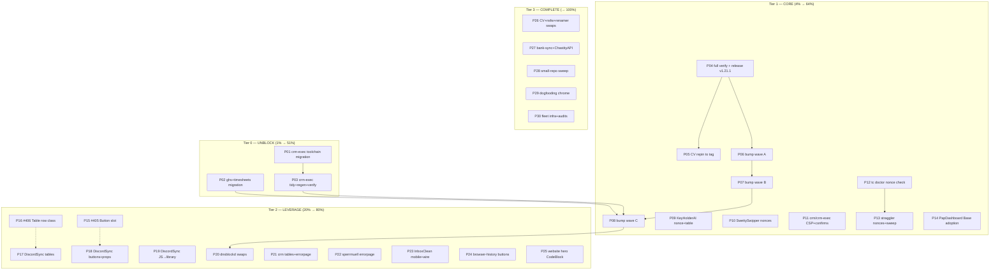

# Fleet Usage Pareto Plan — templ-components consumers

**Date:** 2026-10-12 17:31
**Scope:** ALL todos from the 2026-10-12 consumer-usage deep review (the 50-item list in `docs/status/2026-10-12_17-15_consumer-usage-deep-review-status.md` §f, which includes harvested TODO_LIST #405–#408) plus their prerequisites. Nothing else — no re-litigating decided ADRs, no scope creep into unrelated repos.
**Goal (the "result" being Pareto-measured):** every consumer renders correctly under its CSP (zero dead inline scripts), builds locally, pins a current release tag, and the library's top sharp edges (#405/#406/#407) are closed.
**Source docs:** `docs/reviews/2026-10-12_consumer-usage-review.md`, `docs/status/2026-10-12_17-15_….md`, TODO_LIST #402–#408.

---

## Step 1 — Pareto breakdown

### The 1% that delivers 51% — UNBLOCK VERIFICATION

**The go 1.27.2 sibling-pin migration in crm-exec-stage, github-local-sync, and timesheets.**
Three repos are locally build-broken right now (`go.work`/go.mod pins at 1.27.1, replaced siblings require ≥ 1.27.2; crm-exec-stage additionally has an out-of-sync go.mod and stale UI inventories). Nothing in any of those repos can be _verified_ until this lands — and unverified fixes are exactly how the nonce bugs shipped. cqrs-htmx already landed the exact flake pattern (`go_1_27.overrideAttrs` → 1.27.2); this is a copy, not a design job. One commit per repo, everything pinned in the same commit (the repo's own ONE-COMMIT rule).

_Why this and not the release or the doctor check as the 1%:_ the release and the doctor check deliver _features_; the migration delivers _verifiability_ — the precondition for trusting every other item on this page.

### The 4% that delivers 64% — the 1% PLUS the correctness core

Add to the 1%:

- **Release cut (v1.21.1) + CV repin** — gives the 14 stale consumers a real tag to ride and removes CV's load-bearing master pseudo-version.
- **Fleet bump wave** (9× v1.19.4, 5× v1.20.1 → current) — mechanically absorbs the ≤1.20.1 `nonce=""` self-hosted-htmx emission class and delivers 18 months of component fixes to every consumer at once.
- **Nonce-correctness in the 5 known-broken consumers** (KeyHolderAI, SwettySwipperWeb, pbx-lens, PapDashboard, crush-daily) + **CSP/confirm-handler cleanup in crm/crm-exec** — the remaining _live_ dead-script/inline-handler bugs.
- **`tc doctor` nonce check + the Nonce-consuming-components table** — converts the bug class from "silent" to "loud", fleet-wide, forever.

Roughly 8–10 of the ~50 identified work items (~4% of the total effort universe) take the fleet from "three repos unverifiable, real dead scripts in production" to "everything builds, everything current, zero known dead scripts" — that is the 64%.

### The 20% that delivers 80% — the 4% PLUS the top consumer duplication kills + the two library enablers

Add:

- `display.Button` children slot (#405) and `Table` Body-row class override (#406) — each deletes a _documented consumer workaround_ class.
- DiscordSync (biggest consumer): tables, buttons, lightbox/palette/spinner swaps.
- dnsblockd bump + navigation swaps + dark-mode pair fixes.
- crm/crm-exec raw tables + errorpage adoption.
- sperrmuell errorpage adoption, InboxClean MobileMenu/wire adoption, browser-history button/props sweep.
- Website hero → `display.CodeBlock` (the highest-visibility dogfooding fix).

### The remaining 80% of work → the last 20% of result

Everything else, in descending value: CV/nsfw/renamer/bank-sync component swaps, the small-repo tail (Zlota44, go-taskqueue, webphone, Rolls-Royce, GmbH, index, plugmarket), the remaining dogfooding gaps (header/footer, playground, shadow cards), fleet infrastructure (inventory script, fake-nonce sweep), the mr-sync/SEC audits, and the crm-exec↔crm fork-extraction design. Necessary for 100%, but none of it blocks correctness.

---

## Step 2 — Comprehensive plan (30–100 min tasks, ALL todos, sorted by impact)

30 tasks; "covers" = status-report §f item numbers. Tier 0 = the 1%, Tier 0+1 = the 4%, Tier 0–2 = the 20%.

| ID  | Tier | Task (30–100 min each)                                                                                                                                                                                                                                        | Covers                 | Impact   | Effort | Customer value                                |
| --- | ---- | ------------------------------------------------------------------------------------------------------------------------------------------------------------------------------------------------------------------------------------------------------------- | ---------------------- | -------- | ------ | --------------------------------------------- |
| P01 | 0    | crm-exec-stage toolchain-floor migration: copy cqrs-htmx's `go_1_27.overrideAttrs`(1.27.2) into `flake.nix` (3 sites), bump `.buildflow.yml` GOTOOLCHAIN + `scripts/{regen-ui,check-ui-artifacts,verify-pinned}.sh` pins + AGENTS.md commands, all ONE commit | 1                      | Critical | 90min  | Local builds work again                       |
| P02 | 0    | github-local-sync + timesheets: same migration (go.work 1.27.2, flake override, pins), one commit each                                                                                                                                                        | 1                      | Critical | 75min  | Local builds work again                       |
| P03 | 0    | crm-exec-stage post-migration verify: `go mod tidy`, `scripts/regen-ui.sh`, full test suite, commit go.mod/go.sum/inventories                                                                                                                                 | 2                      | Critical | 60min  | Repo returns to green, honestly               |
| P04 | 1    | templ-components: full `nix run .#verify` + `scripts/ci-repro.sh --lint --website` at the exact commit, then cut v1.21.1 via the release.sh ritual                                                                                                            | 3, 12                  | High     | 90min  | Real tag for the fleet                        |
| P05 | 1    | CV: repin from `v1.21.1-0.20261011002900-a30aa632` to the release tag; build + test                                                                                                                                                                           | 4                      | High     | 30min  | Removes load-bearing pseudo-version           |
| P06 | 1    | Fleet bump wave A: Cyberdom, dnsblockd, index, KeyHolderAI, Rolls-Royce → current (get+tidy+build+test each)                                                                                                                                                  | 8                      | High     | 90min  | 18mo of fixes; kills v1.19.4 `nonce=""` class |
| P07 | 1    | Fleet bump wave B: ChastityAPI, plugmarket, go-cqrs-lite/catalog + indirect-only pins (github-local-sync, timesheets ride P02)                                                                                                                                | 8                      | High     | 90min  | Same                                          |
| P08 | 1    | Fleet bump wave C: InboxClean, GmbH, webphone, PapDashboard, crm-exec-stage                                                                                                                                                                                   | 8                      | High     | 90min  | Same                                          |
| P09 | 1    | KeyHolderAI: thread nonce into `TCToastContainer`/shell (tc.templ:20); raw `<table>` → `display.Table`; decide htmx-vs-datastar single stack                                                                                                                  | 9, 50                  | High     | 75min  | Live dead-script fix                          |
| P10 | 1    | SwettySwipperWeb: fake literal nonces → real nonce flow; ThemeToggle-ID-as-nonce fix (`layout.templ:135`); onclick removal                                                                                                                                    | 10                     | High     | 75min  | Live CSP time-bomb defused                    |
| P11 | 1    | crm + crm-exec-stage: add CSP middleware; 4 `onsubmit` confirms → `htmx.ConfirmDelete`; `onclick` button attrs → delegated JS; bare `<script src>` → `layout.Script`                                                                                          | 11                     | High     | 90min  | Prepares 2 apps for CSP safely                |
| P12 | 1    | `tc doctor` nonce check: render every script-emitting component, flag nonce-less inline scripts when consumer declares CSP + write the Nonce-consuming-components table into the adoption guide                                                               | 5, 6                   | High     | 90min  | Bug class becomes loud, forever               |
| P13 | 1    | Straggler nonce fixes: pbx-lens (nonce middleware + thread), crush-daily (`report.templ` onto shell/nonce), PapDashboard htmx script; fleet `nonce="[a-z-]+"` literal sweep script                                                                            | 47, 48, 31             | High     | 75min  | Zero known dead scripts                       |
| P14 | 1    | PapDashboard: adopt `layout.Base` (theme/CSP/SEO free) + swap bespoke tabs/buttons/modal                                                                                                                                                                      | 13                     | High     | 100min | Icons-only consumer becomes real adoption     |
| P15 | 2    | #405 `display.Button` children/content slot: API design, implement, goldens, a11y, contract inventory, consumer note for cqrs-htmx                                                                                                                            | 7                      | High     | 100min | Deletes a documented workaround class         |
| P16 | 2    | #406 `display.Table` Body-row class/hover override: implement + guard tests + DiscordSync recipe                                                                                                                                                              | 16                     | Medium   | 75min  | Deletes the dummy-row hack class              |
| P17 | 2    | DiscordSync: 4 raw tables → `display.Table` via existing `listTableWithHeader`                                                                                                                                                                                | 17                     | High     | 90min  | Biggest consumer dedup                        |
| P18 | 2    | DiscordSync: `primaryButtonClass` buttons → `display.Button`; delete `input.css:193` rebrand hacks; physical props → logical                                                                                                                                  | 18                     | High     | 75min  | Removes brittle CSS coupling                  |
| P19 | 2    | DiscordSync: app.js lightbox/command-palette/spinner → `display.Lightbox`/`CommandPalette`/`feedback.Spinner`; wire.Action pilot on top-10 hx sites                                                                                                           | 19, 20                 | Medium   | 100min | ~400 lines hand-rolled UI deleted             |
| P20 | 2    | dnsblockd: bump + Pagination/nav swaps + inverted `dark:` pair fixes + ThemeToggle                                                                                                                                                                            | 21                     | High     | 90min  | Consumer correctness                          |
| P21 | 2    | crm/crm-exec: 8 raw tables → `display.Table`; topbar → `navigation.Nav`; `http.Error` paths → errorpage                                                                                                                                                       | 22                     | Medium   | 100min | Duplication + error UX                        |
| P22 | 2    | sperrmuell-direct: delete hand-rolled 404/ErrorPage → `errorpage` module; admin alerts → `feedback.Alert`; pager → `navigation.Pagination`                                                                                                                    | 24                     | Medium   | 60min  | Clearest deletion win                         |
| P23 | 2    | InboxClean: mobile sidebar → `navigation.MobileMenu`; ~15 raw hx-* → `wire.Action`; status pills → `StatusDot`                                                                                                                                                | 25                     | Medium   | 90min  | Dual-transport consistency                    |
| P24 | 2    | browser-history: ~25 raw buttons → `display.Button` (start: preset/filter chips); `ml-*`/`left-0` → logical (9+ sites)                                                                                                                                        | 23                     | Medium   | 75min  | Consistency + RTL safety                      |
| P25 | 2    | website hero → `display.CodeBlock` + `CopyButton`, delete `assets/js/copy-code.js` (+ CSP-hash update via `--update-csp`)                                                                                                                                     | 33                     | High     | 75min  | Landing page dogfoods its own product         |
| P26 | 3    | CV (spinner/skeletons → feedback.*, wire adoption, DashboardCard/Hero → Card/PageHeader) + nsfw-classifier (4 tables, inline SVG → icons.Icon) + file-and-image-renamer (Alert, LoadMore, delete v1.10.0 copies)                                              | 27, 28, 26             | Medium   | 100min | Mid-tier consumer dedup                       |
| P27 | 3    | bank-sync (dropdown/search/badge/sparkline swaps ~150 lines) + ChastityAPI (5 tables; JSFuncCall drawer → CSP-safe before CSP_ENFORCE)                                                                                                                        | 30, 32                 | Medium   | 100min | Mid-tier consumer dedup                       |
| P28 | 3    | Small-repo sweep: Zlota44 (3 tables, ThemeToggle), go-taskqueue (StatCard, 404), webphone (icons, 404), Rolls-Royce (Footer, templ.KV), GmbH (5 anchor-buttons)                                                                                               | 40, 39, 43, 42, 41     | Low      | 100min | Tail correctness                              |
| P29 | 3    | Dogfooding: website header/footer → `navigation.Nav`/`MobileMenu`/`Footer` (delete header.js), playground → `forms.*`, sections → `display.*`, demo shadow cards → library                                                                                    | 34, 35, 36, 37         | Medium   | 100min | "Built with the library" becomes true         |
| P30 | 3    | Fleet infra: index quarantine guard test; plugmarket Play-CDN → compiled CSS (ADR-0045 inventory); fleet inventory script; mr-sync + SEC/Swetty audits; crm-exec↔crm fork-extraction design doc; TODO_LIST harvest of this plan                               | 38, 44, 49, 45, 46, 29 | Medium   | 100min | Keeps the fleet honest                        |

**Coverage check:** status-report items 1–50 all map (1→P01/P02, 2→P03, 3→P04, 4→P05, 5/6→P12, 7→P15, 8→P06–P08, 9/50→P09, 10→P10, 11→P11, 12→P04, 13→P14, 14→done (harvest #402–408) + P30, 15→P25, 16→P16, 17→P17, 18→P18, 19/20→P19, 21→P20, 22→P21, 23→P24, 24→P22, 25→P23, 26/27/28→P26, 29→P30, 30/32→P27, 31/47/48→P13, 33→P25, 34–37→P29, 38/44/45/46/49→P30, 39/40/41/42/43→P28). **Nothing dropped.**

---

## Step 3 — Fine breakdown (≤12 min tasks, ALL todos, sorted by impact)

_Sorted within tiers by impact/effort. Parent in last column._

### Tier 0 — Unblock (the 1%)

| ID    | Micro-task (≤12 min)                                                                                | Min | Parent |
| ----- | --------------------------------------------------------------------------------------------------- | --- | ------ |
| F-001 | Read cqrs-htmx `flake.nix` goPkg block; note exact overrideAttrs + hash                             | 5   | P01    |
| F-002 | crm-exec-stage flake.nix: add goPkg override, replace `pkgs.go_1_27` at treefmt + go-licenses sites | 12  | P01    |
| F-003 | crm-exec-stage `.buildflow.yml`: GOTOOLCHAIN go1.27.1 → go1.27.2 (+ comment)                        | 5   | P01    |
| F-004 | crm-exec-stage scripts: bump GOTOOLCHAIN in regen-ui.sh, check-ui-artifacts.sh, verify-pinned.sh    | 10  | P01    |
| F-005 | crm-exec-stage AGENTS.md: update the two GOTOOLCHAIN command blocks                                 | 10  | P01    |
| F-006 | crm-exec-stage: `go mod tidy` (amd64 1.27.2 toolchain) + confirm go directive                       | 10  | P01    |
| F-007 | crm-exec-stage: `nix build` + `check-toolchain-pin.sh` green                                        | 12  | P01    |
| F-008 | crm-exec-stage: commit migration (detailed message)                                                 | 5   | P01    |
| F-009 | github-local-sync: go.work 1.27.1 → 1.27.2 + go mod tidy + build                                    | 12  | P02    |
| F-010 | github-local-sync: flake go override + pin script updates (mirror P01 pattern)                      | 12  | P02    |
| F-011 | github-local-sync: full test + commit                                                               | 10  | P02    |
| F-012 | timesheets: go.work + tidy + build + test                                                           | 12  | P02    |
| F-013 | timesheets: flake/pin updates + commit                                                              | 12  | P02    |
| F-014 | crm-exec-stage: `go mod tidy` + `git diff` review of go.mod/go.sum                                  | 10  | P03    |
| F-015 | crm-exec-stage: run `scripts/regen-ui.sh` (templ + tailwind + inventory)                            | 12  | P03    |
| F-016 | crm-exec-stage: eyeball regenerated diffs (goldens, library-classes.txt)                            | 10  | P03    |
| F-017 | crm-exec-stage: full `go test ./...` green                                                          | 12  | P03    |
| F-018 | crm-exec-stage: commit regenerated artifacts                                                        | 5   | P03    |

### Tier 1 — Core value (completes the 4%)

| ID    | Micro-task (≤12 min)                                                                                         | Min | Parent |
| ----- | ------------------------------------------------------------------------------------------------------------ | --- | ------ |
| F-019 | templ-components: `nix run .#verify` full (build+test+lint)                                                  | 12  | P04    |
| F-020 | templ-components: warm CHANGELOG [Unreleased] if release notes need it                                       | 10  | P04    |
| F-021 | templ-components: `scripts/ci-repro.sh --lint --website` at exact HEAD, read VERDICT                         | 12  | P04    |
| F-022 | templ-components: run `scripts/release.sh v1.21.1 "
"` inside nix shell w/ govulncheck               | 12  | P04    |
| F-023 | templ-components: review `git show v1.21.1` (assert_release_tree, no `result*` paths)                        | 10  | P04    |
| F-024 | templ-components: push master + tags immediately after green verdict                                         | 10  | P04    |
| F-025 | CV: `go get github.com/larsartmann/templ-components@v1.21.1` (all 5 modules) + tidy                          | 10  | P05    |
| F-026 | CV: build + test + commit                                                                                    | 12  | P05    |
| F-027 | Cyberdom: bump + tidy + build + test                                                                         | 12  | P06    |
| F-028 | dnsblockd: bump + tidy + build + test (note new nonce-omit behavior)                                         | 12  | P06    |
| F-029 | index: bump + tidy + build + test                                                                            | 12  | P06    |
| F-030 | KeyHolderAI: bump + tidy + build + test                                                                      | 12  | P06    |
| F-031 | Rolls-Royce: bump + tidy + build + test + commit wave A                                                      | 12  | P06    |
| F-032 | ChastityAPI: bump + tidy + build + test                                                                      | 12  | P07    |
| F-033 | plugmarket: bump server+ui modules + build + test                                                            | 12  | P07    |
| F-034 | go-cqrs-lite/catalog: bump v1.20.1 → current + build + test                                                  | 12  | P07    |
| F-035 | Commit wave B (message lists per-repo result)                                                                | 5   | P07    |
| F-036 | InboxClean: bump + build + test                                                                              | 12  | P08    |
| F-037 | GmbH: bump + build + test (re-verify nonce goldens)                                                          | 12  | P08    |
| F-038 | webphone + PapDashboard: bump + build + test                                                                 | 12  | P08    |
| F-039 | crm-exec-stage: bump + build + test + commit wave C                                                          | 12  | P08    |
| F-040 | KeyHolderAI: locate all `Nonce: ""`/`TCToastContainer("")` sites (tc.templ et al.)                           | 10  | P09    |
| F-041 | KeyHolderAI: thread nonce from request → shell → components                                                  | 12  | P09    |
| F-042 | KeyHolderAI: raw `<table>` (simulation_list.templ:27) → `display.Table`                                      | 12  | P09    |
| F-043 | KeyHolderAI: write down htmx-vs-datastack decision + drop the unused runtime                                 | 10  | P09    |
| F-044 | KeyHolderAI: build + test + commit                                                                           | 10  | P09    |
| F-045 | SwettySwipper: inventory fake nonces (`nonce="toast"` etc., 6 sites) + ThemeToggle arg bug                   | 10  | P10    |
| F-046 | SwettySwipper: add nonce middleware / thread real nonce into the 6 script sites                              | 12  | P10    |
| F-047 | SwettySwipper: remove `onclick=` handlers (tournament/vs/layout) → delegated JS                              | 12  | P10    |
| F-048 | SwettySwipper: build + test + commit                                                                         | 10  | P10    |
| F-049 | crm: add CSP middleware (nonce) behind a flag; verify login page CSP test still green                        | 12  | P11    |
| F-050 | crm: 4 `onsubmit` confirms → `htmx.ConfirmDelete` (companies/tasks/deals/contact_detail)                     | 12  | P11    |
| F-051 | crm: `onclick` passkey button + bare script tag → `layout.Script`/delegated                                  | 10  | P11    |
| F-052 | crm-exec: port the same 3 changes (diff against crm to stay in sync)                                         | 12  | P11    |
| F-053 | crm/crm-exec: build + test both + commit                                                                     | 12  | P11    |
| F-054 | `tc doctor`: sketch check output shape (component × nonce × CSP declaration)                                 | 10  | P12    |
| F-055 | `tc doctor`: implement render-scan for script-emitting components (reuse integration render table)           | 12  | P12    |
| F-056 | `tc doctor`: CSP-declaration detection (middleware headers / config file)                                    | 12  | P12    |
| F-057 | `tc doctor`: tests + docs/cli.md section                                                                     | 12  | P12    |
| F-058 | Write "components that consume Nonce" table into docs (adoption guide)                                       | 12  | P12    |
| F-059 | pbx-lens: add nonce middleware + thread into ThemeToggle/Toast                                               | 12  | P13    |
| F-060 | crush-daily: route `report.templ` htmx script through nonce/shell                                            | 10  | P13    |
| F-061 | PapDashboard: nonce the htmx script (interim, pre-P14)                                                       | 5   | P13    |
| F-062 | Write + run fleet fake-nonce sweep (`rg 'nonce="[a-z-]+"'`)                                                  | 12  | P13    |
| F-063 | Fix sweep stragglers + commit per repo                                                                       | 12  | P13    |
| F-064 | PapDashboard: swap hand-rolled shell → `layout.Base` (keep data-theme script behind NoThemeScript if needed) | 12  | P14    |
| F-065 | PapDashboard: bespoke tabs/bulk-bar/modal → `display.Tabs`/`Button`/`Modal`                                  | 12  | P14    |
| F-066 | PapDashboard: build + visual smoke + commit                                                                  | 12  | P14    |

### Tier 2 — The 20% (→ 80%)

| ID    | Micro-task (≤12 min)                                                                    | Min | Parent |
| ----- | --------------------------------------------------------------------------------------- | --- | ------ |
| F-067 | #405 design: children slot vs LoadingButton-variant — write the API decision (ADR note) | 12  | P15    |
| F-068 | #405 implement `ButtonProps.Children`/slot in display/button                            | 12  | P15    |
| F-069 | #405 goldens + golden_sweep entries                                                     | 12  | P15    |
| F-070 | #405 a11y + edge-case + example tests                                                   | 12  | P15    |
| F-071 | #405 contract inventory + integration render table + docs + CHANGELOG                   | 12  | P15    |
| F-072 | cqrs-htmx adminui: replace copied class-string buttons with the new slot (proof)        | 12  | P15    |
| F-073 | #406 implement `TableRow.Class`/Body-row hover hook + tests                             | 12  | P16    |
| F-074 | #406 goldens + docs recipe (replaces DiscordSync dummy-row hack)                        | 12  | P16    |
| F-075 | DiscordSync: command_audit table → `display.Table`                                      | 12  | P17    |
| F-076 | DiscordSync: projection_health table → `display.Table`                                  | 10  | P17    |
| F-077 | DiscordSync: attachment_analytics ×2 → `display.Table`                                  | 12  | P17    |
| F-078 | DiscordSync: build + goldens + commit                                                   | 12  | P17    |
| F-079 | DiscordSync: export/dlq/backfill buttons → `display.Button`                             | 12  | P18    |
| F-080 | DiscordSync: delete `input.css:193-200` rebrand hacks (Button now themable)             | 10  | P18    |
| F-081 | DiscordSync: `ml-/left-/right-` → logical (`media`, `sentinel`, `search`, `filters`)    | 12  | P18    |
| F-082 | DiscordSync: messages.templ missing `dark:` variant + build + commit                    | 10  | P18    |
| F-083 | DiscordSync: lightbox → `display.Lightbox` (delete app.js DOM builder)                  | 12  | P19    |
| F-084 | DiscordSync: command palette → `display.CommandPalette`                                 | 12  | P19    |
| F-085 | DiscordSync: spinner swap + wire.Action pilot (10 highest-traffic hx sites)             | 12  | P19    |
| F-086 | DiscordSync: build + e2e smoke + commit                                                 | 12  | P19    |
| F-087 | dnsblockd: query_log pagination → `navigation.Pagination`; nav → library                | 12  | P20    |
| F-088 | dnsblockd: fix inverted `dark:text-gray-600` pairs (dashboard ×4, query_log)            | 10  | P20    |
| F-089 | dnsblockd: add ThemeToggle; `ml-*` → logical; build + commit                            | 12  | P20    |
| F-090 | crm/crm-exec: contacts + dashboard tables → `display.Table` (×2 repos)                  | 12  | P21    |
| F-091 | crm/crm-exec: companies + credentials tables → `display.Table`                          | 12  | P21    |
| F-092 | crm/crm-exec: topbar → `navigation.Nav` + `http.Error` → errorpage                      | 12  | P21    |
| F-093 | crm/crm-exec: build + test + commit                                                     | 12  | P21    |
| F-094 | sperrmuell: swap notfound.templ/errorpage.templ → `errorpage.NotFound404`/`ErrorPage`   | 12  | P22    |
| F-095 | sperrmuell: admin alert boxes → `feedback.Alert`; pager → `navigation.Pagination`       | 12  | P22    |
| F-096 | sperrmuell: build + test + commit                                                       | 10  | P22    |
| F-097 | InboxClean: mobile sidebar → `navigation.MobileMenu` (delete custom scrim/app.js block) | 12  | P23    |
| F-098 | InboxClean: labels/memory/chat hx-* → `wire.Action` (batch 1)                           | 12  | P23    |
| F-099 | InboxClean: sync/deadletters/events hx-* → `wire.Action` (batch 2)                      | 12  | P23    |
| F-100 | InboxClean: status pills → `StatusDot`; `mr-/ml-` → logical; build + commit             | 12  | P23    |
| F-101 | browser-history: dashboard preset/filter chips → `display.Button`                       | 12  | P24    |
| F-102 | browser-history: remaining raw buttons batch → `display.Button`                         | 12  | P24    |
| F-103 | browser-history: `ml-*` → logical (timeline, dashboard, devices); build + commit        | 12  | P24    |
| F-104 | website hero: replace code window + copy-btn with `display.CodeBlock`                   | 12  | P25    |
| F-105 | website: delete `assets/js/copy-code.js`; re-run `--update-csp`; goldens                | 12  | P25    |
| F-106 | website: route-golden re-baseline review + commit                                       | 12  | P25    |

### Tier 3 — The rest (→ 100%)

| ID    | Micro-task (≤12 min)                                                                   | Min | Parent |
| ----- | -------------------------------------------------------------------------------------- | --- | ------ |
| F-107 | CV: `ats_dashboard` spinner + skeletons → `feedback.Spinner`/`SkeletonGroup`           | 12  | P26    |
| F-108 | CV: raw alert boxes → `feedback.Alert`; `role="alert"` boxes in fragments              | 12  | P26    |
| F-109 | CV: wire.Action pilot (ats_dashboard refresh/search) + commit                          | 12  | P26    |
| F-110 | nsfw-classifier: parts/faces/history/index tables → `display.Table` (4 files)          | 12  | P26    |
| F-111 | renamer: DLQ toast → `feedback.Alert`; hx-get load-more → `navigation.LoadMore`        | 12  | P26    |
| F-112 | renamer: delete v1.10.0-copied stagger/pollIndicator; use library equivalents + commit | 12  | P26    |
| F-113 | bank-sync: backfillMenu → `display.Dropdown`; search → `forms.Input`                   | 12  | P27    |
| F-114 | bank-sync: stream badge → `LivePill`; sparkline → `display.Sparkline`; delete JS       | 12  | P27    |
| F-115 | ChastityAPI: users/policies tables → `display.Table` (batch 1)                         | 12  | P27    |
| F-116 | ChastityAPI: account table + drawer JSFuncCall → CSP-safe; build + commit              | 12  | P27    |
| F-117 | Zlota44: 3 property_detail tables → `display.Table` + ThemeToggle                      | 12  | P28    |
| F-118 | go-taskqueue: nowband → `display.StatCard`; 404 → errorpage                            | 12  | P28    |
| F-119 | webphone: inline SVGs → `icons.Icon`; 404 → errorpage                                  | 12  | P28    |
| F-120 | Rolls-Royce: footer → `navigation.Footer`; concat → templ.KV                           | 12  | P28    |
| F-121 | GmbH: 5 anchor-buttons → `display.Button`; build + commit sweep                        | 12  | P28    |
| F-122 | website header/footer → `navigation.Nav`/`MobileMenu`/`Footer`; delete header.js       | 12  | P29    |
| F-123 | website: CSP `--update-csp` + route goldens re-baseline + commit                       | 12  | P29    |
| F-124 | demo errorpage playground → `forms.Form/Input/Select/Textarea` + `display.Button`      | 12  | P29    |
| F-125 | website sections: cards/table/CTAs → `display.*`; inline arrow → `icons.Icon`          | 12  | P29    |
| F-126 | demo: shadow demoStatCard/demoPageCard/recipeLinkCard → library; commit                | 12  | P29    |
| F-127 | index: render-guard test quarantine for readmeindexer CLI onclick variants             | 12  | P30    |
| F-128 | plugmarket: Play CDN → compiled library CSS pipeline (ADR-0045 classes.txt)            | 12  | P30    |
| F-129 | Fleet inventory script: versions × modules × adoption per consumer (JSON + md out)     | 12  | P30    |
| F-130 | mr-sync + SEC/Swetty audits (agent pass, findings filed)                               | 12  | P30    |
| F-131 | crm-exec↔crm fork-extraction design doc (shared httpapi UI package)                    | 12  | P30    |
| F-132 | TODO_LIST harvest of this plan's new items (#409+) + close-out                         | 12  | P30    |

**96 micro-tasks, total ≈ 19.5 h.** Every one ≤12 min. All 50 status-items covered via the parent map above.

---

## Execution graph

Solid arrows = hard dependencies (verification/`replace`-graph). Dotted = soft (work is easier after the enabler, not blocked).

---

## Verschlimmbessern guardrails (the "don't make it worse" contract)

1. **One repo = one concern per commit.** No mixed migration+feature commits; the daemon commits are noise enough.
2. **Never regenerate against the wrong templ generator.** Check "who generates this repo's files" BEFORE the first `templ generate` (the 1070-vs-1020 lesson, paid once already).
3. **Consumer bumps ride release tags, never pseudo-versions** (tagging policy, v1.20.0 incident).
4. **Every fix ships with its guard** (the cqrs-htmx CSP sweep was vacuous — a fix without a guard that can fail is not done).
5. **Goldens re-baselined only after eyeballing the diff**; never `-update` to green.
6. **`[Unreleased]` warm in the same commit as any user-facing change**; release.sh refuses otherwise.
7. **M03 ritual:** `scripts/ci-repro.sh --lint --website` at the exact commit, VERDICT PASS, push immediately.

---

## Execution notes

- **Approval gate:** per the pareto-planning skill, full execution starts after plan approval — beginning with Tier 0 (P01–P03), which unblocks everything else.
- **Harvest:** TODO_LIST carries #405–#408 already; this plan adds **#409 (release cut + CV repin — prereq of #408)**; the remaining new work routes through #400's wave structure. See TODO_LIST.
- **Effort total:** ≈ 34 h medium-granularity, ≈ 19.5 h fine-granularity (micro-tasks exclude inter-task context switching — the medium estimate is the realistic one).
