# Remaining-Fleet Closure Pareto Plan v2 — post-v1.22.0

**Date:** 2026-10-13 13:02
**Supersedes for execution:** the unexecuted tail of
`docs/planning/2026-10-12_17-31_fleet-usage-pareto-plan.md` (P13–P30). Executed already:
that plan's Tier 0–2 (v1.22.0 shipped, 12 consumers bumped, #405/#406/#407 landed — see
`docs/status/2026-10-12_22-00_pareto-execution-status.md` and the
`2026-10-13_12-12` retrospective).
**Goal (the measured result):** every consumer renders correctly under CSP (zero known
dead scripts), builds locally, pins the CURRENT release (v1.22.0), and the library's docs,
guards, and memory stay honest — no drift, no Verschlimmbesserung.
**Sources:** the 2026-10-13_12-12 retrospective (50-item next list), TODO_LIST open rows
(162–387), the 2026-10-12 review doc's version matrix (stale — R13 refreshes it).

---

## Step 1 — Pareto breakdown

### The 1% that delivers 51% — ZERO KNOWN DEAD SCRIPTS + HONEST VERSIONS

**The four P13 nonce fixes (SwettySwipper, pbx-lens, crush-daily, PapDashboard) + the
second bump pass (14 stale repos → v1.22.0).**
SwettySwipper is the worst fleet citizen: fake literal nonces (`nonce="toast"`), a
ThemeToggle called with an element ID as nonce, and inline `onclick=` handlers — the day
it adopts a real CSP, everything dies at once. pbx-lens/crush-daily/PapDashboard are the
armed-trap class (components called with empty nonces; ≤1.20.1 even emits broken
`nonce=""` on the self-hosted htmx runtime — PapDashboard is still on v1.20.1). The bump
pass is mechanical (`go get` + tidy + build + test against each repo's own baseline) but
it is what makes "pins the current release" TRUE fleet-wide — after yesterday's wave the
matrix already reads stale.

_Why this and not the consumer swaps as the 1%:_ swaps delete duplication; the nonce fixes
and version honesty close CORRECTNESS. Unverified or dead-rendering consumers are how the
original three bugs shipped.

### The 4% that delivers 64% — the 1% PLUS the closure loop

Add:

- **KeyHolderAI closure** (raw table → `display.Table`; htmx-vs-datastar decision;
  `vendor/` tracking verification) — the last partially-done consumer.
- **cqrs-htmx `Button.Children` proof (F-072)** — replaces the copied class-string
  buttons that justified #405; without it the workaround class still exists.
- **#407 completion:** `docs/nonce-consumers.md` wired into the website docs + the
  javascript-guide link + a guard pinning the doctor's scan table to the integration
  render table (two hand-copied lists drift unguarded today).
- **crm/crm-exec CSP prep** (P11): nonce middleware behind a flag, 4 `onsubmit` confirms →
  `htmx.ConfirmDelete`, `onclick`/bare-script → `layout.Script`/delegated.
- **Harvest honesty:** strike stale TODO rows (#386 done yesterday, #328 shipped in
  v1.22.0), harvest the plan file's P-items into TODO_LIST, refresh the version matrix.

### The 20% that delivers 80% — the 4% PLUS the top adoption waves

Add:

- DiscordSync wave (biggest consumer): 4 raw tables → `display.Table`;
  `primaryButtonClass` → `display.Button` + delete the `input.css` rebrand hacks;
  physical → logical properties; lightbox/command-palette/spinner → library; `wire.Action`
  pilot.
- dnsblockd wave: Pagination/nav swaps, inverted `dark:` pairs, ThemeToggle, logical.
- crm/crm-exec swaps: 8 raw tables, topbar → `navigation.Nav`, `http.Error` → errorpage.
- sperrmuell errorpage adoption (clearest deletion win).
- InboxClean: MobileMenu + `wire.Action` ×15 + StatusDot.
- browser-history: ~25 raw buttons + logical sweep.
- website hero → `display.CodeBlock` (+ delete `copy-code.js`, `--update-csp`) — the
  highest-visibility dogfooding fix.
- PapDashboard → `layout.Base` + component swaps.
- Library stickiness: demo entries + ADR note for #405/#406 (the repo's own
  plan-authoring checklist gates), `gen-library-classes.sh` standardization (RR and
  dnsblockd carry forked copies), AGENTS.md memory pass (hook FileName drift trap,
  `goTarballVersion` pattern, poisoned upstream `datastar/v1.19.4` tag).

### The remaining 20% of work → the last 20% of result

Small-repo tail (Zlota44, go-taskqueue, webphone icons/404, Rolls-Royce Footer, GmbH
anchor-buttons); fleet infra (inventory script, fake-nonce sweep, index quarantine guard);
library quality backlog from TODO open rows (#330 contrast sweep, #335 templ v0.3.1070
migration — the held one needing a flake generator pin + full re-baseline, #162 progressbar
golden eyeball, #258/262 kanban transport verification + flaky-board helper, #271
skip-stars default, #272 Lighthouse lane, #275/276/279 docs, #280 prod spot-checks, #213/
214/215 CI niceties, #216 vnu re-triage, #217 demand re-check, #264 demo abuse posture,
#385 BuildFlow allowlist, #387 branching-flow nits); upstream BuildFlow filing
(website-CWD templ-generate gap); crm-exec-stage branch strategy; mr-sync/SEC audits.

---

## Step 2 — Comprehensive plan (30–100 min tasks, ALL remaining todos)

38 tasks. Tier A = 1%, A+B = 4%, A–C = 20%, A–D = 100%. Sorted by impact/effort/value.

| ID  | Tier | Task (30–100 min)                                                                                                                                                                                  | Closes                  | Impact   | Effort |
| --- | ---- | -------------------------------------------------------------------------------------------------------------------------------------------------------------------------------------------------- | ----------------------- | -------- | ------ |
| R01 | A    | SwettySwipper CSP correctness: nonce middleware, replace 6 fake literal nonces, fix ThemeToggle-ID-as-nonce (`layout.templ:135`), remove inline `onclick=` handlers → delegated JS; build+test     | P10, fleet dead-scripts | Critical | 90min  |
| R02 | A    | pbx-lens: nonce middleware; thread into ThemeToggle/Toast call sites; build+test                                                                                                                   | P13                     | Critical | 60min  |
| R03 | A    | crush-daily: route `report.templ` htmx script through the shell/nonce flow; build+test                                                                                                             | P13                     | High     | 45min  |
| R04 | A    | PapDashboard: bump to v1.22.0 FIRST (still v1.20.1 — emits `nonce=""`), then nonce the htmx script (interim pre-R26); build+test                                                                   | P13, #408 tail          | Critical | 60min  |
| R05 | A    | Bump pass A → v1.22.0: Cyberdom, dnsblockd, index, KeyHolderAI, Rolls-Royce (each: get+tidy+build+test vs own baseline)                                                                            | #408                    | High     | 90min  |
| R06 | A    | Bump pass B → v1.22.0: ChastityAPI, plugmarket, go-cqrs-lite/catalog, InboxClean, GmbH (plugmarket: server module + goldens eyeball)                                                               | #408                    | High     | 90min  |
| R07 | A    | Bump pass C → v1.22.0: github-local-sync, timesheets (first bump ever), webphone; record the version matrix refresh                                                                                | #408                    | High     | 90min  |
| R08 | B    | KeyHolderAI closure: raw `<table>` → `display.Table` (`TableCell.Content` fits StatusBadge/link cells), write htmx-vs-datastar decision + drop unused runtime, verify `vendor/` git tracking state | P09                     | High     | 90min  |
| R09 | B    | cqrs-htmx adminui: replace the copied class-string buttons (`members.templ:44-72`, `components.templ:148`) with `display.Button` `Children` — #405's own proof step                                | F-072                   | High     | 60min  |
| R10 | B    | #407 completion: website docs page for nonce consumers (`website/content/docs/`), javascript-guide.md link, guard pinning `nonceConsumers` ⇔ `integration/csp_nonce_test.go` render table          | #407 discoverability    | High     | 75min  |
| R11 | B    | crm: CSP middleware (nonce) behind a flag; 4 `onsubmit` confirms → `htmx.ConfirmDelete` (companies/tasks/deals/contact_detail); onclick passkey + bare script → `layout.Script`/delegated          | P11                     | High     | 90min  |
| R12 | B    | crm-exec-stage: port R11's three changes (diff against crm to stay in sync); build+test both                                                                                                       | P11                     | High     | 60min  |
| R13 | B    | Harvest honesty: strike stale TODO rows (#386 AGENTS-trim done, #328 CodeBlock shipped), harvest plan P-items into TODO_LIST rows, refresh the version matrix in the review doc                    | P30 harvest             | High     | 60min  |
| R14 | C    | #405/#406 demo entries + ADR note for the Children-slot API decision + demo CSS rebuild (`nix run .#css`) + visual re-run                                                                          | plan-authoring gate     | High     | 90min  |
| R15 | C    | DiscordSync: command_audit, projection_health, attachment_analytics ×2 → `display.Table` via `listTableWithHeader`; build+goldens                                                                  | P17                     | High     | 90min  |
| R16 | C    | DiscordSync: export/dlq/backfill buttons → `display.Button`; delete `input.css:193-200` rebrand hacks; `media/sentinel/search/filters` physical → logical; messages.templ `dark:` fix              | P18                     | High     | 90min  |
| R17 | C    | DiscordSync: lightbox → `display.Lightbox` (delete app.js builder), command palette → `display.CommandPalette`, spinner → `feedback.Spinner`, `wire.Action` pilot on 10 highest-traffic hx sites   | P19                     | Medium   | 100min |
| R18 | C    | dnsblockd: query_log pagination → `navigation.Pagination`; nav → library; ThemeToggle; build+test                                                                                                  | P20                     | High     | 75min  |
| R19 | C    | dnsblockd: inverted `dark:text-gray-600` pairs (dashboard ×4, query_log); `ml-*` → logical; commit with R18 if same session                                                                        | P20                     | High     | 45min  |
| R20 | C    | crm/crm-exec: contacts, dashboard, companies, credentials tables → `display.Table` (×2 repos)                                                                                                      | P21                     | Medium   | 100min |
| R21 | C    | crm/crm-exec: topbar → `navigation.Nav`; `http.Error` paths → errorpage handlers                                                                                                                   | P21                     | Medium   | 75min  |
| R22 | C    | sperrmuell-direct: notfound/errorpage hand-rolls → `errorpage.NotFound404`/`ErrorPage`; admin alerts → `feedback.Alert`; pager → `navigation.Pagination`                                           | P22                     | Medium   | 75min  |
| R23 | C    | InboxClean: mobile sidebar → `navigation.MobileMenu`; ~15 raw hx-* → `wire.Action`; status pills → `StatusDot`                                                                                     | P23/P25                 | Medium   | 90min  |
| R24 | C    | browser-history: ~25 raw buttons → `display.Button` (start: preset/filter chips); `ml-*`/`left-0` → logical (9+ sites)                                                                             | P23                     | Medium   | 90min  |
| R25 | C    | website hero → `display.CodeBlock` + `CopyButton`; delete `assets/js/copy-code.js`; `go run ./cmd/site --update-csp`; visual smoke                                                                 | P25/#33                 | High     | 75min  |
| R26 | C    | PapDashboard: hand-rolled shell → `layout.Base`; bespoke tabs/bulk-bar/modal → `display.Tabs`/`Button`/`Modal`; build+visual smoke                                                                 | P14                     | High     | 100min |
| R27 | C    | Standardize `gen-library-classes.sh`: extract the RR/dnsblockd forked copies into templ-components `scripts/` (parameterized roots), point both repos at it                                        | fleet infra             | Medium   | 75min  |
| R28 | C    | AGENTS.md memory pass: hook website-FileName drift trap, `goTarballVersion`/`goPkg` sibling-floor pattern, poisoned `datastar/v1.19.4` upstream tag (→ tag-tree section)                           | memory protocol         | High     | 45min  |
| R29 | D    | Small-repo tail: Zlota44 (3 tables, ThemeToggle), go-taskqueue (StatCard, 404), webphone (icons, 404), Rolls-Royce (Footer, templ.KV), GmbH (5 anchor-buttons)                                     | P28                     | Low      | 100min |
| R30 | D    | Fleet infra: index quarantine guard test; plugmarket Play-CDN → compiled CSS; fleet inventory script (repo × version × dead-script posture)                                                        | P30/#38/#44             | Medium   | 100min |
| R31 | D    | #330: sweep remaining sub-4.5:1 text tone classes (ScrollbackToneSuccess green-600 13px = 3.2:1 and siblings) to green-700-style shades + axe re-run                                               | #330                    | Medium   | 60min  |
| R32 | D    | #335 templ v0.3.1070 migration — FIRST SLICE: flake-level generator pin + golden/visual re-baseline plan draft (execution is multi-session by design)                                              | #335                    | Medium   | 100min |
| R33 | D    | Visual/site backlog: #162 progressbar golden eyeball, #258 kanban single-transport views, #262 flaky-board helper extraction, #271 SITE_SKIP_STARS default, #272 Lighthouse lane                   | #162/#258/262/271/272   | Medium   | 100min |
| R34 | D    | Docs backlog: #275 visual-testing.md site-tier section, #276 SKILL.md site section, #279 warm-dark pattern into theming docs                                                                       | #275/276/279            | Medium   | 75min  |
| R35 | D    | CI backlog: #213 PR wall-clock budget, #214 benchstat comment, #215 gremlins mutation pilot, #216 vnu ignore re-triage, #280 prod spot-checks                                                      | #213-216/#280           | Low      | 100min |
| R36 | D    | Governance: #217 demand re-check (MultiSelect/TreeView/FileDrop/DateRangePicker), #264 demo abuse posture, #385 golangci allowlist, #387 branching-flow nits                                       | #217/264/385/387        | Low      | 100min |
| R37 | D    | Audits: mr-sync templ audit, SEC/Swetty Swipper deep audit (post-R01 verification)                                                                                                                 | P29 audit items         | Low      | 100min |
| R38 | D    | Upstream: file the BuildFlow website-CWD templ-generate gap (verify-at-source, minimal repro FIRST), note the go-licenses wrapper fragility in the license-check step                              | P30 upstream            | Low      | 60min  |

**Coverage check:** retrospective f-list 1–50 → R01(1-3) R02(4) R03(5) R04(6) R26(7)
R05-07(8-9) R08(10-11,45) R09(12) R10(36,38) R11(13-15) R12(13-15) R13(49) R14(41-42)
R15(15) R16(16-18) R17(19-21) R18(23) R19(24-25) R20(26) R21(27) R22(28) R23(29-31)
R24(32-33) R25(35) R27(43) R28(40) R29(39-tail) R30(30,47) R31(31→#330) R32(→#335)
R33(#162/258/262/271/272) R34(#275/276/279) R35(#213/214/215/216/280) R36(#217/264/385/387)
R37(37→audits) R38(39,46). **Nothing from the 50-list dropped; TODO open rows 162–387 map
into R32–R36; stale rows #386/#328 strike in R13.**

---

## Step 3 — Fine breakdown (≤12 min micro-tasks, ALL todos)

_N-IDs; parent in last column. Sorted within tiers by impact/effort._

### Tier A — zero dead scripts + honest versions (the 1%)

| ID    | Micro-task (≤12 min)                                                                                        | Parent |
| ----- | ----------------------------------------------------------------------------------------------------------- | ------ |
| N-001 | SwettySwipper: inventory the fake nonces (`nonce="toast"` etc., 6 sites) + the ThemeToggle ID-as-nonce site | R01    |
| N-002 | SwettySwipper: add nonce middleware (per-request nonce + CSP header, flag-gated)                            | R01    |
| N-003 | SwettySwipper: thread the request nonce into the 6 script sites                                             | R01    |
| N-004 | SwettySwipper: fix the ThemeToggle call (`layout.templ:135` — ID arg is not a nonce)                        | R01    |
| N-005 | SwettySwipper: remove `onclick=` (tournament/vs/layout) → one delegated script                              | R01    |
| N-006 | SwettySwipper: build + test + probe every script carries the request nonce                                  | R01    |
| N-007 | pbx-lens: locate ThemeToggle/Toast call sites + middleware insertion point                                  | R02    |
| N-008 | pbx-lens: nonce middleware + thread nonces; build+test                                                      | R02    |
| N-009 | crush-daily: read `report.templ` htmx script flow; find the shell entry                                     | R03    |
| N-010 | crush-daily: move the script behind the shell nonce; build+test                                             | R03    |
| N-011 | PapDashboard: bump → v1.22.0 + tidy + build (still v1.20.1 — emits `nonce=""`)                              | R04    |
| N-012 | PapDashboard: nonce the htmx script call site(s); build+test                                                | R04    |
| N-013 | Bump Cyberdom → v1.22.0 (get+tidy+build+test vs baseline)                                                   | R05    |
| N-014 | Bump dnsblockd → v1.22.0 (get+tidy+build+test; re-check the R18/R19 swap sites against new markup)          | R05    |
| N-015 | Bump index → v1.22.0 (get+tidy+build+test)                                                                  | R05    |
| N-016 | Bump KeyHolderAI → v1.22.0 (get+tidy+**go mod vendor**+build+test)                                          | R05    |
| N-017 | Bump Rolls-Royce → v1.22.0 (get+tidy+build+test; CSS/inventory regen if classes changed)                    | R05    |
| N-018 | Bump ChastityAPI → v1.22.0 (get+tidy+build+test)                                                            | R06    |
| N-019 | Bump plugmarket server → v1.22.0 (get+tidy+build+test; goldens eyeball, UPDATE_GOLDEN full-suite if diff)   | R06    |
| N-020 | Bump go-cqrs-lite/catalog → v1.22.0 (get+tidy+build+test)                                                   | R06    |
| N-021 | Bump InboxClean → v1.22.0 (get+tidy+build+test)                                                             | R06    |
| N-022 | Bump GmbH → v1.22.0 (get+tidy+build+test; re-verify nonce goldens)                                          | R06    |
| N-023 | Bump github-local-sync → v1.22.0 (first bump; get+tidy+build+test in the new workspace)                     | R07    |
| N-024 | Bump timesheets → v1.22.0 (first bump; get+tidy+build+test)                                                 | R07    |
| N-025 | Bump webphone → v1.22.0 (get+tidy+**go mod vendor**+build+test)                                             | R07    |
| N-026 | Refresh the version matrix section in the review doc (repo × version × posture)                             | R07    |

### Tier B — the closure loop (4%)

| ID    | Micro-task (≤12 min)                                                                                          | Parent |
| ----- | ------------------------------------------------------------------------------------------------------------- | ------ |
| N-027 | KeyHolderAI: read simulation_list.templ table; map cells → `TableCell{Text/Content}`                          | R08    |
| N-028 | KeyHolderAI: swap the table; StatusBadge/link cells via `Content`; build+test                                 | R08    |
| N-029 | KeyHolderAI: check `git check-ignore vendor/` + go.mod; decide vendor strategy (commit vs ignore)             | R08    |
| N-030 | KeyHolderAI: write the htmx-vs-datastar decision (5 lines) into AGENTS/docs; drop the unused runtime dep      | R08    |
| N-031 | KeyHolderAI: build+test+commit (message names all four sub-changes)                                           | R08    |
| N-032 | cqrs-htmx: read `members.templ:44-72` + `components.templ:148` copied-class buttons                           | R09    |
| N-033 | cqrs-htmx: replace with `display.Button{Children: spinner+label}`; delete the copied class strings            | R09    |
| N-034 | cqrs-htmx: regenerate (`nix develop` templ v0.3.1020, NOT go.mod's 1070) + goldens + suite                    | R09    |
| N-035 | Website: author `website/content/docs/guides/nonce-consumers.md` (port + link the repo doc)                   | R10    |
| N-036 | Website: link the new page from the docs nav + javascript-guide.md section                                    | R10    |
| N-037 | Guard: `TestNonceScanTableMatchesIntegration` — every integration render-table name is scannable + vice versa | R10    |
| N-038 | Website: build (`cd website && … go test ./...`) + CSP rehash if scripts changed (`--update-csp`)             | R10    |
| N-039 | crm: CSP middleware behind `CSP_ENFORCE` flag (copy cqrs-htmx's middleware shape)                             | R11    |
| N-040 | crm: companies/tasks/deals/contact_detail `onsubmit` confirms → `htmx.ConfirmDelete` (4 sites)                | R11    |
| N-041 | crm: passkey `onclick` button → delegated handler; bare `<script src>` → `layout.Script`                      | R11    |
| N-042 | crm: build+test (login page CSP test must stay green)                                                         | R11    |
| N-043 | crm-exec-stage: diff against crm; port the 3 changes                                                          | R12    |
| N-044 | crm-exec-stage: build+test both repos; commit                                                                 | R12    |
| N-045 | Strike #386 (AGENTS trim — done 2026-10-12, 186 lines) with evidence                                          | R13    |
| N-046 | Strike #328 (CodeBlock — shipped in v1.22.0) with tag reference                                               | R13    |
| N-047 | Harvest plan P-items into TODO_LIST rows (P13/P14/P17–P30 get real IDs)                                       | R13    |
| N-048 | Refresh the review doc's version matrix; strike #408 with the R05–R07 outcomes                                | R13    |

### Tier C — adoption waves + library stickiness (20%)

| ID    | Micro-task (≤12 min)                                                                                             | Parent |
| ----- | ---------------------------------------------------------------------------------------------------------------- | ------ |
| N-049 | Demo: `Button.Children` example (spinner + label) on the display page                                            | R14    |
| N-050 | Demo: `TableRow.Class` example on the table page                                                                 | R14    |
| N-051 | `nix run .#css` rebuild + `nix run .#visual` subset re-run (route goldens shift)                                 | R14    |
| N-052 | ADR note: `docs/adr/` entry — Children slot vs LoadingButton-shaped variant (decision + rejected alternative)    | R14    |
| N-053 | DiscordSync: read the 4 raw tables; map columns to `TableProps`                                                  | R15    |
| N-054 | DiscordSync: command_audit → `display.Table`                                                                     | R15    |
| N-055 | DiscordSync: projection_health → `display.Table`                                                                 | R15    |
| N-056 | DiscordSync: attachment_analytics ×2 → `display.Table`                                                           | R15    |
| N-057 | DiscordSync: build + goldens + commit                                                                            | R15    |
| N-058 | DiscordSync: export/dlq/backfill buttons → `display.Button` (3 sites)                                            | R16    |
| N-059 | DiscordSync: delete `input.css:193-200` rebrand hacks (Button now themable)                                      | R16    |
| N-060 | DiscordSync: media/sentinel/search/filters physical → logical                                                    | R16    |
| N-061 | DiscordSync: messages.templ missing `dark:` variant; build+commit                                                | R16    |
| N-062 | DiscordSync: lightbox → `display.Lightbox`; delete the app.js DOM builder                                        | R17    |
| N-063 | DiscordSync: command palette → `display.CommandPalette`                                                          | R17    |
| N-064 | DiscordSync: spinner swap + `wire.Action` pilot (10 highest-traffic hx sites)                                    | R17    |
| N-065 | DiscordSync: build + e2e smoke + commit                                                                          | R17    |
| N-066 | dnsblockd: query_log pagination → `navigation.Pagination`                                                        | R18    |
| N-067 | dnsblockd: nav → library (SimpleNav/ThemeToggle)                                                                 | R18    |
| N-068 | dnsblockd: dashboard ×4 + query_log inverted `dark:` pairs                                                       | R19    |
| N-069 | dnsblockd: `ml-*` → logical; build+test+commit R18+R19                                                           | R19    |
| N-070 | crm: contacts + dashboard tables → `display.Table`                                                               | R20    |
| N-071 | crm-exec: same two tables (diff against crm)                                                                     | R20    |
| N-072 | crm/crm-exec: companies + credentials tables → `display.Table`                                                   | R20    |
| N-073 | crm/crm-exec: topbar → `navigation.Nav`; wire the active-path detection                                          | R21    |
| N-074 | crm/crm-exec: `http.Error` paths → errorpage handlers (NotFound/Forbidden/Conflict)                              | R21    |
| N-075 | crm/crm-exec: build+test both; commit                                                                            | R21    |
| N-076 | sperrmuell: notfound.templ → `errorpage.NotFound404` (SearchAction + links)                                      | R22    |
| N-077 | sperrmuell: errorpage.templ → `errorpage.ErrorPage` (family mapping)                                             | R22    |
| N-078 | sperrmuell: admin alerts → `feedback.Alert`; pager → `navigation.Pagination`; build+test+commit                  | R22    |
| N-079 | InboxClean: mobile sidebar → `navigation.MobileMenu` (nonce + menuID flow)                                       | R23    |
| N-080 | InboxClean: raw hx-* batch 1 (7 sites) → `wire.Action`                                                           | R23    |
| N-081 | InboxClean: raw hx-* batch 2 (8 sites) → `wire.Action`                                                           | R23    |
| N-082 | InboxClean: status pills → `StatusDot`; build+test+commit                                                        | R23    |
| N-083 | browser-history: preset/filter chips → `display.Button` (first 8)                                                | R24    |
| N-084 | browser-history: remaining buttons → `display.Button` (~17)                                                      | R24    |
| N-085 | browser-history: `ml-*`/`left-0` → logical (9+ sites); build+test+commit                                         | R24    |
| N-086 | website: hero code sample → `display.CodeBlock` (language + label)                                               | R25    |
| N-087 | website: delete `assets/js/copy-code.js`; hero `CopyButton` carries the copy now                                 | R25    |
| N-088 | website: `go run ./cmd/site --update-csp` + site tests + siteshots smoke; commit                                 | R25    |
| N-089 | PapDashboard: shell → `layout.Base` (NoThemeScript if the data-theme script conflicts)                           | R26    |
| N-090 | PapDashboard: bespoke tabs/bulk-bar → `display.Tabs`/`Button`                                                    | R26    |
| N-091 | PapDashboard: modal → `display.Modal`; build+visual smoke+commit                                                 | R26    |
| N-092 | Read RR + dnsblockd `gen-library-classes.sh` forks; diff the parameterizable surface                             | R27    |
| N-093 | templ-components: canonical `scripts/gen-library-classes.sh` (LIBRARY_ROOTS + dest args)                         | R27    |
| N-094 | Point RR + dnsblockd at the canonical script; delete the forks; verify byte-identical inventories                | R27    |
| N-095 | AGENTS.md: hook website-FileName drift trap (BuildFlow templ-generate subdirectory CWD)                          | R28    |
| N-096 | AGENTS.md: `goTarballVersion`/`goPkg` sibling-floor pattern + poisoned `datastar/v1.19.4` tag (tag-tree section) | R28    |

### Tier D — the last 20% (100%)

| ID    | Micro-task (≤12 min)                                                                                              | Parent |
| ----- | ----------------------------------------------------------------------------------------------------------------- | ------ |
| N-097 | Zlota44: 3 raw tables → `display.Table`; ThemeToggle add                                                          | R29    |
| N-098 | go-taskqueue: StatCard + 404 → library; build+commit                                                              | R29    |
| N-099 | webphone: inline SVGs → `icons.Icon`; 404 → errorpage                                                             | R29    |
| N-100 | Rolls-Royce: Footer → library; templ.KV cleanup; GmbH: 5 anchor-buttons → `display.Button`; commit tail           | R29    |
| N-101 | Index quarantine guard test (repo refuses to build with drifted index/)                                           | R30    |
| N-102 | plugmarket: Play-CDN → compiled CSS (ADR-0045 inventory flow)                                                     | R30    |
| N-103 | Fleet inventory script: repo × templ-components version × CSP posture × dead-script findings (feeds R13's matrix) | R30    |
| N-104 | #330: inventory sub-4.5:1 tone classes (ScrollbackToneSuccess + siblings)                                         | R31    |
| N-105 | #330: apply green-700-style shades + `TestDarkModeSemanticColors` + axe re-run; commit                            | R31    |
| N-106 | #335: draft the migration plan (flake generator pin, golden+visual re-baseline, source-trim review)               | R32    |
| N-107 | #335: spike the 1070 generator diff on one package (icon+label spacing) to size the re-baseline                   | R32    |
| N-108 | #162: eyeball progressbar half_light.png; verdict + fix-or-close                                                  | R33    |
| N-109 | #258: kanban `?transport=` single-transport view screenshots                                                      | R33    |
| N-110 | #262: extract the stall/fail flaky-board helper into visualtest                                                   | R33    |
| N-111 | #271: SITE_SKIP_STARS=1 default for non-prod entry points; flag for prod                                          | R33    |
| N-112 | #272: Lighthouse lane sketch (chromedp nav-timing budget test in visualtest)                                      | R33    |
| N-113 | #275: visual-testing.md site-tier section (8 route goldens, axe, touch/zoom, skip-stars)                          | R34    |
| N-114 | #276: SKILL.md site section (search scope, sitemap lastmod, topLevelPages)                                        | R34    |
| N-115 | #279: warm-dark `dark:`-pair override pattern → theming docs + site content page                                  | R34    |
| N-116 | #213: PR wall-clock budget (+20% comment) workflow                                                                | R35    |
| N-117 | #214: benchstat comment on benchmark suites                                                                       | R35    |
| N-118 | #215: gremlins mutation pilot on utils (kill-rate baseline)                                                       | R35    |
| N-119 | #216: re-triage the vnu ignore classes on the html5validator bump                                                 | R35    |
| N-120 | #280: post-deploy prod spot-checks (Lighthouse live, sitemap lastmod, stars render, path filters)                 | R35    |
| N-121 | #217: demand re-check for MultiSelect/TreeView/FileDrop/DateRangePicker (survey + registry)                       | R36    |
| N-122 | #264: demo `/errors/*` abuse posture (rate-limit note or guard test)                                              | R36    |
| N-123 | #385: golangci-lint-auto-configure accepted-disabled allowlist upstream note/config                               | R36    |
| N-124 | #387: branching-flow nits (strong ID types, golden.go:203 guard, harness hardening)                               | R36    |
| N-125 | mr-sync templ audit; SEC/Swetty deep audit (post-R01)                                                             | R37    |
| N-126 | BuildFlow upstream: verify-at-source + minimal repro for the website-CWD templ-generate gap, then file            | R38    |
| N-127 | go-licenses wrapper fragility: note in the license-check step docs (BuildFlow reinstall re-breaks it)             | R38    |

**Micro-coverage:** 127 micro-tasks; every R-task decomposed; every retrospective f-list
item, every open TODO row (162–387), and every unexecuted plan P-item appears.

---

## Execution graph

```mermaid
flowchart TD
    subgraph A["Tier A — 1%: zero dead scripts + honest versions (51%)"]
        R01[R01 SwettySwipper CSP]
        R02[R02 pbx-lens]
        R03[R03 crush-daily]
        R04[R04 PapDashboard bump+nonce]
        R05[R05 Bump pass A ×5]
        R06[R06 Bump pass B ×5]
        R07[R07 Bump pass C ×3 + matrix]
    end
    subgraph B["Tier B — 4%: closure loop (64%)"]
        R08[R08 KeyHolderAI closure]
        R09[R09 cqrs-htmx Children proof]
        R10[R10 #407 completion + guard]
        R11[R11 crm CSP prep]
        R12[R12 crm-exec mirror]
        R13[R13 harvest honesty]
    end
    subgraph C["Tier C — 20%: adoption waves (80%)"]
        R14[R14 demo + ADR + CSS]
        R15[R15 DiscordSync tables]
        R16[R16 DiscordSync buttons/CSS]
        R17[R17 DiscordSync overlays+wire]
        R18[R18 dnsblockd nav/pager]
        R19[R19 dnsblockd dark/logical]
        R20[R20 crm tables ×8]
        R21[R21 crm topbar/errorpage]
        R22[R22 sperrmuell errorpage]
        R23[R23 InboxClean menu/wire/pills]
        R24[R24 browser-history buttons]
        R25[R25 website hero CodeBlock]
        R26[R26 PapDashboard Base]
        R27[R27 gen-library-classes std]
        R28[R28 AGENTS memory pass]
    end
    subgraph D["Tier D — last 20% (100%)"]
        R29[R29 small-repo tail]
        R30[R30 fleet infra]
        R31[R31 #330 contrast]
        R32[R32 #335 templ 1070 slice]
        R33[R33 visual/site backlog]
        R34[R34 docs backlog]
        R35[R35 CI backlog]
        R36[R36 governance]
        R37[R37 audits]
        R38[R38 upstream filings]
    end
    R01 --> R37
    R04 --> R26
    R05 --> R08
    R07 --> R13
    R09 --> R14
    R10 --> R25
    R11 --> R12
    R11 --> R20
    R11 --> R21
    R15 --> R16 --> R17
    R18 --> R19
    R20 --> R21
    R26 --> R04
    R28 -.memory.-> A
    R13 -.matrix.-> R30
```

Key edges: R08 needs KeyHolderAI already on v1.21+ (true since yesterday); R04's bump
precedes R26's shell swap; R11 seeds R12/R20/R21 (stay-in-sync rule); R13's matrix feeds
R30's inventory script; R28 records the session traps BEFORE the waves that will hit them
again.

---

## Verschlimmbesserung guards (rule 5)

- Every bump verifies against the repo's OWN pre-bump baseline (never "should be green").
- Goldens re-pin ONLY via the repo's own update flow after eyeballing the diff
  (plugmarket lesson: the failure message's `-run` filter is broken — full-suite update).
- Vendor-bearing repos (KeyHolderAI, webphone) get `go mod vendor` INSIDE the bump, not
  after the first failure.
- cqrs-htmx regenerates ONLY with nixpkgs templ v0.3.1020 (go.mod's 1070 is the runtime
  lib, not the generator).
- crm-exec-stage work happens on its branch in the shared gitdir; explicit-path staging
  only (a parallel session was live there yesterday).
- `--no-verify` ONLY for the two documented drift-source cases (website FileName
  canonicalization, tc-sources mirror heal) — never as a habit.
