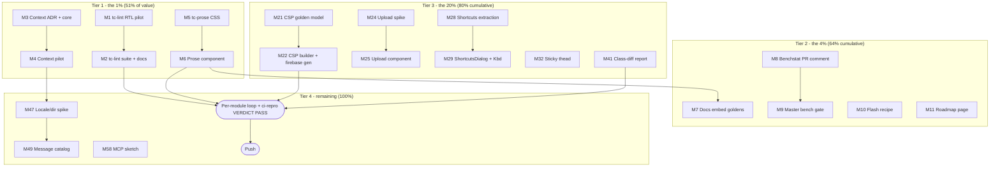

# Plan: FIFTY-IDEAS PARETO MASTER PLAN

**Created:** 2026-10-14 18:52 | **Scope:** all 50 ideas from
[`docs/reviews/2026-10-14_50-big-picture-ideas.md`](../reviews/2026-10-14_50-big-picture-ideas.md)
| **Method:** Pareto 1% → 4% → 20% → remaining 80% of tasks (final 20% of value)

## Context

The 2026-10-14 big-picture session produced 50 mutually-unrelated improvement
directions across 12 axes, dupe-checked against every prior idea corpus
(100-IMPROVEMENT-IDEAS, STANDOUT, SUPERB, ROADMAP harvests, TODO #1-#400) with
two honest convergence flags (#41 ↔ TODO #214, #42 ↔ 100-ideas #86). Nothing in
the corpus ranks them. This plan does: which few deliver most, what order, and
at what task size. Evidence base per idea lives in the review doc; tracked
convergences are called out inline (⚑ = existing TODO_LIST/100-ideas anchor).

## Goal / non-goals

- Goal: a ranked, two-granularity execution queue (60 medium tasks / 150 micro
  tasks) that covers ALL 50 ideas without violating any repo gate.
- Non-goals: implementing demand-gated ideas without a demand signal (#4, #15,
  #18, #33 stay at ADR/sketch tier); re-litigating closed ADRs (0021/0033/0039/
  0040); hand-typing any machine-guarded count; bumping the templ pin; skipping
  any wired component's e2e ladder.

## Pareto breakdown (ideas → value tiers)

| Tier                 | Claim                                   | Ideas (review-doc #)                                                                                                                                                           | Why this tier                                                                                                                                                                                                                                                                                                                                                                                                                                                                                                              |
| -------------------- | --------------------------------------- | ------------------------------------------------------------------------------------------------------------------------------------------------------------------------------ | -------------------------------------------------------------------------------------------------------------------------------------------------------------------------------------------------------------------------------------------------------------------------------------------------------------------------------------------------------------------------------------------------------------------------------------------------------------------------------------------------------------------------- |
| **1% → 51%**         | 3 ideas carry over half the total value | **#34 tc lint, #1 context-injected defaults, #13 Prose**                                                                                                                       | tc lint converts the repo's private QA moat into public adoption surface (near-unique in the ecosystem, scanners already exist). Context-injection removes the single largest per-props papercut and un-blocks every future label/locale feature. Prose closes the most-visible catalogue gap for real content-heavy apps. All three are internal-quality-driven (no demand gate needed) and compound: context shrinks every future component's props surface; tc lint makes every consumer's code meet the library's bar. |
| **4% → 64%**         | +4 ideas                                | **#21 docs-embed-goldens, #41 benchmark gate (⚑ #214), #9 flash recipe, #48 public roadmap page**                                                                              | Docs that cannot lie + a perf claim that is load-bearing + the daily-use PRG pattern + free distribution of the roadmap. Cheap relative to value.                                                                                                                                                                                                                                                                                                                                                                          |
| **20% → 80%**        | +~9 ideas                               | **#16 password, #20 sticky thead, #25 migration guide, #26 authoring guide, #27 SR protocol, #31 class-diff, #29 windows lane, #36 security dry run, #47 chart data fallback** | Pragmatic tier: docs/CI/medium components with full-ladder budgets, each independently shippable in a session.                                                                                                                                                                                                                                                                                                                                                                                                             |
| **Remaining → 100%** | the other ~34 ideas                     | everything else (platform spikes, demand-gated ADRs, i18n pair, heavy components, distribution)                                                                                | Real value, lower urgency or gated: sequenced last, several are explicitly ADR/spike-only by policy.                                                                                                                                                                                                                                                                                                                                                                                                                       |

## Phases (Pareto order)

Global gate rules (apply to every task; the four gates from
`docs/plan-authoring-checklist.md`):

- **Goldens cover this** — only component/CSS-emitting tasks (M4-M6, M13, M15,
  M22, M24-M25, M27, M29, M32, M42, M47, M49, M50, M55) owe named golden files.
  Docs/CI/ADR tasks: N/A by nature (no rendered output change).
- **Wired ⇒ e2e** — tasks emitting `hx-*`/`data-on:*`/`wire.Action` (M15 links
  only, M25 upload, M29 shortcuts) owe chromedp e2e IN PHASE or a written
  waiver. M15's waiver: link hrefs are string-asserted; no new request flow.
- **Counts bump in the same edit** — every new component/enum/golden bumps the
  guarded doc numbers in the SAME commit (`TestDocsCountDrift`,
  `TestFeaturesEnumTableExhaustive`).
- **Demo smoke is a gate** — every task that touches demo content or adds a
  component runs the demo smoke / `nix run .#visual` before "done".

### Tier 1 — the 1% (→51%)

- **M1 — `tc lint` RTL scanner extraction** (medium 90min | micro F1-F3)
  - What: parameterize the RTL compliance scanner (currently a repo-fixed test)
    to accept an arbitrary directory; add `tc lint --rtl <dir>`; run it on the
    website module's hand-written pages as the first dogfood.
  - Proof: `tc lint --rtl ./website` exits 0 on clean pages and reports real
    findings on a seeded violation fixture.
- **M2 — `tc lint` scanner suite + docs** (medium 100min | micro F4-F7)
  - What: wire dark-mode, motion-reduce, and inline-icon scanners behind the
    same subcommand (flag-per-scanner + `--all`); documented allowlists;
    docs page.
  - Proof: `tc lint --all` over this repo reproduces the four guard tests'
    verdicts; docs page lists every scanner and its allowlist syntax.
- **M3 — Context-injected defaults: ADR + core** (medium 60min | micro F8-F10)
  - What: ADR for precedence (props > context > zero value);
    `utils.ContextWithNonce(ctx, nonce)` + lookup helper; precedence guard test
    proving explicit props always win.
  - Proof: new test fails on precedence violation; ADR merged with the
    struct-literal-zero-value rule restated.
- **M4 — Context pilot on one script emitter** (medium 90min | micro F11-F13)
  - What: one nonce-consuming component (candidate: `utils.Dismiss`/
    `feedback.dismissScript` consumer) reads context as fallback; goldens
    re-baselined; `[Unreleased]` warmed.
  - Proof: golden shows identical output with props-nonce and context-nonce;
    new compliance test: context+props disagreement is caught.
- **M5 — `.tc-prose` CSS extraction** (medium 60min | micro F14-F16)
  - What: lift `templates/custom.css` typography block into a `.tc-prose`
    class family (headings, lists, blockquotes, code, tables, images) with
    dark/RTL/motion compliance and size hooks.
  - Proof: golden of a markdown-rendered sample page; compliance scanners pass
    on the new classes.
- **M6 — `display.Prose` component** (medium 100min | micro F17-F19)
  - What: `ProseProps` (children, size enum, Class/Attrs), wrapper component,
    full ladder: enum IsValid + test, goldens, counts in same edit, demo route.
  - Proof: golden sweep green; demo smoke on the new route; counts bumped.

### Tier 2 — the 4% (→64%)

- **M7 — Docs embed live goldens: Card pilot** (medium 90min | micro F20-F22)
  - What: docs generator loads Card's golden HTML and renders it verbatim in
    the docs page (scoped styling via `.tc-prose`-adjacent wrapper or iframe);
    drift test: golden change fails the docs build until re-embedded.
  - Proof: hand-edit a golden → docs build fails → restore → green.
- **M8 — Benchstat PR comment (lands ⚑ #214)** (medium 100min | micro F23-F25)
  - What: per TODO #214's runbook — master run stores `bench.old` per module as
    a workflow artifact; PR job runs `bench.new`, `benchstat old new` posts the
    table comment.
  - Proof: workflow run on a test PR shows the comment; re-run is idempotent
    (updates, not spams).
- **M9 — Master benchmark regression gate** (medium 60min | micro F26-F27)
  - What: thresholds calibrated from 3 releases' benchmark history; master
    job fails on sustained regression beyond threshold (gate, not comment).
  - Proof: seeded regression (sleep in a bench target on a branch) trips the
    gate; revert clears it.
- **M10 — Flash (PRG) recipe** (medium 60min | micro F28-F29)
  - What: recipe doc (cookie flash → Toast/Alert render, clear-on-read, works
    with plain 303 and `hx-redirect`); demo route proving it.
  - Proof: recipe's code blocks compile against the demo; smoke captures the
    flash appearing once and not on reload.
- **M11 — Public roadmap page** (medium 60min | micro F30-F32)
  - What: DocRef entry rendering ROADMAP.md (comparison.md mechanics);
    frontmatter synthesis; sidebar entry; test pin.
  - Proof: site test suite green; /roadmap renders the repo doc single-sourced.

### Tier 3 — the 20% (→80%)

- **M12 — Typed `Href`: survey + ADR** (60min | F33-F34) — inventory every
  `Href string` field; `ParseHref` design (internal/fragment/external+rel).
  Proof: ADR with the field inventory table.
- **M13 — Typed `Href`: one-package pilot** (100min | F35-F37) — alias
  migration in ONE package, consumers + goldens, lint note for the rest.
  Proof: package goldens unchanged; `ParseHref` rejects bad shapes in tests.
- **M14 — `wire.EncodeQuery[T]` design** (100min | F38-F40) — godoc-first API;
  round-trip property harness (`Decode(Encode(x)) == x`); adversarial fuzz
  seeds. Proof: property test green incl. filter-state struct.
- **M15 — `EncodeQuery` consumer wiring** (90min | F41-F43) — FilterChips
  hrefs + Pagination links consume it; goldens. Waiver: no new request flow
  (link hrefs string-asserted). Proof: goldens show encoded hrefs.
- **M16 — Early Hints spike** (90min | F44-F46) — Cloud Run 103 probe; demo
  middleware spike; measurement writeup. Proof: numbers doc; go/no-go note.
- **M17 — Server-resolved theme middleware** (90min | F47-F49) — cookie-read
  middleware + `ThemeToggle` form-endpoint pattern + recipe with noscript
  proof. Proof: recipe demo flips theme with JS disabled.
- **M18 — Render observer overhead spike** (60min | F50-F51) — wrap-benchmark
  on the heaviest route; ADR go/no-go at nanosecond overhead. Proof: ADR.
- **M19 — Fragment memoization spike** (90min | F52-F53) — LRU wrapper spike on
  the demo index route; numbers doc + verdict. Proof: numbers doc.
- **M20 — Conditional-GET poll pattern** (90min | F54-F56) — `ETagOf` +
  If-None-Match 304 pattern doc with a worked PolledRegion example; promote-
  to-helper decision note. Proof: pattern doc + demo endpoint returns 304.
- **M21 — Typed CSP builder: golden model** (100min | F57-F59) — policy struct;
  demo's existing CSP modeled as a test; equality property vs the
  firebase.json header. Proof: struct renders byte-identical policy strings.
- **M22 — CSP builder API + generation** (100min | F60-F62) — `String()` +
  nonce injection points; firebase.json generation path (kills the
  keep-two-equal footgun); docs + recipe. Goldens: policy-render unit goldens.
  Proof: generated firebase.json matches committed file.
- **M23 — Trusted Types report-only audit** (90min | F63-F65) — flip demo CSP
  to report-only with TT directive in a capture run; violation report read;
  docs stance. Proof: violation report doc + stance section in
  docs/javascript-guide.md.
- **M24 — FileUploadProgress spike** (90min | F66-F67) — progress-event
  plumbing against a stub endpoint in visualtest; dual-transport shape
  decision. Proof: spike test shows live progress in real Chromium.
- **M25 — FileUploadProgress component** (100min | F68-F70) — props + templ;
  htmx + datastar emission (Wire); e2e + goldens + counts. Wired ⇒ e2e: IN
  PHASE. Proof: e2e asserts progress reaches 100% and swap lands.
- **M26 — PasswordInput ADR** (45min | F71) — scoring locus: server-side only.
  Proof: ADR merged.
- **M27 — PasswordInput build** (100min | F72-F74) — reveal toggle (hit-box,
  aria-pressed), server-scored meter (0-4), confirm-match state; ladder +
  counts. Proof: goldens + a11y sweep clean.
- **M28 — KeyboardShortcuts extraction** (60min | F75-F76) — extract
  CommandPalette hotkey wiring into the shared singleton shape; data-attribute
  registry contract. Proof: CommandPalette e2e still green on shared script.
- **M29 — ShortcutsDialog + `Kbd`** (100min | F77-F79) — Kbd atom + goldens;
  ShortcutsDialog listing active bindings; e2e + counts. Wired ⇒ e2e: IN
  PHASE. Proof: e2e opens `?` dialog, Esc closes.
- **M30 — Presence recipe** (90min | F80-F81) — SSE presence handler example +
  avatar-stack recipe; demo probe. Proof: recipe demo shows two tabs as
  present.
- **M31 — Wizard recipe** (100min | F82-F84) — signed-cookie step state; demo
  checkout route; recipe doc (per-step re-render, back without loss). Proof:
  demo smoke walks all steps forward and back.
- **M32 — Table sticky header** (100min | F85-F87) — `--tc-shell-header-h`
  CSS-var contract with AppShell; thead CSS + RTL; tall-table golden +
  scroll-container edge case. Goldens: sticky + non-sticky. Proof: visual
  golden at a tall-table route.
- **M33 — Versioned demo tags** (45min | F88-F89) — release workflow tags the
  demo image per version; verify deploy. Proof: two versions queryable.
- **M34 — Componentshots probe** (60min | F90-F91) — manual Modal-open capture
  with existing chromedp tools; format/quality verdict. Proof: artifact +
  verdict note (pipeline-ize only if good without hand-tuning).
- **M35 — Migration guide from shadcn-templ** (100min | F92-F94) — inventory
  from their llms.txt (re-verify cadence per TODO #376); mapping table; gaps
  section; DocRef page. Proof: page renders; claims carry verify dates.
- **M36 — Public authoring guide** (90min | F95-F96) — distill SKILL.md Part 2
  - plan-authoring-checklist into a human contributor guide; link from
    CONTRIBUTING. Proof: page live; a fresh-eyes read test (Lars approves).
- **M37 — Screen-reader protocol + first pass** (100min | F97-F99) — protocol
  doc (NVDA/VoiceOver/Orca scripts, expected announcements); Modal + Drawer
  pass; ledger beside `axe_baseline.json`. Proof: ledger committed with
  findings (whatever they are).
- **M38 — Consumer golden-testing guide** (90min | F100-F101) — extract an
  example from a package's golden_sweep_test.go into docs + starter fragment.
  Proof: guide's example compiles in a scratch module.
- **M39 — Windows CI lane** (60min | F102-F103) — windows runner: `go build
  ./...` + per-module unit loop; visual jobs excluded. Proof: lane green.
- **M40 — `utils.Class` profile + fast path** (100min | F104-F105) — CPU
  profile on the heaviest route; fast-path decision ADR (complements
  100-ideas #30's budget). Proof: profile artifact + ADR verdict.
- **M41 — Release class-diff report** (100min | F106-F108) — golden class
  inventory diff between two versions, classified additive/noise/breaking;
  validate against known-intentional changes; release.sh hook decision.
  Proof: v1.20.1→master run classifies the known Toggle change correctly.
- **M42 — Attribute-injection fuzz lane** (90min | F109-F111) — `FuzzHTMLDataAttrs`
  - `FuzzClass` with quote/angle/newline seeds; attribute-breakout assertions.
    Proof: fuzz targets run 10k execs clean; one seeded smuggling shape is
    caught by the assertion.
- **M43 — Release provenance attestations** (90min | F112-F113) —
  attest-build-provenance on the demo image workflow; "verify a release" doc
  (tag → provenance → checksums). Proof: attestation verifiable via gh CLI.
- **M44 — Security posture dry run** (100min | F114-F116) — supported-versions
  table (policy decision surfaced to owner ⫱); weekly govulncheck schedule;
  fake advisory drafted end-to-end. Proof: schedule green; draft in
  docs/advisories/draft/.
- **M45 — Flagship talk abstract** (60min | F117-F118) — abstract + CFP short
  list; demo artifact links verified. Proof: abstract doc; links live.

### Tier 4 — the remaining (final 20%)

- **M46 — chi adapter page** (90min | F119-F120) — 50-line chi mount example +
  docs page; stdlib mux stays canonical. Proof: example compiles in scratch.
- **M47 — Locale → dir + formatters spike** (100min | F121-F123) — BCP47
  direction inference vs ICU ground truths; RelativeTime de/ar/ja; x/text
  weight-budget ADR. Proof: spike table + ADR (labels ride context from M3/M4).
- **M48 — User-facing string inventory scanner** (90min | F124-F125) —
  scanner for templ text nodes; outlier catalog (jargon/length). Proof:
  inventory artifact; feeds M54.
- **M49 — Message catalog struct + errorpage migration** (100min | F126-F128)
  — typed struct of user-facing strings, English zero value = current render;
  errorpage migrates first. Goldens: unchanged output proof. Proof: goldens
  byte-identical after migration.
- **M50 — Image `FetchPriority`** (45min | F129-F130) — prop + golden; LCP
  pairing docs with Early Hints (#5/M16). Proof: golden.
- **M51 — Visual-diff PR bot (manual first)** (90min | F131-F132) — artifact +
  comment step run manually on the next component PR; template finalized.
  Proof: comment renders side-by-side links.
- **M52 — Per-route quality badges** (100min | F133-F134) — JSON emission from
  the sweep job; quality-ledger page. Proof: page table over real sweep JSON.
- **M53 — hx-boost spike + ADR** (100min | F135-F137) — boost the demo docs
  section; sharp-edge catalog (scripts/focus/scroll); support-or-reject ADR.
  Proof: ADR merged (either answer is a win).
- **M54 — Cognitive a11y pass** (100min | F138-F139) — use M48's inventory;
  fix the worst ten strings (same-edit counts where docs numbers move).
  Proof: before/after table.
- **M55 — Chart data-table fallback** (90min | F140-F141) — LineChart sr-only
  `<table>` fallback (`DataTableFallback *bool`); golden + a11y review.
  Proof: golden asserts table shape; review verdict recorded.
- **M56 — AutoForm demand-gated ADR** (60min | F142) — pre-write the ADR (the
  100-ideas #81 pattern) so build is ready the day demand lands. Proof: ADR.
- **M57 — OtpInput demand-gated ADR** (45min | F143) — same. Proof: ADR.
- **M58 — MCP prerequisite + sketch** (60min | F144-F145) — registry (100-ideas
  #13) documented as the prerequisite; query-layer sketch. Proof: sketch doc.
- **M59 — Email-safe render spike + ADR** (100min | F146-F148) — inline-style
  render probe for Alert+Button; litmus-style checker pass; ADR (honest
  "not planned" is an acceptable verdict). Proof: ADR.
- **M60 — Consumer fleet scan script** (90min | F149-F150) — scan known
  consumer checkouts (go.mod pins + imports); version/usage matrix; feed one
  real demand-gate decision with it. Proof: matrix output + decision note.

## Execution graph

Reading: T1 first (M1-M6, any order except the drawn edges); T2 rides behind
(M7 needs M6's `.tc-prose`; M8→M9 is one lane); T3 tasks are independent
lanes; T4 runs last or on demand. Every lane ends in the same verify gate.

## Fine plan — micro tasks (≤12min each, ALL tasks covered, tier-sorted)

Columns: F# | Task | Scope (single ≤12min unit) | Feeds

### Tier 1 micros

| F#  | Task                            | Scope (single ≤12min unit)                                                                       | Feeds |
| --- | ------------------------------- | ------------------------------------------------------------------------------------------------ | ----- |
| F1  | Extract RTL scanner core        | `utils` RTL scanner gains a `scanDir(dir string) []Finding` entry point, repo test keeps passing | M1    |
| F2  | `tc lint --rtl` subcommand      | flag parsing + scanDir call + findings printer + exit codes                                      | M1    |
| F3  | Dogfood on website module       | run on `website/`, file the findings list, fix trivial ones in place                             | M1    |
| F4  | Wire dark-mode scanner          | same scanDir shape for `darkmode_compliance` logic behind `--dark`                               | M2    |
| F5  | Wire motion + icon scanners     | `--motion` + `--icons` flags, shared finding model                                               | M2    |
| F6  | Allowlist syntax + docs page    | `// tc-lint:ignore` comment convention; `docs/cli.md` section                                    | M2    |
| F7  | `tc lint --all` parity test     | test asserting scanner verdicts == the four guard tests on this repo                             | M2    |
| F8  | Context precedence ADR skeleton | `docs/adr/00XX-context-defaults.md`: props > context > zero                                      | M3    |
| F9  | `ContextWithNonce` + lookup     | `utils/context.go`: setter + typed getter, zero fallback                                         | M3    |
| F10 | Precedence guard test           | explicit props always win; context only fills empty                                              | M3    |
| F11 | Pick pilot component            | grep nonce consumers, choose smallest script emitter, note rationale                             | M4    |
| F12 | Context read-through in pilot   | component resolves nonce via lookup helper; unit tests                                           | M4    |
| F13 | Pilot goldens + `[Unreleased]`  | re-baseline affected goldens; warm changelog entry                                               | M4    |
| F14 | Lift typography block           | move `custom.css` typography section to `.tc-prose` base classes                                 | M5    |
| F15 | Element coverage in `.tc-prose` | headings/lists/quotes/code/tables/imgs + dark/RTL pass                                           | M5    |
| F16 | Prose golden sample             | golden a rendered markdown sample with the new classes                                           | M5    |
| F17 | `ProseSize` enum + IsValid      | typed enum + `IsValid()` + test in the SAME commit (repo rule)                                   | M6    |
| F18 | `Prose` props + templ wrapper   | `ProseProps{Children, Size, Class, Attrs}` + wrapper                                             | M6    |
| F19 | Prose ladder completion         | goldens, demo route, counts in same edit, demo smoke                                             | M6    |

### Tier 2 micros

| F#  | Task                           | Scope (single ≤12min unit)                                        | Feeds |
| --- | ------------------------------ | ----------------------------------------------------------------- | ----- |
| F20 | Card golden loader             | docs generator reads the Card golden file by convention           | M7    |
| F21 | Embed + scoped styling         | render golden verbatim in the docs page, scoped CSS wrapper       | M7    |
| F22 | Docs-drift proof test          | golden edit ⇒ docs build fails; restore ⇒ green                   | M7    |
| F23 | `bench.old` artifact on master | workflow step storing per-module bench baselines                  | M8    |
| F24 | PR bench job                   | run benches, `benchstat old new`, emit markdown table             | M8    |
| F25 | Comment step + runbook         | post/update PR comment; document the flow (⚑ #214 close-out)      | M8    |
| F26 | Threshold calibration          | benchstat last 3 releases; pick noise floor; write thresholds     | M9    |
| F27 | Master gate wiring             | master job fails on regression beyond threshold; seed-test proves | M9    |
| F28 | Flash recipe doc               | cookie set → redirect → read+render+clear; `hx-redirect` variant  | M10   |
| F29 | Flash demo route               | demo endpoint + smoke capture (appears once, not on reload)       | M10   |
| F30 | ROADMAP DocRef entry           | registry entry + source override like comparison.md               | M11   |
| F31 | Frontmatter + sidebar          | synthesize frontmatter; add nav entry; sitemap lastmod            | M11   |
| F32 | Roadmap page test pin          | site test asserts /roadmap renders + heading present              | M11   |

### Tier 3 micros

| F#   | Task                           | Scope (single ≤12min unit)                                    | Feeds |
| ---- | ------------------------------ | ------------------------------------------------------------- | ----- |
| F33  | Href field inventory           | grep all `Href string` props fields into an ADR table         | M12   |
| F34  | `ParseHref` design             | internal/fragment/external+rel constructors + rejection table | M12   |
| F35  | One-package alias migration    | switch ONE package's Href fields behind the type alias        | M13   |
| F36  | Pilot consumers + goldens      | update call sites; goldens unchanged proof                    | M13   |
| F37  | Migration lint note            | document the remaining-package path in the ADR                | M13   |
| F38  | EncodeQuery godoc-first API    | signature + semantics doc; nil/empty/round-trip contract      | M14   |
| F39  | Round-trip property harness    | `Decode(Encode(x)) == x` over the filter-state struct         | M14   |
| F40  | Adversarial fuzz seeds         | malformed queries, dup keys, bad types into the fuzz corpus   | M14   |
| F41  | FilterChips integration        | chips build hrefs via EncodeQuery                             | M15   |
| F42  | Pagination integration         | page links via EncodeQuery                                    | M15   |
| F43  | Goldens + waiver note          | encoded-href goldens; record the no-e2e waiver                | M15   |
| F44  | Cloud Run 103 probe            | minimal service emitting 103; confirm upstream forwards       | M16   |
| F45  | Demo middleware spike          | `Link: preload` for app.css before body render                | M16   |
| F46  | Measurement writeup            | TTFB/paint numbers; go/no-go note                             | M16   |
| F47  | Theme middleware impl          | cookie read → `dark` class server-side; reference impl        | M17   |
| F48  | Toggle form endpoint pattern   | ThemeToggle variant posting to a cookie-setter endpoint       | M17   |
| F49  | Recipe + noscript proof        | recipe doc; demo flips theme with JS disabled                 | M17   |
| F50  | Observer wrap-benchmark        | benchmark page render with/without the hook                   | M18   |
| F51  | Observer ADR                   | go/no-go at measured overhead                                 | M18   |
| F52  | Memo LRU spike                 | wrapper on demo index subtree; correctness under staleness    | M19   |
| F53  | Memo numbers doc               | latency/CPU deltas; promote-or-pattern verdict                | M19   |
| F54  | `ETagOf` helper                | hash rendered fragment; If-None-Match compare; 204/304        | M20   |
| F55  | PolledRegion worked example    | demo poll endpoint returning 304 on unchanged data            | M20   |
| F56  | Promote-or-pattern note        | decide helper vs docs-only; record rationale                  | M20   |
| F57  | CSP policy struct              | typed directives + sources model                              | M21   |
| F58  | Demo CSP as test               | struct renders the demo's exact policy string                 | M21   |
| F59  | firebase equality property     | generated header == committed firebase.json header            | M21   |
| F60  | `String()` + nonce points      | render with nonce injection; omit-empty contract respected    | M22   |
| F61  | firebase generation path       | `--update-csp` style generator writes firebase.json block     | M22   |
| F62  | CSP builder docs + recipe      | docs page; demo adopts generated path                         | M22   |
| F63  | TT report-only flip            | capture run adds `require-trusted-types-for` report-only      | M23   |
| F64  | Violation report read          | collect + summarize violations from the run                   | M23   |
| F65  | Trusted Types stance doc       | javascript-guide section: surviving sinks, consumer guidance  | M23   |
| F66  | Upload progress spike          | progress events against stub endpoint in visualtest           | M24   |
| F67  | Dual-transport shape decision  | htmx vs datastar emission contract note                       | M24   |
| F68  | Upload props + templ           | FileUploadProgress props + markup                             | M25   |
| F69  | Wire emission                  | htmx `hx-post` + datastar `data-on:` paths                    | M25   |
| F70  | Upload e2e + counts            | chromedp e2e to 100%; goldens; counts same edit               | M25   |
| F71  | Password scoring ADR           | server-side scoring locus; breach-check hook shape            | M26   |
| F72  | Reveal toggle                  | show/hide button, hit-box pattern, aria-pressed               | M27   |
| F73  | Meter + states                 | 0-4 strength bar, confirm-match error state                   | M27   |
| F74  | Password ladder + counts       | goldens, a11y sweep, counts same edit                         | M27   |
| F75  | Extract hotkey shape           | CommandPalette hotkey wiring → shared singleton script        | M28   |
| F76  | Registry contract              | data-attribute binding declaration format                     | M28   |
| F77  | `Kbd` atom + goldens           | kbd display component + goldens                               | M29   |
| F78  | ShortcutsDialog                | dialog listing active bindings from the registry              | M29   |
| F79  | Shortcuts e2e + counts         | open via `?`, Esc closes; counts same edit                    | M29   |
| F80  | Presence SSE handler example   | reference handler: connect/disconnect → roster broadcast      | M30   |
| F81  | Avatar-stack recipe + probe    | recipe doc; two-tab demo probe                                | M30   |
| F82  | Wizard step-state shape        | signed cookie state; step transitions; back without loss      | M31   |
| F83  | Demo checkout route            | 3-step flow on StepIndicator + Form                           | M31   |
| F84  | Wizard recipe doc              | the canonical writeup incl. error re-render                   | M31   |
| F85  | Shell-header CSS var contract  | `--tc-shell-header-h` emitted by AppShell                     | M32   |
| F86  | Sticky thead CSS + RTL         | `position: sticky` with var offset; RTL scroll check          | M32   |
| F87  | Tall-table golden              | sticky golden + scroll-container edge case                    | M32   |
| F88  | Demo image tagging             | release workflow tags demo image with version                 | M33   |
| F89  | Deploy verify                  | two versions reachable; note URLs                             | M33   |
| F90  | Modal-open capture             | chromedp capture of open animation frames                     | M34   |
| F91  | Format verdict                 | gif/webp/mp4 quality/size verdict; pipeline-ize decision      | M34   |
| F92  | shadcn-templ inventory pull    | their llms.txt component list, verify-dated                   | M35   |
| F93  | Mapping table                  | their component → ours → prop translation → gap               | M35   |
| F94  | Migration DocRef page          | render + sidebar + sitemap                                    | M35   |
| F95  | Distill SKILL.md Part 2        | human-facing authoring guide draft                            | M36   |
| F96  | Guide page + CONTRIBUTING link | publish + link from CONTRIBUTING                              | M36   |
| F97  | SR protocol doc                | NVDA/VoiceOver/Orca scripts + expected announcements          | M37   |
| F98  | Modal + Drawer pass            | run the protocol; record transcript notes                     | M37   |
| F99  | SR ledger                      | results ledger beside axe_baseline.json                       | M37   |
| F100 | Extract consumer example       | minimal golden harness from an existing sweep test            | M38   |
| F101 | Guide + starter fragment       | docs page; starter-template fragment                          | M38   |
| F102 | Windows workflow job           | windows-latest: go build + per-module unit loop               | M39   |
| F103 | Lane verification              | green run; fix any path/sep findings                          | M39   |
| F104 | Class CPU profile              | profile on heaviest demo route; hot spots doc                 | M40   |
| F105 | Fast-path ADR                  | decide constant-pair cache; complexity vs win                 | M40   |
| F106 | Class inventory diff script    | two versions → class sets → classified diff                   | M41   |
| F107 | Validate vs known changes      | run on Toggle rework; classification must match reality       | M41   |
| F108 | release.sh hook decision       | integrate or keep one-off; record rationale                   | M41   |
| F109 | `FuzzHTMLDataAttrs`            | fuzz target with quote/angle/newline seeds                    | M42   |
| F110 | `FuzzClass`                    | class-string fuzz target                                      | M42   |
| F111 | Breakout assertions            | attribute-boundary assertions; seeded smuggling shape caught  | M42   |
| F112 | Attest workflow                | attest-build-provenance on demo image release                 | M43   |
| F113 | Verify-release doc             | tag → provenance → checksums walk-through                     | M43   |
| F114 | Supported-versions table       | policy draft; ⫱ owner gate on scope (latest minor only?)      | M44   |
| F115 | govulncheck schedule           | weekly workflow + results note                                | M44   |
| F116 | Fake advisory draft            | end-to-end advisory draft in docs/advisories/draft/           | M44   |
| F117 | Talk abstract                  | flagship abstract + CFP short list                            | M45   |
| F118 | Artifact links check           | demo/site links in the abstract verified live                 | M45   |
| F119 | chi mount example              | 50-line chi integration, tested in scratch                    | M46   |
| F120 | Adapter docs page              | publish with stdlib as canonical                              | M46   |
| F121 | Direction inference spike      | BCP47 → dir vs ICU ground truths table                        | M47   |
| F122 | RelativeTime i18n probe        | de/ar/ja output vs expectations                               | M47   |
| F123 | x/text weight ADR              | dependency budget verdict (opt-in subpackage?)                | M47   |
| F124 | Text-node scanner              | extract user-facing strings from templ files                  | M48   |
| F125 | Outlier catalog                | jargon/length/idiom flags; feeds M54                          | M48   |
| F126 | Catalog struct design          | typed struct, English zero value, plural fn fields            | M49   |
| F127 | errorpage migration            | swap hardcoded strings for the struct                         | M49   |
| F128 | Zero-value proof               | goldens byte-identical pre/post migration                     | M49   |
| F129 | FetchPriority prop             | Image prop + golden                                           | M50   |
| F130 | LCP docs note                  | pair with Early Hints section                                 | M50   |
| F131 | Manual bot run                 | artifact + comment on the next component PR                   | M51   |
| F132 | Comment template               | finalize side-by-side layout                                  | M51   |
| F133 | Sweep JSON emission            | quality report per route from the axe/visual jobs             | M52   |
| F134 | Quality ledger page            | table over the JSON; site test                                | M52   |
| F135 | Demo boost spike               | hx-boost on the docs section                                  | M53   |
| F136 | Sharp-edge catalog             | scripts/focus/scroll findings                                 | M53   |
| F137 | hx-boost ADR                   | support or reject, in writing                                 | M53   |
| F138 | Worst-ten flagging             | from M48 inventory                                            | M54   |
| F139 | Fix worst ten                  | string fixes; same-edit counts where numbers move             | M54   |
| F140 | LineChart sr table             | visually-hidden data table fallback                           | M55   |
| F141 | Fallback golden + review       | golden asserts shape; a11y verdict recorded                   | M55   |
| F142 | AutoForm ADR pre-write         | demand gate + design Qs answered in advance                   | M56   |
| F143 | OtpInput ADR pre-write         | same pattern                                                  | M57   |
| F144 | Registry prerequisite note     | document 100-ideas #13 as MCP prerequisite                    | M58   |
| F145 | MCP query-layer sketch         | tool surface: lookup/signature/wiring queries                 | M58   |
| F146 | Inline-style render probe      | Alert+Button with inlined styles                              | M59   |
| F147 | Email checker pass             | litmus-style checks on the probe output                       | M59   |
| F148 | Email ADR                      | honest verdict, incl. "not planned"                           | M59   |
| F149 | Fleet scan script              | consumer go.mod pins + imports → matrix                       | M60   |
| F150 | Matrix + decision feed         | run once; feed one demand-gate decision; note outcome         | M60   |

## Verification (whole plan)

- [ ] Per-module loop green after any code-touching lane:
      `for mod in utils icons errorpage charts/echarts datastar htmx; do (cd "$mod" && GOWORK=off go test ./...); done`
- [ ] `scripts/ci-repro.sh --lint --website` → `VERDICT: PASS` at the exact
      commit before ANY push (M03 ritual; re-verify if `git status -sb` moved).
- [ ] Demo smoke after every demo-touching lane (M10, M17, M19, M30, M31, M55,
      M52, M53...).
- [ ] `[Unreleased]` warm after every consumer-visible change; counts bumped in
      the same edits (no follow-up commit count fixes).
- [ ] Visual goldens regenerate ONLY via `nix run .#visual -- -update` (never
      bare `go test -update` in visualtest/).
- [ ] Demand-gated items (M56, M57, M58) stop at ADR/sketch until a named
      consumer asks.

## Verschlimmbesserung guardrails (what this plan must NOT do)

1. No library change without its ladder (enum IsValid + test same commit;
   counts same edit; wired ⇒ e2e or written waiver).
2. No `templ` pin moves, no generator re-baselines, no linter re-enables.
3. No demand-gated implementation (M56/M57/M58 stay pre-written ADRs).
4. No hand-typed counts anywhere — every number rides the guards.
5. No skipping ci-repro before push, even for docs-only commits.
6. Spikes (M16, M18, M19, M53, M59) end in a written verdict even when the
   verdict is "no" — a spike that only lives in someone's head is a ghost.

## Deferred / follow-through seeds

- Registry source of truth (100-ideas #13) is the unlock for M58 — if it lands
  first, M58 upgrades from sketch to buildable.
- M44's supported-versions table is an owner decision (⫱) — plan stops at the
  draft.
- Threshold values for M9 intentionally come AFTER calibration (F26), not from
  this plan — plans that hard-code numbers they haven't measured are lies.

## Provenance

- Source: docs/reviews/2026-10-14_50-big-picture-ideas.md (50 ideas, dupe-checked).
- Convergence anchors honored: ⚑ #214 (M8/M9), 100-ideas #86 (M50 adjacency),
  100-ideas #13 (M58 prerequisite), ROADMAP g2 label-props (M49 complement).
- Template: docs/planning/TEMPLATE.md; gates from docs/plan-authoring-checklist.md.
