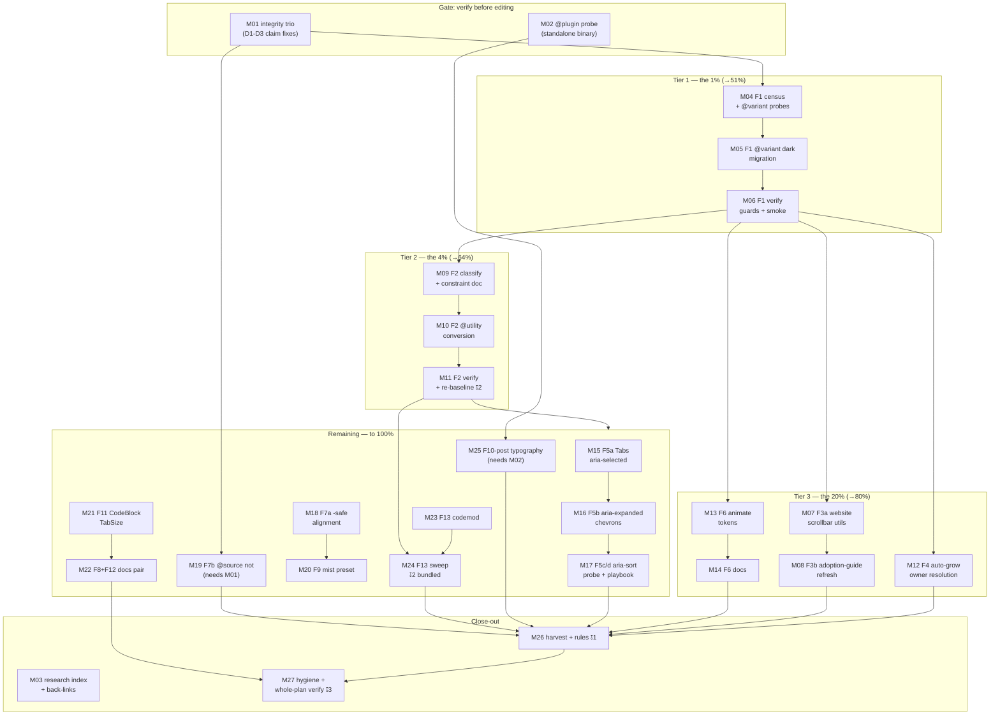

# Plan: TAILWIND-V4 CONSUMER-COMPOSABILITY PARETO PLAN

**Created:** 2026-10-14 20:45 | **Scope:** all 50 work items from
[`docs/status/2026-10-14_20-39_tailwind-deep-dive-session-status.md`](../status/2026-10-14_20-39_tailwind-deep-dive-session-status.md)
(section f — the Tailwind deep-dive session's full action pool, which subsumes
the 12 ranked opportunities in
[`docs/research/2026-10-14_tailwindcss-deep-dive.html`](../research/2026-10-14_tailwindcss-deep-dive.html))
| **Method:** Pareto 1% → 4% → 20% → remaining (final 20% of value)

## Context

The 2026-10-14 Tailwind deep-dive (83/100) established: the repo is on the
latest release (4.3.3, all lanes pinned), the 10-08 audit's five fixes are
verified in-tree, and the remaining value is **consumer-facing composability** —
handing the framework's variant machinery to consumers (`@variant dark` inside
custom.css, `@utility` for the tc-\* helpers, `@theme --animate-*` tokens,
`aria-*` state variants) plus a WebKit-only scrollbar block on the website and
three secondhand claims inside the new report that must be primary-verified
before anyone edits based on them (D1–D3 in the status report). Everything here
is CSS/tests/docs — zero new Go dependencies, no pin bumps, no generator
changes. Dupe-check: the 18:52 FIFTY-IDEAS plan ranks the product-idea corpus
and shares no M-task with this plan; one convergence flag ⚑ — its #13
(`display.Prose`) vs this plan's M25 (website typography plugin) target
different surfaces (library component vs website docs CSS) — M25 must not
pre-empt #13.

## Goal / non-goals

- Goal: close the audit's actionable gap list — every one of the 50 items
  either DONE, explicitly waived with a recorded reason, or gated on an owner
  decision (⫱) — with the library's guard suite green and no un-bundled
  golden/visual re-baselines.
- Non-goals: bumping templ or Tailwind pins (TODO #335 owns 1070); touching the
  concurrent session's files in `utils/` without coordination (⫱3); expanding
  `ContainerAware` or re-litigating ADR-0033/0039/0040; growing AGENTS.md past
  its 220-line gate; hand-typing any machine-guarded count.

## Pareto breakdown (items → value tiers)

| Tier                 | Claim                                                   | Items (status-doc #)                                                                                                                                                                                      | Why this tier                                                                                                                                                                                                                                                                        |
| -------------------- | ------------------------------------------------------- | --------------------------------------------------------------------------------------------------------------------------------------------------------------------------------------------------------- | ------------------------------------------------------------------------------------------------------------------------------------------------------------------------------------------------------------------------------------------------------------------------------------ |
| **1% → 51%**         | 1 medium task carries over half the composability value | **#6 (F1 `@variant dark`)**                                                                                                                                                                               | Priority 20/20, safe today (no re-baseline: semantically identical CSS), deletes the ~15 `.dark` forks that are the last hand-maintained duplication in custom.css, and establishes the `@variant` pattern that F2/F6/F25 build on. One file, one verify loop, whole-pattern unlock. |
| **4% → 64%**         | +1 task                                                 | **#12 (F2 `@utility` conversion)**                                                                                                                                                                        | Priority 16; the other half of the composability thesis. Tree-shakes custom.css for minimal-adoption consumers (the library's documented adoption mode) and gives consumers `hover:tc-*` variant composition. Needs the re-baseline window (bundling decision ⫱2).                   |
| **20% → 80%**        | +5 tasks                                                | **#1-3 (integrity trio), #4 (F10 probe), #9-10 (F3 website scrollbar + guide), #14 (F4 owner), #17 (F6 animate tokens)**                                                                                  | The audit's credibility fixes (never edit on a secondhand claim), the website's Firefox-visible scrollbar win, the probe that resolves a whole finding for 5 minutes of work, the DRY-est form-control decision, and the consumer animation surface.                                 |
| **Remaining → 100%** | the other ~19 medium tasks                              | aria suite (F5a-d), `-safe`/`@source not` (F7), mist preset (F9), CodeBlock tab-size (F11), docs pair (F8/F12), size-\* sweep (F13), F25-post, harvest + process rules, hygiene + whole-plan verification | Real value, lower urgency: docs, showcases, mechanical sweeps, process hardening — sequenced last, several bundled into the shared re-baseline window.                                                                                                                               |

## Phases (Pareto order)

Global gate rules (from `docs/plan-authoring-checklist.md`, applied per task):

- **Goldens cover this** — CSS-emitting tasks (M05, M07, M10, M12, M13, M15,
  M16, M18, M19, M20, M21, M24) owe named golden files or a recorded
  byte-stable proof; docs tasks are N/A by nature.
- **Wired ⇒ e2e** — no task here emits `hx-*`/`data-on:*`; waivers: M16 keeps
  existing dropdown e2e coverage (keyboard pack already browser-proven); M19
  output must be byte-stable (stronger than a golden).
- **Counts bump in the same edit** — M13 (new `animate-tc-*` utilities),
  M20 (new preset), M21 (new prop) bump the guarded doc numbers
  (`TestDocsCountDrift`) and warm `[Unreleased]` in the SAME commit.
- **Demo smoke is a gate** — M05, M13, M18, M19, M20, M21 run demo smoke /
  `nix run .#visual` before "done".
- ⫱ Owner gates: **⫱1** harvest approval (M26), **⫱2** re-baseline bundling
  (M11/M24 ride the templ-1070 window vs standalone), **⫱3** concurrent
  `utils/` session coordination before any M-task that lints the tree.

### Tier 1 — the 1% (→51%)

- **M04 — F1 pre-flight: fork census + `@variant`-in-`@supports` probe** (45min)
  Count the exact `.dark` fork sites in custom.css (report says ~15 — make it
  precise); probe that `@variant dark { }` compiles inside the
  `@supports (appearance: base-select)` block via a scratch compile.
  Proof: census list committed to the plan appendix; probe output saved.
- **M05 — F1 execute: `@variant dark` migration** (75min)
  Replace every `.dark`-prefixed fork with `@variant dark { }` nesting; use
  v4.3 compound `@variant hover, focus { }` where light rules duplicate.
  Proof: compiled demo CSS semantically identical (selector-set diff empty);
  goldens untouched.
- **M06 — F1 verify: guards + freshness + demo smoke** (45min)
  `TestCustomCSSUtilities`, `TestCustomCSSThemeTokens`, `nix run .#css`,
  `TestCSSFreshness` with `-count=1`, demo smoke.
  Proof: all green; `git diff` shows no compiled-CSS content change beyond
  minified ordering.

### Tier 2 — the 4% (→64%)

- **M09 — F2 classify: convertible vs component-shaped** (60min)
  Sort every `.tc-*` class: @utility-eligible single-class rules vs compound
  selectors; write the constraint list into the theming docs (status #36).
  Proof: classification table reviewed; doc drafted.
- **M10 — F2 execute: `@utility` conversion** (90min)
  Convert the eligible set (`tc-content-auto(-compact)`, `tc-auto-grow`,
  `tc-squircle`, `tc-snap-*`, `tc-fluid-*`) — glass.css:35 is the in-repo
  pattern. Proof: classes still resolve; consumer variant smoke
  (`hover:tc-squircle` in scratch page) generates CSS.
- **M11 — F2 verify + re-baseline** (100min) ⫱2
  Sync `TestCustomCSSUtilities`; run the golden/visual re-baseline — bundled
  with the templ-1070 window if it lands within the sprint, else one standalone
  `nix run .#visual -- -update` with reviewed diff. Proof: guards green, diff
  reviewed and justified line-by-line.

### Tier 3 — the 20% (→80%)

- **M01 — Integrity trio: verify the three secondhand claims** (45min)
  Recount F13 pair totals (D1), read demo.css `@source` lines (D2), read
  `.tc-auto-grow` values (D3); correct the 10-14 report HTML where wrong.
  Proof: each claim now cites a fresh command output; report fixed.
- **M02 — F10 probe: standalone `@plugin` support** (45min)
  Scratch-compile with `@plugin "@tailwindcss/typography"` under the nix
  standalone binary; record verdict in the report + guide.
  Proof: probe command + output committed to the report appendix.
- **M03 — Research index + back-link + changelog policy** (45min)
  docs/research/README.md index; forward-pointer annotation on the 10-08
  report; one-paragraph changelog policy for research reports.
  Proof: index lists both deep-dives; annotation is append-only.
- **M07 — F3a website scrollbar utilities** (45min)
  Replace site.css:223-237 `::-webkit-scrollbar` block with
  `scrollbar-thin scrollbar-thumb-* dark:*` on the scrolling containers.
  Proof: site rebuild; visual check light+dark; Firefox no longer excluded.
- **M08 — F3b adoption-guide refresh** (60min)
  Replace the hand-rolled `.scrollbar-thin` example (guide :89-94) with native
  v4.3 utilities; seed the `@utility`/`@variant` consumer section (status #37).
  Proof: guide examples compile verbatim in a scratch CSS file.
- **M12 — F4 resolve tc-auto-grow vs field-sizing-content** (60min)
  Read actual values; pick owner; either Textarea emits
  `field-sizing-content` + clamps, or wrapper documented as deliberate.
  Proof: decision recorded; goldens for the touched component; M10 alignment.
  ⚠ M01 2026-10-15: F4 is ALREADY RESOLVED in-tree — `forms/textarea.templ:87`
  emits `field-sizing-content min-h-10 max-h-80` inline and NO `.tc-auto-grow`
  CSS rule exists anywhere. Scope shrinks to: verify + close (drop
  `tc-auto-grow` from the F2 `@utility` list), no redesign.
- **M13 — F6 execute: `--animate-tc-*` theme tokens** (90min)
  Register 11 icon presets (+ `tc-log-in` where sensible) as `--animate-tc-*`
  with keyframes inside `@theme`; keep `.tc-anim` wrapper defaults.
  Proof: `group-hover:animate-tc-pulse motion-reduce:animate-none` compiles;
  count docs bumped same commit.
- **M14 — F6 docs: icons recipe + skill note** (30min)
  Document both surfaces (wrapper default vs token utilities) in the icons
  recipe and skill consumer guide. Proof: docs build; example compiles.

### Remaining — to 100%

- **M15 — F5a Tabs `aria-selected:` refactor** (90min) — variants replace the
  JS class write; goldens + a11y tests; e2e waiver: tab switching already
  browser-proven in the tabs pack.
- **M16 — F5b Dropdown/Popover `aria-expanded:` chevron** (90min) — delete JS
  class writes where trivial; existing keyboard e2e pack is the wire-proof.
- **M17 — F5c/d Table aria-sort probe + skill playbook note** (45min) — probe
  `aria-[sort=ascending]:` value; adopt only if it survives the guard tests.
- **M18 — F7a `-safe` alignment on Pagination/Nav** (60min) —
  `items-center-safe justify-center-safe`; goldens identical at normal widths.
- **M19 — F7b `@source not` demo exclusions** (30min) — only after M01/D2
  verifies the glob; proof = compiled demo CSS byte-stable.
- **M20 — F9 mist preset** (90min) — v4.2 neutral palette as the fifth preset;
  presets docs + demo theme page + goldens; count bump same commit.
- **M21 — F11 CodeBlock.TabSize** (100min) — typed prop → `tab-N`, clamp 1-8,
  golden, props-inventory registration, example; count bump same commit.
- **M22 — F8 + F12 docs pair** (30min) — pointer-coarse escape hatch
  (javascript-guide) + user-valid/invalid variant note (forms docs).
- **M23 — F13 codemod script** (100min) — mechanical w-N h-N → size-N
  rewriter with exclusion list (test fixtures exempt); dry-run mode.
- **M24 — F13 sweep + bundled re-baseline** (100min) ⫱2 — run codemod for
  real, fold into the same re-baseline window as M11; review diff.
- **M25 — F10-post: typography plugin or documented keep** (60min) — if M02
  probe passes in all 3 lanes, migrate `.docs-content`; else write the
  constraint into the guide. ⚑ must not pre-empt FIFTY-IDEAS #13.
  ✅ M02 2026-10-15: probe PASSED — standalone + node lanes converge
  (verdict in the report appendix); migrate `.docs-content`.
- **M26 — Harvest + standing rules** (60min) ⫱1 — TODO_LIST/ROADMAP update
  from this plan; record the three process rules (re-verify copied stats;
  rendered-screenshot pass for HTML deliverables; <10-min probes run now).
- **M27 — Hygiene + whole-plan verification** (100min) ⫱3 — BuildFlow binary
  reinstall, `interrogate` availability, govulncheck stdlib triage note; then
  the full verify ladder (below).

## Comprehensive plan — medium tasks (30–100 min each, ALL todos, impact-sorted)

| #   | Task                                 | Covers (status #)      | Min | Impact | Proof / gate                |
| --- | ------------------------------------ | ---------------------- | --- | ------ | --------------------------- |
| M04 | F1 pre-flight census + probe         | 7, 8a                  | 45  | High   | census + probe output       |
| M05 | F1 `@variant dark` migration         | 6                      | 75  | High   | selector-set diff empty     |
| M06 | F1 verify guards + smoke             | 11a                    | 45  | High   | guards green                |
| M09 | F2 classification + constraint doc   | 36 (+12 prep)          | 60  | High   | table reviewed              |
| M10 | F2 `@utility` conversion             | 12                     | 90  | High   | variant smoke compiles      |
| M11 | F2 verify + re-baseline ⫱2           | 13, 15a                | 100 | High   | guards green, diff reviewed |
| M01 | Integrity trio (D1-D3)               | 1, 2, 3                | 45  | High   | fresh command outputs       |
| M02 | F10 `@plugin` probe                  | 4                      | 45  | High   | verdict recorded            |
| M03 | Index + back-link + policy           | 5, 39, 40              | 45  | Medium | docs exist                  |
| M07 | F3a website scrollbar                | 9                      | 45  | High   | light+dark visual check     |
| M08 | F3b guide refresh + @utility section | 10, 37                 | 60  | Medium | examples compile            |
| M12 | F4 owner resolution                  | 14                     | 60  | Medium | decision + goldens          |
| M13 | F6 animate tokens                    | 17                     | 90  | High   | consumer variant compiles   |
| M14 | F6 docs                              | 18                     | 30  | Medium | docs build                  |
| M15 | F5a Tabs aria-selected               | 19                     | 90  | Medium | goldens + a11y green        |
| M16 | F5b aria-expanded chevron            | 20                     | 90  | Medium | keyboard e2e pack green     |
| M17 | F5c/d Table aria-sort + playbook     | 21, 22                 | 45  | Low    | probe verdict               |
| M18 | F7a `-safe` alignment                | 23                     | 60  | Medium | goldens stable              |
| M19 | F7b `@source not`                    | 24, 25                 | 30  | Low    | byte-stable proof           |
| M20 | F9 mist preset                       | 31                     | 90  | Medium | count bump + goldens        |
| M21 | F11 CodeBlock.TabSize                | 32                     | 100 | Low    | full ladder green           |
| M22 | F8+F12 docs pair                     | 33, 34                 | 30  | Low    | docs build                  |
| M23 | F13 codemod script                   | 16                     | 100 | Medium | dry-run diff clean          |
| M24 | F13 sweep + re-baseline ⫱2           | (F13 carried)          | 100 | Medium | diff reviewed               |
| M25 | F10-post typography or keep          | 35                     | 60  | Medium | lanes agree                 |
| M26 | Harvest + standing rules ⫱1          | 38, 41-43, 50          | 60  | High   | TODO_LIST updated           |
| M27 | Hygiene + whole-plan verify ⫱3       | 44-47, template ladder | 100 | High   | ci-repro VERDICT PASS       |

Total: 27 medium tasks · 1,845 min ≈ 31 h · covers all 50 status items.

## Detailed breakdown — micro tasks (≤12 min each, ALL todos, execution order)

| #   | M   | Micro task (≤12 min)                                                         | Verify              |
| --- | --- | ---------------------------------------------------------------------------- | ------------------- |
| F01 | M01 | Recount `w-N h-N` pairs with the one-liner; record output                    | counts in note      |
| F02 | M01 | Fix F13 line in 10-14 report HTML (drop "re-counted" or make true)           | grep fixed          |
| F03 | M01 | Read demo.css `@source` block; confirm/correct F7b claim in report           | cite lines          |
| F04 | M01 | Read `.tc-auto-grow` block; confirm/correct F4 values in report              | cite lines          |
| F05 | M01 | Re-validate report HTML after edits (tag balance + anchors)                  | script clean        |
| F06 | M02 | Scratch CSS with `@plugin "@tailwindcss/typography"`; nix standalone compile | exit code           |
| F07 | M02 | Same compile via `@tailwindcss/cli` lane (node) for comparison               | exit code           |
| F08 | M02 | Record verdict + lane table in report appendix and guide                     | docs diff           |
| F09 | M03 | Write docs/research/README.md index (both deep-dives + md notes)             | file exists         |
| F10 | M03 | Append forward-pointer note to 10-08 report (ANNOTATE, append-only)          | diff is append      |
| F11 | M03 | Write changelog-policy paragraph; park in docs/agent-context-history         | policy recorded     |
| F12 | M04 | Census: list every `.dark`-fork rule in custom.css with line numbers         | census list         |
| F13 | M04 | Scratch-probe `@variant dark` inside `@supports` block                       | compile ok          |
| F14 | M04 | Scratch-probe v4.3 compound `@variant hover, focus` nesting                  | compile ok          |
| F15 | M05 | Migrate select block forks (largest cluster) to `@variant dark`              | diff review         |
| F16 | M05 | Migrate backdrop/overlay + remaining forks                                   | diff review         |
| F17 | M05 | Collapse duplicated hover/focus pairs with compound form                     | diff review         |
| F18 | M05 | Recompile demo CSS; diff selector sets (must be equal)                       | diff empty          |
| F19 | M06 | Run TestCustomCSSUtilities + TestCustomCSSThemeTokens `-count=1`             | green               |
| F20 | M06 | `nix run .#css` + TestCSSFreshness `-count=1`                                | green               |
| F21 | M06 | Demo smoke pass (changed CSS = all pages; spot-run visual)                   | smoke ok            |
| F22 | M07 | Map site.css scrollbar block to scrolling containers                         | container list      |
| F23 | M07 | Replace block with `scrollbar-thin scrollbar-thumb-* dark:*`                 | class diff          |
| F24 | M07 | Rebuild website; light+dark screenshot check                                 | images ok           |
| F25 | M08 | Rewrite guide :89-94 example to native `scrollbar-thin`                      | compile ok          |
| F26 | M08 | Draft guide section: consumer `@utility`/`@variant` composition              | section draft       |
| F27 | M08 | Verify every guide example compiles in scratch CSS                           | compile ok          |
| F28 | M09 | Classify all tc-* classes: eligible vs component-shaped                      | table               |
| F29 | M09 | Write constraint rationale into theming docs (status #36)                    | doc drafted         |
| F30 | M10 | Convert `tc-content-auto` + `-compact` to `@utility`                         | resolves            |
| F31 | M10 | Convert `tc-auto-grow` (or note M12 outcome if retired)                      | resolves            |
| F32 | M10 | Convert `tc-squircle` + `tc-snap-*` set                                      | resolves            |
| F33 | M10 | Convert `tc-fluid-*` set                                                     | resolves            |
| F34 | M10 | Scratch page: `hover:tc-squircle md:tc-content-auto` generates CSS           | css emitted         |
| F35 | M11 | Sync TestCustomCSSUtilities expectations                                     | test green          |
| F36 | M11 | Golden sweep across touched packages                                         | goldens green       |
| F37 | M11 | Visual re-baseline per ⫱2 decision (bundled or standalone)                   | diff reviewed       |
| F38 | M11 | `[Unreleased]` entry for the conversion                                      | changelog warm      |
| F39 | M12 | Read values; write one-paragraph decision (owner: utility vs wrapper)        | decision recorded   |
| F40 | M12 | Implement chosen path in forms.Textarea / custom.css                         | diff review         |
| F41 | M12 | Golden + substring tests for the touched component                           | tests green         |
| F42 | M13 | Move 11 icon keyframes into `@theme` with `--animate-tc-*` keys              | tokens exist        |
| F43 | M13 | Register `tc-log-in` (scrollback) as token if semantics fit                  | decision note       |
| F44 | M13 | Scratch: `group-hover:animate-tc-pulse motion-reduce:animate-none`           | css emitted         |
| F45 | M13 | Demo smoke + count bump (new utilities) same commit                          | guards green        |
| F46 | M14 | Icons recipe section: wrapper default vs token utility                       | docs diff           |
| F47 | M14 | skill/SKILL.md consumer-table one-liner update                               | docs diff           |
| F48 | M15 | Map Tabs JS class-write sites to `aria-selected:` variants                   | site list           |
| F49 | M15 | Refactor Tabs markup to aria-variants                                        | diff review         |
| F50 | M15 | Delete the now-dead JS class writes                                          | diff review         |
| F51 | M15 | Goldens + a11y tests for Tabs                                                | tests green         |
| F52 | M16 | Same treatment for Dropdown trigger chevron                                  | diff review         |
| F53 | M16 | Same for Popover + ContextMenu triggers                                      | diff review         |
| F54 | M16 | Keyboard e2e pack run (wire-proof)                                           | pack green          |
| F55 | M17 | Probe `aria-[sort=ascending]:` on Table sorted header                        | probe verdict       |
| F56 | M17 | Adopt or waive with reason in plan appendix                                  | note                |
| F57 | M17 | Add aria-variant pattern note to skill playbook                              | docs diff           |
| F58 | M18 | Add `-safe` modifiers to Pagination row                                      | diff review         |
| F59 | M18 | Add `-safe` modifiers to Nav centering groups                                | diff review         |
| F60 | M18 | Goldens (expect identical at standard viewports)                             | goldens green       |
| F61 | M18 | Demo smoke                                                                   | smoke ok            |
| F62 | M19 | Add `@source not` lines to demo.css (post-F03 verification)                  | lines added         |
| F63 | M19 | Recompile demo CSS; assert byte-stable artifact                              | byte diff empty     |
| F64 | M20 | Draft mist.css preset from v4.2 mist ramp                                    | file exists         |
| F65 | M20 | Presets docs entry + demo theme page wiring                                  | demo renders        |
| F66 | M20 | Goldens for preset page + count bump same commit                             | guards green        |
| F67 | M21 | Add `TabSize` field + clamp to CodeBlockProps                                | compiles            |
| F68 | M21 | Emit `tab-N` utility on the pre element                                      | markup ok           |
| F69 | M21 | Golden + edge cases (0, 9, negative → clamp/default)                         | tests green         |
| F70 | M21 | Props-inventory registration + example_test                                  | inventory green     |
| F71 | M21 | Count bump + `[Unreleased]` same commit                                      | guards green        |
| F72 | M22 | Pointer-coarse escape-hatch note in javascript-guide                         | docs diff           |
| F73 | M22 | user-valid/invalid variant note in forms docs                                | docs diff           |
| F74 | M23 | Write codemod (parse+rewrite pairs, exclusion list, dry-run flag)            | script runs         |
| F75 | M23 | Dry-run on tree; inspect sample of 20 rewrites for false positives           | sample clean        |
| F76 | M23 | Unit-test codemod on fixture file                                            | test green          |
| F77 | M24 | Full sweep via codemod (real run)                                            | diff bounded        |
| F78 | M24 | Build + per-package goldens                                                  | green               |
| F79 | M24 | Fold into shared re-baseline window per ⫱2                                   | diff reviewed       |
| F80 | M24 | `[Unreleased]` entry (idiom change, no visual delta claimed)                 | changelog warm      |
| F81 | M25 | If probe passed: migrate `.docs-content` rules to prose classes              | site builds         |
| F82 | M25 | Else: write standalone-binary constraint into guide                          | docs diff           |
| F83 | M25 | Website test suite + route goldens                                           | green               |
| F84 | M26 | ⫱1 asked/answered; harvest Medium/High items into TODO_LIST                  | TODO_LIST diff      |
| F85 | M26 | Park exploratory items into ROADMAP (named-container, font-features)         | ROADMAP diff        |
| F86 | M26 | Record standing rule: copied stats get re-verified or dated                  | rule recorded       |
| F87 | M26 | Record standing rule: HTML deliverables get screenshot pass                  | rule recorded       |
| F88 | M26 | Record standing rule: <10-min gating probes run in-session                   | rule recorded       |
| F89 | M26 | Retro item scheduled: review (d)+(e) at next session start                   | note                |
| F90 | M27 | ⫱3 coordination check before tree-wide lint tasks                            | note                |
| F91 | M27 | `nix build . && nix run .#reinstall` (BuildFlow freshness)                   | preflight warn gone |
| F92 | M27 | `interrogate` availability: devShell add or mark N/A                         | decision note       |
| F93 | M27 | govulncheck stdlib findings: triage note (wait-for-patch stance)             | note                |
| F94 | M27 | Per-module test loop (all 6 sub-modules)                                     | all green           |
| F95 | M27 | `nix run .#verify` (generate+build+test+lint)                                | green               |
| F96 | M27 | `scripts/ci-repro.sh --lint --website` → VERDICT PASS                        | exit 0              |
| F97 | M27 | Demo smoke over all touched endpoints                                        | smoke ok            |
| F98 | M27 | `git status` clean check + result\* audit pre-close                          | clean               |

Total: 98 micro tasks ≤ 150 cap · each ≤12 min · covers every medium task.

## Execution graph

## Verification (whole plan)

- [ ] Per-module loop green: `for mod in utils icons errorpage charts/echarts datastar htmx; do (cd "$mod" && GOWORK=off go test ./...); done`
- [ ] Root build+test via `scripts/ci-repro.sh --lint --website` → `VERDICT: PASS (exit 0)` before any push (M03 ritual)
- [ ] Demo smoke over changed endpoints; `nix run .#visual` only inside the ⫱2 window
- [ ] CHANGELOG `[Unreleased]` warm; drift counts bumped in the same edits
- [x] Report-integrity loop closed: D1–D3 verified or corrected (M01, 2026-10-15 — D1 corrected to 25 pair sites with command, D2 confirmed with demo.css:14-15 citation, D3 corrected: F4 resolved in-tree)
- [ ] No un-bundled golden/visual re-baseline was spent (M11+M24 share one window)

## Deferred / follow-through seeds

- Named container queries (`@container/name:`) — revisit when a dashboard
  pattern nests containers (ROADMAP).
- v4.2 block-axis logical utilities + `font-features-*` for Eyebrow — parked
  N/A-for-now, revisit on first consumer request (ROADMAP).
- Functional `@utility tc-fluid-*` with `--value(--text-*)` + `--default()` —
  only after M10 lands clean (ROADMAP).
- CHANGELOG policy for research reports — decided in M03, recorded in
  agent-context-history; harvest to TODO_LIST only if it needs enforcement.
- ⫱ gates (harvest approval, re-baseline bundling, utils coordination) are
  Lars's calls; tasks M11, M24, M26, M27 stop at the gate edge if unanswered.
