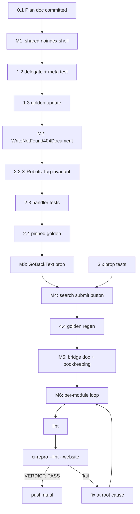

# Plan: NotFound404 Hardening — Document Shell, noindex, i18n Completeness

> Pareto plan per `docs/planning/TEMPLATE.md`. Written 2026-10-14 22:26 CEST.
> Source: architecture review of the 404 implementation in this session (findings
> with file:line evidence below). Format note: rendered as `.md` with a mermaid
> execution graph per explicit request (the pareto-planning skill's HTML default
> was overridden).

## Context

The dedicated 404 page (`errorpage.NotFound404`) is functionally strong — `<main>`
landmark, RTL-logical properties, dark mode, CSP-safe `goBackScript`, test coverage
across a11y/edge/golden/BDD tiers. The review found four gaps:

1. **No standalone document shell (API asymmetry).** `ErrorHandler` has
   `HTMLShell`+`Lang` config producing a full `<!DOCTYPE html>` document
   (`errorpage/handler.go:101`, `renderShellToBuffer` at `handler.go:250`);
   `WriteNotFound404` (`handler.go:190`) always writes a bare `<main>` fragment.
   A consumer without `layout.Base` ships an invalid HTML document. Real-world
   proof: both in-repo consumers hand-roll their own wrapper
   (`website/internal/pages/notfound.templ:29`, `examples/demo/main.go:846`).
2. **No noindex defense.** Neither an `X-Robots-Tag: noindex` header nor a
   `<meta name="robots" content="noindex">` in shell mode. A true-404 status is
   not indexed, but soft-404 misconfigurations (error markup served with 200)
   are the classic footgun; the header is free insurance on every error
   response this module writes.
3. **i18n gap: "Go back" is hardcoded.** `notFound404GoBackText` at
   `notfound404.templ:68` is the only visible string with no prop override.
   The library's i18n contract is "all user-facing strings are props"
   (zero translation deps — dependency budget is closed per AGENTS.md); this
   string breaks the contract.
4. **Search form is Enter-only** (`notfound404.templ:112-130`) — no submit
   button; mobile keyboards show "go" so it works, but there is no clickable
   affordance for pointer users.

i18n direction (user directive): follow the httputil pattern documented in
`~/projects/httputil/docs/integrations/go-i18n.md` — httputil's `Language`
middleware negotiates and stamps `Content-Language` + `Vary`; go-i18n owns
catalogs; the component library stays string-prop-driven and dependency-free.
Templ-components needs (a) the missing prop and (b) a bridge doc showing the
`Localizer → props` wiring. No new imports.

## Goal / non-goals

- Goal: a consumer can serve a **valid, noindex-hardened, fully translatable**
  404 document from this module in one call, with zero new dependencies.
- Non-goals:
  - Importing go-i18n or httputil (dependency budget closed; bridge stays in
    consumer land, documented).
  - Language negotiation inside templ-components (httputil owns it).
  - Redesigning `layout.Base`/skip-link interplay (already coordinated,
    `layout/base.templ:175`).
  - Simplifying the website/demo wrappers to use the new shell (follow-up seed).

## Pareto breakdown

- **1% → 51% of value:** `WriteNotFound404Document` (valid standalone HTML
  document) built on a shared, noindex-meta-bearing shell. Fixes the invalid-HTML
  gap AND the SEO soft-404 defense in one move.
- **4% → 64% of value:** + `X-Robots-Tag: noindex` on every HTML error writer
  (one invariant, tested once) + `GoBackText` prop (i18n contract complete).
- **20% → 80% of value:** + search submit button (clickable affordance) +
  `docs/integrations/go-i18n.md` bridge doc + CHANGELOG/doc.go/FEATURES bookkeeping.
- **Remaining → 100%:** owner-gated follow-ups (listed in Deferred) — website
  wrapper simplification, visual-golden rebaseline if the button design is
  iterated, ErrorPage demo route exercising search.

## Phases (Pareto order: 1% → 4% → 20% → remaining)

### M1 — Shared noindex document shell (medium ~45 min | micros 1.1–1.4)

- What: extract the `handler.go:250` prologue/epilogue into a shared document
  shell helper taking `(title, lang string, noindex bool, content templ.Component)`;
  `renderShellToBuffer` delegates to it with `noindex: true`; shells embed
  `<meta name="robots" content="noindex">` in `<head>`.
- Proof: `TestGoldenHandlerHTMLShell` updated (markup gains the meta line);
  new unit test asserts `noindex` meta present in shell output.
- Checklist:
  - [x] Goldens cover this — `errorpage` HTMLShell golden updated in the same
        edit (name: the pinned handler-shell golden in `errorpage/testdata/`).
  - [x] Wired ⇒ e2e — N/A: no `wire.Action`/`hx-*`/`data-on:*` markup.
  - [x] Counts bump — no new golden files yet (update-only here); M2 adds one,
        bumped there.
  - [x] Demo smoke — no demo endpoint change (waiver: shell is handler-land,
        demo routes unchanged).
- ⫱ Owner gate (resolved by policy, recorded here): `noindex` is **always on**
  for error/404 documents — an indexable error page is an impossible-want; no
  opt-out footgun.

### M2 — `WriteNotFound404Document` + X-Robots-Tag invariant (medium ~40 min | micros 2.1–2.4)

- What: new `WriteNotFound404Document(w, r, props, nonce, lang)` mirroring
  `writeHTMLShell`; `X-Robots-Tag: noindex` header on all HTML error writers
  (`WriteNotFound404`, `WriteNotFound404Document`, `WriteErrorPage`,
  `ErrorHandler` HTML paths, `writeFallbackError`). JSON mode untouched.
- Proof: handler tests — 404 status, header present on all HTML writers,
  document contains `<!DOCTYPE html`, `lang` attribute, meta robots, and the
  nonce'd goBackScript when `ShowGoBack`.
- Checklist:
  - [x] Goldens cover this — new pinned golden for the 404 document path
        (count 329→330, bumped in M6 bookkeeping).
  - [x] Wired ⇒ e2e — N/A (no transport markup).
  - [x] Counts bump — golden +1 → AGENTS.md/FEATURES number lines in M6.
  - [x] Demo smoke — no demo change (waiver as M1).
- ⫱ Owner gate: none — purely additive API, existing signatures unchanged.

### M3 — `GoBackText` prop (medium ~25 min | micros 3.1–3.3)

- What: `NotFound404Props.GoBackText string`, in-template fallback to
  `notFound404GoBackText`, pre-resolved in `DefaultNotFound404Props()`;
  `notfound404.templ:68` renders the prop.
- Proof: default-values test extends; empty-override falls back; substring
  assert for a custom label; goldens unchanged (default text identical).
- Checklist: goldens cover this (unchanged — verified by sweep green);
  wired⇒e2e N/A; counts N/A; demo smoke N/A.

### M4 — Search submit button (medium ~35 min | micros 4.1–4.4)

- What: `type="submit"` icon button positioned at `inset-e-0` inside the
  existing relative wrapper, ≥40px hit target, `utils.TransitionColors` +
  motion-reduce pair, dark + RTL safe; `SearchSubmitLabel` prop (default
  "Search") as its `aria-label`.
- Proof: a11y test (accessible name present), touch-target ≥24px by
  construction; golden sweep regen for search-bearing goldens (`-update` AFTER
  package list, inside `errorpage/`).
- Checklist:
  - [x] Goldens cover this — search-variant goldens updated; visual suite
        unaffected (demo/visual use default props → no search form rendered;
        verified via `visualtest.TestNotFound404` props).
  - [x] Wired ⇒ e2e — N/A (plain GET form, no transport wiring).
  - [x] Counts bump — golden update-only, no file count change (verified).
  - [ ] Demo smoke — waiver: no demo route renders SearchAction; if one is
        added later it rides the standard visual suite.
- ⫱ Owner gate (recorded, non-blocking): the button is a visual design change;
  one CSS/class line reverts it if Lars iterates the design.

### M5 — Bridge doc + bookkeeping (medium ~45 min | micros 5.1–5.5)

- What: `docs/integrations/go-i18n.md` in THIS repo mirroring the httputil
  doc's shape — negotiation stays in httputil, go-i18n owns catalogs, props
  carry strings; worked example localizing `NotFound404` (Title, Message,
  GoHomeText, GoBackText, LinksTitle, SearchPlaceholder, SearchSubmitLabel)
  - `Content-Language`/`Vary` note. Then: `doc.go` API list, FEATURES
    NotFound404 line, CHANGELOG `[Unreleased]`, golden-count drift lines
    (AGENTS.md, FEATURES) if M2 added a file.
- Proof: `utils.TestDocsCountDrift` + `TestVersionMatches*` stay green;
  docs build unaffected (flat markdown).

### M6 — Verification, commit, push ritual (medium ~60 min | micros 6.1–6.5)

- What: errorpage module regen from INSIDE the module dir (`templ generate` —
  go.work gotcha), per-module test loop, errorpage `-update` golden regen,
  `nix run .#lint`, then `scripts/ci-repro.sh --lint --website` at the exact
  tip; M03 push ritual (read `VERDICT: PASS`, push immediately, re-verify tip
  first — the daemon races). Detailed commits: plan doc first, then
  implementation (shell+noindex / i18n prop / search+docs split or single —
  decided at commit time by review size).

## Task tables

### Comprehensive plan (30–100 min tasks, sorted by impact/effort/value)

| #  | Task                                      | Impact     | Effort | Value delivered             |
| -- | ----------------------------------------- | ---------- | ------ | --------------------------- |
| M1 | Shared noindex document shell             | 51% core   | ~45m   | Valid standalone HTML       |
| M2 | `WriteNotFound404Document` + X-Robots-Tag | 51% core   | ~40m   | One-call 404 doc + SEO      |
| M3 | `GoBackText` prop                         | 64% core   | ~25m   | i18n contract complete      |
| M4 | Search submit button                      | 80% polish | ~35m   | Clickable search affordance |
| M5 | go-i18n bridge doc + all bookkeeping      | 80% docs   | ~45m   | Consumer onboarding         |
| M6 | Verify + commit + push ritual             | process    | ~60m   | Green CI, pushed master     |

### Micro breakdown (≤12 min each, execution order)

| #   | Micro task                                                         | Parent |
| --- | ------------------------------------------------------------------ | ------ |
| 0.1 | Write this plan doc + commit                                       | —      |
| 1.1 | Extract `renderDocumentShell(title, lang, noindex, content)`       | M1     |
| 1.2 | Delegate `renderShellToBuffer`; add meta-robots assert test        | M1     |
| 1.3 | Update pinned HTMLShell golden (meta line)                         | M1     |
| 1.4 | `go build` + errorpage tests green                                 | M1     |
| 2.1 | `WriteNotFound404Document` + lang/noindex shell wiring             | M2     |
| 2.2 | `X-Robots-Tag` on all HTML error writers + fallback                | M2     |
| 2.3 | Handler tests: status/header/document/nonce                        | M2     |
| 2.4 | New pinned 404-document golden + sweep regen                       | M2     |
| 3.1 | `GoBackText` field + consts + `DefaultNotFound404Props`            | M3     |
| 3.2 | `.templ` fallback + render prop; regenerate errorpage              | M3     |
| 3.3 | Tests (default/override/fallback) + sweep green                    | M3     |
| 4.1 | `SearchSubmitLabel` prop + consts + defaults                       | M4     |
| 4.2 | Submit button markup (inset-e-0, hit box, motion-reduce, dark/RTL) | M4     |
| 4.3 | Regenerate; update a11y + search tests                             | M4     |
| 4.4 | Golden regen for search variants (`-update` inside module)         | M4     |
| 5.1 | Write `docs/integrations/go-i18n.md`                               | M5     |
| 5.2 | Update `doc.go`, FEATURES errorpage line                           | M5     |
| 5.3 | CHANGELOG `[Unreleased]` entries                                   | M5     |
| 5.4 | Golden-count drift lines (AGENTS.md, FEATURES)                     | M5     |
| 5.5 | Commit implementation                                              | M5     |
| 6.1 | Per-module test loop + errorpage golden sweep                      | M6     |
| 6.2 | `nix run .#lint` per-module set                                    | M6     |
| 6.3 | `scripts/ci-repro.sh --lint --website` at tip                      | M6     |
| 6.4 | Commit leftovers (guard mirror/.gitignore check)                   | M6     |
| 6.5 | Push ritual (VERDICT → immediate push → verify tip)                | M6     |

## Execution graph

## Verification (whole plan)

- [ ] Per-module loop green: `for mod in utils icons errorpage charts/echarts datastar htmx; do (cd "$mod" && GOWORK=off go test ./...); done`
- [ ] Errorpage golden sweep green after `-update` (flag AFTER package list, inside module dir)
- [ ] `nix run .#lint` clean on touched packages
- [ ] `scripts/ci-repro.sh --lint --website` → `VERDICT: PASS (exit 0)` at the exact pushed tip
- [ ] CHANGELOG `[Unreleased]` warm; golden-count drift lines bumped in the same edits
- [ ] `_sources` mirror synced by guard; no re-added `*.templ.go` ignore line survives commits

## Deferred / follow-through seeds

- Simplify `website/internal/pages/notfound.templ` wrapper onto the new
  document shell (needs website deploy cycle — separate task).
- Demo route rendering `SearchAction` so the search variant gets pixel + axe
  coverage in the standard suite.
- `ErrorPage` shell `Lang` propagation parity check (out of scope here).
- If button design iterates: visual-golden rebaseline via
  `nix run .#visual -- -update` only (never bare `-update`).
