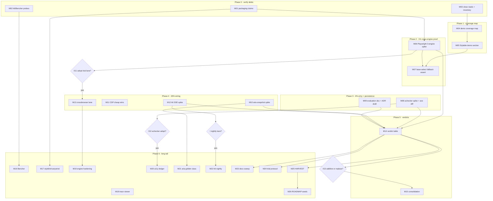

# UI Testing Tooling Adoption — Pareto Plan (2026-10-15 00:05)

**Scope:** Everything from the 2026-10-14 session: the open-source UI/UX/Web testing tool
research (verified-facts answer) and its status report
(`docs/status/2026-10-14_23-59_ui-testing-tool-research-status.md`, §f items 1–50).
Point-in-time snapshot; `TODO_LIST.md` stays the living source (new items #411–#420
registered there alongside this plan).

**Input sources:** 2026-10-14 research session (5 verified fetches) · status report §a–§g ·
repo state verified 2026-10-15 00:05 (see Context).

**Override note:** `pareto-planning` skill default is a styled HTML report with an inlined
D2 SVG; the owner explicitly requested `.md` with a mermaid.js/d2 graph — honored (same
precedent as `docs/planning/2026-09-17_06-00_RELEASE-FIRST-PARETO-MASTER-PLAN.md`).
Micro-task cap tightened 15 min → **12 min** per owner instruction.

---

## Context

What exists today (verified by direct inspection, 2026-10-15 00:05):

- **visualtest/** is a mature chromedp module: ~30 e2e/visual test files, axe sweep with a
  default-FAIL baseline ledger, keyboard traversal tests (`keyboard_traversal_test.go` —
  keyboard-walkthrough coverage ALREADY EXISTS; extend, don't create), route goldens,
  demo smoke tooling, flake-retry harness.
- **Rendering is Chromium-only.** No WebKit/Gecko coverage anywhere. `appearance:
  base-select` (used by `forms.Select` `Stylable`) is **unsupported in Firefox** (verified:
  Mozilla Bug 1944403/1958443, still unshipped ~FF 157–161) — the fallback path is
  completely untested.
- **`Stylable` has ZERO references in `examples/demo/`** (rg, 2026-10-15) — there is no
  demo route exercising the one component whose cross-engine behavior is riskiest.
- **Node precedent:** `website.yml` runs ephemeral `npm install --no-save
  tailwindcss@4.3.3` (no tracked `package.json` anywhere in the repo). Node-in-CI exists
  but only as an ephemeral, unpinned install — a Playwright/achecker suite would be the
  first _real_ Node surface.
- **k6 SSE:** native support closed as "not planned" (Nov 2025); `xk6-sse` community
  extension is the blessed path. Demo SSE through Firebase buffers indefinitely (#329,
  owner-gated) — any load test must target the demo Go binary / raw run.app URL directly.
- **Coverage gate:** #28 (awesome-templ PR) is blocked on library coverage 72.1% vs 80%.
  NOTE: the tools in this plan add _browser-level_ checks, not Go statement coverage —
  they do NOT unblock #28 (explicit non-goal, listed to prevent false hope).
- Lost Pixel is dead (archived 2026-04-22, team → Figma) — verified; must not resurface.

What hurts: progressive-enhancement claims ("it degrades gracefully") are Chromium-proven
only; a11y is single-engine (axe-core); SSE/reconnect behavior under load is untested;
benchmark trends are eyeballed, not tracked.

## Goal / non-goals

- **Goal:** A decided, evidence-backed adoption set of open-source UI testing tools
  (or a justified rejection), with the highest-value coverage — cross-engine rendering,
  second a11y opinion, SSE load, aria-level goldens — wired as low-maintenance lanes and
  recorded in ADR/TODO_LIST so the decision compounds.
- **Non-goals:**
  - Replacing the chromedp suite inside this plan — that is an owner-gated _outcome_
    (M14/M15), not a precondition.
  - Bumping Go statement coverage (#28 gate) — browser tools don't move that number.
  - Screen-reader automation (Guidepup/NVDA) — Windows-runner cost; ROADMAP seed only.
  - Any new CI lane without a named owner and kill-criteria (tooling budget, M24).

---

## 1. Pareto Breakdown

### The 1% that delivers 51% — PROVE (OR KILL) CROSS-ENGINE COVERAGE

**→ M01 + M06: verify the Nix packaging claim, then run Playwright Firefox+WebKit
full-page screenshots over the EXISTING demo routes, and write the verdict.**

The single biggest unknown in the whole tooling question is whether multi-engine
testing is even practical in this Nix/Go repo. ~2.5h answers it with artifacts
(screenshots + a finding list). Everything else in this plan is worth less than this
proof: if WebKit/Gecko screenshots of the demo are practical and surface real findings,
the adoption thesis stands; if it's a packaging quagmire, the whole shortlist reshapes
(container-based CI, or reject). No other task changes a decision this much.

### The 4% that delivers 64% — MAKE THE PROOF SPECIFIC AND PERMANENT

**→ Add M04 (demo coverage map), M05 (Stylable select demo section), M07 (base-select
Firefox fallback assert), M08 (IBM achecker spike + axe diff), M09 (persist evaluation
doc + ADR draft).**

The 1% proves engines run; these five make the proof _about our components_ (the riskiest
one has no demo route today), add the second a11y engine's independent findings, and
persist every verdict so the next session doesn't re-research. Demo gap → targeted assert
→ decision record = 64%.

### The 20% that delivers 80% — CHEAP WINS, LOAD, AND WIRING

**→ Add M02, M03, M10, M11, M12, M13, M25:** k6/Bencher probe notes, close the partial
skill read + harness inventory (extend-not-duplicate map), aria-snapshot goldens spike,
CDP cheap wins inside the EXISTING visualtest (vision-deficiency, reduced-motion, print),
k6 SSE load spike against the demo binary, the `nix run .#crossbrowser` lane (owner-gated),
and the docs-health HARVEST that lands all of it in TODO_LIST/AGENTS.md.

### The remaining 80% — VERDICT EXECUTION, LONG TAIL, ROADMAP SEEDS

M14–M24 + M26: owner verdict meeting, consolidation execution, Bencher/stylelint/
trace-viewer spikes, cross-engine hardening, second a11y ledger, k6 nightly, aria-golden
class integration, docs sweep (compat facts, dead-tool note, rejected-tools log),
tool-trial protocol with kill-criteria, and the ROADMAP backlog seeds (parity contracts,
keyboard EXTENSION, Guidepup, HTTP contract tests, sampling economics, chaos, re-verify
reminder). Small or slow individually — explicitly NOT allowed to block the 1%.

**Sequencing rule:** 1% → 4% → 20% → 80%. Owner gates (⫱G1–⫱G4) are planned **to the
gate edge** so zero planning time is wasted waiting.

---

## 2. Comprehensive Plan (medium tasks, 30–100 min each)

> Format per `docs/planning/TEMPLATE.md`. Checklist gates (goldens / wired⇒e2e / counts
> same-edit / demo smoke) answered per task; research-only tasks carry `n/a` + reason.
> Micro breakdown (≤12 min, ALL tasks) is §3; execution graph is §4.

### Phase 0 — Verify session debts (no code)

**M01 — Verify packaging & cheap-win claims (60 min)** · f-1..f-5

- What: fetch/verify (a) nixpkgs `playwright-driver.browsers` usable for Node Playwright,
  (b) rustywind maintenance + packaging, (c) stylelint + Tailwind v4 at-rules feasibility,
  (d) chromedp surface for CDP `Emulation.setEmulatedVisionDeficiency` + media emulation.
  Output: updated verified-facts table in the evaluation doc; go/no-go per claim.
- Proof: each claim marked verified-with-source or demoted/rejected.
- Checklist: n/a — research only, no markup/endpoint change.

**M02 — k6 extension probe + Bencher cost note (45 min)** · f-6, f-8

- What: confirm `xk6-sse` resolves via k6 automatic extension resolution; one-paragraph
  Bencher self-host cost/benefit vs benchstat+baselines for the 7 benchmark packages.
- Proof: probe transcript + note in evaluation doc.
- Checklist: n/a — research only.

**M03 — Close reads + harness inventory (45 min)** · f-9, f-10

- What: read `templ-components` SKILL.md past line 200 to EOF; inventory visualtest
  harness capabilities (harness.go, poll.go, keyboard_traversal_test.go, axe.go,
  flake_retry_test.go) into an extend-not-duplicate map for later tasks.
- Proof: inventory table in evaluation doc; skill gate closed.
- Checklist: n/a — docs only.

### Phase 1 — Coverage map + demo gap (prereq for targeted spikes)

**M04 — Demo coverage map (60 min)** · f-10, status-report question 3

- What: authoritative map of `examples/demo/pages.go` (`demoPageMeta` set) vs the 136
  components; list unrepresented components (confirmed so far: `Stylable` select);
  write `docs/testing/demo-coverage-map.md` with a keep-gap/waive-gap verdict per gap.
- Proof: map committed; every one of the 136 components accounted for.
- Checklist: n/a — docs only (no markup change).

**M05 — Stylable select demo section (75 min)** · f-13 prereq

- What: add a demo section exercising `forms.Select` `Stylable` (base-select path +
  native fallback note). New demo content = auto axe audit + route golden.
- Proof: demo route renders; axe clean or ledgered; route golden added.
- Checklist:
  - [x] **Goldens cover this** — new route golden captured in this task (name it in PR).
  - [x] **Wired ⇒ e2e** — no `wire.Action`/hx-_/data-on:_ on this section; waiver:
        static form control, chromedp e2e covered by M07's fallback assertion instead.
  - [x] **Counts bump in the same edit** — demo route count lines in site data /
        FEATURES if enumerated (verify with `utils.TestDocsCountDrift`).
  - [x] **Demo smoke is a gate** — `visualtest/tools/smoke` run before done.

### Phase 2 — THE 1%: cross-engine proof

**M06 — Playwright 3-engine spike (90 min)** · f-11

- What: standalone spike (NOT repo-integrated): Playwright script + WebKit + Firefox +
  Chromium full-page screenshots of all demo routes at pinned theme (localStorage +
  reload — headless dark-default gotcha). Depends on M01's packaging verdict.
- Proof: 3× route artifact set + findings list (any engine-specific breakage named).
- Checklist: n/a — read-only over existing routes; no markup change.

**M07 — base-select Firefox fallback assert (45 min)** · f-12, f-13

- What: assertion over the M05 section: in Firefox the select falls back to native
  rendering without layout breakage (screenshot + computed-style check).
- Proof: assertion passes; finding recorded (degraded-but-usable or bug filed).
- Checklist: [x] demo smoke rerun after any M05 fix-ups.

### Phase 3 — THE 4%: second a11y engine + persistence

**M08 — IBM accessibility-checker spike (60 min)** · f-15

- What: `npx achecker` (or Playwright adapter) over demo routes; diff its finding
  classes vs the axe baseline ledger; classify: new-real / known / noise.
- Proof: finding-class diff table in evaluation doc.
- Checklist: n/a — read-only audit.

**M09 — Persist decision artifacts (45 min)** · f-33, f-34

- What: write `docs/testing/tooling-evaluation.md` (verified facts + spike results +
  verdicts-in-progress) and draft the ADR (adopt/reject matrix, placeholders for ⫱G1–G3).
- Proof: both docs committed; ADR numbered per `docs/adr/` convention.
- Checklist: n/a — docs only.

### Phase 4 — THE 20%: cheap wins, load, integration

**M10 — aria-snapshot goldens spike (60 min)** · f-14

- What: Playwright `toMatchAriaSnapshot()` on representative components: Table
  (`aria-sort`), Modal (`role=dialog`), Dropdown/Popover (`aria-expanded`), Tabs.
- Proof: 4 snapshots + one intentional regression demo showing the catch.
- Checklist: n/a — spike; integration gated on verdict (M21).

**M11 — CDP cheap wins into visualtest (75 min)** · f-18, f-19, f-20

- What: add to the existing chromedp suite: (a) vision-deficiency pass
  (achromatopsia/deuteranopia) over existing visual routes, (b) reduced-motion emulation
  assert on one animated component, (c) print-media rendering probe for Table/Card.
- Proof: new tests green; findings logged (print findings likely → follow-ups).
- Checklist: [x] counts — if new goldens result, doc numbers bump in the SAME edit;
  [x] no new endpoints; demo smoke unaffected.

**M12 — k6 SSE load spike (75 min)** · f-16

- What: k6 + `xk6-sse` scenario against the demo binary's LiveRegion endpoint DIRECTLY
  (#329: Firebase buffers — never target the canonical URL); steady-state + reconnect
  - client-drop profile.
- Proof: load report (latency, stream continuity, reconnect behavior).
- Checklist: n/a — external load tool, no repo change yet.

**M13 — `nix run .#crossbrowser` app + CI lane (90 min)** · f-23, f-24 — ⫱G1 after M06

- What: flake app wrapping the M06 spike as a repeatable command; optional non-blocking
  GitHub Actions lane with diff-artifact upload on failure.
- Proof: `nix run .#crossbrowser` reproducible from clean clone; lane green.
- Checklist: [x] counts — any new golden artifacts bump doc numbers same-edit;
  [x] no demo endpoint change; [x] lane kill-criteria written (see M24).

### Phase 5 — Verdicts & consolidation (owner-gated)

**M14 — Verdict meeting doc (45 min)** · f-25 — ⫱G2, ⫱G3

- What: per-tool verdict table (adopt / trial / reject) with evidence links; explicit
  additive-vs-replacement recommendation for chromedp vs Playwright.
- Proof: verdict section in ADR; ⫱G1–G3 posed to Lars in one message.
- Checklist: n/a — decision doc.

**M15 — Execute consolidation decision (90 min)** · f-25 — ⫱G3

- What: EITHER keep chromedp + Playwright cross-engine-only (document boundary) OR plan
  the chromedp→Playwright migration (separate plan; never two long-term pixel suites).
- Proof: boundary documented in ADR; no duplicate pixel suites remain.

### Phase 6 — The remaining 80% (never blocks the 1%)

**M16 — Bencher single-package spike (60 min)** · f-17 — gated on M02 verdict

- What: self-hosted (or cloud-free CLI) Bencher tracking ONE benchmark package; decide
  keep/kill by kill-criteria (M24).
- Proof: one tracked benchmark with history + kill decision recorded.

**M17 — stylelint + rustywind trial (40 min)** · f-21, f-2

- What: stylelint inventory run over `templates/custom.css` + `examples/demo/demo.css`;
  rustywind class-sort trial on `.templ` sources (dry-run diff only).
- Proof: findings inventory; adopt/reject note (rejected items → rejected-tools log).

**M18 — Trace-viewer debugging aid (40 min)** · f-22

- What: reproduce one flaky-prone chromedp e2e under Playwright trace viewer; evaluate
  as debugging aid only (not a port).
- Proof: trace artifact + keep/drop note.

**M19 — Cross-engine hardening (60 min)** · f-31, f-32 — gated on M13

- What: theme pinning + fontconfig needs for WebKit/Gecko in the nix env; viewport
  policy (below-`xl:` route-golden caveat applied to new engine captures).
- Proof: deterministic 3-engine captures on repeat runs.

**M20 — Second a11y ledger (60 min)** · f-26 — gated on M08/⫱G2

- What: achecker ledger with its OWN semantics (Violation / Needs review /
  Recommendation) — never shoehorned into `axe_baseline.json`.
- Proof: ledger file + wiring + one documented finding flow.

**M21 — aria-golden class integration (75 min)** · f-29, f-30 — gated on M10 verdict

- What: promote aria snapshots to a maintained golden class: `-update` workflow docs,
  `TestDocsCountDrift` same-edit bump, golden-count lines in AGENTS.md/FEATURES.
- Proof: new golden class counted; drift guard green with `-count=1`.

**M22 — k6 nightly lane + SSE matrix (75 min)** · f-27, f-28 — gated on M12/⫱

- What: nightly (never pre-push) k6 job; test matrix: steady stream, reconnect
  (`LiveRegionProps.Retry`), client-drop.
- Proof: scheduled run green; matrix documented.

**M23 — Docs sweep (45 min)** · f-35, f-36, f-37, f-40

- What: record `field-sizing` (all engines, Baseline Newly Available Jun 2026) +
  `base-select` (Firefox-unsupported) in the compat/docs surface; consider the
  progressive-enhancement support matrix; Lost Pixel dead-tool note; rejected-tools log.
- Proof: docs updated; dead tools can no longer be re-recommended innocently.

**M24 — Tool-trial protocol + CI budget (45 min)** · f-39, f-49

- What: write the standing protocol (spike → verdict → ADR → integrate OR
  log-rejection) + per-lane owner + kill-criteria table (tooling budget).
- Proof: protocol doc committed; every lane from this plan has a row.

**M25 — docs-health HARVEST (60 min)** · f-38

- What: pull remaining plan items into TODO_LIST/ROADMAP with IDs; update AGENTS.md
  Testing section ONLY for adopted tools; FEATURES/ROADMAP touches.
- Proof: TODO_LIST IDs referenced from this plan; AGENTS.md accurate or untouched.

**M26 — ROADMAP backlog seeds (45 min)** · f-41..f-48, f-50

- What: seed ROADMAP with: per-component engine parity contracts, keyboard-walkthrough
  EXTENSION of `keyboard_traversal_test.go` (exists — extend), Guidepup (parked),
  htmx-fragment HTTP contract tests, Lighthouse revisit criteria, engine×component
  sampling economics, Datastar reconnect chaos, golden-churn tracking, 6-month
  re-verification reminder for tool states.
- Proof: ROADMAP entries with source links to this plan.

---

## 3. Detailed Breakdown (micro tasks, ≤12 min each — ALL tasks covered)

### Phase 0

| ID  | Task (≤12 min)                                                                     | M   | Output                       |
| --- | ---------------------------------------------------------------------------------- | --- | ---------------------------- |
| μ01 | Fetch nixpkgs `playwright-driver` attr + recent usage reports                      | M01 | packaging verdict draft      |
| μ02 | Probe: minimal Node playwright-core + driver browsers in `nix shell`               | M01 | works / fails + transcript   |
| μ03 | Fetch rustywind repo status + packaging (npm/nix)                                  | M01 | claim verdict                |
| μ04 | Fetch stylelint TWv4 at-rule support; grep chromedp CDP emulation surface          | M01 | 2 claim verdicts             |
| μ05 | Install/resolve k6 + xk6-sse via automatic extension resolution                    | M02 | resolved binary + transcript |
| μ06 | Write Bencher self-host cost note (storage, server, effort) vs benchstat baseline  | M02 | evaluation-doc paragraph     |
| μ07 | Read templ-components SKILL.md lines 200–EOF                                       | M03 | gate closed                  |
| μ08 | Skim harness.go + poll.go; list existing helpers                                   | M03 | inventory rows               |
| μ09 | Skim keyboard_traversal_test.go + axe.go + flake_retry_test.go; mark extend-points | M03 | extend-not-duplicate map     |

### Phase 1

| ID  | Task (≤12 min)                                                                        | M   | Output             |
| --- | ------------------------------------------------------------------------------------- | --- | ------------------ |
| μ10 | Parse pages.go: extract full demoPageMeta route list                                  | M04 | route table        |
| μ11 | Cross-route table vs 136-component catalogue (display/forms/feedback/layout/nav/htmx) | M04 | gap list draft     |
| μ12 | Verify each gap: real gap vs covered-via-composition (grep rendered demo HTML)        | M04 | verified gap list  |
| μ13 | Write docs/testing/demo-coverage-map.md (gaps + waive reasons)                        | M04 | committed map      |
| μ14 | Design Stylable demo section (props variants: Stylable on/off, error, groups)         | M05 | section spec       |
| μ15 | Implement section markup + register route in pages.go                                 | M05 | route live         |
| μ16 | `templ generate` + build + `visualtest/tools/smoke` on the new route                  | M05 | smoke green        |
| μ17 | Capture route golden; run axe audit; ledger or fix findings                           | M05 | golden + axe clean |
| μ18 | Bump demo-route count lines same-edit (TestDocsCountDrift probe with -count=1)        | M05 | drift guard green  |

### Phase 2 — the 1%

| ID  | Task (≤12 min)                                                                             | M   | Output               |
| --- | ------------------------------------------------------------------------------------------ | --- | -------------------- |
| μ19 | Scaffold spike dir (tools/crossbrowser-spike): package manifest + playwright-core          | M06 | runnable scaffold    |
| μ20 | Wire chromium + firefox + webkit launches from driver browsers                             | M06 | 3 browsers launch    |
| μ21 | Route lister: read demo routes from pages.go (single source of truth)                      | M06 | route manifest       |
| μ22 | Screenshot loop: full-page, pinned theme via localStorage + reload                         | M06 | chromium set         |
| μ23 | Repeat loop for Firefox; collect console/pageerrors per route                              | M06 | firefox set + errors |
| μ24 | Repeat loop for WebKit; collect console/pageerrors per route                               | M06 | webkit set + errors  |
| μ25 | Diff triage: name engine-specific findings; classify real/cosmetic                         | M06 | findings list        |
| μ26 | Write spike verdict (practical? findings? effort estimate?) → ⫱G1 material                 | M06 | verdict doc          |
| μ27 | Firefox assert: Stylable select renders native fallback (computed appearance + screenshot) | M07 | assertion result     |
| μ28 | Layout sanity on fallback (no overflow/breakage) + finding writeup                         | M07 | fallback verdict     |
| μ29 | If broken: minimal repro note → upstream/consumer-doc follow-up seed                       | M07 | follow-up seed       |

### Phase 3 — the 4%

| ID  | Task (≤12 min)                                                                   | M   | Output                |
| --- | -------------------------------------------------------------------------------- | --- | --------------------- |
| μ30 | Install accessibility-checker; config file for demo URL list                     | M08 | achecker runs         |
| μ31 | Scan all demo routes; capture raw report                                         | M08 | findings JSON         |
| μ32 | Map achecker finding classes → axe baseline entries (overlap table)              | M08 | diff table            |
| μ33 | Classify: new-real / known-ledgered / noise; flag any new-real for immediate fix | M08 | classified list       |
| μ34 | Write docs/testing/tooling-evaluation.md skeleton (verified facts + spike slots) | M09 | eval doc live         |
| μ35 | Fill M01–M08 results into eval doc; source links inline                          | M09 | evidence-complete doc |
| μ36 | Draft ADR (adopt/reject matrix; ⫱G1–G3 placeholders; alternatives section)       | M09 | ADR draft             |

### Phase 4 — the 20%

| ID  | Task (≤12 min)                                                                  | M   | Output              |
| --- | ------------------------------------------------------------------------------- | --- | ------------------- |
| μ37 | Write aria snapshot for Table route (aria-sort)                                 | M10 | snapshot 1          |
| μ38 | Snapshot Modal (role=dialog) + Dropdown/Popover (aria-expanded)                 | M10 | snapshots 2–3       |
| μ39 | Snapshot Tabs; commit all four under spike dir                                  | M10 | snapshot 4          |
| μ40 | Regression demo: mutate one ARIA attr → assert catch → revert                   | M10 | proof-of-catch      |
| μ41 | chromedp CDP vision-deficiency helper (achromatopsia) + run on 3 visual routes  | M11 | helper + captures   |
| μ42 | Deuteranopia pass; triage any contrast bombs                                    | M11 | captures + findings |
| μ43 | Reduced-motion emulation assert on one animated component                       | M11 | test green          |
| μ44 | Print-media probe: Table + Card render check                                    | M11 | probe screenshots   |
| μ45 | Log print findings; seed follow-ups (print stylesheet?) or waive                | M11 | findings note       |
| μ46 | k6 script: steady-state SSE scenario vs demo binary (direct URL, NOT canonical) | M12 | scenario file       |
| μ47 | Reconnect + client-drop scenarios (LiveRegionProps.Retry path)                  | M12 | 2 more scenarios    |
| μ48 | Run profiles; record latency/continuity numbers                                 | M12 | load report         |
| μ49 | Verdict note: worth a nightly lane? kill-criteria draft                         | M12 | verdict paragraph   |
| μ50 | Promote spike → flake app `.#crossbrowser` (nix wiring)                         | M13 | nix run works       |
| μ51 | Determinism pass: repeat run → identical captures (theme/font pinning)          | M13 | stable diff         |
| μ52 | Optional GH Actions lane (non-blocking) + artifact upload                       | M13 | lane green          |
| μ53 | Write lane kill-criteria row (budget table entry)                               | M13 | budget row          |
| μ54 | HARVEST pass 1: TODO_LIST registration check (#411–#420 accurate)               | M25 | TODO_LIST true      |

### Phase 5 — verdicts & consolidation

| ID  | Task (≤12 min)                                                           | M   | Output                 |
| --- | ------------------------------------------------------------------------ | --- | ---------------------- |
| μ55 | Fill verdict table: per-tool adopt/trial/reject + evidence links         | M14 | verdict table          |
| μ56 | Write additive-vs-replacement recommendation (chromedp vs Playwright)    | M14 | recommendation section |
| μ57 | Pose ⫱G1–G3 to Lars in ONE message (gate-edge prep, zero idle waiting)   | M14 | gate message           |
| μ58 | Execute ⫱G3 outcome: document pipeline boundary (ADR edit)               | M15 | boundary section       |
| μ59 | OR: draft migration plan skeleton (if replacement chosen)                | M15 | plan skeleton          |
| μ60 | Delete/retire anything the verdict kills (spike scaffolds, dead options) | M15 | no zombie tooling      |

### Phase 6 — long tail

| ID  | Task (≤12 min)                                                                                  | M   | Output                  |
| --- | ----------------------------------------------------------------------------------------------- | --- | ----------------------- |
| μ61 | Bencher: track ONE benchmark package end-to-end                                                 | M16 | tracked benchmark       |
| μ62 | Bencher keep/kill verdict per kill-criteria                                                     | M16 | verdict note            |
| μ63 | stylelint run over custom.css + demo.css; triage findings                                       | M17 | findings inventory      |
| μ64 | rustywind dry-run diff on .templ sources; adopt/reject note                                     | M17 | verdict note            |
| μ65 | Re-run one flaky-prone e2e under Playwright trace viewer                                        | M18 | trace artifact          |
| μ66 | Keep/drop note: trace viewer as standard debugging aid?                                         | M18 | verdict note            |
| μ67 | WebKit/Gecko fontconfig needs in nix env; pin if required                                       | M19 | deterministic fonts     |
| μ68 | Viewport policy applied to engine captures (below-xl: caveat)                                   | M19 | policy doc row          |
| μ69 | Repeat-determinism check: 3 consecutive runs identical                                          | M19 | stability proof         |
| μ70 | achecker ledger schema (Violation/Needs-review/Recommendation)                                  | M20 | ledger schema           |
| μ71 | Wire achecker into lane with ledger; document one finding flow                                  | M20 | working ledger          |
| μ72 | Promote aria snapshots to golden class: -update workflow docs                                   | M21 | docs section            |
| μ73 | TestDocsCountDrift same-edit bump + golden count lines (AGENTS/FEATURES)                        | M21 | guards green (-count=1) |
| μ74 | k6 nightly job + matrix doc (steady/reconnect/drop)                                             | M22 | nightly green           |
| μ75 | Compat facts into docs: field-sizing (all engines) + base-select (no Firefox)                   | M23 | docs updated            |
| μ76 | Support-matrix decision: adopt or waive (reason recorded)                                       | M23 | decision note           |
| μ77 | Lost Pixel dead-tool note + rejected-tools log seed                                             | M23 | notes committed         |
| μ78 | Tool-trial protocol doc (spike→verdict→ADR→integrate/reject)                                    | M24 | protocol doc            |
| μ79 | CI tooling budget table: lane → owner → kill-criteria                                           | M24 | budget table            |
| μ80 | HARVEST: remaining open items → TODO_LIST/ROADMAP with IDs                                      | M25 | TODO_LIST updated       |
| μ81 | AGENTS.md Testing section update — ONLY adopted tools                                           | M25 | AGENTS.md accurate      |
| μ82 | ROADMAP seeds: parity contract, keyboard EXTENSION, Guidepup, contract tests                    | M26 | ROADMAP entries         |
| μ83 | ROADMAP seeds: Lighthouse criteria, sampling economics, chaos, golden-churn, re-verify reminder | M26 | ROADMAP entries         |
| μ84 | Final: full plan verification checklist ticked; stale notes annotated                           | all | verified plan           |

**Coverage check:** 84 micro tasks; every medium task M01–M26 has ≥2 micro rows; every
status-report §f item (1–50) maps to ≥1 medium task (see task annotations f-N).

---

## 4. Execution Graph

---

## Verification (whole plan)

> **Executed 2026-10-15** (this session): M01–M26 complete. M06's 3 CSP findings
> FIXED (incl. the CSP-safe `data-tc-overlay-trigger` library feature); M08 achecker
> caught demo-wide duplicate ids — fixed, −23% findings; M11 emulation tests
> integrated in `visualtest`; M13 delivered to the ⫱G1 edge (flake app + determinism
> proof + dispatch-only CI draft). Verdicts: `docs/testing/tooling-evaluation.md` §6;
> decision record: ADR 0048; protocol + budget: `docs/testing/tool-trial-protocol.md`;
> engine matrix: `docs/browser-support.md`; spike findings → TODO #421–#424.
> ⫱G1–⫱G4 POSED to the owner (see `docs/status/2026-10-15_17-10_ui-testing-plan-execution-status.md` §g for the original questions; the final gate report supersedes it).

- [x] Phase-0/1 tasks: no build impact expected; any repo edit re-runs the per-module loop
      `for mod in utils icons errorpage charts/echarts datastar htmx; do (cd "$mod" && GOWORK=off go test ./...); done`
- [x] M05/M13/M21 edits: `scripts/ci-repro.sh --lint --website` at the exact commit (M03 ritual) before push
- [x] M05: demo smoke + axe + route golden green
- [x] M11/M21: drift guards re-run with `-count=1` (file-reading guards)
- [x] CHANGELOG `[Unreleased]` stays warm for any consumer-visible change (`data-tc-overlay-trigger` from the M06 fix)
- [x] Every ⫱ gate planned to the gate edge — nothing idles waiting on Lars

## Guardrails (anti-Verschlimmbesserung)

1. **Never two long-term pixel suites.** Playwright lands cross-engine OR replaces — ⫱G3 decides; until then spikes live outside the repo's test surface.
2. **No new lane without owner + kill-criteria** (M24 table is the register).
3. **Counts bump in the same edit** as any new golden/route (TestDocsCountDrift is predictive, not reactive).
4. **Pre-push ritual untouched:** k6 never enters `ci-repro.sh`; crossbrowser lane stays non-blocking until ⫱G3.
5. **Dead tools stay dead:** Lost Pixel and friends go to the rejected-tools log, not the backlog.
6. **Demo SSE load targets the Go binary / raw run.app URL** (#329) — never the canonical buffered URL.

## Deferred / follow-through seeds

- Print-stylesheet findings from M11 (likely follow-ups; IDs on harvest).
- Upstream base-select Firefox tracking (Mozilla bugs 1944403/1958443) — revisit at M07.
- #329 SSE domain decision interacts with M22's nightly target — plan to the gate edge.
- Coverage 72.1% → 80% (#28) remains a Go-statement-coverage effort; separate plan.
- Tool-state re-verification reminder (M26): re-check all verified facts if adoption slips past ~6 months.
