# ALL-TODOS MASTER PARETO PLAN — 2026-10-15 20:00

**Scope:** every open item in `TODO_LIST.md` (IDs ≤ 433) + this session's color domain-model follow-ups (#425–#433, harvested from `docs/reviews/2026-10-15_color-domain-model.html`). Sources: `TODO_LIST.md` @ v1.23.0, `docs/planning/2026-10-15_00-05_UI-TESTING-TOOLING-PARETO-PLAN.md` (M/μ numbering preserved where reused), `docs/planning/2026-10-10_06-06_extraction-backlog-pareto-master-plan.md` (T1/T2 references).

**Sort key:** importance = customer-value × impact ÷ effort. Customer = library consumers (correctness > determinism > DX > docs > polish). Blocked/⫱/separate-repo/v2 items are sequenced into gates G1–G6, not dropped — the "other 20%" to reach 100%.

**Guardrails (do not verschlimmbessern):**

- No breaking API changes outside the v2 gate (ADR-0039). All color work in M07/M08/M16/M17 is additive or internal.
- Wired component ⇒ e2e in the same task (repo plan-authoring checklist).
- Golden/visual re-baselines happen at most TWICE repo-wide: (1) the templ 0.3.1070 + size-* window (M14/M15), (2) the v2 class swap (#431). Nothing else re-baselines pixels.
- Verify ritual before any push: `scripts/ci-repro.sh --lint --css --website` at the exact commit, read "VERDICT: PASS", push immediately (M03 ritual).
- Parallel-session hazard is LIVE (a sibling session added #424 at 20:02): re-read files before every edit; single-writer rule (#357).

---

## Step 1 — Pareto Breakdown

### The 1% that delivers 51%

1. **#413 Playwright 3-engine spike** — proves or kills cross-engine coverage for a Chromium-only library; its findings list IS the adoption thesis (designated THE 1% by the tooling plan).
2. **The four shipped defects: #421, #422, #423 (invalid ARIA found by achecker) + #424 (zero print styling)** — correctness bugs visible to real users today, each a small fix.
3. **#356 CI runner hygiene** — pin vnu.jar, concurrency groups, setup-go dedup: stops the recurring CI fires that burned multiple sessions.
4. **#271 + #362** — kill the two standing classes of nondeterminism (live-stars fetch, hand-typed hero count).

### The 4% that delivers 64% (adds to the above)

5. **#425 `utils/tone` Phase 0** — the foundation that makes 8 other tasks (#426–#433, #330/#428) mechanical instead of archaeological.
6. **#426 + #427** — typed chart colors + derived guard hue list: close the two silent-failure holes (typo class = invisible default; 7 hues escape the dark-mode scan).
7. **#412 + #418 + #420** — verify packaging claims, persist the tooling evaluation, write the trial protocol: spike knowledge stops dying with sessions.
8. **#414 + #415 + #416** — demo coverage map + the Stylable demo route + Firefox base-select fallback: the riskiest cross-engine component goes from folklore to pinned.
9. **#330 + #428** — WCAG text-tone tail + the warning amber/yellow split-brain (two hues for one semantic on one page).
10. **#340** — stale-row VERIFY sweep (#270, #211, #354, #367 are verified suspects): the TODO list stops lying.

### The 20% that delivers 80% (adds to the above)

11. **M14/M15** — templ 0.3.1070 + size-* + @utility: ONE re-baseline event, gated on nixpkgs catching up (#335).
12. **M16/M17** — position enum + StepState + color v2-prep/probe/generated docs.
13. **M18** — consumer asks (#322–#326): FamilyFromStatus, sidebar-w class, GridColsAutoFit safelist, SSE live-row recipe, errorpage wrapper docs.
14. **M19–M27** — guard/demo verification wave, testing infra, docs/DX wave, process/nonce wave, fleet/security/prod wave, CI/test extras, demo depth.

### The other 20% (to reach 100%) — gates G1–G6

- **G1 Owner decisions** (#233–#239, #312, #303, #358, #411, #428-hue, #322-500-mapping, #295, #217 re-check, #400, #190, #212, #329): one prepared decision session.
- **G2 BuildFlow upstream sprint** (#93, #107, #108, #124, #125, #126, #232, #352, #383, #384, #385) — separate repo, kills the daemon-incident class.
- **G3 art-dupl upstream sprint** (#292, #293, #315, #316) — separate repo.
- **G4 External waits** (#28 coverage→80% then awesome-templ PR, #29 templ.guide review, #80/#162/#150 human eyeballs + vision-model pass, #269 upstream PR go-ahead).
- **G5 v2 wave** (ADR-0039/0044 T1): #399 Phase 2 class swap, #431 tone collapse, #39 compound overlays, #40 Scrollback rename, TrendWarn value, ButtonType split, #33 Validate, #34 testutil, #157 Calendar Wire, #345 htmx v4 radar, #154 prerender sync.
- **G6 HOLD — demand-gated builds** (#217): MultiSelect, TreeView, FileDrop, Toast positions; DateRangePicker = recipe candidate. Re-check on next adoption survey. (#410b = documented blockers, no action; #410c is in M25.)

---

## Step 2 — Comprehensive Plan (medium tasks, 30–100 min, ALL TODOs, sorted)

| #   | Task (TODO IDs)                                                                                                                        | Tier | Imp | Eff | Cust-value rationale                                                     |
| --- | -------------------------------------------------------------------------------------------------------------------------------------- | ---- | --- | --- | ------------------------------------------------------------------------ |
| M01 | Playwright 3-engine spike over existing demo routes (#413)                                                                             | 1%   | H   | M   | The 1%: proves-or-kills cross-engine story; findings = adoption evidence |
| M02 | Fix the 3 invalid-ARIA defects (#421 CopyButton nesting, #422 Split aside, #423 Table region)                                          | 1%   | H   | M   | Shipped accessibility bugs, screen-reader visible today                  |
| M03 | Print stylesheet layer (#424)                                                                                                          | 1%   | H   | S   | Zero print support = broken paper/PDF output for every consumer          |
| M04 | CI runner hygiene (#356: pin vnu.jar, concurrency groups, setup-go dedup)                                                              | 1%   | H   | S   | Stops recurring CI fires + runner starvation                             |
| M05 | Determinism smalls (#271 SITE_SKIP_STARS default, #362 derived hero count)                                                             | 1%   | M   | S   | Kills golden flakes + lying count                                        |
| M06 | Stale-row VERIFY sweep of Open/Blocked TODOs >7d (#340; suspects #270, #211, #354, #367)                                               | 4%   | M   | S   | The list is memory; stale rows poison prioritization                     |
| M07 | `utils/tone` Phase 0 (#425): Tone+Hue axes, Pair, tone×surface table, adapters, exhaustiveness test                                    | 4%   | H   | M   | Foundation for 9 follow-ups; zero visual change, non-breaking            |
| M08 | Color guard hardening (#426 ChartColor constants + typed fields; #427 derived dark-scan hue list)                                      | 4%   | H   | M   | Closes two silent-failure classes (typo class, stale regex)              |
| M09 | Tooling knowledge persistence (#412 packaging verify; #418 tooling-eval + ADR draft; #420 trial protocol)                              | 4%   | M   | M   | Verdicts survive sessions; no lane without owner + kill-criteria         |
| M10 | Demo coverage + Select cross-engine (#414 coverage map, #415 Stylable demo route, #416 Firefox fallback assert)                        | 4%   | H   | M   | Riskiest component currently has zero demo + untested fallback           |
| M11 | Visible color quality (#330 WCAG text-tone sweep + goldens; #428 warning hue unification ⫱hue)                                         | 4%   | H   | M   | Contrast failures + two warning hues on one page                         |
| M12 | achecker full spike over demo routes + baseline diff (#417)                                                                            | 4%   | M   | S   | Second a11y engine; M02 proved it catches what axe cannot                |
| M13 | Docs/DX wave (#355 FEATURES nonce/HTMLDataAttrs rows, #338 floor-bump checklist, #339 golden diff readability)                         | 4%   | M   | M   | API surface exists, docs don't know it; triage pain is real              |
| M14 | templ 0.3.1070 migration window (#335 + #368 size-* sweep) — GATED on nixpkgs ≥0.3.1070                                                | 20%  | M   | L   | One re-baseline event instead of two; unlocks generator fixes            |
| M15 | `@utility` migration for tc-* classes (#369) — inside the M14 window                                                                   | 20%  | M   | M   | Tree-shakes consumer bundles; shares the golden churn                    |
| M16 | Position + StepIndicator unification (#429 display.Position; #430 StepState + tone derivation)                                         | 20%  | M   | M   | 4→1 enums; kills the Dropdown left/right RTL API violation               |
| M17 | Color v2-prep (#432 @theme-inline probe, #433 generated theming docs, #431 ADR-ready v2 batch plan)                                    | 20%  | M   | M   | Makes the v2 collapse mechanical when the gate opens                     |
| M18 | Consumer asks (#322 FamilyFromStatus ⫱500, #323 sidebar-w class, #324 GridColsAutoFit safelist, #326 wrapper doc)                      | 20%  | H   | M   | Source-verified consumer duplication; each deletes hand-rolled code      |
| M19 | Guard/demo verify wave (#287 kanban e2e doctrine, #289 TC_SKIP_SYNC UX, #347 playground shots, #258 transport views)                   | 20%  | M   | M   | Wire-proofs currently string-proven only                                 |
| M20 | `nix run .#crossbrowser` flake app (#419) — ⫱G1 after M01 verdict                                                                      | 20%  | M   | S   | Turns the spike into a repeatable lane (non-blocking, kill-criteria)     |
| M21 | Testing infra (#272 Lighthouse lane, #373 axe EvalAwaitPromise, #262 flaky-board helper)                                               | 20%  | M   | M   | Reproducible perf + cleaner async a11y handshake                         |
| M22 | Recipes/polish (#344 SSE live-row recipe, #301 ADR-0009 appendix, #307 varnamelen, #311 demo smoke additions)                          | 20%  | L   | S   | Institutional memory + small debts                                       |
| M23 | Website docs wave (#275 visual-testing doc, #276 SKILL.md site, #279 warm-dark pattern, #361 error-pages tails, #366 tc doctor floors) | 20%  | M   | M   | Docs trail shipped features                                              |
| M24 | Process/nonce wave (#357 single-writer protocol, #359 nonce deepening, #360 nonce pins, #363 health warns, #365 MobileMenu gating)     | 20%  | M   | M   | Fleet root-cause classes from #402/#403                                  |
| M25 | Fleet/security/prod wave (#410c stale-CSS sweep, #264 demo security posture, #280 post-deploy spot-checks)                             | 20%  | M   | M   | Consumer-side + production truth                                         |
| M26 | CI/test extras (#216 vnu re-triage on bump, #213 wall-clock budget, #214 benchstat, #215 gremlins pilot, coverage +2pp toward #28)     | 20%  | L   | L   | Measurement maturity; #28 unblock path                                   |
| M27 | Demo depth (#189 file-backed kanban + dashboard recipe, #224 422-rejection e2e, #229 session CSRF)                                     | 20%  | L   | M   | Demo realism; pairs with M19                                             |

**Gates (not schedulable work — decision/blocking points):**

| Gate | Contents (TODO IDs)                                                                                                                                                                                            | Unblock condition                       |
| ---- | -------------------------------------------------------------------------------------------------------------------------------------------------------------------------------------------------------------- | --------------------------------------- |
| G1   | Owner decisions: #233 #234 #235 #236 #237 #238 #239 #312 #303 #358 #411 #428-hue #322-500 #295 #217-recheck #400 #190 #212 #329                                                                                | One prepared 60–90 min decision session |
| G2   | BuildFlow upstream: #93 #107 #108 #124 #125 #126 #232 #352 #383 #384 #385                                                                                                                                      | Sprint in `larsartmann/buildflow`       |
| G3   | art-dupl upstream: #292 #293 #315 #316                                                                                                                                                                         | Sprint in `~/projects/art-dupl`         |
| G4   | External: #28 (needs coverage ≥80% — M26 starts the climb), #29 (maintainer), #80 #162 #150 (API key + human), #269 (owner go-ahead), #410a crm-exec-stage rebase-or-abandon, #410d crm BDD flake (other repo) | External actors                         |
| G5   | v2 wave: #399-Phase2 #431 #39 #40 TrendWarn ButtonType #33 #34 #157 #345 #154 (#397 decided 2026-10-10; its implementation IS #399 — closed as a decision row)                                                 | v2.0 decision (ADR-0039)                |
| G6   | HOLD builds: #217 (MultiSelect, TreeView, FileDrop, Toast positions; DateRangePicker→recipe)                                                                                                                   | Demand evidence (next survey)           |

---

## Step 3 — Fine Breakdown (micro tasks, ≤12 min each, ALL TODOs)

_Estimations assume the dev shell is warm and the guard suites run per task. μ-IDs are M-task-scoped. Verification is a named μ per task (guards/tests/ritual)._

### Phase 1% — M01–M06

| μ    | Task                                                                                                         | Est |
| ---- | ------------------------------------------------------------------------------------------------------------ | --- |
| 01.1 | Verify packaging claims: nixpkgs playwright-driver.browsers, rustywind, stylelint v4 at-rules (#412 partial) | 12m |
| 01.2 | Spike harness: playwright go test skeleton, pinned theme, 3 engines × 8 site + 13 demo routes (#413)         | 12m |
| 01.3 | Run spike; collect per-route engine diff list (screenshots + console errors)                                 | 12m |
| 01.4 | Triage findings: real-bug vs engine-fingerprint; write findings table into tooling-eval (#413)               | 12m |
| 01.5 | Cross-engine verdict draft for ⫱G1 (adopt-trial-reject) + kill-criteria (#411 input)                         | 12m |
| 02.1 | #421: move CopyButton/CodeBlock live region outside `<button>` (sibling + aria-live)                         | 12m |
| 02.2 | #421: update goldens + a11y assertions (achecker rule green) + CHANGELOG entry                               | 12m |
| 02.3 | #422: decide+implement Split `AsideLabel` prop (default keeps current markup; label when set)                | 12m |
| 02.4 | #422: goldens + demo section update + CHANGELOG                                                              | 12m |
| 02.5 | #423: Table wrapper `role="region"` + accessible name from AriaLabel/caption; goldens + CHANGELOG            | 12m |
| 03.1 | #424: `@media print` block in `templates/custom.css` (hide nav chrome/actions, drop shadows, expand links)   | 12m |
| 03.2 | #424: demo print spot-check (CDP print emulation) + docs guidance paragraph for consumers                    | 12m |
| 03.3 | #424: `TestCustomCSSUtilities` extension + CHANGELOG + tc-init starter mirror check                          | 12m |
| 04.1 | #356: pin vnu.jar release version in ci.yaml (kill /latest drift)                                            | 12m |
| 04.2 | #356: GitHub Actions concurrency groups (cancel superseded runs per branch)                                  | 12m |
| 04.3 | #356: de-duplicate setup-go pins (go-version-file) across workflows                                          | 12m |
| 04.4 | #356: verify with `nix shell nixpkgs#actionlint nixpkgs#shellcheck -c actionlint` + commit                   | 12m |
| 05.1 | #271: default SITE_SKIP_STARS=1 for non-prod entry points (.#shots, siteshots, manual serves)                | 12m |
| 05.2 | #271: flag-gate the live-stars production build; golden re-read                                              | 12m |
| 05.3 | #362: derive demo hero count from build.CountStats; sweep hand-typed componentCount constants                | 12m |
| 06.1 | #340: grep-verify suspects #270 (releases cut 3× since), #211 (deleted via #290), #367 (done via #379)       | 12m |
| 06.2 | #340: verify #354 post-merge bundle against current master state                                             | 12m |
| 06.3 | #340: strike/close verified rows in TODO_LIST.md with provenance; commit                                     | 12m |

### Phase 4% — M07–M13

| μ    | Task                                                                                                      | Est |
| ---- | --------------------------------------------------------------------------------------------------------- | --- |
| 07.1 | #425: `utils/tone/tone.go` — Tone type, 6 values, IsValid, All()                                          | 12m |
| 07.2 | #425: `utils/tone/hue.go` — Hue type, 10 values, IsValid                                                  | 12m |
| 07.3 | #425: `Pair` type + Classes(); doc comment on scanner-safety contract                                     | 12m |
| 07.4 | #425: `surfaces.go` — Surfaces struct + tone×surface table (6 tones, from feedbackStyleMap values)        | 12m |
| 07.5 | #425: hue×utility table (text/bg literal columns from chartColor*/segmentBarPalette)                      | 12m |
| 07.6 | #425: adapters: StatTone/KanbanTone/TrendDirection/AvatarStatus/BadgeType .Tone()/.Hue() + tests          | 12m |
| 07.7 | #425: TestToneTableExhaustive + Pair-completeness (dark: present in every Dark literal) + counts guards   | 12m |
| 08.1 | #426: ChartColor constants (8) exported; LineChartSeries/PieChartSlice Color fields typed                 | 12m |
| 08.2 | #426: type remaining Color fields (Spinner, ProgressBar, CircularProgress×2, SegmentBar, BarChart×2)      | 12m |
| 08.3 | #426: doc comments updated (constant-first, literal escape hatch); compile+lint all modules               | 12m |
| 08.4 | #427: derive darkModeSemanticRe hue list from tone tables (export HueNames()/tone surfaces introspection) | 12m |
| 08.5 | #427: regression test proving emerald/rose/violet/cyan/pink/purple now FAIL the scan when dark: dropped   | 12m |
| 09.1 | #412: verify chromedp CDP emulation surface claim; record in tooling-eval                                 | 12m |
| 09.2 | #418: persist docs/testing/tooling-evaluation.md facts (verify-before-filing pass)                        | 12m |
| 09.3 | #418: draft tooling ADR skeleton (adopt/reject matrix, ⫱G1–⫱G3 placeholders)                              | 12m |
| 09.4 | #420: tool-trial protocol + CI tooling budget table (lane→owner→kill-criteria) into docs/testing/         | 12m |
| 10.1 | #414: script demoPageMeta routes × 136 components → coverage table draft                                  | 12m |
| 10.2 | #414: write docs/testing/demo-coverage-map.md; keep-gap/waive-gap verdict per gap; Stylable=keep          | 12m |
| 10.3 | #415: demo section for Select Stylable (base-select + native fallback note) in pages.go                   | 12m |
| 10.4 | #415: route golden + axe auto-audit green; counts bump in same commit                                     | 12m |
| 10.5 | #416: Firefox base-select fallback assert (screenshot + computed style) — rides M01 engine env            | 12m |
| 11.1 | #330: grep text-{green,amber,red}-600 + small sizes in style maps; list TEXT sites                        | 12m |
| 11.2 | #330: fix to -700-style light shades; regen affected goldens                                              | 12m |
| 11.3 | #428: decision memo amber-vs-yellow (contrast numbers both ways) → ⫱G1; default rec = amber               | 12m |
| 11.4 | #428 (post-G1): tone table warning row = chosen hue; badge/kanban/stat maps swap; goldens + CHANGELOG     | 12m |
| 12.1 | #417: achecker run over demo routes; diff vs axe baseline ledger                                          | 12m |
| 12.2 | #417: classify new finding classes; ledger or fix (fix-forward rule); record counts                       | 12m |
| 13.1 | #355: FEATURES rows (ScriptAttrs/ScriptComponent/HTMLDataAttrs/PolledRegion role/nonce contract)          | 12m |
| 13.2 | #355: SKILL.md consumer catalogue sync + consumer migration note (dead nonce="" attribute)                | 12m |
| 13.3 | #338: extend version-support.md floor-bump checklist (goldens, pins, docs floors, AGENTS, consumer probe) | 12m |
| 13.4 | #339: golden diff readability: windowed/word diff mode in utils/golden + test                             | 12m |

### Phase 20% — M14–M27

| μ    | Task                                                                                                  | Est |
| ---- | ----------------------------------------------------------------------------------------------------- | --- |
| 14.1 | #335 gate check: nixpkgs templ ≥0.3.1070? if no → stop, re-check next input bump (GATED task)         | 6m  |
| 14.2 | #335: bump all 9 go.mod pins + flake generator pin (github:a-h/templ input if needed)                 | 12m |
| 14.3 | #335: `templ generate ./...` from repo root + per-module regen (CWD gotcha); review icon-space diff   | 12m |
| 14.4 | #335: HTML goldens re-pin; decide source-trim vs space (me-3 review)                                  | 12m |
| 14.5 | #368: size-* sweep (w-N h-N pairs → size-N) across packages                                           | 12m |
| 14.6 | #335/#368: visual goldens re-baseline (ONE event) + AGENTS templ-pin section update                   | 12m |
| 15.1 | #369: @utility for tc-squircle/tc-content-_/tc-log-_/tc-fluid-*; component CSS stays plain            | 12m |
| 15.2 | #369: extend loadCustomCSSClasses to parse @utility form; demo CSS recompile                          | 12m |
| 15.3 | #369: visual read + CHANGELOG (bundle-size note)                                                      | 12m |
| 16.1 | #429: display.Position enum (top/bottom/start/end) + IsValid + test                                   | 12m |
| 16.2 | #429: Tooltip/Popover/HoverCard adopt; Dropdown maps left/right→start/end (deprecated aliases v1)     | 12m |
| 16.3 | #429: goldens + counts + CHANGELOG (breaking note deferred to v2 rename)                              | 12m |
| 16.4 | #430: StepState enum + step_indicator branches → tone.Style() derivation; rides accent swap list      | 12m |
| 16.5 | #430: goldens + a11y assertions + CHANGELOG                                                           | 12m |
| 17.1 | #432: @theme inline + .dark flip probe on pinned Tailwind 4.3.3 (throwaway component + compiled CSS)  | 12m |
| 17.2 | #432: record probe verdict (retire-669-dark: yes/no + caveats) in docs/theming.md                     | 12m |
| 17.3 | #433: generate theme-bridge color table + tc-token inventory check from utils/tone (docs-count guard) | 12m |
| 17.4 | #431: write the v2 collapse batch plan (ADR-0044 T1 + tone collapse + TrendWarn/ButtonType riders)    | 12m |
| 18.1 | #322: FamilyFromStatus + canonical 500 mapping memo → ⫱G1; additive helper + test post-decision       | 12m |
| 18.2 | #323: AppShell sidebar-w → tc-sidebar-w-* classes in custom.css; drop inline style=; CSP win          | 12m |
| 18.3 | #323: TestInlineStyleCompliance exemption removal + goldens + CHANGELOG                               | 12m |
| 18.4 | #324: GridColsAutoFit: ship safelist.css (consumers @import) + guide section                          | 12m |
| 18.5 | #326: errorpage wrapper adoption-path doc (extend/document/refuse options) → decide + write           | 12m |
| 19.1 | #287: kanban e2e via nix run .#visual (extracted newKanbanReadyTab) + all-module build                | 12m |
| 19.2 | #289: TC_SKIP_SYNC=1 opt-out banner + measured runtime + --fix pointer                                | 12m |
| 19.3 | #347: .#shots /errors/playground light+dark; eyeball + archive                                        | 12m |
| 19.4 | #258: kanban demo ?transport= views screenshots (both single-transport renders)                       | 12m |
| 20.1 | #419: flake app .#crossbrowser wrapping M01 spike; non-blocking CI lane + artifact upload             | 12m |
| 20.2 | #419: kill-criteria into lane description; verify lane green ×2                                       | 12m |
| 21.1 | #272: pick shape (chromedp nav-timing budget test preferred — no npx dance); implement                | 12m |
| 21.2 | #373: axe-sweep handshake → chromedp v0.20 EvalAwaitPromise; visual suite green                       | 12m |
| 21.3 | #262: extract flaky-board (stall/fail cards) visualtest helper + one adoption                         | 12m |
| 22.1 | #344: SSE live-row recipe (Table BodyID + Body + oob/SSE append) into docs/recipes/                   | 12m |
| 22.2 | #301: ADR-0009 appendix per-group verdict table (t=2/t=3 sets)                                        | 12m |
| 22.3 | #307: varnamelen config sweep (2 coord renames verdict)                                               | 12m |
| 22.4 | #311: add headingTag render paths to demo smoke if demo-visible                                       | 12m |
| 23.1 | #275: docs/visual-testing.md site tier + skip-stars pin                                               | 12m |
| 23.2 | #276: SKILL.md site section (search scope, lastmod, topLevelPages)                                    | 12m |
| 23.3 | #279: warm-dark dark:-pair override pattern → theming.md + site theming page                          | 12m |
| 23.4 | #361: /errors/404-page "Try it live" link + api-reference rows + width-enum pin                       | 12m |
| 23.5 | #366: tc doctor floors text + website content floors sweep                                            | 12m |
| 24.1 | #357: AGENTS.md single-writer protocol section (sibling-session rules)                                | 12m |
| 24.2 | #359: nonce deepening decisions memo (strict mode, GetNonce auto-detect, emitter ban) → ⫱G1-adjacent  | 12m |
| 24.3 | #360: nonce pins (demoNonceConst assert, cross-links, ScriptComponent fuzz)                           | 12m |
| 24.4 | #363: BuildFlow health warns (lychee exclude, interrogate, rebuild binary)                            | 12m |
| 24.5 | #365: MobileMenu unconditional script render decision + change                                        | 12m |
| 25.1 | #410c: stale-CSS sweep remaining fleet (SKILL grep-the-artifact check per repo)                       | 12m |
| 25.2 | #264: demo security posture note (rate-limit stance) + HTTP contract tail                             | 12m |
| 25.3 | #280: post-deploy prod spot-checks (Lighthouse live, lastmod, stars badge, path-filter parity)        | 12m |
| 26.1 | #216: vnu ignore re-triage ritual doc + run on current snapshot (classes deletion pass)               | 12m |
| 26.2 | #213: PR wall-clock budget runbook (baseline artifact + diff comment) — implementation gated on infra | 12m |
| 26.3 | #214: benchstat comment runbook (master bench.old artifact) — implementation gated on infra           | 12m |
| 26.4 | #215: gremlins mutation pilot run 1 (utils) + baseline doc                                            | 12m |
| 26.5 | coverage +2pp batch: target untested exported funcs (goal path to 80% for #28)                        | 12m |
| 27.1 | #189: file-backed kanban demo state + dashboard recipe section                                        | 12m |
| 27.2 | #224: kanban 422 sorted-view rejection e2e (pairs with 27.1 endpoint)                                 | 12m |
| 27.3 | #229: session-scoped CSRF store for demo                                                              | 12m |

### Gates G1–G6 (preparation micros)

| μ    | Task                                                                                                                                                      | Est |
| ---- | --------------------------------------------------------------------------------------------------------------------------------------------------------- | --- |
| g1.1 | Draft one-page decision memo per ⫱ item (#233–#239, #312, #303, #358, #411, #428, #322, #295, #217, #400, #190, #212, #329) with recommendation + default | 12m |
| g2.1 | BuildFlow sprint prep: issue list from #93 family + #352/#383/#384/#385 with repro notes                                                                  | 12m |
| g3.1 | art-dupl sprint prep: #292 repro, #293/#315/#316 issue drafts                                                                                             | 12m |
| g4.1 | #28: coverage gap analysis (72.1%→80% plan); #80/#162/#150: vision-review-goldens.sh run with API key                                                     | 12m |
| g5.1 | v2 ADR roll-up draft (#431 plan from μ17.4 + #39 ADR-0023 + #40 + riders) for the v2 decision                                                             | 12m |
| g6.1 | #217 demand-recheck cadence note (next survey trigger conditions)                                                                                         | 12m |

**Totals:** 27 medium tasks (~35.5 h) · 108 micro tasks ≈ 21 h of executable slices + 6 gate-prep micros. Every TODO ID ≤433 appears exactly once above (execution) or in a gate (blocked/owner/v2/hold).

---

## Execution Graph

```mermaid
flowchart TD
    subgraph P1["1% — Defects, Flakes, CI Fires"]
        M01[M01 Playwright 3-engine spike]
        M02[M02 Fix 3 invalid-ARIA defects]
        M03[M03 Print stylesheet]
        M04[M04 CI runner hygiene]
        M05[M05 Determinism smalls]
        M06[M06 Stale-row VERIFY sweep]
    end
    subgraph P4["4% — Foundations"]
        M07[M07 utils/tone Phase 0]
        M08[M08 Color guard hardening]
        M09[M09 Tooling persistence]
        M10[M10 Demo coverage + Select]
        M11[M11 WCAG + warning hue]
        M12[M12 achecker spike]
        M13[M13 Docs/DX wave]
    end
    subgraph P20["20% — Waves"]
        M14[M14 templ 0.3.1070 + size-* GATED]
        M15[M15 @utility migration]
        M16[M16 Position + StepIndicator]
        M17[M17 Color v2-prep]
        M18[M18 Consumer asks]
        M19[M19 Guard/demo verify]
        M20[M20 crossbrowser app]
        M21[M21 Testing infra]
        M22[M22 Recipes/polish]
        M23[M23 Website docs]
        M24[M24 Process/nonce]
        M25[M25 Fleet/security/prod]
        M26[M26 CI/test extras]
        M27[M27 Demo depth]
    end
    subgraph GATES["The other 20% — gates to 100%"]
        G1[G1 Owner decisions]
        G2[G2 BuildFlow upstream]
        G3[G3 art-dupl upstream]
        G4[G4 External waits]
        G5[G5 v2 wave ADR-0039/0044]
        G6[G6 HOLD demand-gated]
    end

    M01 --> M20
    M01 --> M10
    M06 --> G6
    M07 --> M08
    M07 --> M11
    M07 --> M16
    M07 --> M17
    M11 --> G1
    M02 --> M12
    M14 --> M15
    M14 -. "gated on nixpkgs templ 0.3.1070" .-> G4
    M17 --> G5
    M18 --> G1
    M20 --> G1
    M26 --> G4
    M24 --> G2
    g1prep[G1 decision memos] --> G1
    G1 --> G5
```

**Critical path:** M01 → M10 → (verdict) G1 → M20. **Foundation path:** M07 → M08/M11/M16/M17 → G5. **Golden-budget path:** M14 → M15 (one re-baseline event, gated externally).

---

## Verification plan

- Every μ that touches library code names its guard: goldens (`-update` AFTER package list), `nix run .#visual` for pixel truth, `scripts/ci-repro.sh --lint --css --website` VERDICT PASS before pushes.
- Counts discipline: any component/golden/enum change bumps FEATURES/CHANGELOG/skill counts in the SAME commit (`TestDocsCountDrift`).
- After ANY daemon commit mid-execution: re-check edits survived, `[Unreleased]` warm, `git fetch` before assuming local-only state (AGENTS.md).
- This plan is a snapshot: completion tracking lives in TODO_LIST.md; harvest back via docs-health HARVEST/ANNOTATE, never rewrite this file.
