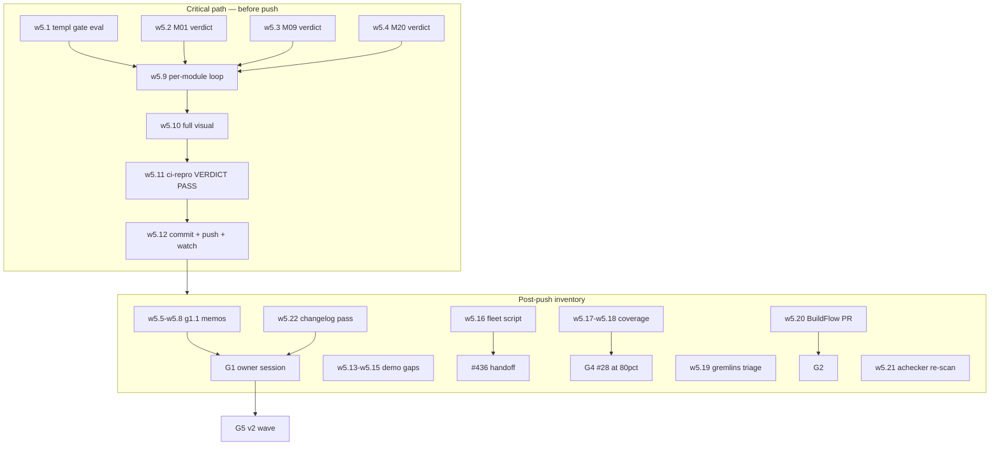

# Wave 5 — Endgame Pareto Plan (2026-10-17 08:53)

**State at planning:** waves 1–4 struck 33+ TODO rows this week; M01–M27 executed or verdict-gated; master `ahead 8` (unpushed, daemon-carried); tree clean at `50256dfd`. This plan covers EVERY remaining open row: the wave-5 executable set, the gate-prep micros, and the gates themselves (G1–G6 — the "other 20%").

**Guardrails (unchanged):** no breaking API outside v2 (ADR-0039); wired⇒e2e same task; golden re-baseline cap 2 (both consumed-by-window, targeted single-route updates excluded); M03 push ritual at the exact commit; single-writer (#357) — sibling owns crossbrowser-spike/docs-testing docs.

---

## Step 1 — Pareto breakdown of the REMAINDER

### The 1% that delivers 51%
1. **Final ritual + push** — 8 commits of green work sit unpushed; `ci-repro --lint --css --website` VERDICT: PASS at the tip, then push (owner-authorized this session). Everything else is inventory until this lands.
2. **M14/M15 templ gate check** — one `nix eval`; if nixpkgs ≥0.3.1070 the single biggest golden-churn window opens (it keeps being re-applied by automation — the answer must be RECORDED either way).
3. **Sibling verdicts M01/M09/M20** — three artifacts sit verified-but-unstruck; the adopt/reject verdicts feed G1 (#411) and close the tooling story.

### The 4% that delivers 64%
4. **g1.1 bulk decision memos** (13 ⫱ items) — the G1 session cannot happen without them; each is one page: recommendation + default + reopen condition.
5. **Demo-coverage KEEP gaps** — datastar LoadingButton + PolledRegion demo sections, StatusBadgeWith demo-or-deprecate: the shop-window gaps the coverage map flagged as KEEP.
6. **#436 fleet fix script** — `scripts/fleet-css-check.sh` turns the one-off membership check into a standing one-command audit.

### The 20% that delivers 80%
7. **Coverage long-tail batch** (display/forms) toward #28's 80%.
8. **gremlins lived-mutant triage** — the 50:45 gap map is the highest-signal test-writing guide in the repo.
9. **BuildFlow lychee upstream PR** (G2 opener — the fix is already committed on the BuildFlow side).
10. **Achecker re-scan** to confirm #434's zero-hit (sibling tool, read-only run).
11. **CHANGELOG completeness pass** for the wave's doc additions before any release decision.

### The other 20% (gates G1–G6, to reach 100%)
- **G1** owner decisions: #233–#239, #303, #312, #358, #411, #428-hue, #322-500, #295, #217-recheck, #400, #190, #212, #329 + v1.24.0 cut.
- **G2** BuildFlow upstream: #93, #107, #108, #124–#126, #232, #352, #383–#385.
- **G3** art-dupl upstream: #292, #293, #315, #316 (+ the #435 baseline re-record after the fork stabilizes).
- **G4** external: #28 (cov ≥80%), #29 (maintainer), #80/#162/#150 (human/API key), #269 (owner), #316b (htmx v4 radar), #154.
- **G5** v2 wave: #399-P2, #431-exec, #39, #40, #33, #34, #157, #154.
- **G6** HOLD: #217 (demand-gated builds).

---

## Step 2 — Medium tasks (30–100 min, ALL remaining work)

| # | Task (IDs) | Tier | Imp | Eff | Rationale |
|---|-----------|------|-----|-----|-----------|
| W1 | Final ritual + push (ritual, CI-green confirmation at tip, push, post-push CI watch) | 1% | H | M | 8 commits unpushed; everything else is inventory |
| W2 | M14/M15 gate check + record verdict (#335/#368/#369) | 1% | H | S | One eval; unblocks or definitively parks the biggest churn window |
| W3 | Sibling verdicts M01/M09/M20 (#413, #412/#418/#420, #419) | 1% | M | M | Closes the tooling arc; feeds #411/G1 |
| W4 | g1.1 bulk memos (13 ⫱ items, one page each) | 4% | H | M | G1 session-ready |
| W5 | Demo-coverage KEEP gaps (datastar LoadingButton, PolledRegion, StatusBadgeWith) | 4% | M | M | Shop-window completeness; wired⇒e2e |
| W6 | `scripts/fleet-css-check.sh` + #436 handoff notes | 4% | M | S | Standing enforcement for the consumer-outage class |
| W7 | Coverage long-tail (display/forms) toward 80% (#28 path) | 20% | M | M | The awesome-templ unblock |
| W8 | gremlins lived-mutant triage (50:45 map) | 20% | M | M | Test-gap honesty |
| W9 | BuildFlow lychee upstream PR (G2) | 20% | M | S | Upstream the proven fix |
| W10 | Achecker re-scan (#434 confirmation) + CHANGELOG completeness pass | 20% | M | S | Ledger honesty before release |
| G1 | Owner decision session (memos ready) | gate | H | — | 14 decisions incl. v1.24.0, #428-hue, #322-500 |
| G2–G6 | Upstream sprints, external waits, v2 wave, HOLD | gate | — | — | Out of repo scope |

---

## Step 3 — Micro tasks (≤12 min each)

| μ | Task | Ref | Est |
|---|------|-----|-----|
| w5.1 | `nix eval --inputs-from . nixpkgs#templ.version` → record gate verdict in TODO #335 + plan | W2 | 3m |
| w5.2 | M01 verdict: read spike findings/results → adopt/reject row → strike #413 | W3 | 10m |
| w5.3 | M09 verdict: verify #412/#418/#420 artifacts → strikes | W3 | 8m |
| w5.4 | M20 verdict: verify #419 flake app + dispatch CI → strike #419 | W3 | 6m |
| w5.5 | g1.1 memos 1–4 (#233, #234, #235, #236) | W4 | 12m |
| w5.6 | g1.1 memos 5–8 (#237, #238, #239, #303) | W4 | 12m |
| w5.7 | g1.1 memos 9–12 (#312, #358, #411, #428-hue) | W4 | 12m |
| w5.8 | g1.1 memos 13 (#322-500) + index doc linking all memos | W4 | 8m |
| w5.9 | Ritual 1: per-module test loop (all modules `-count=1`) | W1 | 10m |
| w5.10 | Ritual 2: full `nix run .#visual` | W1 | 12m |
| w5.11 | Ritual 3: `scripts/ci-repro.sh --lint --css --website` → VERDICT: PASS | W1 | 12m |
| w5.12 | Detailed commit (this wave's status + plan + strikes) → push → watch CI at tip | W1 | 10m |
| w5.13 | Demo gap: datastar LoadingButton section | W5 | 12m |
| w5.14 | Demo gap: PolledRegion section + route golden check | W5 | 12m |
| w5.15 | Demo gap: StatusBadgeWith demo-or-deprecate verdict | W5 | 10m |
| w5.16 | `scripts/fleet-css-check.sh` (extract from the #410c session commands) | W6 | 12m |
| w5.17 | Coverage batch 1: display long-tail zero-funcs | W7 | 12m |
| w5.18 | Coverage batch 2: forms long-tail | W7 | 12m |
| w5.19 | gremlins triage: classify 50 lived by file → test-gap list | W8 | 12m |
| w5.20 | BuildFlow lychee PR branch + push (upstream repo) | W9 | 10m |
| w5.21 | Achecker re-scan (read-only) → #434 zero-hit note | W10 | 8m |
| w5.22 | CHANGELOG completeness pass → release-readiness note | W10 | 8m |

Sequencing: w5.1 → w5.2–w5.4 → w5.9–w5.12 (push) → w5.5–w5.8, w5.13–w5.22 (post-push inventory) — the push is the critical path; everything else survives a session boundary.

---

## Execution graph

## Verification plan
- Every μ names its guard (tests/lint/ritual lanes); counts discipline (`TestDocsCountDrift`) on any strike that touches numbers.
- After ANY daemon commit: re-verify edits survived; `[Unreleased]` warm; `git status -sb` before push.
- Push ONLY on `VERDICT: PASS` at the exact commit (M03); the daemon races commits — re-verify the tip if `git status -sb` moved.
