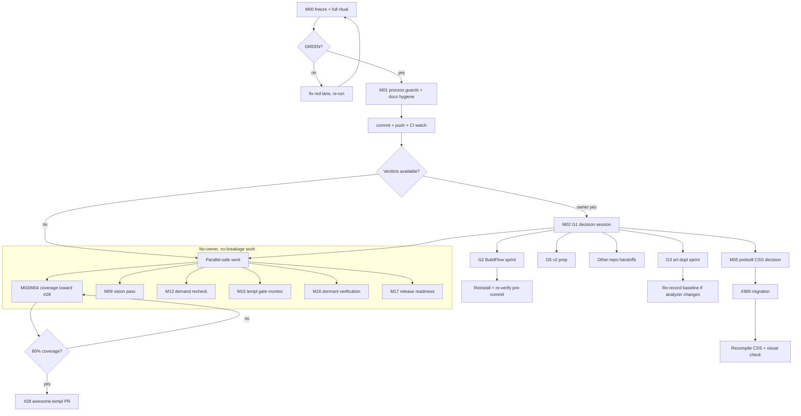

# SUPERB REMAINING-WORK PARETO EXECUTION PLAN — 2026-10-23 09:27

**Goal:** finish the remaining work in `TODO_LIST.md` with the highest
customer-value-per-effort, without breaking anything, and with every step
verifiable. This plan supersedes the 09:03 execution plan for sequencing; that plan
remains the record of what was already executed.

**Current state (verified this session):** v1.23.0, branch `master`, local suites green
(root + utils/icons/errorpage/charts/echarts/datastar/htmx + website), visualtest
compiles, demo route goldens green (92.8 s), lints 0 issues, art-dupl baseline
re-recorded (150 groups, green ×2). **Not pushed.** Full `ci-repro` and the complete
visual suite have not been run since the changes.

**Open rows counted in this plan (60):**
28, 33, 34, 39, 40, 80, 93, 107, 108, 120, 124, 125, 126, 150, 154, 156, 157, 162,
190, 191, 211, 212, 217, 232–239, 269, 292, 293, 295, 303, 312, 315, 316, 316b, 329,
335, 345, 352, 358, 368, 369, 383–385, 387, 397, 399, 400, 410, 411, 428, 436.

**Sort key:** `score = customer-value × impact ÷ effort` (1–5 each). Customer = library
consumers. Correctness > determinism > DX > docs > polish.

**Guardrails (do not verschlimmbessern):**

- No breaking API outside the v2 gate (ADR-0039). No new dependency.
- No root-level `templ generate ./...` while `go.work` is active (the 2026-10-23
  incident rewritten 28 submodule `FileName` paths and the daemon committed it).
- No pixel/HTML golden re-baseline without a stated reason; package goldens via the
  owning package, pixels only under `nix run .#visual`.
- Owner gates (⫱) are decision points, not agent work. Verify the packet; never fake
  the verdict.
- Push only after `scripts/ci-repro.sh --lint --css --visual --website` prints
  `VERDICT: PASS` at the exact commit, then push immediately.
- Re-read a file immediately before editing it (single-writer protocol).
- After any daemon commit: re-check that edits survived and that the tree is still
  the one you verified.

---

## 1. Pareto breakdown

### The 1% that delivers 51%

1. **Prove the current tree in CI terms** — run the full ritual
   (`--lint --css --visual --website`) and push. Everything else is inventory until
   the green verdict lands on `origin/master`. (NEW-P0)
2. **Kill the generated-file corruption class** — add `TestGeneratedFileNameRoots`
   plus a go.work-safe generation wrapper. This exact class cost 28 files and a daemon
   commit this session; a guard is cheaper than vigilance. (NEW-P0)
3. **Close #28** — the only remaining adoption blocker with a named external payoff
   (`awesome-templ`). Coverage 70.4 % root / 72.1 % library vs the 80 % gate; the gap
   is ordinary test-writing in `display` and `forms`. (30–100 min batches)
4. **Run the G1 decision session** — 17 rows are parked behind one sitting; the memos
   already contain recommendations, defaults, and reopen conditions. Every downstream
   color/v2/release decision is blocked here.

### The 4% that delivers 64% (adds to the above)

5. **#369 prebuilt-CSS policy** — decide whether `templates/styles.css` is supported
   before converting opt-in classes to `@utility`; doing it backwards silently breaks
   consumers who do not compile Tailwind.
6. **#335/#368 window** — one `nix eval` per session; if nixpkgs ever ships 0.3.1070,
   the single biggest golden-churn window opens and `size-*` must ride it.
7. **#80/#150/#162 vision pass** — three human-eyeball items; one API key + one script
   converts them from folklore to verdicts.
8. **#269 upstream PR** — a prepared, tested branch already exists; pushing it is a
   one-command owner decision.
9. **#234/#235/#237/#238/#239** — cheap policy ratifications that stop re-litigating
   the same decisions in every session.

### The 20% that delivers 80% (adds to the above)

10. **G2 BuildFlow sprint** — 11 upstream rows; the daemon commit-gate (#232),
    `.gitignore` re-append (#124), CSS un-minification (#125), and artifact classifier
    (#126) are the recurring incident class.
11. **G3 art-dupl sprint** — #292/#293/#315/#316 make the duplication lane
    self-describing and binary-safe.
12. **G5 v2 prep** — #431 batches and #399 Phase 2 are planned but parked; the work
    is sequencing and dry-runs, not new design.
13. **OTHER repos** — #400/#410/#436 are handoffs; each needs a one-page card with the
    exact command and expected artifact.
14. **#217 demand recheck** — HOLD stays HOLD until a second consumer asks.

### The other 20% (to reach 100%)

- **G6 HOLD**: #217 (MultiSelect/TreeView/FileDrop/Toast positions) — do nothing
  unless demand evidence appears.
- **Dormant/decided**: #120 (reopen only on recurrence), #154 (keep-in-sync note),
  #191 (decided, reorder deferred), #397 (decisions landed; implementation is #399).
- **#316b/#345**: htmx v4 radar + dialect checklist — watch only until v4.1.

---

## 2. Medium tasks (30–100 minutes each) — ALL open work

| M   | Task                                                                                 | IDs                                                      | Tier | CV | Imp | Eff | Score | Est  |
| --- | ------------------------------------------------------------------------------------ | -------------------------------------------------------- | ---- | -- | --- | --- | ----- | ---- |
| M00 | Full ritual + push (lint, CSS, visual, website, verdict, commit, push)               | NEW-P0                                                   | 1%   | 5  | 5   | 3   | 8.3   | 90m  |
| M01 | Process guards + docs hygiene (FileName root guard, lcsAt test, TODO footer/links)   | NEW-P0, #387 strike                                      | 1%   | 4  | 5   | 2   | 10.0  | 60m  |
| M02 | G1 owner decision session (17 rows; memos ready)                                     | 190,211,212,233–239,295,303,312,322r,329,358,400,411,428 | 1%   | 5  | 5   | 2   | 12.5  | 90m  |
| M03 | Coverage batch 1: `display` long tail toward 80 %                                    | 28                                                       | 4%   | 5  | 4   | 4   | 5.0   | 90m  |
| M04 | Coverage batch 2: `forms` long tail toward 80 %                                      | 28                                                       | 4%   | 5  | 4   | 4   | 5.0   | 90m  |
| M05 | #369 prebuilt-CSS decision + `@utility` migration (only after the decision)          | 369                                                      | 4%   | 3  | 4   | 4   | 3.0   | 90m  |
| M06 | BuildFlow sprint A: daemon honesty + artifact hygiene                                | 93,107,108,124,125,126                                   | 20%  | 4  | 4   | 4   | 4.0   | 100m |
| M07 | BuildFlow sprint B: commit gate, license, pseudo-versions, art-dupl, lint allowlist  | 232,352,383,384,385                                      | 20%  | 4  | 4   | 4   | 4.0   | 100m |
| M08 | art-dupl upstream sprint                                                             | 292,293,315,316                                          | 20%  | 3  | 4   | 4   | 3.0   | 90m  |
| M09 | Vision-model pass + human confirmation for overlay/wire/progressbar goldens          | 80,150,162                                               | 4%   | 4  | 3   | 2   | 6.0   | 45m  |
| M10 | External asks: go-error-family PR, htmx radar, consumer offers, prerender sync       | 269,316b,156,154                                         | 20%  | 3  | 3   | 2   | 4.5   | 60m  |
| M11 | v2 prep A: ADR-0044/0045 dry-runs and color-collapse batches                         | 397,399,431                                              | 20%  | 3  | 4   | 4   | 3.0   | 90m  |
| M12 | v2 prep B: compound overlays, Scrollback rename, Calendar wire, v4 checklist, size-* | 33,34,39,40,157,345,368                                  | 20%  | 3  | 3   | 5   | 1.8   | 100m |
| M13 | Demand re-check for held builds                                                      | 217                                                      | 20%  | 2  | 2   | 1   | 4.0   | 30m  |
| M14 | Other-repo handoffs/implementation: consumer migrations, fleet CSS, crm tails        | 400,410,436                                              | 20%  | 4  | 3   | 4   | 3.0   | 100m |
| M15 | templ migration gate monitor (one eval, record the verdict, keep #368 parked)        | 335,368                                                  | 20%  | 2  | 3   | 1   | 6.0   | 30m  |
| M16 | Dormant/decided verification (no code expected)                                      | 120,154,191,397                                          | O    | 2  | 2   | 1   | 4.0   | 30m  |
| M17 | Release readiness: CHANGELOG completeness, TODO footer, plan link, next-cut packet   | NEW                                                      | 20%  | 4  | 3   | 2   | 6.0   | 45m  |

**Customer value / impact / effort** are 1–5; **Score = CV×Imp÷Eff**. M00 is scored
lower only because its effort is high, not because it is optional — it is the gate for
everything else.

---

## 3. Micro tasks (≤12 minutes each) — ALL open work

### M00 — Ritual + push

| μ    | Task                                                 | Verify               | Est |
| ---- | ---------------------------------------------------- | -------------------- | --- |
| 00.1 | Freeze scope, `git status -sb`, record HEAD SHA      | clean tree/SHA       | 5m  |
| 00.2 | `scripts/ci-repro.sh --lint`                         | step exits 0         | 12m |
| 00.3 | `scripts/ci-repro.sh --css`                          | byte-stable CSS      | 12m |
| 00.4 | `scripts/ci-repro.sh --visual`                       | visual lane green    | 12m |
| 00.5 | `scripts/ci-repro.sh --website`                      | website lane green   | 12m |
| 00.6 | Read the `VERDICT:` line; fix or re-run any red lane | VERDICT PASS         | 10m |
| 00.7 | Detailed commit (plan + status report + guards)      | message quality      | 10m |
| 00.8 | Push `master`, watch CI at the pushed SHA            | origin/master = HEAD | 10m |

### M01 — Process guards + docs hygiene

| μ    | Task                                                                | Verify                            | Est |
| ---- | ------------------------------------------------------------------- | --------------------------------- | --- |
| 01.1 | Add `TestGeneratedFileNameRoots` (module-relative `FileName:` only) | guard fails on a synthetic prefix | 12m |
| 01.2 | Add `lcsAt` malformed-table unit test                               | `go test ./utils/golden/`         | 10m |
| 01.3 | Strike #387 with evidence                                           | TODO row                          | 5m  |
| 01.4 | Update TODO footer (2026-10-23) + link this plan                    | TODO header                       | 10m |
| 01.5 | Run the new guards + touched suites                                 | green                             | 12m |

### M02 — G1 owner decisions (one row per memo; 3 micro batches)

| μ    | Task                                                                           | Verify            | Est |
| ---- | ------------------------------------------------------------------------------ | ----------------- | --- |
| 02.1 | Verdict batch 1: #233, #234, #235, #236                                        | TODO rows updated | 12m |
| 02.2 | Verdict batch 2: #237, #238, #239, #303                                        | TODO rows updated | 12m |
| 02.3 | Verdict batch 3: #312, #358, #411, #428                                        | TODO rows updated | 12m |
| 02.4 | Verdict batch 4: #295, #190, #212, #329                                        | TODO rows updated | 12m |
| 02.5 | Verdict batch 5: #322r, #400, #211 + v1.24 cut timing                          | TODO rows updated | 12m |
| 02.6 | Apply the accepted one-line follow-ups (flake lock, npm pin, docs, class swap) | targeted diffs    | 12m |

### M03 — Coverage batch 1 (`display`)

| μ    | Task                                           | Verify               | Est |
| ---- | ---------------------------------------------- | -------------------- | --- |
| 03.1 | Enumerate zero-coverage functions in `display` | coverage report      | 10m |
| 03.2 | Add table-driven tests for 3 low-risk helpers  | `go test ./display/` | 12m |
| 03.3 | Add chart-geometry edge cases                  | `go test ./display/` | 12m |
| 03.4 | Add enum/IsValid table coverage                | guard test           | 10m |
| 03.5 | Measure delta and record                       | coverage %           | 8m  |

### M04 — Coverage batch 2 (`forms`)

| μ    | Task                                         | Verify             | Est |
| ---- | -------------------------------------------- | ------------------ | --- |
| 04.1 | Enumerate zero-coverage functions in `forms` | coverage report    | 10m |
| 04.2 | Add validation/aria helper tests             | `go test ./forms/` | 12m |
| 04.3 | Add filter/segmented/rating edge cases       | `go test ./forms/` | 12m |
| 04.4 | Add calendar/TagsInput boundary tests        | `go test ./forms/` | 12m |
| 04.5 | Measure library-wide coverage and record     | ≥80 % or delta     | 8m  |

### M05 — #369 prebuilt CSS

| μ    | Task                                                           | Verify        | Est |
| ---- | -------------------------------------------------------------- | ------------- | --- |
| 05.1 | Write the prebuilt-CSS decision (keep/safelist/drop) as a memo | decision note | 10m |
| 05.2 | Inventory opt-in classes and their consumers                   | list          | 10m |
| 05.3 | Convert only the safe classes to `@utility`                    | CSS diff      | 12m |
| 05.4 | Extend `loadCustomCSSClasses` for `@utility tc-*`              | parser test   | 10m |
| 05.5 | Recompile artifacts + class inventory + starter mirror         | byte checks   | 12m |
| 05.6 | Run visual/route checks and CHANGELOG                          | green         | 12m |

### M06 — BuildFlow sprint A

| μ    | Task                                                   | Verify        | Est |
| ---- | ------------------------------------------------------ | ------------- | --- |
| 06.1 | Reproduce #93/#107/#108 in `~/projects/BuildFlow` HEAD | failing cases | 12m |
| 06.2 | Fix #107 jsonv2 detection across submodules            | upstream test | 12m |
| 06.3 | Fix #108 eslint scoping                                | upstream test | 12m |
| 06.4 | Fix #124 `*_templ.go` `.gitignore` re-append           | upstream test | 12m |
| 06.5 | Fix #125 CSS minification guard                        | upstream test | 12m |
| 06.6 | Fix #126 vetted-artifact classifier                    | upstream test | 12m |
| 06.7 | Reinstall binary + re-run this repo's pre-commit       | clean hook    | 12m |

### M07 — BuildFlow sprint B

| μ    | Task                                                      | Verify         | Est |
| ---- | --------------------------------------------------------- | -------------- | --- |
| 07.1 | #232 daemon commit gate (build-per-module + release lock) | upstream test  | 12m |
| 07.2 | #352 license-check GOROOT export                          | upstream test  | 12m |
| 07.3 | #383 pseudo-version acceptance option                     | upstream test  | 12m |
| 07.4 | #384 art-dupl config passthrough                          | upstream test  | 12m |
| 07.5 | #385 lint accepted-disabled allowlist                     | upstream test  | 12m |
| 07.6 | Verify repo-side `.buildflow.yml` skip list can shrink    | pre-commit run | 12m |

### M08 — art-dupl upstream

| μ    | Task                                                      | Verify          | Est |
| ---- | --------------------------------------------------------- | --------------- | --- |
| 08.1 | Reproduce #292 piped-output truncation                    | failing capture | 12m |
| 08.2 | Fix #292 and add a regression test                        | upstream test   | 12m |
| 08.3 | Implement #316 baseline-version stamp/must-match          | upstream test   | 12m |
| 08.4 | Implement #315 actionable-vs-raw counts                   | upstream test   | 12m |
| 08.5 | Implement #293 fingerprint-only/config discovery          | upstream test   | 12m |
| 08.6 | Re-tag/re-record this repo's baseline with the new binary | green ×2        | 12m |

### M09 — Vision pass

| μ    | Task                                                         | Verify        | Est |
| ---- | ------------------------------------------------------------ | ------------- | --- |
| 09.1 | Export an API key and run `scripts/vision-review-goldens.sh` | report        | 10m |
| 09.2 | Confirm SUSPECT verdicts for overlays (#80)                  | struck/queued | 12m |
| 09.3 | Confirm wire (#150) and progressbar 45 % (#162)              | struck/queued | 12m |

### M10 — External asks

| μ    | Task                                                              | Verify      | Est |
| ---- | ----------------------------------------------------------------- | ----------- | --- |
| 10.1 | Verify the #269 branch is green; push + open PR (owner go-ahead)  | PR URL      | 12m |
| 10.2 | #316b: re-check htmx v4.x patch releases and event renames        | radar note  | 10m |
| 10.3 | #156: send/refresh the consumer adoption offers                   | offer notes | 12m |
| 10.4 | #154: verify prerender still uses the default both-transport view | code read   | 8m  |

### M11 — v2 prep A

| μ    | Task                                                         | Verify   | Est |
| ---- | ------------------------------------------------------------ | -------- | --- |
| 11.1 | #397 mark decided; ensure #399 owns the implementation       | TODO row | 6m  |
| 11.2 | #431 Batch 0 decisions recorded (FeedbackError→Danger + hue) | plan doc | 12m |
| 11.3 | #431 Batch 1 dry-run on one component                        | diff     | 12m |
| 11.4 | #399 class inventory/token swap dry-run                      | diff     | 12m |
| 11.5 | Re-baseline budget check (exactly one event)                 | plan     | 8m  |

### M12 — v2 prep B

| μ    | Task                                          | Verify | Est |
| ---- | --------------------------------------------- | ------ | --- |
| 12.1 | #39 design check against ADR-0023             | note   | 10m |
| 12.2 | #40 rename plan + call sites                  | list   | 10m |
| 12.3 | #157 Calendar wire decision                   | note   | 10m |
| 12.4 | #345 dialect checklist draft                  | doc    | 10m |
| 12.5 | #368 size-* inventory (parked behind #335)    | count  | 10m |
| 12.6 | #33/#34 feasibility check (Validate/testutil) | note   | 10m |

### M13 — Demand recheck

| μ    | Task                                                              | Verify   | Est |
| ---- | ----------------------------------------------------------------- | -------- | --- |
| 13.1 | Re-run the consumer demand scan for MultiSelect/TreeView/FileDrop | evidence | 12m |
| 13.2 | Record HOLD or flip with the evidence                             | TODO     | 8m  |

### M14 — Other repos

| μ    | Task                                                             | Verify | Est |
| ---- | ---------------------------------------------------------------- | ------ | --- |
| 14.1 | #400: write the dnsblockd/DiscordSync/nsfw/mr-sync handoff cards | cards  | 12m |
| 14.2 | #436: reproduce the pbx-lens + nsfw stale-CSS gaps               | check  | 12m |
| 14.3 | #410a: crm-exec-stage rebase-or-abandon decision packet          | note   | 12m |
| 14.4 | #410b–d: record the documented blockers/flake                    | note   | 10m |

### M15 — templ gate monitor

| μ    | Task                                                           | Verify  | Est |
| ---- | -------------------------------------------------------------- | ------- | --- |
| 15.1 | `nix eval --inputs-from . nixpkgs#templ.version`               | version | 3m  |
| 15.2 | If ≥0.3.1070, open the migration window; else keep #368 parked | TODO    | 5m  |

### M16 — Dormant/decided verification

| μ    | Task                                        | Verify | Est |
| ---- | ------------------------------------------- | ------ | --- |
| 16.1 | #120: confirm no recurrence since `fabd1fb` | note   | 5m  |
| 16.2 | #191: confirm the deferred reorder decision | note   | 5m  |
| 16.3 | #154: rerun the prerender read              | note   | 5m  |

### M17 — Release readiness

| μ    | Task                                                        | Verify  | Est |
| ---- | ----------------------------------------------------------- | ------- | --- |
| 17.1 | CHANGELOG completeness pass for this session's work         | entries | 10m |
| 17.2 | TODO footer + plan link (if not already done in M01)        | links   | 8m  |
| 17.3 | Version-triple check (`utils.Version`, CHANGELOG, FEATURES) | guards  | 6m  |
| 17.4 | Next-cut packet: what v1.24.0 would contain                 | note    | 10m |

---

## 4. Execution order (dependency-correct, Pareto-first)

**Rule:** M00 and M01 are the only critical path. After the push, work may proceed in
any order, but owner-gated work (M02) must precede M05, R, S, T, U because each of
those flips a policy or an external contract.

---

## 5. Verification matrix

| Change class                          | Required proof                                                                                            |
| ------------------------------------- | --------------------------------------------------------------------------------------------------------- |
| Go code (component/helper)            | package `go test -count=1`, lint, goldens if markup changed                                               |
| `.templ`                              | regenerate with pinned templ from the correct CWD/module, inspect the diff scope, package tests + goldens |
| CSS (`custom.css`, starter, artifact) | `nix run .#css`, class inventory guard, `app.css` line-count/minified guard, visual route goldens         |
| Generated artifacts                   | `scripts/check-templ-sync.sh`, `check-tc-sources-sync.sh`, `TestCompiledCSSInventory`                     |
| Baseline (art-dupl)                   | `check` green twice with the same binary, ADR/AGENTS/CHANGELOG counts updated                             |
| Public API                            | CHANGELOG `[Unreleased]`, FEATURES row, count guards, doc examples compile                                |
| Push                                  | `ci-repro --lint --css --visual --website` → `VERDICT: PASS` at the exact SHA                             |

---

## 6. Execution log

| Step         | Result | Evidence                                                                                                                                                                                                                                                                                                                                                                   |
| ------------ | ------ | -------------------------------------------------------------------------------------------------------------------------------------------------------------------------------------------------------------------------------------------------------------------------------------------------------------------------------------------------------------------------- |
| Plan written | ✅     | this file                                                                                                                                                                                                                                                                                                                                                                  |
| M00          | ✅     | `scripts/ci-repro.sh --lint --css --visual --website` → `VERDICT: PASS (exit 0)` at `2026-10-23 09:41:44 CEST` on `820e2df1`; full visual suite re-ran serially green (484 s) under load; final non-visual ritual PASS at `10:04:47` on `432359c7`; CI run `39922132311` **SUCCESS** on `432359c7` (Build & Test, Visual Regression, Lint, CSS Freshness, HTML validation) |
| M01          | ✅     | `TestGeneratedFileNameRoots` (module-relative `FileName:` invariant) + `TestLCSAtOutOfRange` added; #387 struck; TODO header/footer updated and linked to this plan; utils suite + lint green                                                                                                                                                                              |
| NEW-P0       | ✅     | CI `templ generate` now mirrors `scripts/ci-repro.sh` (root + per-submodule regeneration). The bare root invocation made the ephemeral CI tree workspace-relative and turned the new guard red on an otherwise-correct commit. Commit `432359c7`; CI green afterwards                                                                                                      |
| M02          | ⏸     | **Packet verified, verdicts NOT applied** (owner gate). Re-checked the 2026-10-17 memos against today's tree and appended a dated re-verification table to `docs/planning/2026-10-17_g1-decision-memos.md`: #235 was already satisfied (all three tailwind lanes pin 4.3.3 → row struck), #233's revert target `ef34387d…` is now two input moves back (head `02c087f3…`), #312/#322/#358/#411 facts unchanged. The 13 verdicts still need the owner sitting |
| M03/M04      | ✅     | **Premise corrected, then executed.** The stated "raw coverage 70→80% by writing tests" premise was false: generated `*_templ.go` carries one unreachable `WriteString` error branch per element (`display/card_templ.go:128-145`), so raw coverage tops out near 73% (generated statements are 91.3% of the library; even 100% hand-written coverage leaves raw at 73.6%). Measured both numbers with the new `scripts/coverage-library.sh` (published modules, demo + `tc` excluded): **73.3% raw / 96.7% hand-written (2275/2353)**. Branch tests added for chart helpers, tone adapters, error-page fallback writers, scanner error paths, icon-name export, echarts defaults, wire bool parsing; hand-written 95.3% → 96.7%, root package 97.5% → 99.4%. Gate wired into `ci-repro.sh` + the CI coverage job. #28 row rewritten with the corrected diagnosis |
| M05          |        | owner decision first                                                                                                                                                                                                                                                                                                                                                       |
| M06/M07      |        | upstream repo                                                                                                                                                                                                                                                                                                                                                              |
| M08          |        | upstream repo                                                                                                                                                                                                                                                                                                                                                              |
| M09          |        | needs API key/human                                                                                                                                                                                                                                                                                                                                                        |
| M00b         | ✅     | Post-push ritual at `f7c229d6` → `VERDICT: PASS` at `12:29:05`; CI run `39939447152` **SUCCESS** (Build & Test incl. the new coverage gate, Visual Regression, Lint, CSS Freshness, HTML validation). Local `--visual` lane was skipped for this tests/docs-only change (no markup or CSS diff; CSS freshness recompiled byte-identical) — CI's Visual Regression job is the authority here |
| M15          | ✅     | `nix eval --inputs-from . nixpkgs#templ.version` → **0.3.1020** (2026-10-23 12:08): the window has not opened, #368 stays parked                                                                                                                                                                                                                                          |
| M10–M14      | ⏸     | Out of reach this session: M09 needs a vision API key + human confirmation; M10 needs an owner go-ahead to file to an external repo; M11/M12 are behind the v2 gate (ADR-0039); M13 needs fresh external demand evidence (HOLD stands); M14 lives in other repositories                                                                                                                                                       |
| M16          | ✅     | Read-only verification: #120's local guard is `ci-repro --css` (green in the M00 run); #154 `examples/demo/prerender.go:26` builds a query-less request, so prerender keeps the default both-transport view; #191 and #397 stay decided with no code change expected                                                                                                                                                        |
| M17          | ✅     | Version triple consistent (`utils.Version`, CHANGELOG latest heading, FEATURES `**Version:**` = 1.23.0); `[Unreleased]` warm with this session's coverage entry. The cut itself was NOT performed — tagging is irreversible and is an owner decision                                                                                                                                                                          |

**Post-push CI:** run `39919529944` (at `820e2df1`) failed in Build & Test because the
CI job itself ran a bare root `templ generate`; the guard was right, the CI generation
was wrong. Fixed in `432359c7`; run `39922132311` is green. The visual lane's first
local re-run failed only on `TestDemoNavTimingBudget` under a load average of 22; the
serial re-run (`-parallel 1`) passed in 484 s, and CI's Visual Regression job passed.

---

## 7. Risks and kill-criteria

| Risk                                                       | Mitigation / kill-criterion                                                                                   |
| ---------------------------------------------------------- | ------------------------------------------------------------------------------------------------------------- |
| Root-level templ generation corrupts submodule paths again | Only per-module generation; `TestGeneratedFileNameRoots` must exist before any `.templ` edit                  |
| Daemon commits mid-verification                            | Re-read HEAD/SHA; re-run the ritual at the tip about to be pushed; never push a SHA you did not verify        |
| `@utility` drops opt-in classes from prebuilt CSS          | Decision first (M05.1); kill the migration if the prebuilt artifact is still supported and no safelist exists |
| Coverage chase adds brittle tests                          | Only behavior-level table tests; no internal-call assertions; stop when the 80 % gate is met                  |
| v2 work accidentally ships in v1                           | All v2 changes stay behind the ADR-0039 gate; no class swap on `master`                                       |
| Vision-model false positives                               | Human confirms only SUSPECT verdicts; never auto-strike on the model alone                                    |
| BuildFlow/art-dupl scope creep                             | Each upstream row is one PR-sized change with its own test; stop after the listed rows                        |
| Full ritual flake under load                               | Re-run once with `-parallel 4`; never `-update` because of load                                               |

---

_This plan is the execution contract for the remaining 60 rows. Update §6 as work
lands; never strike a row without the evidence named in §5._
