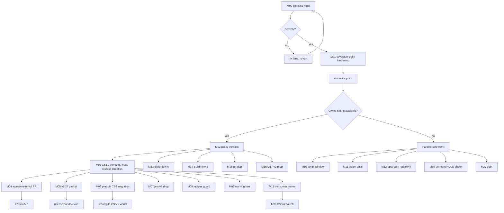

# TRULY-COMPLETE REMAINING-WORK PARETO PLAN — 2026-10-23 14:25

**Goal:** finish every open row in `TODO_LIST.md` in the order that maximises
customer value per minute, with each step independently verifiable, and without
turning any working system into a worse one.

**Supersedes** `2026-10-23_09-27_SUPERB-REMAINING-WORK-PARETO-EXECUTION-PLAN.md`
for sequencing. That plan stays as the execution record of the morning session;
this one covers the **60 open rows** left after it (56 existing + 4 debt rows the
session created, #438–#441).

**Verified state at plan time**

| Fact                        | Value                                                                 |
| --------------------------- | --------------------------------------------------------------------- |
| Branch                      | `master`, clean, `master == origin/master`                             |
| Tip                         | `b165a214` (3 commits, 3 green CI runs: `39939447152`, `39941061353`, `39942314019`) |
| Version                     | 1.23.0 (utils.Version = CHANGELOG = FEATURES)                          |
| Coverage (hand-written)     | **96.7 %** (2275/2353 statements), raw 73.3 %, raw ceiling 73.6 %      |
| Gates                       | adoption 80 %, CI ratchet 94 %, per-package floors (display ratcheted to 70) |
| Open rows                   | **60** (56 + #438–#441)                                                |
| Owner gates                 | 17 rows; 4 of them block whole workstreams (see §1)                    |

**Sort key:** `score = customer-value × impact ÷ effort` (1–5 each);
customer = library consumers. Correctness > determinism > DX > docs > polish.
When scores tie, the row that unblocks other rows wins.

**Guardrails (do not verschlimmbessern)**

- No breaking API outside the v2 gate (ADR-0039). No new dependency.
- No root-level `templ generate ./...` with `go.work` active; submodules generate
  from their own directories (`scripts/ci-repro.sh` is the reference recipe).
- No golden re-baseline without a stated reason; HTML goldens via the owning
  package, pixels only under `nix run .#visual`.
- Owner gates (⫱) are decision points, not agent work: verify the packet, never
  fake the verdict. Where a memo says "the recommendation applies if the owner
  does not engage", that still needs the owner to *say so*.
- Never quote raw coverage as "the library's coverage"; the generated-code
  ceiling is in AGENTS.md and `scripts/coverage-library.sh`.
- Push only after `scripts/ci-repro.sh --lint --css --website` prints
  `VERDICT: PASS (exit 0)` at the exact commit, then push immediately.
- Re-read a file immediately before editing it (single-writer protocol).
- After any daemon commit: re-check that edits survived and re-verify the tip.
- A gate that has never been seen failing is not a gate (#439).

---

## 1. Pareto breakdown

### The 1 % that delivers 51 %

Four moves. Everything else is either blocked by them or worth less.

1. **Run the owner decision sitting (#233/#234/#236–#239/#295/#303/#312/#329/
   #358/#411, plus the #211/#217/#212/#400/#428 direction).** 17 rows wait on one
   conversation. Each memo is one page, recommendations included, and four of them
   (CSS artifact, demand HOLD, release timing, tool ratification) freeze entire
   workstreams. *(M02 + M03)*
2. **Ship the `awesome-templ` PR (#28).** The only externally visible payoff in
   the list; the coverage blocker is now correctly diagnosed and the honest number
   exists. Needs one owner answer on framing (Q3). *(M04)*
3. **Make the coverage claim self-defending (#438, #439).** The session's headline
   number is hand-typed prose today; a stored artifact plus a gate self-test stops
   the next session from re-litigating or silently drifting. *(M01)*
4. **Decide and prepare the v1.24.0 cut.** `[Unreleased]` carries a full minor's
   worth of changes; consumers cannot plan around an unannounced release, and the
   release blocks the fleet wave (#400). *(M05)*

### The 4 % that delivers 64 % (adds to the above)

5. **#211/#369 prebuilt-CSS policy** — decides whether the `@utility` migration is
   safe at all; doing it backwards silently breaks consumers who never compile
   Tailwind. *(M06)*
6. **#358 drop `GOEXPERIMENT=jsonv2`** — one lockstep commit, 16 export sites,
   removes a stale flag from every lane. *(M07)*
7. **#234 recipes drift guard** — the last silent-drift class in the repo without
   a machine guard. *(M08)*
8. **#295 flip art-dupl to blocking** — the baseline is re-recorded and green; the
   advisory lane has now been green twice. *(M02 follow-up)*
9. **#428 warning hue** — unblocks the v2 color collapse; until one hue is chosen
   every theming decision re-opens it. *(M09)*
10. **#80/#150/#162 vision pass** — three human-eyeball items convert from folklore
    to verdicts with one API key. *(M11)*
11. **#269 upstream go-error-family PR** — the branch is prepared; pushing it is a
    one-command owner decision. *(M12)*
12. **#335/#368 window check** — one `nix eval` per session; if nixpkgs ever ships
    1070, the biggest golden-churn window opens and both must ride it. *(M10)*

### The 20 % that delivers 80 % (adds to the above)

13. **BuildFlow sprint A** (#93/#107/#108/#124/#125/#126/#384) — the recurring
    daemon/artifact incident class. *(M13)*
14. **BuildFlow sprint B** (#232/#352/#383/#385) — commit gate, license, pseudo
    versions, lint allowlist. *(M14)*
15. **art-dupl sprint** (#292/#293/#315/#316) — makes the duplication lane
    self-describing and binary-safe. *(M15)*
16. **v2 prep** (#397/#399, #33/#34/#39/#40/#157) — sequencing and dry-runs, not
    new design. *(M16 + M17)*
17. **Consumer waves** (#400/#410/#436) — handoffs and fleet CSS repairs in other
    repositories. *(M18)*

### The other 20 % (to reach 100 %)

- **HOLD by decision:** #217 (MultiSelect/TreeView/FileDrop/Toast positions) — do
  nothing until a second consumer asks. #190 (touch-drag) — same.
- **Decided, no code expected:** #191 (feature-scope props), #397 (decisions
  landed; implementation is #399).
- **Dormant, verify only:** #120 (CSS false negative; guard is `ci-repro --css`),
  #154 (prerender default transport), #156 (consumer survey refresh).
- **Watch only:** #316b (htmx v4 — v4.0.0 is stable, no patch yet), #345 (dialect
  checklist waits for v4), #368 (`size-*` waits for the templ 1070 window).
- **Gated:** #335 (nixpkgs still 0.3.1020), #369 (needs the CSS decision),
  #399 (needs v2), #410/#436 (other repos), #28 (needs Q3).

---

## 2. Inventory — all 60 rows, one class each

| Class                        | Rows                                                                                                  | Count |
| ---------------------------- | ----------------------------------------------------------------------------------------------------- | ----- |
| A — agent, ungated, in-repo  | 28, 120, 154, 156, 191, 316b, 438, 439, 440, 441                                                      | 10    |
| B — G1 owner decision        | 212, 217, 233, 234, 236, 237, 238, 239, 295, 303, 312, 329, 358, 400, 411, 428                        | 16    |
| C — CSS policy (owner + work)| 211, 369                                                                                              | 2     |
| D — BuildFlow upstream       | 93, 107, 108, 124, 125, 126, 232, 352, 383, 384, 385                                                  | 11    |
| E — art-dupl upstream        | 292, 293, 315, 316                                                                                    | 4     |
| F — other repos / upstream   | 269, 410, 436                                                                                         | 3     |
| G — v2 / gated / deferred    | 33, 34, 39, 40, 157, 190, 335, 345, 368, 397, 399                                                     | 11    |
| H — human / credential       | 80, 150, 162                                                                                          | 3     |
| **Total**                    |                                                                                                       | **60** |

*(#322 from the G1 memo has no open TODO row today — the 5xx→Corruption behaviour
is documented in `errorpage/styles.go:473-487`, so the memo entry is informational.)*

---

## 3. Medium tasks (30–100 min) — all 60 rows

| M   | Task                                                                                     | IDs                                   | Tier | CV | Imp | Eff | Score | Est  |
| --- | ---------------------------------------------------------------------------------------- | ------------------------------------- | ---- | -- | --- | --- | ----- | ---- |
| M00 | Baseline ritual + commit/push (status report, TODO rows, this plan)                       | —                                     | 1 %  | 4  | 5   | 3   | 6.7   | 30m  |
| M01 | Coverage claim hardening: artifact + `--profile` + gate self-test + prose guard           | 438, 439                              | 1 %  | 4  | 4   | 3   | 5.3   | 90m  |
| M02 | Owner sitting #1: policy ratifications (#233/#234/#236/#237/#238/#239/#295/#303/#312/#329/#358/#411) | 233, 234, 236, 237, 238, 239, 295, 303, 312, 329, 358, 411 | 1 %  | 5  | 5   | 2   | 12.5  | 100m |
| M03 | Owner sitting #2: CSS/demand/hue/release direction (#211/#212/#217/#400/#428) + v1.24 timing | 211, 212, 217, 400, 428               | 1 %  | 5  | 5   | 2   | 12.5  | 60m  |
| M04 | `awesome-templ` submission: CONTRIBUTING re-read, README slot, PR body, file              | 28                                    | 1 %  | 5  | 4   | 2   | 10.0  | 90m  |
| M05 | v1.24.0 packet: Unreleased audit, release notes, triple check, cut decision               | —                                     | 1 %  | 4  | 4   | 2   | 8.0   | 45m  |
| M06 | Prebuilt-CSS decision + `@utility` migration + class-inventory parser                     | 211, 369                              | 4 %  | 3  | 4   | 4   | 3.0   | 100m |
| M07 | Drop `GOEXPERIMENT=jsonv2` in one lockstep commit (16 sites)                              | 358                                   | 4 %  | 3  | 3   | 3   | 3.0   | 60m  |
| M08 | Recipes-identifier drift guard (build, wire, verify)                                      | 234                                   | 4 %  | 3  | 3   | 3   | 3.0   | 90m  |
| M09 | Warning hue unification: one hue in the tone table + goldens                              | 428                                   | 4 %  | 3  | 3   | 4   | 2.3   | 90m  |
| M10 | templ 1070 window check + `size-*` inventory (park unless the gate opens)                 | 335, 368                              | 4 %  | 2  | 3   | 1   | 6.0   | 45m  |
| M11 | Vision pass with a key; human confirms only SUSPECT verdicts                              | 80, 150, 162                          | 4 %  | 4  | 3   | 2   | 6.0   | 60m  |
| M12 | Upstream radar/PR: go-error-family #269, htmx v4 radar, dialect checklist draft           | 269, 316b, 345                        | 4 %  | 3  | 3   | 2   | 4.5   | 60m  |
| M13 | BuildFlow sprint A: daemon honesty + artifact hygiene                                     | 93, 107, 108, 124, 125, 126, 384      | 20 % | 4  | 4   | 4   | 4.0   | 100m |
| M14 | BuildFlow sprint B: commit gate, license, pseudo versions, lint allowlist                 | 232, 352, 383, 385                    | 20 % | 4  | 4   | 4   | 4.0   | 90m  |
| M15 | art-dupl upstream: truncation, fingerprint, counts, baseline stamp                        | 292, 293, 315, 316                    | 20 % | 3  | 4   | 4   | 3.0   | 90m  |
| M16 | v2 prep A: #397 close-out + #399 batch dry-run + budget check                             | 397, 399                              | 20 % | 3  | 4   | 4   | 3.0   | 90m  |
| M17 | v2 prep B: Validate methods, testutil, compound overlays, Scrollback rename, Calendar wire| 33, 34, 39, 40, 157                   | 20 % | 2  | 2   | 3   | 1.3   | 100m |
| M18 | Consumer waves: #400 cards, #410 tails, #436 stale CSS                                    | 400, 410, 436                         | 20 % | 4  | 3   | 4   | 3.0   | 100m |
| M19 | Dormant + HOLD verification: no code expected                                             | 120, 154, 156, 190, 191               | O    | 2  | 2   | 2   | 2.0   | 45m  |
| M20 | Debt: profile statement-count discrepancy + pre-commit fmt/lint race                      | 440, 441                              | 20 % | 3  | 3   | 3   | 3.0   | 60m  |

**Reading:** M02/M03 dominate the score because 17 rows are parked behind them.
M00 is scored below its importance because its effort is high, not because it is
optional — it is the gate for every push.

---

## 4. Micro tasks (≤12 min each) — all rows

### M00 — Baseline ritual + commit/push

| μ    | Task                                                      | Verify                | Est |
| ---- | --------------------------------------------------------- | --------------------- | --- |
| 00.1 | `git status -sb`, record HEAD and origin equal             | clean tree            | 3m  |
| 00.2 | `scripts/ci-repro.sh --lint`                               | exit 0                | 12m |
| 00.3 | `scripts/ci-repro.sh --css`                                | byte-identical CSS    | 12m |
| 00.4 | `scripts/ci-repro.sh --website`                            | website lane green    | 12m |
| 00.5 | Read the `VERDICT:` line; fix or re-run a red lane         | `VERDICT: PASS`       | 10m |
| 00.6 | Commit plan + status report + TODO rows with detailed text | message quality       | 10m |
| 00.7 | Push, watch CI at the pushed SHA                           | `origin/master` = HEAD| 10m |

### M01 — Coverage claim hardening (#438, #439)

| μ    | Task                                                              | Verify                        | Est |
| ---- | ----------------------------------------------------------------- | ----------------------------- | --- |
| 01.1 | Have the script write `reports/coverage-library.txt` (gitignored → artifact in CI) | file contents match stdout | 10m |
| 01.2 | Add `--profile <file>` to skip measurement and reuse a profile    | manual run on a stored file   | 12m |
| 01.3 | Write `scripts/test-coverage-library-gate.sh` (fail below, pass above) | script exits 0                | 12m |
| 01.4 | Wire the self-test into the pre-commit guard chain + ci-repro     | guard runs green              | 10m |
| 01.5 | Guard the prose: one source of truth for 96.7/73.3/73.6           | `TestDocsCountDrift` or new test | 12m |
| 01.6 | Full verify + CHANGELOG entry                                      | package tests + lint green    | 10m |

### M02 — Owner sitting #1 (#233/#234/#236/#237/#238/#239/#295/#303/#312/#329/#358/#411)

| μ    | Task                                                                    | Verify          | Est |
| ---- | ----------------------------------------------------------------------- | --------------- | --- |
| 02.1 | Verdicts: #233 flake.lock target, #234 recipes guard                     | TODO rows       | 12m |
| 02.2 | Verdicts: #236 error demo shape, #237 chrome default                     | TODO rows       | 12m |
| 02.3 | Verdicts: #238 failure UX, #239 pending-timeout budget                   | TODO rows       | 12m |
| 02.4 | Verdicts: #295 blocking flip, #303 clone blanket-accept                  | TODO rows       | 12m |
| 02.5 | Verdicts: #312 HeadingTag, #329 SSE hosting                              | TODO rows       | 12m |
| 02.6 | Verdicts: #358 jsonv2 drop, #411 tool ratification                       | TODO rows       | 12m |
| 02.7 | Apply the accepted one-line follow-ups (lock, pins, docs)                | targeted diffs  | 12m |
| 02.8 | Strike rows + record verdicts in the memo file                           | memo + TODO     | 10m |

### M03 — Owner sitting #2 (#211/#212/#217/#400/#428 + v1.24)

| μ    | Task                                                              | Verify        | Est |
| ---- | ----------------------------------------------------------------- | ------------- | --- |
| 03.1 | #211/#369 direction: keep+safelist or drop the artifact           | decision note | 12m |
| 03.2 | #212 annotation policy for pre-2026-09-10 reports                 | decision note | 10m |
| 03.3 | #217 demand HOLD or flip with evidence                            | TODO row      | 10m |
| 03.4 | #400 wave go-ahead (which consumer first)                         | TODO row      | 10m |
| 03.5 | #428 hue: amber vs yellow, with the visual blast radius           | decision note | 12m |
| 03.6 | v1.24.0 timing: cut now, or bank for a later window               | decision note | 10m |
| 03.7 | Record all six verdicts in the memo file                          | memo diff     | 10m |

### M04 — `awesome-templ` submission (#28) — gated on Q3

| μ    | Task                                                          | Verify            | Est |
| ---- | ------------------------------------------------------------- | ----------------- | --- |
| 04.1 | Re-read `templ-go/awesome-templ` CONTRIBUTING + README order   | notes             | 12m |
| 04.2 | Draft the one-line entry in alphabetical position              | diff              | 10m |
| 04.3 | Draft the PR body with 96.7 %, the exclusion rationale, links  | draft file        | 12m |
| 04.4 | Add pkg.go.dev + Go Report Card + the stored coverage artifact | draft             | 10m |
| 04.5 | Owner review of the framing                                    | approval          | 12m |
| 04.6 | Open the PR; record the URL in TODO #28                        | PR URL            | 10m |

### M05 — v1.24.0 packet (no row; release decision)

| μ    | Task                                                          | Verify            | Est |
| ---- | ------------------------------------------------------------- | ----------------- | --- |
| 05.1 | Audit `[Unreleased]` for completeness and duplicates           | changelog diff    | 12m |
| 05.2 | Draft user-facing release notes                                | notes             | 12m |
| 05.3 | Version-triple + sibling-pin precondition check                | guards            | 8m  |
| 05.4 | Packet: what v1.24.0 contains and what it does not             | note              | 10m |
| 05.5 | Owner decides cut timing (feeds 03.6)                          | decision          | 5m  |

### M06 — Prebuilt CSS + `@utility` (#211, #369)

| μ    | Task                                                              | Verify             | Est |
| ---- | ----------------------------------------------------------------- | ------------------ | --- |
| 06.1 | Inventory every opt-in `.tc-*` class and its consumers            | list               | 12m |
| 06.2 | Confirm whether `templates/styles.css` is still supported (Q2)    | decision           | 10m |
| 06.3 | Convert only the safe classes to `@utility tc-*`                  | CSS diff           | 12m |
| 06.4 | Extend `loadCustomCSSClasses` to parse `@utility tc-*`            | parser test        | 12m |
| 06.5 | Recompile all three tracked artifacts + class inventory           | byte checks        | 12m |
| 06.6 | Route goldens / visual check + CHANGELOG                          | green              | 12m |

### M07 — Drop `GOEXPERIMENT=jsonv2` (#358) — gated on M02

| μ    | Task                                                              | Verify             | Est |
| ---- | ----------------------------------------------------------------- | ------------------ | --- |
| 07.1 | Enumerate all 16 export sites (.envrc, flake ×12, CI ×3)          | list               | 8m  |
| 07.2 | Drop them from `flake.nix` in one pass                            | diff               | 10m |
| 07.3 | Drop from `.envrc` and the CI env blocks                          | diff               | 8m  |
| 07.4 | Update AGENTS/docs that mention the flag                          | grep = 0           | 10m |
| 07.5 | Full verify (build/test/lint/website)                             | VERDICT PASS       | 12m |

### M08 — Recipes drift guard (#234) — gated on M02

| μ    | Task                                                              | Verify         | Est |
| ---- | ----------------------------------------------------------------- | -------------- | --- |
| 08.1 | Collect the identifiers recipes reference (type/func/field names)  | list           | 12m |
| 08.2 | Write the guard test (parse recipes, assert symbols exist)         | test red/green | 12m |
| 08.3 | Fix any drift the guard finds                                      | recipes diff   | 12m |
| 08.4 | Wire into pre-commit + CI; document the regen path                 | guard green    | 10m |

### M09 — Warning hue (#428) — gated on M03

| μ    | Task                                                              | Verify         | Est |
| ---- | ----------------------------------------------------------------- | -------------- | --- |
| 09.1 | Map every amber/yellow warning site (badge/kanban/stat/alert/…)     | list           | 12m |
| 09.2 | Confirm the chosen hue and its contrast pairs                      | note           | 10m |
| 09.3 | Change the tone table + adapters (one place)                       | diff           | 12m |
| 09.4 | Re-baseline the affected HTML goldens                              | golden diff    | 12m |
| 09.5 | Visual check of the affected routes + CHANGELOG                    | green          | 12m |

### M10 — templ window + `size-*` (#335, #368)

| μ    | Task                                                              | Verify         | Est |
| ---- | ----------------------------------------------------------------- | -------------- | --- |
| 10.1 | `nix eval --inputs-from . nixpkgs#templ.version`                   | version        | 3m  |
| 10.2 | Record the verdict in #335 and keep #368 parked if < 1070          | TODO row       | 5m  |
| 10.3 | If ≥ 1070: inventory the 168 `w-N h-N` pairs                       | count          | 12m |
| 10.4 | If ≥ 1070: open the joint migration window (one re-baseline)       | plan note      | 10m |

### M11 — Vision pass (#80, #150, #162)

| μ    | Task                                                              | Verify         | Est |
| ---- | ----------------------------------------------------------------- | -------------- | --- |
| 11.1 | Export the API key and run `scripts/vision-review-goldens.sh`      | report         | 10m |
| 11.2 | Confirm or reject the overlay findings (#80)                       | verdicts       | 12m |
| 11.3 | Confirm or reject the wire findings (#150)                         | verdicts       | 10m |
| 11.4 | Confirm or reject the progressbar 45 % finding (#162)              | verdicts       | 10m |
| 11.5 | Strike or queue per verdict; record the evidence                    | TODO rows      | 8m  |

### M12 — Upstream radar/PR (#269, #316b, #345)

| μ    | Task                                                              | Verify         | Est |
| ---- | ----------------------------------------------------------------- | -------------- | --- |
| 12.1 | Verify the prepared #269 branch still applies and is green         | branch check   | 12m |
| 12.2 | Push + open the go-error-family PR (owner go-ahead)                | PR URL         | 10m |
| 12.3 | Re-check htmx releases for the first v4 patch                      | release list   | 8m  |
| 12.4 | Draft the `actionFieldDialects` audit checklist for v4             | doc            | 12m |

### M13 — BuildFlow sprint A (#93, #107, #108, #124, #125, #126, #384)

| μ    | Task                                                              | Verify         | Est |
| ---- | ----------------------------------------------------------------- | -------------- | --- |
| 13.1 | Reproduce #93/#107/#108 against BuildFlow HEAD                      | failing cases  | 12m |
| 13.2 | Fix #107 jsonv2 detection across submodules                        | upstream test  | 12m |
| 13.3 | Fix #108 eslint scoping                                            | upstream test  | 12m |
| 13.4 | Fix #124 `*_templ.go` `.gitignore` re-append                       | upstream test  | 12m |
| 13.5 | Fix #125 CSS un-minification guard                                 | upstream test  | 12m |
| 13.6 | Fix #126 vetted-artifact classifier                                | upstream test  | 12m |
| 13.7 | Fix #384 art-dupl config passthrough                               | upstream test  | 12m |
| 13.8 | Reinstall the binary; re-run this repo's hook clean                 | hook green     | 12m |

### M14 — BuildFlow sprint B (#232, #352, #383, #385)

| μ    | Task                                                              | Verify         | Est |
| ---- | ----------------------------------------------------------------- | -------------- | --- |
| 14.1 | #232 daemon commit gate (per-module build + release lock)          | upstream test  | 12m |
| 14.2 | #352 license-check GOROOT export                                   | upstream test  | 12m |
| 14.3 | #383 pseudo-version acceptance option                              | upstream test  | 12m |
| 14.4 | #385 lint accepted-disabled allowlist                              | upstream test  | 12m |
| 14.5 | Shrink this repo's `.buildflow.yml` skip list where now unneeded   | pre-commit run | 12m |

### M15 — art-dupl upstream (#292, #293, #315, #316)

| μ    | Task                                                              | Verify          | Est |
| ---- | ----------------------------------------------------------------- | --------------- | --- |
| 15.1 | Reproduce #292 piped-output truncation                             | failing capture | 12m |
| 15.2 | Fix #292 + regression test                                         | upstream test   | 12m |
| 15.3 | Implement #316 baseline version stamp + must-match                 | upstream test   | 12m |
| 15.4 | Implement #315 actionable-vs-raw counts                            | upstream test   | 12m |
| 15.5 | Implement #293 fingerprint-only + config discovery                 | upstream test   | 12m |
| 15.6 | Re-record this repo's baseline with the new binary (green ×2)      | lane green      | 12m |

### M16 — v2 prep A (#397, #399)

| μ    | Task                                                              | Verify         | Est |
| ---- | ----------------------------------------------------------------- | -------------- | --- |
| 16.1 | Mark #397 decided; confirm #399 owns the implementation            | TODO row       | 6m  |
| 16.2 | Dry-run one #399 token-swap batch on a single component            | diff           | 12m |
| 16.3 | Diff the class inventory for that batch                            | inventory      | 10m |
| 16.4 | Confirm the "exactly one re-baseline event" budget check           | plan note      | 10m |

### M17 — v2 prep B (#33, #34, #39, #40, #157)

| μ    | Task                                                              | Verify         | Est |
| ---- | ----------------------------------------------------------------- | -------------- | --- |
| 17.1 | #33 feasibility: which props structs can actually validate         | list           | 12m |
| 17.2 | #34 move plan for test helpers → `internal/testutil`               | list           | 10m |
| 17.3 | #39 compound overlay API sketch against ADR-0023                   | note           | 12m |
| 17.4 | #40 `ScrollbackLine.Timestamp` → `Prefix` call-site inventory       | list           | 10m |
| 17.5 | #157 Calendar `Wire` feasibility (month nav)                       | note           | 10m |

### M18 — Consumer waves (#400, #410, #436)

| μ    | Task                                                              | Verify         | Est |
| ---- | ----------------------------------------------------------------- | -------------- | --- |
| 18.1 | #400: write the four handoff cards (command + artifact per repo)   | cards          | 12m |
| 18.2 | #410a: crm-exec-stage rebase-or-abandon decision packet            | note           | 12m |
| 18.3 | #410b–d: record the documented blockers/flake                      | note           | 10m |
| 18.4 | #436: reproduce pbx-lens + nsfw stale-CSS gaps                     | repro          | 12m |
| 18.5 | Hand off / apply the CSS regenerations in the consumer repos       | artifacts      | 12m |

### M19 — Dormant + HOLD verification (#120, #154, #156, #190, #191)

| μ    | Task                                                              | Verify         | Est |
| ---- | ----------------------------------------------------------------- | -------------- | --- |
| 19.1 | #120: confirm no recurrence since `fabd1fb`                        | note           | 5m  |
| 19.2 | #154: re-read prerender transport default                          | note           | 5m  |
| 19.3 | #191: confirm the deferred reorder decision still holds            | note           | 5m  |
| 19.4 | #156: refresh the consumer survey snapshot                         | note           | 12m |
| 19.5 | #190: record the HOLD rationale with the demand evidence           | TODO row       | 8m  |

### M20 — Debt (#440, #441)

| μ    | Task                                                              | Verify         | Est |
| ---- | ----------------------------------------------------------------- | -------------- | --- |
| 20.1 | Bisect the old vs fresh profile (same block count, different stmts)| explanation    | 12m |
| 20.2 | Compare `go version` / covermode between the two profiles          | explanation    | 8m  |
| 20.3 | Reproduce the hook race (fmt + lint concurrently)                  | repro          | 12m |
| 20.4 | Serialize fmt before lint in the hook (or document the constraint) | hook green ×5  | 12m |
| 20.5 | Report the DAG behaviour upstream if BuildFlow owns it             | issue          | 10m |

---

## 5. Execution order (dependency-correct)

**Rule:** M00 and M01 are the only critical path to a trustworthy baseline.
After the push, every lane is parallel except: M02 must precede M03, M06, M07,
M08, M09, M18 (each flips a policy or an external contract), and M03 must precede
M04 and M05 (framing and cut timing).

---

## 6. Verification matrix

| Change class                          | Required proof                                                                                     |
| ------------------------------------- | -------------------------------------------------------------------------------------------------- |
| Go code (component/helper)            | package `go test -count=1`, lint, goldens if markup changed                                        |
| `.templ`                              | regenerate from the owning module dir with the pinned templ, inspect diff scope, package tests + goldens |
| CSS (`custom.css`, starter, artifact) | `nix run .#css`, class inventory guard, `TestCompiledCSSInventory`, route goldens                   |
| Generated artifacts                   | `scripts/check-templ-sync.sh`, `check-tc-sources-sync.sh`, `TestCompiledCSSInventory`               |
| Coverage tooling                      | `scripts/coverage-library.sh --gate 94` twice, plus the gate self-test (#439)                       |
| Baseline (art-dupl)                   | `check` green twice with the same binary; ADR/AGENTS/CHANGELOG counts updated                       |
| Public API                            | CHANGELOG `[Unreleased]`, FEATURES row, count guards, doc examples compile                          |
| Release                               | `scripts/release.sh` inside the dev shell, `assert_release_tree`, tags for every module              |
| Push                                  | `ci-repro --lint --css --website` → `VERDICT: PASS` at the exact SHA                                |

---

## 7. Execution log

| Step | Result | Evidence |
| ---- | ------ | -------- |
| Plan written | ✅ | this file |
| Baseline | ✅ | `master == origin/master` at `b165a214`; three green CI runs on the morning session |
| TODO rows 438–441 added | ✅ | coverage artifact/guard, gate self-test, profile discrepancy, hook race |
| Coverage floors ratcheted | ✅ | `display 69 → 70` (measured 72); other packages already at current−2; `cmd/tc` left at 23 (17-point jump is an owner-level change) |
| Coverage convention documented | ✅ | AGENTS.md Build & Test Commands: two numbers, the ceiling, the toolchain caveat, `--gate 94` |
| M00 | ✅ | `scripts/ci-repro.sh --lint --css --website` → `VERDICT: PASS (exit 0)` at **14:37:09 CEST** on `51a03c3e`; pushed; CI run **`39954700548` SUCCESS** (Build & Test incl. the coverage gate, Visual Regression, Lint, CSS Freshness, HTML validation). The push required a merge, not a force-push: the daemon had published an intermediate docs snapshot plus an automation bump of `playwright-core` to 1.64.1; the merge kept the final docs tree and restored the 1.63.0 lockstep pin |
| M01 (#438, #439) | ✅ | `scripts/coverage-library.sh` gained `--profile` (reuse, no compile), `--record` (baseline + merged-profile artifact), a `go_version` field and a toolchain-mismatch warning; `scripts/test-coverage-library-gate.sh` proves both gate directions plus the generated/examples/cmd-tc exclusions (8 cases, <1 s); wired as pre-commit Guard 9, `ci-repro.sh` step, and CI step; `utils.TestCoverageBaselineMatchesProse` pins AGENTS.md to the baseline (mutation-tested). Baseline recorded on **go1.27.3**: 96.6 % hand-written (1720/1780), 72.7 % raw (19232/26446), 72.9 % ceiling, 93.3 % generated. The earlier 96.7/73.3/73.6 figures came from go1.27.0 — see M20 |
| M20 (#440) | ✅ | Root cause: **statement attribution changes between Go patch releases** while block layout is identical. Same utils module/commit, 650 blocks: go1.27.0 → 766 statements, go1.27.3 → 994 (reproduced twice). CI and the dev shell both run the latest 1.27.x patch; the bare profile `go` was 1.27.0. `go_version` is now recorded and compared |
| M20 (#441) | ✅ local | Cause confirmed in BuildFlow `tools/providers/golangci_detect_repair.go:66` (lint depends only on `go-fix` + `workspace-build-verify`, both blocklisted pre-commit → formatters run concurrently). Guard 10 formats the staged blob before BuildFlow (`git update-index --cacheinfo`, worktree untouched); hermetic self-test in hook/ci-repro/CI. Upstream DAG fix → TODO #442 (owner-gated) |
| M10 (#335, #368) | ✅ verified | `nixpkgs#templ.version` = **0.3.1020** (gate still closed → #368 stays parked); `tailwindcss_4` = 4.3.3 (lockstep holds); htmx latest stable is still **v4.0.0** (2026-08-28, no patch) → #316b stays watch-only |
| M19 (#120/#154/#156/#190/#191) | ✅ verified | #120: no recurrence — the CSS lane ran byte-identical in every `ci-repro` this session; #154: `examples/demo/prerender.go:26` still builds a query-less request (default transport, documented); #191: the 2026-09-16 decision still holds (WIP limits out, in-column reorder deferred); #190: HOLD unchanged, demand evidence unchanged; #156: the 2026-09-07 survey is now superseded as a *mechanical* signal by `scripts/fleet-css-check.sh` (fleet hooks), narrative refresh still owner work |
| M12 (#269, #316b, #345) | ✅ verified / gated | `feat/bridge-classified-error-message` in `~/projects/go-error-family` still carries exactly one commit (`5988569`, +42 lines bridge + test) on `744e93f`; push waits on owner go-ahead. htmx radar: no v4 patch. `actionFieldDialects` checklist stays blocked on v4 |
| M01–M20 (rest) | pending | M02/M03 are owner gates (Q1); M04 waits on Q3; M06 waits on Q2 |

---

## 8. Risks and kill-criteria

| Risk                                                        | Mitigation / kill-criterion                                                                                   |
| ----------------------------------------------------------- | ------------------------------------------------------------------------------------------------------------- |
| Another false-premise plan                                  | Every metric-to-work claim must cite a decomposition artifact (§1 rule, #438)                                 |
| Coverage prose drifts                                       | Kill any new coverage claim that has no stored artifact behind it (#438)                                      |
| Coverage compared across toolchains                         | Statement attribution moves between Go patch releases (go1.27.0 vs 1.27.3: same 650 blocks, 766 vs 994 statements). Re-record on the dev-shell/CI patch level; the baseline records `go_version` and warns on mismatch (#440) |
| Owner sitting never happens                                 | M02/M03 are the first agenda item; do not start policy-dependent work (M06–M09, M18) before they land         |
| Prebuilt CSS migration breaks consumers                     | Kill M06 if `templates/styles.css` is still supported and no safelist exists (Q2)                             |
| v2 work leaks into v1                                       | All #399/#431 changes stay behind the ADR-0039 gate; no class swap on `master`                                |
| Upstream sprint scope creep                                 | One PR-sized change per row with its own test; stop after the listed rows                                     |
| Vision false positives                                      | Human confirms only SUSPECT verdicts; never auto-strike on the model alone                                     |
| Hook race repeats                                           | Kill the "commit while BuildFlow runs" pattern; serialize fmt before lint (#441)                               |
| Full ritual flakes under load                               | Re-run once with lower parallelism; never `-update` because of load                                           |

---

_This plan is the execution contract for the 60 open rows. Update §7 as work
lands; never strike a row without the evidence named in §6._
