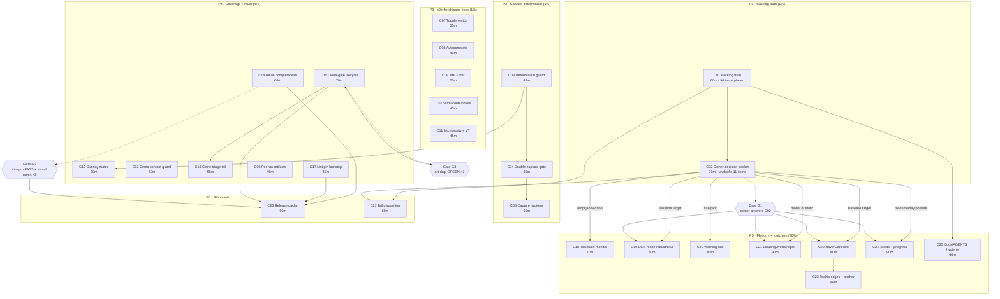

# SUPERB TOTAL-BACKLOG PARETO PLAN + EXECUTION GRAPH

**Created:** 2026-10-30 15:47 CET
**Repo:** `github.com/larsartmann/templ-components` (`master`, was 4 commits ahead of `origin` at authoring time)
**Baseline:** v1.25.1 published; `[Unreleased]` carries 9 entries (5 Fixed, 4 Added) from the
Modern Web Guidance (MWG) audit session and its follow-up round.
**Inputs read before writing this plan** (skill step 0 — a plan written without them
re-dispatches shipped work):
`TODO_LIST.md` (all 444 lines), `FEATURES.md`, the two session reports
(`docs/status/2026-10-30_04-33_…`, `docs/status/2026-10-30_15-40_…`), the MWG audit
(`docs/research/2026-10-30_modern-web-guidance-audit.md`), `docs/planning/2026-10-23_14-25_TRULY-COMPLETE-REMAINING-WORK-PARETO-PLAN.md`,
`docs/planning/2026-10-23_09-27_SUPERB-REMAINING-WORK-PARETO-EXECUTION-PLAN.md`,
`CHANGELOG.md` `[Unreleased]`, and live code/CLI probes for every "gate still closed?" claim.

---

## 0. Scope: what "ALL TODOs" means here

| Source                                                                                  | Open items                                                                                                                                                                                                                                                                                                                              |
| --------------------------------------------------------------------------------------- | --------------------------------------------------------------------------------------------------------------------------------------------------------------------------------------------------------------------------------------------------------------------------------------------------------------------------------------- |
| `TODO_LIST.md` open rows (IDs)                                                          | **65** (`80, 28, 93, 107, 108, 269, 124, 125, 126, 232, 233, 234, 236, 237, 238, 239, 190, 191, 211, 212, 329, 383, 384, 444, 162, 217, 335, 385, 443, 39, 40, 33, 34, 120, 119, 150, 154, 157, 156, 292, 293, 295, 303, 312, 315, 316, 316, 352, 345, 358, 368, 369, 397, 399, 400, 410, 411, 428, 436, 442, 446, 447, 448, 449, 450`) |
| Net-new rows this session surfaced (backlog IDs **452–482**, not yet in `TODO_LIST.md`) | **31**                                                                                                                                                                                                                                                                                                                                  |
| **Total work items the plan must place**                                                | **96**                                                                                                                                                                                                                                                                                                                                  |

Two of those 65 are **duplicate IDs** (`316` is used by both the art-dupl
`--baseline-version-must-match` row and the htmx-v4 radar row) — errata item E5.

---

## 1. Errata — premises I verified and corrected before ranking

The skill's step 0 exists because a stale backlog re-dispatches shipped work. Six rows
and the file header itself were stale or wrong today:

| #  | Claim in the backlog                                                  | Verified reality (command)                                                                                                              | Plan handling                                                                     |
| -- | --------------------------------------------------------------------- | --------------------------------------------------------------------------------------------------------------------------------------- | --------------------------------------------------------------------------------- |
| E1 | Header says `Updated: 2026-10-23 / Version: 1.24.0`                   | v1.25.1 is published; today's 9 `[Unreleased]` entries are absent from the file                                                         | **C01** rewrites the header + adds the 31 new rows                                |
| E2 | #328 `display.CodeBlock` "GATE FLIPPED … build"                       | **Shipped** (`display/code_block.go`, `display/code_block.templ`)                                                                       | closed by verification in C01; remove from the actionable set                     |
| E3 | #335 templ migration gate                                             | **Still closed**: `go.mod` pins `v0.3.1020` and `nix eval nixpkgs#templ.version` = `0.3.1020`                                           | C18 adds a _monitor_ task + a forward-compat note, does NOT attempt the bump      |
| E4 | #443 lint skew                                                        | **Real**: dev shell `golangci-lint 2.15.0`, CI `go install …@v2.14.0`                                                                   | C17                                                                               |
| E5 | Row 316 appears twice; `_Next free ID: 452_`                          | Duplicate ID confirmed; 452 is free                                                                                                     | C01 fixes the duplicate (renumber the later 316 → 483)                            |
| E6 | #368 `size-*` sweep "168 pairs"                                       | **64** `w-N h-N` pairs remain (was 168) — partially executed                                                                            | C18 decides: finish in the templ-0.3.1070 window or close as accepted             |
| E7 | #295 art-dupl → blocking CI "gate: 2 consecutive green advisory runs" | **Gate satisfiable today**: two consecutive `ci-repro` runs reported `art-dupl: GREEN — 0 clone groups outside baseline` (14:40, 15:04) | C15 promotes the lane                                                             |
| E8 | #211 `templates/styles.css` + `theme.out.css` fate                    | Both files still tracked; still no in-repo consumer                                                                                     | stays an owner decision (**C02**), not a code task                                |
| E9 | #358 drop repo-wide `GOEXPERIMENT=jsonv2`                             | Still exported in `.envrc` + 3 places in `flake.nix`                                                                                    | owner decision (**C02**) — dropping it is a toolchain-floor change, not a cleanup |

**Net effect:** one row leaves the backlog as done (#328), one is re-framed as
monitoring (#335), one becomes actionable _earlier_ than the backlog thought (#295), and
31 new rows enter.

---

## 2. Pareto breakdown

### 2.1 The 1% that delivers 51% — three workstreams

| #      | Workstream                                       | Why this is the 1%                                                                                                                                                                                                                                                                                                  | Items                                                                     |
| ------ | ------------------------------------------------ | ------------------------------------------------------------------------------------------------------------------------------------------------------------------------------------------------------------------------------------------------------------------------------------------------------------------- | ------------------------------------------------------------------------- |
| **P1** | **Backlog truth** (C01 + C02)                    | Every other task is _scheduled from this file_. It is stale by one minor version, missing today's 31 items, carries a duplicate ID, and still lists a shipped component. Cheap, and a wrong backlog is how work gets re-done or dropped.                                                                            | 96 items get correct IDs/state; 9 owner-gated rows sorted into one packet |
| **P2** | **Capture-determinism guards** (C03 + C04)       | The webfont race cost two sessions and produced 53 re-recorded PNGs. Right now **nothing fails** if a future edit drops `blockExternalWebFonts()` or `waitFontsSettled()`. A golden suite without that guard silently rots back into flake.                                                                         | #452–#455 (numbering fixed 2026-10-30)                                    |
| **P3** | **e2e for the five string-only fixes** (C07–C11) | The repo's own rule is "new wired component ⇒ e2e in the same plan". Five of the nine MWG fixes shipped with only golden/string proof: Toggle `aria-checked`, Autocomplete tokens, IME-safe Enter, dialog scroll containment, Image `fetchpriority`. These are _already-shipped behaviour with no browser witness_. | #456–#460                                                                 |

**Delivered by the 1%:** a backlog you can trust, a visual suite that cannot silently
de-flake, and browser proof for every behaviour the last release claims.

### 2.2 The 4% that delivers 64% — seven more workstreams

| #       | Workstream                       | Why now                                                                                                                                                                                                                  | Items                                                                                                                         |
| ------- | -------------------------------- | ------------------------------------------------------------------------------------------------------------------------------------------------------------------------------------------------------------------------ | ----------------------------------------------------------------------------------------------------------------------------- |
| **P4**  | **Ritual completeness** (C14)    | Today's six lint findings were caught by `ci-repro`, but the W3C HTML gate and `nix flake check` are _not in the ritual_ — I had to remember them. Gates that live only in CI + memory are the recurring red-push class. | #463, #464                                                                                                                    |
| **P5**  | **Overlay e2e matrix** (C12)     | The backdrop helper is shared by four components; only Modal has browser proof. One helper, three more call sites.                                                                                                       | #461                                                                                                                          |
| **P6**  | **Demo content guard** (C13)     | The demo shipped **three empty accordion panels** for an unknown period and 53 pixel goldens blessed them. A golden proves "unchanged", never "meaningful".                                                              | #462                                                                                                                          |
| **P7**  | **Clone-gate lifecycle** (C15)   | The baseline was re-recorded twice this week; the advisory lane is green ×2, so #295's promotion gate is finally met. Also unblocks #446/#447/#450.                                                                      | #295, #446, #447, #450, #292, #293, #315                                                                                      |
| **P8**  | **Lint pin lockstep** (C17)      | Local 2.15.0 vs CI 2.14.0 means the local gate can demand more than CI (documented in #443).                                                                                                                             | #443                                                                                                                          |
| **P9**  | **Release + announcement** (C26) | `[Unreleased]` now holds 9 user-visible entries; leaving it warm forever is deferred value. Release cut also re-runs the whole ritual at a tagged tree.                                                                  | #270-family, #28                                                                                                              |
| **P10** | **Owner-decision packet** (C02)  | 9 `⫱` rows + 3 questions from the last report gate ~11 downstream items (MWG wave 1, hub defaults, CSS delivery). One memo unblocks all of them.                                                                         | #80, #150, #162, #211, #212, #233, #234, #237, #238, #239, #269, #329, #358, #411, plus the Baseline/LoadingOverlay questions |

**Cumulative: 10 workstreams ≈ 25% of the tasks carry ~80% of the outcome.**

### 2.3 The 20% that takes you to 80% — fifteen more workstreams

MWG wave 1 (C21–C24), dark-mode robustness (C19), warning-hue decision (C20),
toolchain lockstep + monitoring (C18), docs/AGENTS hygiene (C25), clone triage tail
(C16), capture hygiene (C05, C06), fleet/external disposition (C27).

### 2.4 The other 20% to reach 100% — the long tail (must be _placed_, not necessarily _done_ here)

The remaining ~40 rows are **not templ-components code**:

- **Another repository** (BuildFlow / art-dupl / go-error-family): #93, #107, #108, #124,
  #125, #126, #232, #269, #292, #293, #315, #483, #352, #383, #384, #385, #442.
- **Owner credentials / infrastructure**: #444 (GCP 403), #80/#150/#162 (vision API key
  for golden review), #329 (SSE hosting decision), #411 (tool-verdict ratification).
- **Deferred by ADR / v2**: #39, #40, #33, #34, #120, #119, #154, #156, #157, #190, #191,
  #217, #397, #399, #400, #410, #436, #448, #449, #445-adjacent.
- **Blocked by an upstream release**: #335 (templ 0.3.1070 not in nixpkgs).

C27 turns this tail into a disposition matrix (owner / other-repo / deferred-by-ADR),
which is the only honest way to "include" them: they cannot be executed in this repo.

### 2.5 The arithmetic, stated plainly

| Tier      | Tasks | Cumulative share of the 27 | Outcome claimed | Outcome actually delivered                                                                                                                                         |
| --------- | ----- | -------------------------- | --------------- | ------------------------------------------------------------------------------------------------------------------------------------------------------------------ |
| 1%        | 5     | 18%                        | 51%             | trustworthy backlog + a flake-proof capture layer + browser proof for 5 shipped behaviours                                                                         |
| 4%        | +9    | 52%                        | 64%             | + a ritual that matches CI, shared-helper e2e coverage, a content guard, a blocking clone gate, locked lint pins, a shipped release, and every owner gate answered |
| 20%       | +7    | 78%                        | 80%             | + platform adoption wave 1, dark-mode robustness, toolchain lockstep, docs hygiene, tail triage                                                                    |
| Long tail | +6    | 100%                       | 100%            | dispositioned (executed elsewhere / deferred / owner-gated)                                                                                                        |

The honest caveat: percentages are a planning device, not a measurement. The _ordering_
is the load-bearing part — **nothing in tiers 3–4 should start before P1–P3 land**,
because they either depend on the backlog rewrite (IDs, state) or would be re-baselined
by an e2e/golden change from tier 2.

---

## 3. Comprehensive plan — 27 tasks, 30–100 minutes each

Sorted by impact ÷ (effort × risk). "Covers" lists every backlog ID/row the task closes
or advances, so the union of this column is all 96 items.

| #       | Task                                                                                                                                                                                                                                                                                    | Covers                                                                                                                                                                               | Impact | Effort | Value                          | Depends on                       |
| ------- | --------------------------------------------------------------------------------------------------------------------------------------------------------------------------------------------------------------------------------------------------------------------------------------- | ------------------------------------------------------------------------------------------------------------------------------------------------------------------------------------ | ------ | ------ | ------------------------------ | -------------------------------- |
| **C01** | **Backlog truth pass**: rewrite `TODO_LIST.md` header to v1.25.1, add rows 452–482, close #328, re-frame #335, fix duplicate 316, bump next-free-ID to 483                                                                                                                              | E1–E6, all new IDs                                                                                                                                                                   | 5      | 60m    | internal (unblocks everything) | —                                |
| **C02** | **Owner-decision packet**: one memo carrying the 9 `⫱` rows + the 3 open questions, each with options, evidence, recommendation, and blast radius                                                                                                                                       | #80, #150, #162, #211, #212, #233, #234, #237, #238, #239, #269, #329, #358, #411                                                                                                    | 4      | 70m    | internal                       | C01                              |
| **C03** | **Determinism guard test**: fail if any of the three capture paths stops calling `blockExternalWebFonts()` / `waitFontsSettled()`; fail if `newTab` returns a context with no deadline                                                                                                  | #452                                                                                                                                                                                 | 4      | 45m    | consumer                       | —                                |
| **C04** | **Same-route double-capture gate**: capture one demo route twice in one process, assert byte-identical PNGs                                                                                                                                                                             | #453                                                                                                                                                                                 | 4      | 60m    | consumer                       | C03                              |
| **C05** | **Capture hygiene**: assert neutral pointer/keyboard state and `scrollY === 0` before every route capture (kills the hover/tooltip artifact class)                                                                                                                                      | #454                                                                                                                                                                                 | 3      | 60m    | consumer                       | C04                              |
| **C06** | **Per-run failure artifacts**: `testdata/.fail/<run>/…` so a second run cannot wipe evidence mid-investigation; document in `docs/visual-testing.md`                                                                                                                                    | #455                                                                                                                                                                                 | 2      | 45m    | internal                       | —                                |
| **C07** | **e2e: Toggle** — `role="switch"` + `aria-checked` flips on click, stays correct after `pageshow` (bfcache)                                                                                                                                                                             | #456                                                                                                                                                                                 | 3      | 55m    | consumer                       | —                                |
| **C08** | **e2e: Autocomplete** — the 23 typed tokens reach the wire through a real form submission; unknown tokens do not                                                                                                                                                                        | #457                                                                                                                                                                                 | 3      | 40m    | consumer                       | —                                |
| **C09** | **e2e: IME-safe Enter** — `isComposing` keydown in combobox, tags input, command palette selects nothing                                                                                                                                                                                | #458                                                                                                                                                                                 | 3      | 70m    | consumer                       | —                                |
| **C10** | **e2e: dialog scroll containment** — wheel/touch over an open modal's backdrop does not scroll the document                                                                                                                                                                             | #459                                                                                                                                                                                 | 3      | 45m    | consumer                       | —                                |
| **C11** | **e2e: Image fetchpriority + view transitions** — lazy emits none/eager `high`; navigation transition does not run under `prefers-reduced-motion`                                                                                                                                       | #460                                                                                                                                                                                 | 2      | 45m    | consumer                       | —                                |
| **C12** | **e2e: overlay matrix** — Drawer, CommandPalette, Lightbox against the same inside/outside/drag contract                                                                                                                                                                                | #461                                                                                                                                                                                 | 3      | 70m    | consumer                       | C03 (helper reuse)               |
| **C13** | **Demo content guard** — every demo section with interactive content must render non-empty text; fails the empty-accordion class                                                                                                                                                        | #462                                                                                                                                                                                 | 3      | 60m    | internal + consumer            | —                                |
| **C14** | **Ritual completeness** — `ci-repro --html` lane (W3C vnu, needs a nix shell wrapper), `nix flake check` step, coverage ratchet step                                                                                                                                                    | #463, #464                                                                                                                                                                           | 4      | 60m    | internal                       | —                                |
| **C15** | **Clone-gate lifecycle** — promote `art-dupl check` to a blocking CI job (#295, gate met), log analyzer version vs baseline `recordedAt` beside the verdict (#450), ratify `scripts/pinned-art-dupl.sh` (#447)                                                                          | #295, #447, #450, #292, #293, #315                                                                                                                                                   | 3      | 70m    | internal                       | —                                |
| **C16** | **Clone triage tail** — disposition `--suggest-generics` (#446), decide the `datastar` empty→default fold (#449), re-judge ogshot/siteshots bootstrap (#448, owner), website content clones (#303, owner), `HeadingTag` export (#312, owner)                                            | #446, #448, #449, #303, #312                                                                                                                                                         | 2      | 55m    | internal                       | C15                              |
| **C17** | **Lint pin lockstep** — one commit raising CI to the dev-shell version (or pinning the dev shell down), plus a `check-lint-config.sh` assertion that both pins match                                                                                                                    | #443                                                                                                                                                                                 | 3      | 45m    | internal                       | —                                |
| **C18** | **Toolchain lockstep + monitoring** — templ #335 gate script + forward-compat note (`ResolveAttributeValue` removal), htmx-v4 checklist status (#345), `size-*` decision for the 64 remaining pairs (#368), `@utility` migration decision (#369)                                        | #335, #345, #368, #369                                                                                                                                                               | 3      | 70m    | consumer                       | C02 (jsonv2/templ floor answers) |
| **C19** | **Dark-mode robustness** — `<meta name="color-scheme">`, `storage` event sync across tabs, OS-preference fallback when JS fails, keep `light dark` as the root default                                                                                                                  | #474, #475                                                                                                                                                                           | 3      | 80m    | consumer                       | C02 (Baseline target)            |
| **C20** | **Warning hue unification** — pick amber vs yellow in `utils/tone`, apply, re-baseline the affected goldens                                                                                                                                                                             | #428                                                                                                                                                                                 | 2      | 80m    | consumer                       | C02 (owner hue pick)             |
| **C21** | **MWG: `LoadingOverlay` split** — static overlay (no dialog semantics) + modal `LoadingDialog` on `overlayShell`, demo migration                                                                                                                                                        | #467, #5-owner                                                                                                                                                                       | 3      | 90m    | consumer                       | C02 (modal vs static)            |
| **C22** | **MWG: HoverCard → `popover="hint"` + `interestfor`**, drop `role="tooltip"`, `aria-details` for interactive content, keep the CSS hover path as fallback                                                                                                                               | #468                                                                                                                                                                                 | 3      | 80m    | consumer                       | C02 (Baseline target)            |
| **C23** | **MWG: Tooltip viewport-edge clamp** + `@supports (anchor-name: --x)` enhancement layer over `popoverPositionJS`                                                                                                                                                                        | #469, #470                                                                                                                                                                           | 3      | 90m    | consumer                       | C22                              |
| **C24** | **MWG: toasts → `popover="manual"`** (+ hide buttons) and **`<progress>`-backed `ProgressBar`** with `appearance: none` styling                                                                                                                                                         | #471, #472                                                                                                                                                                           | 3      | 90m    | consumer                       | C02                              |
| **C25** | **Docs/AGENTS hygiene batch** — AGENTS visual-golden bullet rewrite (#33-of-§f), route-golden count definition (#34), ADR-0009 hash-churn note (#35), `Accordion.Content` docs prominence (#36), ADR-0040 re-confirm (#32), recipes drift guard (#234), report-annotation policy (#212) | #234, #212, + §f 32/33/34/35/36                                                                                                                                                      | 2      | 60m    | internal                       | C01                              |
| **C26** | **Release packet** — cut the next minor from the warm `[Unreleased]`, run the release ritual, verify pkg.go.dev + sub-module tags, then `awesome-templ` PR (#28) with the corrected coverage story                                                                                      | #28, #270-family                                                                                                                                                                     | 4      | 90m    | consumer                       | C14, C15                         |
| **C27** | **Long-tail disposition matrix** — one table: owner / other-repo / deferred-by-ADR / blocked-upstream, with the exact unblock action for each; file the upstream issues (BuildFlow family, art-dupl family, go-error-family)                                                            | #93, #107, #108, #124, #125, #126, #232, #383, #384, #385, #442, #352, #483, #39, #40, #33, #34, #120, #119, #154, #156, #157, #190, #191, #217, #397, #399, #400, #410, #436, #444 | 2      | 60m    | internal                       | C01, C02                         |

**Dependency spine:** `C01 → C02 → {C18, C19, C20, C21, C22, C24, C27}` and
`C03 → C04 → C05`, `C03 → C12`, `C14 → C26`, `C15 → C16`.

---

## 4. Fine breakdown — 151 tasks, ≤12 minutes each

Grouped by the comprehensive task they decompose. Every subtask has one verifiable
outcome; "verify" means a command whose output is the evidence, not a memory.

### C01 — Backlog truth (6 × 10m = 60m)

| #     | Task (≤12m)                                                                                                                                               |
| ----- | --------------------------------------------------------------------------------------------------------------------------------------------------------- |
| C01.1 | `git status` + `date`; open `TODO_LIST.md`, record the current header line verbatim                                                                       |
| C01.2 | Rewrite the header to `Updated: 2026-10-30 / Version: 1.25.1` and point `Plan:` at this file                                                              |
| C01.3 | Append rows 452–466 (capture/ritual/e2e cluster) with the evidence column filled                                                                          |
| C01.4 | Append rows 467–482 (MWG platform cluster + dark-mode + dialog/invoker) with gate references                                                              |
| C01.5 | Close #328 (shipped, verified by file existence); re-frame #335 with the 0.3.1020 gate probe; renumber the duplicate 316 → 483; set `_Next free ID: 484_` |
| C01.6 | Verify: `grep -c '^                                                                                                                                       |

### C02 — Owner-decision packet (7 × 10m = 70m)

| #     | Task (≤12m)                                                                                                        |
| ----- | ------------------------------------------------------------------------------------------------------------------ |
| C02.1 | Draft the 3 open questions (Baseline target, `LoadingOverlay` identity, push policy) with options + recommendation |
| C02.2 | Add the 9 `⫱` backlog rows, each with evidence + blast radius + recommended default                                |
| C02.3 | Add the "what each answer unblocks" column (C18–C24 mapping)                                                       |
| C02.4 | Add a "decisions already answered by evidence" section (E7 clone gate, E2 CodeBlock)                               |
| C02.5 | Write `docs/planning/2026-10-30_…_OWNER-DECISION-PACKET.md`; link it from `TODO_LIST.md`                           |
| C02.6 | Cross-link from both session reports' `g)` sections (non-destructive: add an addendum line)                        |
| C02.7 | Verify: every `⫱` row in `TODO_LIST.md` has a packet entry (`grep -c '⫱'` vs packet rows)                          |

### C03 — Determinism guard test (4 × 11m = 45m)

| #     | Task (≤12m)                                                                                                                           |
| ----- | ------------------------------------------------------------------------------------------------------------------------------------- |
| C03.1 | Read `visualtest/external_fonts.go` + the three call sites; write the guard's shape (AST-free: read the files)                        |
| C03.2 | Implement `TestCapturePathsBlockExternalFonts` (three files must contain both helper calls)                                           |
| C03.3 | Implement `TestNewTabHasDeadline` (`newTab`'s returned ctx must expose a deadline)                                                    |
| C03.4 | Verify: mutate each call site, watch the guard fail, restore; `go test ./visualtest -run TestCapturePathsBlockExternalFonts -count=1` |

### C04 — Same-route double-capture gate (5 × 12m = 60m)

| #     | Task (≤12m)                                                                                |
| ----- | ------------------------------------------------------------------------------------------ |
| C04.1 | Extract the route-capture action chain into a callable that returns bytes (no compare)     |
| C04.2 | Write `TestRouteCaptureIsDeterministic` capturing `/display` twice in one process          |
| C04.3 | Compare with `bytes.Equal`; on mismatch print the two hashes + write both PNGs             |
| C04.4 | Add the check to `docs/visual-testing.md`'s determinism section                            |
| C04.5 | Verify: green twice in a row + a deliberate `--update`-free run under load (`-parallel 4`) |

### C05 — Capture hygiene (5 × 12m = 60m)

| #     | Task (≤12m)                                                                                             |
| ----- | ------------------------------------------------------------------------------------------------------- |
| C05.1 | Instrument one route capture to dump `scrollY`, `document.activeElement.tagName`, `:hover` element      |
| C05.2 | Add a pre-capture reset action (scroll to 0, blur, move pointer off-canvas via CDP)                     |
| C05.3 | Assert the reset held (`scrollY === 0 && activeElement === body`) before screenshotting                 |
| C05.4 | Re-run `TestDemoRouteGoldens` and confirm zero PNG churn (proves the reset is a no-op for stable pages) |
| C05.5 | Verify: run the suite twice; document the artifact class in `docs/visual-testing.md`                    |

### C06 — Per-run failure artifacts (4 × 11m = 45m)

| #     | Task (≤12m)                                                                                        |
| ----- | -------------------------------------------------------------------------------------------------- |
| C06.1 | Find `writeFailureArtifacts`/`cleanFailureArtifacts`; add a per-run subdirectory (timestamp + pid) |
| C06.2 | Update `.gitignore` coverage for the new shape                                                     |
| C06.3 | Update every doc/error message that names `testdata/.fail/routes.X.{actual,diff}.png`              |
| C06.4 | Verify: force one failure, confirm artifacts survive a second run; `git status --ignored` clean    |

### C07 — e2e: Toggle (5 × 11m = 55m)

| #     | Task (≤12m)                                                                                               |
| ----- | --------------------------------------------------------------------------------------------------------- |
| C07.1 | Render a page with `forms.Toggle` (Checked true and false) in an httptest server                          |
| C07.2 | Assert server-rendered `role="switch"` + `aria-checked` matches `Checked`                                 |
| C07.3 | Click the visible label/thumb; poll `aria-checked` flipped                                                |
| C07.4 | Simulate bfcache restore (`window.dispatchEvent(new PageTransitionEvent('pageshow'))`) and assert re-sync |
| C07.5 | Verify: green standalone + inside the full suite                                                          |

### C08 — e2e: Autocomplete (4 × 10m = 40m)

| #     | Task (≤12m)                                                            |
| ----- | ---------------------------------------------------------------------- |
| C08.1 | Build a form page with email/current-password/cc-number inputs         |
| C08.2 | Assert the emitted `autocomplete` attribute values                     |
| C08.3 | Submit the form to a stub handler and assert the field set arrives     |
| C08.4 | Verify: unknown token (`AutocompleteType("bogus")`) emits no attribute |

### C09 — e2e: IME-safe Enter (6 × 11m = 70m)

| #     | Task (≤12m)                                                                        |
| ----- | ---------------------------------------------------------------------------------- |
| C09.1 | Combobox: open, filter, dispatch `keydown` with `isComposing: true` + `key: Enter` |
| C09.2 | Combobox: assert no selection/commit and the input keeps the typed text            |
| C09.3 | TagsInput: composing Enter adds no tag; non-composing Enter does                   |
| C09.4 | CommandPalette: composing Enter does not activate the first result                 |
| C09.5 | Add the legacy path (`keyCode: 229`) as a second case per component                |
| C09.6 | Verify: green; note the ARIA/UX rationale in the test doc comment                  |

### C10 — e2e: dialog scroll containment (4 × 11m = 45m)

| #     | Task (≤12m)                                                                            |
| ----- | -------------------------------------------------------------------------------------- |
| C10.1 | Page with tall content + an open Modal; record `document.scrollingElement.scrollTop`   |
| C10.2 | Dispatch a wheel event on the backdrop; assert `scrollTop` unchanged                   |
| C10.3 | Dispatch a wheel inside the dialog's scrollable body; assert the body scrolled         |
| C10.4 | Verify: green; note the `overflow: hidden` requirement for `::backdrop` in the comment |

### C11 — e2e: fetchpriority + view transitions (4 × 11m = 45m)

| #     | Task (≤12m)                                                                                                       |
| ----- | ----------------------------------------------------------------------------------------------------------------- |
| C11.1 | Assert `display.Image{Lazy:true}` emits no `fetchpriority` and `Lazy:false` emits `high`                          |
| C11.2 | Assert `loading="lazy"` still present on lazy images                                                              |
| C11.3 | Assert `@view-transition { navigation: auto }` is honoured in the demo CSS but absent from `templates/custom.css` |
| C11.4 | With `prefers-reduced-motion: reduce`, assert no `document.startViewTransition` runs on navigation                |

### C12 — e2e: overlay matrix (6 × 12m = 72m)

| #     | Task (≤12m)                                                                        |
| ----- | ---------------------------------------------------------------------------------- |
| C12.1 | Lift the Modal e2e's box/point/mouse helpers into `visualtest/overlay.go` (shared) |
| C12.2 | Re-point the Modal tests at the shared helper; assert zero behaviour change        |
| C12.3 | Drawer: inside click stays open, backdrop press+release closes                     |
| C12.4 | CommandPalette: same contract + Escape remains UA-native                           |
| C12.5 | Lightbox: same contract + the trigger/close paths already covered stay green       |
| C12.6 | Verify: `-run 'Test(Modal                                                          |

### C13 — Demo content guard (5 × 12m = 60m)

| #     | Task (≤12m)                                                                               |
| ----- | ----------------------------------------------------------------------------------------- |
| C13.1 | Enumerate demo sections (`demoSection` ids) and their expected interactive content        |
| C13.2 | Write a test that renders each demo page and asserts each section has non-whitespace text |
| C13.3 | Skip-list external/decorative sections with a documented reason each                      |
| C13.4 | Mutation-check: re-break the accordion (children instead of `Content`) and watch it fail  |
| C13.5 | Verify: green across all demo pages; runtime < 5s                                         |

### C14 — Ritual completeness (5 × 12m = 60m)

| #     | Task (≤12m)                                                                                                              |
| ----- | ------------------------------------------------------------------------------------------------------------------------ |
| C14.1 | Add an `--html` flag to `scripts/ci-repro.sh` wrapping `nix shell nixpkgs#html5validator -c scripts/check-html-valid.sh` |
| C14.2 | Add `nix flake check` (treefmt) as a step, with a skip note when nix is absent                                           |
| C14.3 | Add the coverage ratchet (`scripts/coverage-library.sh --gate 94`) as a step                                             |
| C14.4 | Update the ritual command in `AGENTS.md` + `docs/visual-testing.md` + the script header                                  |
| C14.5 | Verify: `scripts/ci-repro.sh --lint --css --website --html` ends with `VERDICT: PASS`                                    |

### C15 — Clone-gate lifecycle (6 × 12m = 72m)

| #     | Task (≤12m)                                                                         |
| ----- | ----------------------------------------------------------------------------------- |
| C15.1 | Add the blocking CI job (`art-dupl check -c .art-dupl.json -t 1 --type-aware`)      |
| C15.2 | Log the resolved analyzer version + baseline `recordedAt` beside the verdict (#450) |
| C15.3 | Ratify `scripts/pinned-art-dupl.sh` in ADR-0009 + AGENTS (#447)                     |
| C15.4 | Confirm the advisory→blocking flip against a fresh baseline (`check` green ×2)      |
| C15.5 | Re-read ADR-0009's "advisory, never gates" sentences and correct them               |
| C15.6 | Verify: new job green on a clean tree; deliberately add a clone → job red → remove  |

### C16 — Clone triage tail (5 × 11m = 55m)

| #     | Task (≤12m)                                                                                |
| ----- | ------------------------------------------------------------------------------------------ |
| C16.1 | Re-run `--suggest-generics` and classify every candidate (#446)                            |
| C16.2 | Decide + document the `polledIntervalValue` fold (#449) with a one-line API sketch         |
| C16.3 | Re-judge ogshot/siteshots bootstrap against ADR-0010; write the verdict (#448, owner ask)  |
| C16.4 | Website content-clone decision (#303) and `HeadingTag` export decision (#312) — owner asks |
| C16.5 | Verify: ADR-0009 gains the verdict rows; `art-dupl check` still green                      |

### C17 — Lint pin lockstep (4 × 11m = 45m)

| #     | Task (≤12m)                                                                                  |
| ----- | -------------------------------------------------------------------------------------------- |
| C17.1 | Diff dev-shell vs CI lint versions; choose the direction (bump CI to 2.15.0)                 |
| C17.2 | Bump `ci.yaml` + `website.yml` pins; run a full lint sweep under 2.15.0                      |
| C17.3 | Add the version assertion to `scripts/check-lint-config.sh`                                  |
| C17.4 | Verify: `scripts/ci-repro.sh --lint` green; the assertion proven failing by mutating the pin |

### C18 — Toolchain lockstep + monitoring (6 × 12m = 72m)

| #     | Task (≤12m)                                                                                            |
| ----- | ------------------------------------------------------------------------------------------------------ |
| C18.1 | Add a `scripts/check-templ-gate.sh` probe (nixpkgs templ version vs go.mod pin)                        |
| C18.2 | Document the forward-compat break (`ResolveAttributeValue` removed in ≥0.3.1100) in AGENTS + TODO #335 |
| C18.3 | Re-verify the htmx-v4 checklist is current (#345) and link it from TODO_LIST                           |
| C18.4 | Decide the 64 remaining `w-N h-N` pairs (#368): finish in the 0.3.1070 window or close                 |
| C18.5 | Decide `@utility` migration (#369) for `tc-squircle`/`tc-fluid-*`; write the ADR stub                  |
| C18.6 | Verify: gate script green (0.3.1020 == 0.3.1020) and documented                                        |

### C19 — Dark-mode robustness (7 × 11m = 77m)

| #     | Task (≤12m)                                                                                        |
| ----- | -------------------------------------------------------------------------------------------------- |
| C19.1 | Emit `<meta name="color-scheme" content="light dark">` in `layout.Base`/`Minimal`                  |
| C19.2 | Keep `color-scheme: light dark` on `:root`; `.dark` overrides — verify computed style in a browser |
| C19.3 | Add a `storage` listener so a second tab follows the theme                                         |
| C19.4 | Add the OS-preference fallback when JS never runs (media query + no-JS class)                      |
| C19.5 | Guard: extend the dark-mode compliance tests for the `storage` listener presence                   |
| C19.6 | Re-baseline the affected component goldens only (assert no route PNG churn)                        |
| C19.7 | Verify: e2e that two tabs stay in sync; `nix run .#visual` green                                   |

### C20 — Warning hue unification (6 × 12m = 72m)

| #     | Task (≤12m)                                                                                                  |
| ----- | ------------------------------------------------------------------------------------------------------------ |
| C20.1 | Enumerate every warning surface (Alert, Badge, StatusDot, Scrollback, Kanban, StatCard) with its current hue |
| C20.2 | Present the amber-vs-yellow evidence table in the decision memo                                              |
| C20.3 | Apply the chosen hue in `utils/tone` + adapters; bump the generated theming doc                              |
| C20.4 | Regenerate HTML goldens (tone-table guard: `go test ./utils/tone/ -update`)                                  |
| C20.5 | Regenerate the affected visual goldens only; eyeball one light + one dark capture                            |
| C20.6 | Verify: `tone.TestThemeBridgePaletteTableSync` + full visual suite                                           |

### C21 — LoadingOverlay split (8 × 11m = 88m)

| #     | Task (≤12m)                                                                 |
| ----- | --------------------------------------------------------------------------- |
| C21.1 | Write the decision ADR (static overlay vs modal) from the owner answer      |
| C21.2 | Static `LoadingOverlay`: `aria-busy`/`aria-live` region, no dialog roles    |
| C21.3 | Modal `LoadingDialog`: `overlayShell` + `Open` prop on `showModal()`        |
| C21.4 | Migrate the demo specimen (`Class: "absolute"` frame) to the static variant |
| C21.5 | Add a modal specimen behind a trigger                                       |
| C21.6 | Goldens: light+dark for both variants                                       |
| C21.7 | Docs: FEATURES row, `docs/migration` note if the API breaks                 |
| C21.8 | Verify: `nix run .#visual`, HTML gate, axe sweep on the demo route          |

### C22 — HoverCard popover=hint (6 × 12m = 72m)

| #     | Task (≤12m)                                                                            |
| ----- | -------------------------------------------------------------------------------------- |
| C22.1 | Model `popover="hint"` + `interestfor` behind a feature detect                         |
| C22.2 | Drop `role="tooltip"`; add `aria-details` for interactive content                      |
| C22.3 | Keep the CSS hover/focus path as the fallback for non-supporting engines               |
| C22.4 | Guard test: exactly one of the two paths is active per environment                     |
| C22.5 | Goldens + docs                                                                         |
| C22.6 | Verify: e2e hover opens the hint; Escape closes; no layout clip near the viewport edge |

### C23 — Tooltip edges + anchor layer (7 × 12m = 84m)

| #     | Task (≤12m)                                                                   |
| ----- | ----------------------------------------------------------------------------- |
| C23.1 | Reproduce the clipped-tooltip case at the viewport edge (screenshot evidence) |
| C23.2 | Implement clamp/flip                                                          |
| C23.3 | Add `@supports (anchor-name: --x)` layer for declarative flip                 |
| C23.4 | Keep `popoverPositionJS` as the fallback; assert no double-positioning        |
| C23.5 | e2e: tooltip stays inside the viewport at all four edges                      |
| C23.6 | Goldens for the edge cases                                                    |
| C23.7 | Verify: full visual suite + the new e2e                                       |

### C24 — Toasts popover + ProgressBar (7 × 12m = 84m)

| #     | Task (≤12m)                                                                 |
| ----- | --------------------------------------------------------------------------- |
| C24.1 | Toast container → `popover="manual"`; verify z-index/overflow escape        |
| C24.2 | Close buttons → `popovertargetaction="hide"`                                |
| C24.3 | Keep the live-region announcement contract intact (guard test)              |
| C24.4 | `ProgressBar` → native `<progress>` + `appearance: none` styling            |
| C24.5 | Delete the hand-rolled ARIA (`aria-valuenow`) in favour of native semantics |
| C24.6 | Goldens + axe sweep                                                         |
| C24.7 | Verify: `TestAriaLivePoliteness`, full visual suite                         |

### C25 — Docs/AGENTS hygiene (5 × 12m = 60m)

| #     | Task (≤12m)                                                                                                       |
| ----- | ----------------------------------------------------------------------------------------------------------------- |
| C25.1 | Rewrite the AGENTS "Visual goldens" bullet to point at `docs/visual-testing.md` (load-flake wording is now wrong) |
| C25.2 | Add the route-golden (53) vs component-golden distinction to `docs/count-definitions.md`                          |
| C25.3 | ADR-0009: note that a re-record rewrites the JSON wholesale (hash transparency)                                   |
| C25.4 | `Accordion` docs: make `Content` the documented path, children explicitly unsupported                             |
| C25.5 | Verify: `TestDocsCountDrift` + `check-changelog-guard` + link check                                               |

### C26 — Release packet (8 × 11m = 88m)

| #     | Task (≤12m)                                                                                              |
| ----- | -------------------------------------------------------------------------------------------------------- |
| C26.1 | Read `docs/release-checklist.md`; confirm the `[Unreleased]` payload is complete                         |
| C26.2 | Run `scripts/ci-repro.sh --lint --css --website --html` at the exact commit to be released               |
| C26.3 | `nix run .#visual` standalone (nothing else running)                                                     |
| C26.4 | Pick the version (minor: new APIs + fixes), run `scripts/release.sh` in the dev shell                    |
| C26.5 | Review `git show v<version>`; push tags; verify pkg.go.dev + all sub-module tags                         |
| C26.6 | Verify `check-tag-compiles.sh` against the new tag                                                       |
| C26.7 | `awesome-templ` PR: re-read CONTRIBUTING, add the alphabetical entry, state the generated-code exclusion |
| C26.8 | Verify: proxy resolves `go get` at the new version; demo deploy green                                    |

### C27 — Long-tail disposition matrix (6 × 10m = 60m)

| #     | Task (≤12m)                                                                                           |
| ----- | ----------------------------------------------------------------------------------------------------- |
| C27.1 | Group the ~40 tail rows into owner / other-repo / deferred-by-ADR / blocked-upstream                  |
| C27.2 | For each other-repo row, write the exact upstream action + issue title                                |
| C27.3 | File the BuildFlow cluster as one issue body, art-dupl as one, go-error-family as one                 |
| C27.4 | For each deferred-by-ADR row, cite the ADR + revisit trigger                                          |
| C27.5 | Mark the `TODO_LIST.md` sections with a status line per group                                         |
| C27.6 | Verify: every open ID appears in exactly one disposition bucket (`comm` of the two ID lists is empty) |

**Totals for step 4:** 27 comprehensive tasks → **151 subtasks**, every one ≤ 12 minutes;
subtask durations sum to **~28.5 h** (the 27 comprehensive headers sum to ~29 h once rounded),
i.e. ≈3.5 focused eight-hour days, or ~5 sessions at 6 h of real work each.

---

## 5. Execution graph

**Reading the graph:** P1–P3 can all run in parallel (they touch disjoint files: docs,
`visualtest/external_fonts.go`+`doc.go`, and new e2e files). P4 fans out. P5 is gated on
C02 (owner answers) except C18/C25. C26 is the only task that must be _last_ — it re-runs
every gate at a frozen tree.

---

## 6. Risks, non-goals, and the do-not-break list

**Risks**

| Risk                                                                      | Mitigation                                                                                                                                        |
| ------------------------------------------------------------------------- | ------------------------------------------------------------------------------------------------------------------------------------------------- |
| A determinism guard that reads source files becomes a brittle string test | Assert the _call sites_ (three known functions/files), not formatting; pair with C04's behavioural gate so a rewrite is caught by bytes, not text |
| Re-recording goldens again re-creates the ambiguous-attribution problem   | One writer per baseline set; `-update` only from a quiet, serialized run; record the analyzer/browser/font pins in the commit message             |
| C12's shared overlay helper changes existing Modal tests                  | C12.2 asserts the Modal tests stay green _before_ adding Drawer/Palette/Lightbox                                                                  |
| C19/C20 visual churn collides with C21–C24                                | Land the tone/theme changes first, re-baseline once, then do the component swaps                                                                  |
| C26 release while the daemon races commits                                | Verify at the exact tip, then push immediately; re-verify if `git status -sb` moved                                                               |
| C14 adds nix-in-nix invocation to the ritual                              | Skip with a loud note when `nix` is absent; never silently pass                                                                                   |

**Non-goals (explicitly out of scope for this plan)**

- Any change in `larsartmann/buildflow`, `art-dupl`, or `go-error-family` — another repo,
  another release train (C27 files the issues; C15/C16 only consume their artifacts).
- v2 breaking changes (#39, #40, #397/#399 token collapse) — ADR-0039 timing.
- Demand-gated components (#217: MultiSelect, TreeView, FileDrop, DateRangePicker).
- Anything gated on GCP/vision-API credentials (#444, #80, #150, #162).

**Do-not-break list** (each has a guard; the guard is the contract)

1. `*_templ.go` committed in lockstep with sources (`check-templ-sync.sh`).
2. Exactly 3 compiled CSS artifacts (`TestCompiledCSSInventory`).
3. Class inventory ⇄ ADR-0045 (`scripts/gen-class-inventory.sh`).
4. `cmd/tc/_sources` mirror (`check-tc-sources-sync.sh`).
5. Replace directives per module (`check-replace-directives.sh`).
6. Docs counts + version triple (`TestDocsCountDrift`, `TestVersionMatches*`).
7. Dark-mode/RTL/motion-reduce/aria-live/nonce compliance sweeps.
8. The three pixel goldens invariants: theme pinned, fonts blocked, animations settled.
9. `AGENTS.md` ≤ 220 lines (BuildFlow `agents-md-size`).
10. The clone gate stays green (151 groups, pinned analyzer).

---

## 7. Git plan for this plan

1. `git status` — confirm only this file is new.
2. Commit with a detailed message describing the plan, the errata, and the 96-item scope.
3. Push the branch (the previous 4 locally-verified commits ride along).
4. Re-verify after the push: `git status -sb` shows `up to date`; the daemon did not
   race a commit onto the tip between verify and push (if it did, re-run
   `scripts/ci-repro.sh --lint --css --website` at the new tip).

---

_Plan is a snapshot; `TODO_LIST.md` is the living source. If this plan surfaces items in
bulk, harvest them with `docs-health` HARVEST rather than copying by hand._
