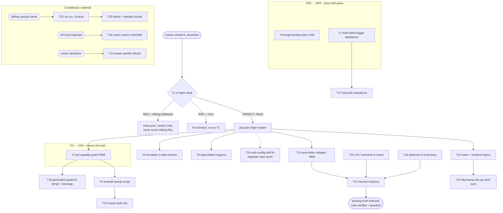

# PARETO BACKLOG-TRUTH & SAFETY PLAN + EXECUTION GRAPH

**Date:** 2026-11-02 00:23 · **Session:** pareto-planning over the full backlog · **Base:** master @ v1.26.0 + 9 daemon commits (ahead of origin, unverified against CI lanes)
**Prior plans honored:** `2026-10-30_15-47_SUPERB-TOTAL-BACKLOG-PARETO` (capture-determinism wave C01–C09 — **shipped**, not re-dispatched) · `2026-10-30_16-30_SUPERB-OWNER-DECISION-PACKET` (⫱ rows proceed on conservative defaults).
**Guardrails:** ADR-0040 (no component-module extraction), dependency budget closed (templ + tailwind-merge-go + go-error-family), templ pin v0.3.1020, M03 push ritual, single-writer protocol.

---

## 0. Scope: what "ALL TODOs" means here

Verified against `TODO_LIST.md` at 2026-11-02 00:23 (58 struck-done rows excluded):

| Bucket                         | Count     | Rows                                                                                     |
| ------------------------------ | --------- | ---------------------------------------------------------------------------------------- |
| **Open — actionable**          | 6         | 162, 217, 335, 385, 995, 996                                                             |
| **Blocked — owner decisions**  | 26        | 80, 28, 93, 107, 108, 269, 270, 124–126, 232–239, 190, 191, 211, 212, 329, 383, 384, 444 |
| **Deferred — v2 catalog**      | ~170 rows | placed as catalog; 3 rows need a truth pass (410, 436, 191 contain DONE text unstruck)   |
| **This week's audit §f items** | 30        | mapped below; duplicates of tracked rows marked as such                                  |

Plus standing policy work (templ window, tone collapse) that is _placed_, not open.

## 1. Errata — premises verified and corrected before ranking

1. **"ahead 9 unverified"** — the branch carries 9 daemon commits (incl. sibling-session component work in `forms/rating.templ`, `feedback/loading.templ`, `feedback/step_indicator.templ` and `utils/format` churn) that have NEVER been through `scripts/ci-repro.sh`. This is the plan's highest-risk fact: everything else assumes a green base.
2. **§f item "close dependabot branch"** — verified real: `origin/dependabot/go_modules/errorpage/minor-and-patch-dc3be6fb51` exists, carries the templ-poisoned bump, unmergeable by policy.
3. **§f item "annotations"** — the older reviews are NOT annotated; this week's review already documents which findings resolved. Pure docs work, no code risk.
4. **#217 demand gate** — CommandPalette already flipped to build (#382, shipped). Remaining demand-gated components: MultiSelect, TreeView, FileDrop, Toast(search?) — re-check is a search pass, not a build task.
5. **#335 templ bump** — still correctly HELD: nixpkgs templ = 0.3.1020 (re-checked 2026-10-23); the migration-window plan (ONE re-baseline event) is the deliverable, not the bump.
6. **#162 / #80 vision review** — both need an API key export; unrunnable in this session, prep-only.
7. **#385** — fix lives in `larsartmann/buildflow` (separate repo); placed, not schedulable here.

## 2. Pareto breakdown

### 2.1 The 1% that delivers 51%

**Verify the base, then lock the discovered bug class shut.**

- **T1 ci-repro + push the ahead-9 tip** — 9 commits of shipped work are unprotected until CI's exact lanes say green. ~45 min. Everything else is built on this.
- **T2 go-error-family pin-equality guard** (TODO #995) — turns this week's _shipped_ skew into a <50 ms CI failure. ~60 min.

Why 51%: the repo's entire value is "consumers can trust the train." An unverified master and a known-unguarded version-skew class are the two live threats to that trust; together they are ~2 h of work.

### 2.2 The 4% that delivers 64%

**Delete recurring taxes and make invisible work visible.**

- **T3 count-table codegen** (TODO #996) — every future component stops paying the same-commit count tax. ~100 min.
- **T4 erraudit sweep script** — today's clean verdict becomes one repeatable command. ~30 min.
- **T5 annotate the three stale reviews** (2026-05-19 `.md`, 2026-07-18 ×2) — docs-health ANNOTATE; the series stops re-deriving resolved findings. ~75 min total.

### 2.3 The 20% that takes you to 80%

**Prep the held gates, sweep the residue, protect the perimeter.**

- **T6 templ migration-window plan** (#335 deliverable) · **T7 display-split trigger dashboard + ROADMAP order** (ADR-0040) · **T8 dependabot hygiene** · **T9 skill-doc fixes in crush-config** · **T10 `nix run .#visual` full re-run** (post sibling-landing) · **T11 index + incident-history entries** · **T12 dep-bump doc: go work sync step** · **T13 house-style doc** (documented-ignore catches, PIPESTATUS rule).

### 2.4 The other 20% to reach 100% — placed, not all executable here

- **T14 owner-decision packet refresh** — re-batch the 26 ⫱ rows with current evidence (vision-review key state, SSE/domain decision 329, templates fate 211, annotation policy 212…). Decisions stay with the owner; the packet stays fresh.
- **T15 #217 demand-gate re-check sweep** (search pass for second consumers) · **T16 Deferred-v2 truth pass** (strike DONE-marked rows 410/436/191-text) · **T17 long-tail tooling evaluations** (D2 contingent diagram, erraudit lsp, `--max` disposition sweep).
- Blocked rows 93/107/108/385/384 → `larsartmann/buildflow` repo, separate session. Rows 124–126, 232–239 (kanban behavior decisions), 190/191, 28, 80 → owner packet. Row 444 → per its own blocker text.

### 2.5 The arithmetic, stated plainly

1% = 2 tasks (~1.75 h) → secures trust. 4% = +3 tasks (~3.5 h) → taxes deleted, docs truthful. 20% = +8 tasks (~7 h) → gates prepped, perimeter swept. Remaining 80% of _volume_ (owner decisions, v2 catalog, external repos) is _placed with an owner and a trigger_ — placement is the deliverable, execution is blocked by design.

---

## 3. Comprehensive plan — 21 tasks, 30–100 minutes each (ALL todos mapped)

| #   | Task                                                                                                                                                              | Tier | Impact       | Effort | Customer value                                       | Covers              |
| --- | ----------------------------------------------------------------------------------------------------------------------------------------------------------------- | ---- | ------------ | ------ | ---------------------------------------------------- | ------------------- |
| T1  | Run `scripts/ci-repro.sh --lint --css --website` at the exact tip; on `VERDICT: PASS` push master immediately (re-verify tip if daemon moved it)                  | 1%   | **Critical** | 45m    | Every consumer: train stays trustworthy              | standing M03 ritual |
| T2  | Add pin-equality guard test (errorpage direct pin == indirect pins in root/visualtest/website), generalizing the go-datastar/static shape                         | 1%   | **Critical** | 60m    | Prevents recurrence of the shipped v0.11/v0.12 skew  | TODO #995, §f1      |
| T3  | Count-table codegen: derive FEATURES/SKILL counts from code (same source as `build.CountStats`), keep `TestDocsCountDrift` as verifier                            | 4%   | High         | 100m   | Maintainers: component tax deleted forever           | TODO #996, §f2      |
| T4  | `scripts/erraudit-sweep.sh` (per-module `fix` dry-run + `lint --type-aware`), README note                                                                         | 4%   | High         | 30m    | Error-model stays modern by default                  | §f3/f4              |
| T5  | docs-health ANNOTATE: 2026-05-19 review (all resolved), 2026-07-18 modularity (resolved by ADR-0034), 2026-07-18 + 2026-10-15 data-model (v2 pending cross-links) | 4%   | Medium       | 75m    | Future sessions stop re-deriving                     | §f12/f13            |
| T6  | Draft templ-window plan: flake-level generator pin + ONE re-baseline event recipe (#368 size-* + #369 @utility + `ResolveAttributeValue`)                         | 20%  | High         | 60m    | Migration fires in hours, not days, when gate opens  | TODO #335, §f25     |
| T7  | Display trigger dashboard script (component count + afferent) + ROADMAP entry: v2 extraction order charts→overlays→tables                                         | 20%  | Medium       | 45m    | ADR-0040 "no trigger" stays a checked claim          | §f27/f14            |
| T8  | Dependabot: add templ (+ go-error-family?) to `ignore` config; close orphan branch `dependabot/go_modules/errorpage/…`                                            | 20%  | Medium       | 30m    | Bot stops proposing policy-violating bumps           | §f9                 |
| T9  | crush-config repo: update go-error-modernization SKILL.md (`fix` uses `-w`, no `--type-aware`; non-Go scanning note); commit there                                | 20%  | Medium       | 30m    | Every future session skips the failed-invocation tax | §f10                |
| T10 | `nix run .#visual` full suite re-run (after sibling session's rating/loading/step_indicator lands + `TestClassInventoryFreshness` green)                          | 20%  | High         | 90m    | Pixel regressions from this week's churn caught      | §f24, B5            |
| T11 | Index assessment in `docs/modularization/README.md` + append errorpage-skew incident to `docs/agent-context-history.md`                                           | 20%  | Low          | 45m    | Provenance answerable; docs discoverable             | §f15/f16            |
| T12 | `docs/external-dependency-bumps.md`: add `go work sync` + go.work.sum freshness step to both families' checklists                                                 | 20%  | Low          | 30m    | Bump protocol covers workspace state                 | §f21                |
| T13 | House-style doc: documented-ignore `catch` pattern for build/website JS + `PIPESTATUS` rule for verification commands                                             | 20%  | Low          | 30m    | Next erraudit pass doesn't re-litigate               | §f22, e4            |
| T14 | Refresh owner-decision packet: re-batch all 26 ⫱ rows with 2026-11 evidence + conservative defaults                                                               | 100% | High         | 60m    | Decisions stay unblocked                             | blocked rows, §f11  |
| T15 | #217 demand-gate re-check: search repos/signals for second consumers of MultiSelect/TreeView/FileDrop; flip or keep gates                                         | 100% | Medium       | 45m    | Demand-driven building stays honest                  | TODO #217           |
| T16 | Deferred-v2 truth pass: strike DONE-marked rows (410, 436, 191-text); verify catalog claims                                                                       | 100% | Medium       | 45m    | Backlog truth                                        | §f, c-list          |
| T17 | Long-tail evaluations: D2 contingent display-split diagram; `erraudit lsp` trial; one `--max` disposition sweep                                                   | 100% | Low          | 60m    | Options stay priced                                  | §f17/18/19          |
| T18 | #162 + #80 vision review first pass — CONDITIONAL on API key export (`scripts/vision-review-goldens.sh`)                                                          | 100% | Medium       | 30m    | Enshrined render bugs ruled out                      | TODO #162/#80       |
| T19 | Generalize pin guard to templ + tailwind-merge across ALL go.mods (one "version train" test)                                                                      | 100% | Medium       | 45m    | Whole train guarded, not one coupling                | §f28                |
| T20 | Demo/website smoke after T10: `nix run .#shots` capture pass + website build check                                                                                | 100% | Medium       | 45m    | Demo truth post-churn                                | §f20 adj.           |
| T21 | Errata/harvest closeout: fold executed outcomes back into TODO_LIST (strike, update), HARVEST new rows                                                            | 100% | Medium       | 30m    | Living backlog stays the single source               | skill mandate       |

Blocked-and-placed (no task — external): 93, 107, 108, 384, 385 (buildflow repo) · 28 (upstream review) · 124–126, 232–239, 190/191, 211, 212, 329 (owner packet, T14) · Deferred v2 catalog (T16 truth pass, then parked until v2).

## 4. Fine breakdown — ≤12-minute subtasks (ALL todos mapped)

| #    | Subtask                                                                                                                                 | Parent | Min | Tier |
| ---- | --------------------------------------------------------------------------------------------------------------------------------------- | ------ | --- | ---- |
| 1.1  | `git fetch` + confirm tip = `git status -sb`; note any daemon movement                                                                  | T1     | 5   | 1%   |
| 1.2  | Run `scripts/ci-repro.sh --lint --css --website` (background, ~8–15 min)                                                                | T1     | 12  | 1%   |
| 1.3  | Read full output; require literal `VERDICT: PASS (exit 0)`; re-run on flake with `-parallel 4`-style patience, never `-update`          | T1     | 10  | 1%   |
| 1.4  | Re-check `git status -sb` unchanged; `git push` immediately; confirm origin tip                                                         | T1     | 5   | 1%   |
| 1.5  | If verdict red: triage lane by lane; sibling-attributed failures → verdict note, never fix their files                                  | T1     | 12  | 1%   |
| 2.1  | Read `scripts/check-replace-directives.sh` + the datastar pin-surface guard test as shape templates                                     | T2     | 10  | 1%   |
| 2.2  | Write `utils.TestGoErrorFamilyPinAlignment`: parse 4 go.mods, assert errorpage direct == consumers' indirect (v-prefixed equality)      | T2     | 12  | 1%   |
| 2.3  | Negative test: temp-tree with v0.11.0 in errorpage → guard must FAIL (proves it fires)                                                  | T2     | 12  | 1%   |
| 2.4  | Run `go test -count=1 ./utils/...`; wire into existing guard-test doc table                                                             | T2     | 10  | 1%   |
| 2.5  | CHANGELOG `[Unreleased]` line + commit                                                                                                  | T2     | 5   | 1%   |
| 3.1  | Map every count-bearing table cell in FEATURES.md/SKILL.md → its code source (components/icons/goldens/enums)                           | T3     | 12  | 4%   |
| 3.2  | Write `tools/countgen` (or `scripts/countgen.sh`): emit the tables from `go list` + golden dir scan, website `CountStats` shape         | T3     | 12  | 4%   |
| 3.3  | Generate; `git diff` against hand-maintained tables; fix discrepancies one by one                                                       | T3     | 12  | 4%   |
| 3.4  | Convert `TestDocsCountDrift` to run countgen in check mode (drift = "run the generator"), keep error messages actionable                | T3     | 12  | 4%   |
| 3.5  | Full root test suite with `-count=1`; update AGENTS.md count-guard sentence (≤220-line budget!)                                         | T3     | 12  | 4%   |
| 3.6  | Doc: `docs/count-definitions.md` stays the semantics owner; note generator in both files' headers                                       | T3     | 10  | 4%   |
| 3.7  | CHANGELOG entry + commit                                                                                                                | T3     | 5   | 4%   |
| 4.1  | Write `scripts/erraudit-sweep.sh`: loop go.mod dirs, `fix` dry-run summary + `lint --type-aware`, non-zero on `errors.As` findings only | T4     | 12  | 4%   |
| 4.2  | Self-test on a scratch copy (inject an `errors.As`, watch it flag)                                                                      | T4     | 10  | 4%   |
| 4.3  | README/AGENTS one-liner + CHANGELOG + commit                                                                                            | T4     | 8   | 4%   |
| 5.1  | ANNOTATE 2026-05-19 `.md`: end-of-file appendix "all findings resolved, see 2026-11-01 review"                                          | T5     | 10  | 4%   |
| 5.2  | ANNOTATE 2026-07-18 modularity HTML: inline note (split shipped via ADR-0034)                                                           | T5     | 12  | 4%   |
| 5.3  | ANNOTATE 2026-07-18 + 2026-10-15 data-model HTMLs: v2-collapse-pending cross-link to 2026-11-01 review                                  | T5     | 12  | 4%   |
| 5.4  | Sanity: re-run structure check on edited HTMLs; commit                                                                                  | T5     | 10  | 4%   |
| 6.1  | Read flake.nix templ input wiring + `check-templ-gate.sh` probe                                                                         | T6     | 10  | 20%  |
| 6.2  | Draft plan doc: generator pin mechanics, golden/visual re-baseline order, #368/#369/ResolveAttributeValue bundling, rollback            | T6     | 12  | 20%  |
| 6.3  | Review against `docs/agent-context-history.md#templ-version`; commit                                                                    | T6     | 10  | 20%  |
| 7.1  | Script: print display component count, file count, afferent importers (go list)                                                         | T7     | 10  | 20%  |
| 7.2  | ROADMAP.md entry: v2 extraction order + trigger definitions T1/T2/T3 cited                                                              | T7     | 10  | 20%  |
| 7.3  | Wire script output into the ROADMAP row as the check command; commit                                                                    | T7     | 10  | 20%  |
| 8.1  | Check `.github/dependabot.yml` current groups                                                                                           | T8     | 5   | 20%  |
| 8.2  | Add `ignore` for templ (+ go-error-family if policy says) with reason string                                                            | T8     | 10  | 20%  |
| 8.3  | `gh` close orphan branch ref + comment pointing at the pin policy                                                                       | T8     | 10  | 20%  |
| 8.4  | Verify actionlint on edited workflow-adjacent YAML; commit                                                                              | T8     | 5   | 20%  |
| 9.1  | Edit go-error-modernization SKILL.md in its source repo (not the fanout!)                                                               | T9     | 12  | 20%  |
| 9.2  | Note non-Go scanning behavior under flag reliability                                                                                    | T9     | 8   | 20%  |
| 9.3  | Commit in crush-config; verify fanout guard script passes                                                                               | T9     | 10  | 20%  |
| 10.1 | Confirm sibling landed: `git status` clean-ish, `TestClassInventoryFreshness -count=1` green                                            | T10    | 10  | 20%  |
| 10.2 | `nix run .#visual` (background ~15–30 min); NEVER concurrently with ci-repro                                                            | T10    | 12  | 20%  |
| 10.3 | Triage mismatches: load-flake rules (`-parallel 4`, never `-update` for load)                                                           | T10    | 12  | 20%  |
| 10.4 | Genuine pixel diffs: root-cause or `-update` via the sanctioned command; commit goldens manually                                        | T10    | 12  | 20%  |
| 11.1 | Add assessment link row to `docs/modularization/README.md`                                                                              | T11    | 5   | 20%  |
| 11.2 | Append skew incident to `docs/agent-context-history.md` (provenance pattern M18-style)                                                  | T11    | 12  | 20%  |
| 11.3 | Commit docs                                                                                                                             | T11    | 5   | 20%  |
| 12.1 | Insert `go work sync` + go.work.sum step into both family checklists in `docs/external-dependency-bumps.md`                             | T12    | 10  | 20%  |
| 12.2 | Cross-check against this session's skew timeline; commit                                                                                | T12    | 8   | 20%  |
| 13.1 | Write house-style section: documented-ignore catch comment format (3 real examples)                                                     | T13    | 10  | 20%  |
| 13.2 | PIPESTATUS/`set -o pipefail` rule + the misread anecdote; commit                                                                        | T13    | 8   | 20%  |
| 14.1 | Re-read owner packet template; list the 26 ⫱ rows with current status column                                                            | T14    | 12  | 100% |
| 14.2 | Update evidence per row (80 key state, 28 PR #12 open, 329 options unchanged, 211/212 recommendations)                                  | T14    | 12  | 100% |
| 14.3 | Re-emit conservative defaults; commit packet v2                                                                                         | T14    | 12  | 100% |
| 15.1 | Search signal sources (sibling repos, issues) for MultiSelect second consumer                                                           | T15    | 12  | 100% |
| 15.2 | Same for TreeView, FileDrop; record verdicts on #217 rows                                                                               | T15    | 12  | 100% |
| 16.1 | Verify + strike row 410 (DONE text), 436, 191-done-parts                                                                                | T16    | 10  | 100% |
| 16.2 | Spot-verify 5 random Deferred claims against CHANGELOG                                                                                  | T16    | 12  | 100% |
| 17.1 | D2 contingent display-split diagram (`.d2` + svg only, no doc rewrite)                                                                  | T17    | 12  | 100% |
| 17.2 | `erraudit lsp --help` + 10-min editor trial verdict                                                                                     | T17    | 12  | 100% |
| 17.3 | `--max` disposition sweep on root module; record posture                                                                                | T17    | 12  | 100% |
| 18.1 | Check for API key in env; if present run `vision-review-goldens.sh`, else record "key needed" in #162/#80                               | T18    | 12  | 100% |
| 18.2 | Human-confirm list: triage SUSPECT findings (or hand off)                                                                               | T18    | 12  | 100% |
| 19.1 | Extend guard test: templ v0.3.1020 + tailwind-merge v0.2.3 equality across all 9 go.mods                                                | T19    | 12  | 100% |
| 19.2 | Negative test + suite run; update guard docs; commit                                                                                    | T19    | 12  | 100% |
| 20.1 | `nix run .#shots` full capture pass; eyeball flagged set                                                                                | T20    | 12  | 100% |
| 20.2 | `cd website && go run ./cmd/site` build + CSP check                                                                                     | T20    | 12  | 100% |
| 21.1 | Strike/fold executed items into TODO_LIST; HARVEST genuinely new rows only                                                              | T21    | 12  | 100% |
| 21.2 | Final `git status` + changelog sanity; commit                                                                                           | T21    | 8   | 100% |

Totals: Table A = 21 tasks; Table B = 82 subtasks. 1% tier = subtasks 1.x + 2.x (17 × ≈10 min ≈ 2.9 h) — everything else can wait a day without loss.

---

## 5. Execution graph

Arithmetic note: nodes inside the 1% subgraph are the only must-run-now items; all other edges start from PUSH because nothing else should build on an unverified master.

## 6. Verschlimmbesser guards

- No templ bump, no module extraction, no new dependencies, no lint-config changes ride this plan.
- T3's generator REPLACES hand-maintenance only after `git diff` proves byte-parity on generated output; `TestDocsCountDrift` stays as the independent verifier.
- T10's `-update` is sanctioned ONLY via `nix run .#visual -- -update`; load flakes get patience, never goldens.
- Sibling files are verdict-only, never edited (single-writer protocol #357).
- Every task ends green or ends with an honest red verdict note — no masking.
