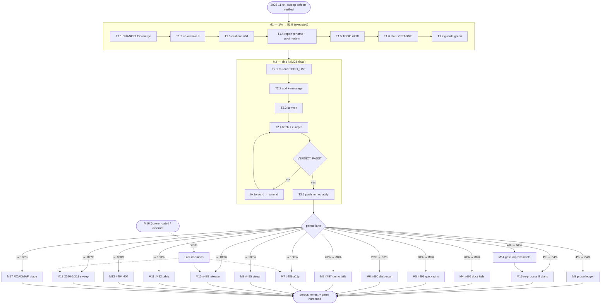

# CORPUS-CLOSE-OUT DEFECT-FIX + FULL-BACKLOG PARETO PLAN

**Date:** 2026-11-04 03:43 | **Owner:** Lars + agent sessions | **Status:** ACTIVE
**Trigger:** the 2026-11-03/04 docs-health corpus sweep (`docs/status/2026-11-04_03-35…self-review`,
`docs/status/2026-11-04_03-27…close-out`) left 3 verified defects + a routed backlog
(TODO_LIST #488–#498) + two un-swept corpora. This plan covers **ALL** of it.

> **Verschlimmbesserung guardrails (the "do no harm" contract):**
>
> 1. Archived files are quoted-as-written — NEVER rewrite their internal links
>    (`lychee.toml exclude_path` is policy, not an accident).
> 2. Bare rows in struck tables are OPEN by design; only strike with evidence.
> 3. Wholly-unstruck tables are invisible to `check-rows` — every archive claim needs a
>    bare-data-row scan, not just the gate exit.
> 4. No push without the M03 ritual: `git fetch` → `scripts/ci-repro.sh --lint --css --website`
>    at the exact tip → read `VERDICT: PASS` → push immediately.
> 5. Doc counts/versions are machine-guarded (countgen + `TestDocsCountDrift` +
>    `TestVersionMatches*`) — never hand-type counts.

---

## Pareto core

| Slice         | Cum. value                    | Contents                                                                                                                                                                                                                                                                                         |
| ------------- | ----------------------------- | ------------------------------------------------------------------------------------------------------------------------------------------------------------------------------------------------------------------------------------------------------------------------------------------------ |
| **1% → 51%**  | Commit integrity              | M1 (defect fixes: CHANGELOG headings, 64 path citations, un-archive 9 planning files, sweep-report rename + postmortem, TODO #498, `docs/status/README.md` index) + **M2: commit + M03 push ritual**. Without this, master ships a CHANGELOG split-brain and 213 staged renames race the daemon. |
| **4% → 64%**  | + corpus honesty & prevention | + M3 (prose-item ledger over the 213 archived files), M14 (gate improvements: UNTOUCHED-table flagging, zero-bare-rows moved-file gate), M15 (re-process the 9 un-archived planning files). Kills the blind-spot class permanently.                                                              |
| **20% → 80%** | + consumer-visible quality    | + M4 (#496 docs tails: README/AGENTS/DOMAIN_LANGUAGE/FEATURES audit), M5 (#493 test/consistency quick wins incl. Alert `templ.Raw` → ScriptComponent), M6 (#490 dark-scan ring-offset/shadow rules), M9 (#497 demo tails).                                                                       |
| **→ 100%**    | + the long tail               | + M7 (#489 keyboard/a11y), M8 (#495 visual tooling), M10 (#488 release/infra), M11 (#492 table), M12 (#494 NotFound404), M13 (2026-10/11 corpus sweep), M17 (ROADMAP residue go/no-go), M16 (⫱ owner-gated/external — listed, not scheduled).                                                    |

---

## TABLE VIEW 1 — Milestones (30–100 min each, sorted by impact/effort/value)

| #     | Milestone (30–100 min)                                                                                                                                                                                                              | Impact | Effort | Value | Depends | Items                                       |
| ----- | ----------------------------------------------------------------------------------------------------------------------------------------------------------------------------------------------------------------------------------- | ------ | ------ | ----- | ------- | ------------------------------------------- |
| M1 ✅ | Defect fixes: CHANGELOG heading merge, 64 citation rewrites, un-archive 9 planning files, sweep-report rename + postmortem, TODO #498, `docs/status/README.md`                                                                      | High   | S      | 51%   | —       | T1.1–T1.7 (executed 2026-11-04 03:35–03:55) |
| M2    | Ship the sweep: TODO_LIST final read, `git add -A`, detailed commit, M03 ritual (`fetch` → `ci-repro --lint --css --website` → `VERDICT: PASS` → push)                                                                              | High   | M      | 51%   | M1      | T2.1–T2.6                                   |
| M3    | Prose-item ledger for the 213 archived files (per-file narrative-vs-item classification, one ledger line per file)                                                                                                                  | Med    | M      | 64%   | M2      | T3.1–T3.4                                   |
| M14   | Gate improvements: `annotate.go` UNTOUCHED-table flag + zero-bare-rows moved-file check + self-test fixtures                                                                                                                        | Med    | M      | 64%   | —       | T14.1–T14.4                                 |
| M15   | Re-process the 9 un-archived planning files (inventor tables → verdicts → re-archive gated)                                                                                                                                         | Med    | M      | 64%   | M14     | T15.1–T15.3                                 |
| M4    | #496 docs tails: README icons section (+IconRTL/AnimatedIcon), README modern-web section, "Last verified" date, DOMAIN_LANGUAGE wire/nonce rows, AGENTS templ+jsonv2 gotchas, starfederation sweep, FEATURES FULLY_FUNCTIONAL audit | Med    | M      | 80%   | M2      | T4.1–T4.7                                   |
| M5    | #493 test/consistency quick wins: Alert→ScriptComponent (+goldens), AssertContainsClass helper, FuzzCombobox, tooltip custom-trigger test, Accordion long-content, CountBadge Max=0, RelativeTime locale, combinatorial bool flags  | Med    | M      | 80%   | M2      | T5.1–T5.8                                   |
| M6    | #490 dark-mode scan: `ring-offset-*` + `shadow-*` rules + Toggle-thumb exception allowlist + goldens                                                                                                                                | Med    | S      | 80%   | M2      | T6.1–T6.3                                   |
| M9    | #497 demo tails: GridColsAutoFit + Card.Header in demo, forms_demo rename decision, demo ld+json decision, docs code-block chrome                                                                                                   | Med    | S      | 80%   | M2      | T9.1–T9.4                                   |
| M13   | 2026-10/11 corpus sweep (~90 files, UNTOUCHED-aware pipeline: inventory → verify → annotate → archive gated)                                                                                                                        | Med    | L      | 95%   | M14     | T13.1–T13.4                                 |
| M7    | #489 keyboard/a11y: MobileMenu focus-trap/Tab-escape, type-ahead, PageUp/PageDown, Tabs parity, Carousel aria-live, arrow-key e2e                                                                                                   | Med    | L      | 95%   | M2      | T7.1–T7.6                                   |
| M8    | #495 visual tooling: configurable #tc-root padding, 50× Chromium variance lane, overlay/blink HTML diff generator                                                                                                                   | Low    | L      | 97%   | M2      | T8.1–T8.3                                   |
| M10   | #488 release/infra: release.sh dry-run + step-0 preflight, push guidance, CI shellcheck job, verify-tag step, worktree script, test-all-modules.sh, provenance stamp                                                                | Med    | L      | 98%   | M2      | T10.1–T10.8                                 |
| M11   | #492 table: Flush+Bordered test, current>total case; demand-gated set ⫱F109                                                                                                                                                         | Low    | S      | 99%   | M2      | T11.1–T11.3                                 |
| M12   | #494 NotFound404 polish (alias/const/wrapper/icon/test decisions; demand-gated per item)                                                                                                                                            | Low    | S      | 99%   | M2      | T12.1–T12.3                                 |
| M17   | ROADMAP residue go/no-go pass (website-growth ideas, v2-leaning API ideas)                                                                                                                                                          | Low    | S      | 100%  | M13     | T17.1–T17.2                                 |
| M16 ⫱ | Owner-gated / external (NOT scheduled): #80 vision eyeball, #93-family BuildFlow, #292/#293 art-dupl upstream, #28 awesome-templ, #22, #39, #157, #190, #211/#303/#312/#411, #156, #238/#239, #335/#368/#369 v2 window, #119-note   | ⫱      | ⫱      | —     | owner   | —                                           |

---

## TABLE VIEW 2 — Micro-tasks (≤12 min each, sorted by importance/impact/effort/value)

| ID      | Task (≤12 min)                                                                                                                                     | M   | Min                                               | Impact |
| ------- | -------------------------------------------------------------------------------------------------------------------------------------------------- | --- | ------------------------------------------------- | ------ |
| T1.1 ✅ | Merge duplicate `[Unreleased]` headings to single Added/Changed/Fixed; re-run changelog guard                                                      | M1  | 8                                                 | 51%    |
| T1.2 ✅ | `git mv` the 9 bare-row planning files back to `docs/planning/`                                                                                    | M1  | 3                                                 | 51%    |
| T1.3 ✅ | Rewrite 64 stale prose path citations in TODO_LIST/ROADMAP to `archived/` (prefix-resolving, kept-open excluded)                                   | M1  | 12                                                | 51%    |
| T1.4 ✅ | Rename sweep report to HH-MM; update refs; append postmortem §1–4                                                                                  | M1  | 10                                                | 51%    |
| T1.5 ✅ | TODO_LIST: insert #498 follow-through row; bump next-free ID                                                                                       | M1  | 5                                                 | 51%    |
| T1.6 ✅ | Write `docs/status/README.md` index (layout, kept-open list, conventions)                                                                          | M1  | 10                                                | 51%    |
| T1.7 ✅ | Guards: count/version/changelog + md-link resolver sweep (0 broken)                                                                                | M1  | 6                                                 | 51%    |
| T2.1    | Final TODO_LIST full read (single-writer check: re-read immediately before edit)                                                                   | M2  | 8                                                 | 51%    |
| T2.2    | `git add -A`; `git status` sanity (213 renames + ~12 edits + 3 new); craft detailed commit message                                                 | M2  | 10                                                | 51%    |
| T2.3    | Commit (hook may run license-check — use the documented wrapper if it trips); verify tree clean                                                    | M2  | 10                                                | 51%    |
| T2.4    | M03: `git fetch origin` + re-check tip; start `scripts/ci-repro.sh --lint --css --website` at exact tip                                            | M2  | 10                                                | 51%    |
| T2.5    | Read ci-repro tail: require `VERDICT: PASS (exit 0)`; on red: fix forward, amend, restart ritual                                                   | M2  | 12                                                | 51%    |
| T2.6    | `git push origin master` IMMEDIATELY after PASS; confirm origin tip == local tip                                                                   | M2  | 3                                                 | 51%    |
| T3.1    | Build prose-ledger scanner: list bare `N.`/`- [ ]` prose lines per archived file                                                                   | M3  | 12                                                | 64%    |
| T3.2    | Classify scanner output: narrative (ledger) vs unresolved item (annotate)                                                                          | M3  | 12                                                | 64%    |
| T3.3    | Apply `<!-- check-rows:ledger -->`-style ledger notes per narrative file                                                                           | M3  | 10                                                | 64%    |
| T3.4    | Annotate the unresolved-item stragglers; re-run both gates                                                                                         | M3  | 12                                                | 64%    |
| T14.1   | Extend `annotate.go check-rows`: flag wholly-unstruck tables (UNTOUCHED) with `--strict`                                                           | M14 | 12                                                | 64%    |
| T14.2   | Add moved-file gate: zero bare `                                                                                                                   | N   | `-rows per archived file (`bare-rows` subcommand) | M14    |
| T14.3   | Fixture tests: untouched-table + bare-row shapes (extend annotate-status-items_test.sh)                                                            | M14 | 12                                                | 64%    |
| T14.4   | Run `annotate.go self-test` + fixture suite; record the new gates in the sweep report conventions                                                  | M14 | 8                                                 | 64%    |
| T15.1   | Inventory the 9 planning files' untouched tables (emit-keys per table)                                                                             | M15 | 12                                                | 64%    |
| T15.2   | Verify+annotate batch 1 (05-18, 07-05_21-27, 07-07_18-10 — 42 rows)                                                                                | M15 | 12                                                | 64%    |
| T15.3   | Verify+annotate batch 2 (07-12 ×2, 07-21_03-54 — 59 rows)                                                                                          | M15 | 12                                                | 64%    |
| T15.4   | Verify+annotate batch 3 (09-13_11-15, 09-19_15-36, 09-19_17-48 — 68 rows)                                                                          | M15 | 12                                                | 64%    |
| T15.5   | check-rows + bare-rows gate per file; re-archive the resolved ones                                                                                 | M15 | 10                                                | 64%    |
| T4.1    | README icons section: add `IconRTL`/`AnimatedIcon` rows                                                                                            | M4  | 10                                                | 80%    |
| T4.2    | README modern-web-standards section (dialog/popover/base-select/field-sizing/print)                                                                | M4  | 12                                                | 80%    |
| T4.3    | README "By the Numbers": add "Last verified 2026-11-04" (countgen-derived)                                                                         | M4  | 5                                                 | 80%    |
| T4.4    | DOMAIN_LANGUAGE: wire (Action/Target/Swap/dialect) + nonce (omit-empty) rows                                                                       | M4  | 12                                                | 80%    |
| T4.5    | AGENTS: templ `//`-comment whitespace gotcha entry                                                                                                 | M4  | 8                                                 | 80%    |
| T4.6    | AGENTS: json/v2 guard mentions (jsontext variant + test guard + CI lane)                                                                           | M4  | 8                                                 | 80%    |
| T4.7    | Sweep `docs/research/datastar-integration-analysis.md` starfederation refs; FEATURES FULLY_FUNCTIONAL spot audit                                   | M4  | 12                                                | 80%    |
| T5.1    | `feedback.Alert`: replace `templ.Raw` concat with `utils.ScriptComponent` (+ omit-empty nonce)                                                     | M5  | 12                                                | 80%    |
| T5.2    | Regenerate Alert goldens; run feedback tests                                                                                                       | M5  | 8                                                 | 80%    |
| T5.3    | `utils.AssertContainsClass` helper + unit test                                                                                                     | M5  | 12                                                | 80%    |
| T5.4    | `FuzzCombobox` + seed corpus                                                                                                                       | M5  | 12                                                | 80%    |
| T5.5    | Tooltip custom-trigger-element test                                                                                                                | M5  | 12                                                | 80%    |
| T5.6    | Accordion >1000px content golden + CountBadge `Max=0` case                                                                                         | M5  | 12                                                | 80%    |
| T5.7    | RelativeTime `Intl.RelativeTimeFormat` locale assertion                                                                                            | M5  | 10                                                | 80%    |
| T5.8    | Combinatorial flag tests for 2+-bool components (pick top 5)                                                                                       | M5  | 12                                                | 80%    |
| T6.1    | darkmode_scan rules: `ring-offset-` + `shadow-` pairs (allowlist `bg-white shadow-sm` Toggle thumb)                                                | M6  | 12                                                | 80%    |
| T6.2    | Fix whatever the new rules flag in library/demo/site                                                                                               | M6  | 12                                                | 80%    |
| T6.3    | Golden re-baseline for touched components; visual suite light+dark                                                                                 | M6  | 12                                                | 80%    |
| T9.1    | Demo: `GridColsAutoFit` section on the layout demo page                                                                                            | M9  | 12                                                | 80%    |
| T9.2    | Demo: `Card.Header` slot showcase (dashboard recipe header)                                                                                        | M9  | 10                                                | 80%    |
| T9.3    | Decide + execute `forms_demo.templ` → `forms_standalone.templ` rename (or record Not-Do)                                                           | M9  | 12                                                | 80%    |
| T9.4    | Docs code-block filename/lang chrome decision + website md renderer note                                                                           | M9  | 12                                                | 80%    |
| T13.1   | Inventory 2026-10/11 corpus (~90 files; UNTOUCHED-aware extraction first)                                                                          | M13 | 12                                                | 95%    |
| T13.2   | Agent-verify batches (3× ~30 files)                                                                                                                | M13 | 12                                                | 95%    |
| T13.3   | Route open residue → TODO_LIST (new IDs); annotate done/superseded                                                                                 | M13 | 12                                                | 95%    |
| T13.4   | Archive the fully-resolved files (both gates) + manifest append                                                                                    | M13 | 12                                                | 95%    |
| T7.1    | MobileMenu: focus-trap vs Tab-escape decision note + implementation                                                                                | M7  | 12                                                | 95%    |
| T7.2    | Listbox type-ahead (first-letter) for Combobox options                                                                                             | M7  | 12                                                | 95%    |
| T7.3    | Combobox PageUp/PageDown + tests                                                                                                                   | M7  | 12                                                | 95%    |
| T7.4    | Tabs keyboard parity when server-rendered (`clientSide` gate audit)                                                                                | M7  | 12                                                | 95%    |
| T7.5    | Carousel `aria-live` slide announcements                                                                                                           | M7  | 12                                                | 95%    |
| T7.6    | Dropdown arrow-key e2e (chromedp, poll helpers)                                                                                                    | M7  | 12                                                | 95%    |
| T8.1    | visualtest: make `#tc-root` padding configurable (default unchanged)                                                                               | M8  | 12                                                | 97%    |
| T8.2    | 50× same-route double-capture variance lane (off by default)                                                                                       | M8  | 12                                                | 97%    |
| T8.3    | Overlay/blink-comparison HTML generator for golden-change PR review                                                                                | M8  | 12                                                | 97%    |
| T10.1   | release.sh: `--dry-run` flag (print plan, no push)                                                                                                 | M10 | 12                                                | 98%    |
| T10.2   | release.sh step-0 preflight: clean tree, go.work, signing key, fetch check                                                                         | M10 | 12                                                | 98%    |
| T10.3   | Push guidance: single `--follow-tags` push retained; document why not `--atomic` (or switch)                                                       | M10 | 10                                                | 98%    |
| T10.4   | CI shellcheck job (nix shell nixpkgs#shellcheck + actionlint parity)                                                                               | M10 | 12                                                | 98%    |
| T10.5   | Release checklist: verify-tag step + tooling-hardening summary rule                                                                                | M10 | 8                                                 | 98%    |
| T10.6   | Worktree lifecycle script (`/tmp` worktree + go.work copy + preflight)                                                                             | M10 | 12                                                | 98%    |
| T10.7   | `scripts/test-all-modules.sh` (sanitized log paths)                                                                                                | M10 | 12                                                | 98%    |
| T10.8   | Compiled-CSS provenance stamp in the three tracked artifacts' build targets                                                                        | M10 | 12                                                | 98%    |
| T11.1   | Table: Flush+Bordered interaction golden                                                                                                           | M11 | 12                                                | 99%    |
| T11.2   | Pagination `current>total` case in the existing table                                                                                              | M11 | 8                                                 | 99%    |
| T11.3   | Demand-gated feature set: record F109 verdicts (no build without an ask) ⫱F109                                                                     | M11 | 8                                                 | 99%    |
| T12.1   | NotFound404: `fullscreenCenter` const + 404+ThemeToggle composition test                                                                           | M12 | 12                                                | 99%    |
| T12.2   | `HomeHref` alias + `NotFoundPageProps` wrapper decision (record, implement if trivial)                                                             | M12 | 12                                                | 99%    |
| T12.3   | Globe/Ghost icon option + `notFound404Search` reuse decision ⫱demand                                                                               | M12 | 8                                                 | 99%    |
| T17.1   | ROADMAP residue: website-growth ideas go/no-go (kill, keep, or promote)                                                                            | M17 | 12                                                | 100%   |
| T17.2   | ROADMAP residue: library-API/testing/docs-ADR ideas triage + TODO promotions                                                                       | M17 | 12                                                | 100%   |
| M16 ⫱   | Owner-gated set (not micro-scheduled): #80, #93-family, #292/#293, #28, #22, #39, #157, #190, #211/#303/#312/#411, #156, #238/#239, #335/#368/#369 | —   | ⫱                                                 | —      |

**Micro-task totals:** 71 tasks; M1 executed (8 tasks, ~64 min) before this plan was committed.

---

## Execution graph

## Rituals honored

- **M03:** never push on "should be green" — `VERDICT: PASS (exit 0)` witnessed at the exact tip, then push immediately; re-verify the tip if `git status -sb` moved.
- **Single-writer:** this session owns `docs/status/`, `docs/planning/`, TODO_LIST, ROADMAP, CHANGELOG, README, docs/status/README.md. Sibling edits → verdicts, never reverts.
- **Counts:** any component/icon/golden delta rides `countgen -w` + guard tests in the same commit.
- **Skill tooling:** annotate.go is the only annotation driver; dry-run first; verify output read IN FULL.
