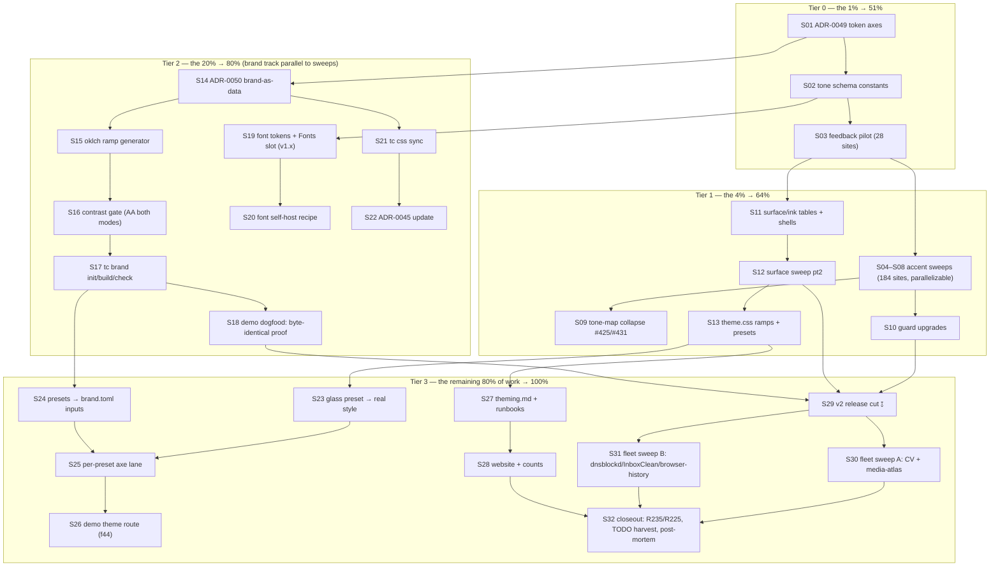

# Design-Schema v2 Pareto Master Plan (2026-11-06 00:26)

**Origin:** fleet review of six upstream apps (CV, emeet-pixyd, dnsblockd, InboxClean,
media-atlas, browser-history) on 2026-11-05/06, plus the design-schema discussion that
preceded it. Every load-bearing claim below was **source-verified this session** (Evidence
table). This plan converts the review into an executable backlog for the library-side work:
make upstream apps better by finishing the design-schema story (token emission, surfaces,
brand-as-data, fonts, tooling) and retiring the fleet's hand-rolled theme bridges.

**Goal (the measurable outcome):** every adopter deletes its hand-rolled theme bridge and
consumes ONE generated `brand.css`; the library emits semantic token classes
(`tc-accent-*`, `tc-surface-*`, `tc-ink-*`) so "UI branding across all my repos" is a
one-file, one-command change with a contrast gate that makes the dnsblockd 2.1:1 hole
class of bug impossible to ship silently.

**Anti-verschlimmbesser contract (read before executing anything):**

- **No parallel class vocabulary** — ROADMAP R225's demand-gate verdict stands: a "style"
  is a preset CSS file, never a forked lookup map. This plan EXTENDS ADR-0044's mechanism,
  it does not invent a second one.
- **Lookup maps collapse INTO `utils/tone` tables** (TODO #425/#431) at v2 as already
  decided — the accent sweep is the collapse opportunity, not a new mapping layer.
- **Scanner-safety is inviolable** — every token class is a COMPLETE literal including its
  `dark:` half; no runtime concatenation (AGENTS.md variant-prefix rule). The safelist
  stays the only sanctioned escape hatch.
- **Breaking class-string changes ONLY inside the v2 window** (ADR-0039/0044). Fonts slot
  and `tc brand`/`tc css sync` are v1.x-able precisely because they are additive.
- **Goldens re-baseline in the SAME task as its sweep** (`-update` AFTER the package list);
  regenerated `*_templ.go` committed with every `.templ` change; `templ generate` from the
  repo root inside `nix develop` only.
- **Counts bump in the same edit** as any component/enum/golden change
  (`utils.TestDocsCountDrift`, `TestFeaturesEnumTableExhaustive`). CHANGELOG `[Unreleased]`
  warm from the first feature commit.
- **The contrast gate checks BOTH modes** — dnsblockd's white-on-pastel 2.1:1 Button is
  the regression this whole plan exists to make impossible (Evidence E3).
- **Fleet sweep only AFTER the v2 tag exists** (pairing rule: tc ≥ v2 ⇄ templ ≥ v0.3.1100;
  CV/media-atlas still sit on the 1.26.0/1070 pair and must cross both in one event).
- **Demo CSS recompiled + binary rebuilt after ANY new class string** (2026-10-14 red-CI
  lesson); demo smoke is a gate for every demo-facing task.
- **No web-components, no runtime JS theming** (ADR-0033 permanent). CSP-safe compile-time
  tokens are the only theming mechanism.
- Wired ⇒ e2e waiver: the emission sweeps change COLOR CLASSES only — no `wire.Action`/
  `hx-*`/`data-on:*` attributes are added or changed anywhere in this plan, so no new e2e
  tasks are required; the per-package golden + guard lanes are the verification. Demo-facing
  tasks (S18, S23–S26) still run the live smoke.

---

## Verified evidence (spot-checked at source, 2026-11-05/06)

| #   | Claim                                                                                                                                                 | Source                                                                                                                                                                                                                  | Verdict      |
| --- | ----------------------------------------------------------------------------------------------------------------------------------------------------- | ----------------------------------------------------------------------------------------------------------------------------------------------------------------------------------------------------------------------- | ------------ |
| E1  | 5/5 templ-components adopters ship a hand-rolled theme bridge; zero sharing between them                                                              | CV `assets/css/input.css:56-114`; dnsblockd `internal/server/views/app.css:47-75`; InboxClean `internal/web/static/app.theme.css`; browser-history `api/static/input.css:32-44`; media-atlas `internal/css/app.css:58+` | ✅ CONFIRMED |
| E2  | Library hardcodes 212 accent sites across 8 packages (50–900 shades)                                                                                  | `docs/adr/0044-semantic-accent-tokens.md` §Context inventory                                                                                                                                                            | ✅ CONFIRMED |
| E3  | dnsblockd's palette remap created a ~2.1:1 contrast hole on Button, patched by an unlayered-CSS re-skin with contrast arithmetic in comments          | dnsblockd `internal/server/views/app.css:212-325`                                                                                                                                                                       | ✅ CONFIRMED |
| E4  | CV + InboxClean each hand-built CSP-safe self-hosted font stacks; browser-history + media-atlas ship no identity fonts                                | CV `assets/css/fonts.css`; InboxClean `app.theme.css:28-63`; grep confirms absence in the others                                                                                                                        | ✅ CONFIRMED |
| E5  | emeet-pixyd REJECTED the library because hand-crafted glass-morphism won on identity (688 lines of hand CSS)                                          | emeet-pixyd `AGENTS.md:183` + archived status `2026-05-24_05-28…:59-62`                                                                                                                                                 | ✅ CONFIRMED |
| E6  | Consumer-side scan/vendoring chore triplicated: CV `gen-tc-safelist.sh`, dnsblockd `gen-library-classes.sh`, plus the ADR-0045 manual copy step       | scripts at source; `templates/app.css` header instructions                                                                                                                                                              | ✅ CONFIRMED |
| E7  | Fleet version skew: CV + media-atlas on tc v1.26.0/templ v0.3.1070; dnsblockd/InboxClean/browser-history on v1.27.0/v0.3.1100 — pairing rule held     | go.mod of each repo (this session)                                                                                                                                                                                      | ✅ CONFIRMED |
| E8  | ROADMAP R235 ("semantic-token theming depth") is open; R225 demand-gate criterion 1 is now demonstrably met (named consumers ship non-default themes) | `ROADMAP.md:225` and `ROADMAP.md:235`                                                                                                                                                                                   | ✅ CONFIRMED |
| E9  | `cmd/tc` today has init/list/add/doctor/lint only — no brand command; no font slot exists in `layout` PageProps                                       | `cmd/tc/main.go` registry; grep of `layout/`                                                                                                                                                                            | ✅ CONFIRMED |
| E10 | ADR numbering next free = 0049; plan skeleton + Pareto tiers are the house format                                                                     | `docs/adr/` tail; `docs/planning/TEMPLATE.md`; `docs/plan-authoring-checklist.md`                                                                                                                                       | ✅ CONFIRMED |

---

## Step 1 — Pareto breakdown

### The 1% that delivers 51% — the token contract + pilot (≈4h)

**S01 + S02 + S03**: the ADR-0049 decision (token axes + emission contract), the
`utils/tone` schema constants, and the `feedback` pilot (28 sites — the smallest color
carrier). Why this and nothing else: until components EMIT `tc-*` classes, every other
item on this page is unbuildable. Once the pilot proves the mechanics (scanner-safe
literals, dark pairs, goldens, guards, docs counts), the remaining 184 accent sites are
mechanical multiplication that can even run in parallel sessions. This is the keystone
the entire fleet benefit hangs on — ADR-0044 Phase 2 already reserved this window; the
pilot is what turns a plan into a pattern.

### The 4% that delivers 64% — the 1% PLUS full accent + surface/ink emission (≈3 days)

Add **S04–S13**: the remaining accent sweeps (display 67, forms 58, navigation 23,
layout 8, errorpage 23, recipes 5 — all of E2's inventory), the tone-map collapse
(TODO #425/#431), guard-test upgrades, and the surface/ink axes (shells first, then
panels/inputs). Why: this completes "the bridges die" — color AND surfaces. E1 says all
five adopters override surfaces too (dnsblockd paper, browser-history stone, CV slate,
media-atlas void/deep) and E3 says color-only theming actively HARMS without surface
awareness. After the 4%, every bridge in the fleet is technically deletable.

### The 20% that delivers 80% — the 4% PLUS adoption tooling (≈2 more days)

Add **S14–S22**: ADR-0050 brand-as-data, the `tc brand` generator (seed → oklch ramp →
AA/AAA contrast gate → `brand.css`), the font story (`--font-tc-*` tokens + additive
`PageProps.Fonts` slot — shippable in v1.x), and `tc css sync` (kills the triplicated
scan/vendoring chore, E6). Why: emission without adoption tooling just moves the
hand-rolling from CSS files to brand files. The generator + gate is what makes branding a
ONE-COMMAND act and what would have caught dnsblockd's hole at generation time.

### The remaining 80% of the work → the last 20% of the result

**S23–S32**: presets become real styles (glass that actually competes with hand-crafted
CSS — the emeet rejection, E5), presets become brand.toml inputs, the per-preset axe lane,
the demo theme route (ROADMAP f44), the token-first theming docs + per-consumer migration
runbooks, the v2 release cut, the fleet sweep (pairing-safe, E7), bridge deletions, and
the ROADMAP/TODO closeout (E8). Necessary for 100% and for the victory lap, but none of
it blocks the schema.

---

## Step 2 — Comprehensive plan (30–100 min tasks, ALL todos, sorted by impact)

Tier 0 = the 1% (→51%), Tier 0–1 = the 4% (→64%), Tier 0–2 = the 20% (→80%), Tier 3 = the
remaining 80% of work (→100%).

| ID  | Tier | Task (30–100 min each)                                                                                                                                                              | Impact   | Effort                                    | Customer value                                                   |
| --- | ---- | ----------------------------------------------------------------------------------------------------------------------------------------------------------------------------------- | -------- | ----------------------------------------- | ---------------------------------------------------------------- |
| S01 | 0    | ADR-0049 "Design token axes": accent/surface/ink emission contract, `tc-*` namespace, scanner-safety, dark-pairing rule, contrast obligations, v2 gating (links R235/R225/ADR-0044) | Critical | 60min                                     | The decision everything else builds on                           |
| S02 | 0    | `utils/tone` schema constants: AccentToken/SurfaceToken/InkToken complete-literal tables + validity/scanner-safety tests + docs-sync section                                        | Critical | 60min                                     | Typed token language; typo cannot render nothing                 |
| S03 | 0    | PILOT: `feedback` package emits `tc-accent-*` (28 sites), goldens re-recorded, guards green, CHANGELOG entry                                                                        | Critical | 90min                                     | Proof-of-pattern; unblocks all parallel sweeps                   |
| S04 | 1    | display accent sweep pt1: Button/Badge/CountBadge/StatusDot/link family (of 67 sites)                                                                                               | Critical | 100min                                    | Biggest visual surface de-hardcoded                              |
| S05 | 1    | display accent sweep pt2: overlays' focus rings + remaining display (charts keep categorical Hue axis deliberately)                                                                 | Critical | 100min                                    | Completes the 67-site package                                    |
| S06 | 1    | forms accent sweep (58 sites: inputs' focus rings, checked states, filters)                                                                                                         | Critical | 75min                                     | Form accent re-skinnable via tokens                              |
| S07 | 1    | navigation + layout accent sweep (23 + 8 sites; audit `--tc-sidebar-*` token interplay)                                                                                             | High     | 60min                                     | Nav/active states follow the brand                               |
| S08 | 1    | errorpage + recipes accent sweep (23 + 5 sites)                                                                                                                                     | High     | 45min                                     | Error pages re-skin with the app                                 |
| S09 | 1    | Collapse remaining tone lookup maps INTO `utils/tone` tables (TODO #425/#431) + equivalence tests + delete legacy maps                                                              | High     | 100min                                    | One color language; kills 13-way duplication permanently         |
| S10 | 1    | Guard-test upgrade: dark-mode/tone scanners recognize tc- pairs; docs-count bumps; ADR-0044 status → Phase 2 implemented                                                            | High     | 60min                                     | The new classes can't regress                                    |
| S11 | 1    | Surface/ink tables + shell conversion: Base/AppShell/Card/Minimal (light+dark literals)                                                                                             | Critical | 90min                                     | Every app's chrome follows its brand                             |
| S12 | 1    | Surface/ink sweep pt2: Table/Dropdown/Popover/Modal/inputs/Toast/CodeBlock/Kanban surfaces                                                                                          | Critical | 75min                                     | Panels + inputs re-skinnable; warm-dark hack retired             |
| S13 | 1    | `templ-components-theme.css` gains tc-surface/ink literal ramps; presets re-emitted; warm-dark recipe rewritten around tokens                                                       | High     | 60min                                     | One import re-skins everything including surfaces                |
| S14 | 2    | ADR-0050 "Brand-as-data": brand.toml schema (seed, neutrals, radius, fonts, density-freeze decision ⫱), command surface, gate definition                                            | High     | 60min                                     | The schema decision for one-command branding                     |
| S15 | 2    | oklch ramp generator: seed → 50–950, lightness/chroma curves, snapshot tests vs Tailwind blue/amber                                                                                 | High     | 100min                                    | Any brand color gets a full perceptual ramp                      |
| S16 | 2    | Contrast gate: WCAG ratio math, pair checks (fg/600, ink/surface, badge tints), BOTH modes, actionable failure output; dnsblockd-pastel scenario must FAIL                          | Critical | 60min                                     | The 2.1:1 hole class becomes unshippable                         |
| S17 | 2    | brand.css emitter (full `@theme` block: accent/surface/ink/font/radius) + `tc brand init                                                                                            | build    | check` wired into cmd/tc registry + tests | High                                                             |
| S18 | 2    | Demo dogfood: demo brand.toml must generate byte-identical CSS to current defaults (no-change proof)                                                                                | High     | 45min                                     | Trust: the generator provably doesn't change anything by default |
| S19 | 2    | Fonts: `--font-tc-sans/mono/display` tokens + additive `PageProps.Fonts` slot with preload/preconnect emission (v1.x)                                                               | High     | 60min                                     | Identity fonts without hand-rolled CSP plumbing                  |
| S20 | 2    | Font self-host recipe (font-face + `font-src 'self'`) replacing the CV/InboxClean hand-rolled patterns + goldens                                                                    | High     | 45min                                     | One documented pattern instead of two bespoke ones               |
| S21 | 2    | `tc css sync`: emit classes.txt/safelist/custom.css/theme.css into a consumer + `--check` drift mode + tests + replace per-repo gen scripts (E6)                                    | High     | 75min                                     | Vendoring chore becomes one command, fleet-wide                  |
| S22 | 2    | ADR-0045 update: `tc css sync` is the sanctioned delivery; app.css header instructions updated                                                                                      | Medium   | 30min                                     | Delivery story stays truthful                                    |
| S23 | 3    | Glass preset → real style: surface translucency + backdrop + shape hooks via tokens; contrast-gated both modes; visualtest captures (answers E5)                                    | High     | 90min                                     | Hand-crafted-identity consumers have an alternative              |
| S24 | 3    | Presets emerald/minimal/default → brand.toml inputs; generated CSS re-emitted; presets README updated                                                                               | Medium   | 45min                                     | Presets become worked examples of the schema                     |
| S25 | 3    | Per-preset axe lane: demo `?theme=` plumbing, light/dark visualtest captures, axe baseline entries or fixes                                                                         | Medium   | 45min                                     | Presets ship with proven accessibility                           |
| S26 | 3    | Demo theme route: full-gallery rendering under a selected brand (ROADMAP f44); route registration + smoke + goldens                                                                 | Medium   | 60min                                     | Live showcase; best sales page for the schema                    |
| S27 | 3    | docs/theming.md token-first rewrite + per-consumer bridge-deletion runbooks (5 repos) + consumer-guide/SKILL.md theming sections                                                    | High     | 60min                                     | Migration is copy-paste, not archaeology                         |
| S28 | 3    | Website theming page + `countgen -w` + TestDocsCountDrift + website suite (incl. CSP if new assets)                                                                                 | Medium   | 45min                                     | Public docs match the new reality                                |
| S29 | 3    | v2 release cut: per-module loop + `scripts/ci-repro.sh --lint --css --website` at the exact commit, then release.sh ritual in the dev shell (tag-tree clean) ⫱ timing               | Critical | 60min                                     | The tag the fleet sweeps onto                                    |
| S30 | 3    | Fleet sweep A: CV + media-atlas cross BOTH pairs (templ 1070→1100 AND tc 1.26→v2) in one event per repo, then bridge deletion + brand.css                                           | High     | 90min                                     | Stragglers current; first bridges deleted                        |
| S31 | 3    | Fleet sweep B: dnsblockd (catppuccin brand.toml; delete `.dnsblockd-btn` — gate now proves contrast), InboxClean (beacon-violet), browser-history (stone/lime)                      | High     | 75min                                     | Three more bridges deleted; contrast hole fixed at root          |
| S32 | 3    | Closeout: R235/R225 roadmap updates, TODO_LIST harvest (incl. deferred axes), final counts/CHANGELOG, plan post-mortem status doc                                                   | Medium   | 60min                                     | The plan ends documented, not dangling                           |

**Coverage check:** every improvement from the fleet review maps — accent emission →
S03–S10 (E2 complete), surfaces → S11–S13 (E1 surface column), brand-as-data → S14–S18
(E3 gate), fonts → S19–S20 (E4), css sync → S21–S22 (E6), presets/styles → S23–S25 (E5),
showcase → S26, docs → S27–S28 (E8), release + fleet → S29–S32 (E7 pairing). Nothing
dropped. **Total ≈ 43h of medium tasks.**

---

## Step 3 — Fine breakdown (≤12 min micro-tasks, ALL todos, sorted by impact)

Every micro-task is one sitting; parents in the last column. Within tiers, ordered by
dependency then impact.

### Tier 0 — the 1%

| Micro | Task (≤12 min)                                                                             | Min | Parent |
| ----- | ------------------------------------------------------------------------------------------ | --- | ------ |
| A-001 | Re-read ADR-0044/0008/0039 + `utils/tone` package docs; note constraints                   | 10  | S01    |
| A-002 | Census: grep emitted color classes per package; confirm 212-site inventory still current   | 12  | S01    |
| A-003 | Draft ADR-0049: namespace, axes, naming scheme (`tc-accent-*`, `tc-surface-*`, `tc-ink-*`) | 12  | S01    |
| A-004 | Draft: scanner-safety contract + dark-pairing rule + contrast obligations                  | 10  | S01    |
| A-005 | Draft: migration story, v2 gating, R235/R225 links; commit ADR-0049                        | 10  | S01    |
| A-006 | Design AccentToken ramp table (complete literals, all shades E2 uses)                      | 12  | S02    |
| A-007 | Design SurfaceToken/InkToken roles + dark halves                                           | 10  | S02    |
| A-008 | Implement token tables + typed helpers in `utils/tone`                                     | 12  | S02    |
| A-009 | Validity tests: IsValid, every value is a complete literal incl. `dark:` half              | 12  | S02    |
| A-010 | Update `tone/doc_sync_test` generated section + run `go test ./utils/tone/ -update`        | 8   | S02    |
| A-011 | List `feedback` accent sites (grep census, expect 28)                                      | 8   | S03    |
| A-012 | Alert: accent classes → tc-accent tokens                                                   | 12  | S03    |
| A-013 | Toast + ToastContainer: same conversion                                                    | 10  | S03    |
| A-014 | Spinner/ProgressBar/CircularProgress fills → tokens                                        | 12  | S03    |
| A-015 | InlineLoading/InlineError/InlineSuccess/StepIndicator/Skeleton → tokens                    | 10  | S03    |
| A-016 | `feedback/styles.go` lookups → tone tables                                                 | 10  | S03    |
| A-017 | `templ generate` (repo root, nix develop) for feedback                                     | 5   | S03    |
| A-018 | Re-record feedback goldens (`go test ./feedback/... -update`, flag AFTER package)          | 10  | S03    |
| A-019 | Feedback guards green: dark-mode/motion-reduce/aria-live/tone sync                         | 8   | S03    |
| A-020 | CHANGELOG `[Unreleased]`: token-emission entry + counts in same edit                       | 5   | S03    |

### Tier 1 — the 4%

| Micro | Task (≤12 min)                                                                                                              | Min | Parent |
| ----- | --------------------------------------------------------------------------------------------------------------------------- | --- | ------ |
| A-021 | Button variant lookup → tc-accent (primary/link/outline-info)                                                               | 12  | S04    |
| A-022 | Badge/CountBadge/StatusDot/StatusBadge(+With) → tokens                                                                      | 12  | S04    |
| A-023 | Link-family components (ExternalLink, Eyebrow accents) → tokens                                                             | 10  | S04    |
| A-024 | Regenerate + re-record display goldens batch 1                                                                              | 12  | S04    |
| A-025 | Display guards green batch 1                                                                                                | 8   | S04    |
| A-026 | Overlays: Modal/Drawer/Dropdown/Popover/ContextMenu focus-visible rings → tokens                                            | 12  | S05    |
| A-027 | Remaining display (Tabs/EmptyState/DataState/CommandPalette/Scrollback) — charts stay on Hue axis (categorical, deliberate) | 12  | S05    |
| A-028 | Regenerate + goldens batch 2                                                                                                | 12  | S05    |
| A-029 | Display guards green batch 2                                                                                                | 8   | S05    |
| A-030 | Input/Select/Textarea: focus rings + label accents → tokens                                                                 | 12  | S06    |
| A-031 | Checkbox/Radio/RadioGroup/Toggle/Slider checked states → tokens                                                             | 12  | S06    |
| A-032 | Combobox/TagsInput/FileInput/Calendar/DatePicker → tokens                                                                   | 12  | S06    |
| A-033 | FilterBar/FilterChips/FilterDropdown/FilterInput/SegmentedControl/Rating → tokens                                           | 10  | S06    |
| A-034 | Regenerate + forms goldens + guards                                                                                         | 12  | S06    |
| A-035 | Nav/SimpleNav/SidebarNav active states → tokens; audit `--tc-sidebar-*` interplay                                           | 12  | S07    |
| A-036 | Breadcrumbs/Pagination/LoadMore/EndOfList/MobileMenu family → tokens                                                        | 10  | S07    |
| A-037 | layout: Base/ThemeToggle accent bits → tokens                                                                               | 8   | S07    |
| A-038 | Regenerate + navigation/layout goldens + guards                                                                             | 10  | S07    |
| A-039 | errorpage family styles → tc-accent/danger tokens                                                                           | 10  | S08    |
| A-040 | recipes conversions (5 sites)                                                                                               | 8   | S08    |
| A-041 | Regenerate + errorpage/recipes goldens + guards                                                                             | 10  | S08    |
| A-042 | Enumerate remaining lookup maps (census vs tone tables)                                                                     | 10  | S09    |
| A-043 | Port map contents into tone tables (batch 1)                                                                                | 12  | S09    |
| A-044 | Port map contents into tone tables (batch 2)                                                                                | 12  | S09    |
| A-045 | Equivalence tests: tables describe reality byte-for-byte                                                                    | 12  | S09    |
| A-046 | Delete legacy maps + repoint references                                                                                     | 12  | S09    |
| A-047 | Full per-module loop green                                                                                                  | 10  | S09    |
| A-048 | Close TODO #425/#431 rows (with evidence)                                                                                   | 5   | S09    |
| A-049 | TestDarkModeCompliance: teach scanner the tc- pair forms                                                                    | 12  | S10    |
| A-050 | Tone-sync guard update + FEATURES enum tables if tokens are enums                                                           | 10  | S10    |
| A-051 | Docs-count bumps (README/FEATURES/ROADMAP/AGENTS lines) + ADR-0044 status flip                                              | 10  | S10    |
| A-052 | `scripts/ci-repro.sh --lint` quick lane green                                                                               | 8   | S10    |
| A-053 | Define surface-0/1/2 + ink-1/2/3 values (light+dark literals) in tone                                                       | 12  | S11    |
| A-054 | layout.Base page/body background + ink → tokens                                                                             | 12  | S11    |
| A-055 | AppShell chrome → tokens (respect classic-dark opt-out tokens)                                                              | 12  | S11    |
| A-056 | Card/SimpleCard + Minimal shells → tokens                                                                                   | 10  | S11    |
| A-057 | Regenerate + light AND dark goldens (shells are the warm-dark blind spot)                                                   | 12  | S11    |
| A-058 | Table/DataTable surfaces → tokens                                                                                           | 10  | S12    |
| A-059 | Dropdown/Popover/ContextMenu panels → tokens                                                                                | 10  | S12    |
| A-060 | Inputs family surfaces (bg, ring, placeholder) → tokens                                                                     | 12  | S12    |
| A-061 | Toast/Alert containers, CodeBlock, Kanban lane surfaces → tokens                                                            | 12  | S12    |
| A-062 | Regenerate + goldens + guards (surface sweep)                                                                               | 12  | S12    |
| A-063 | Add tc-surface/tc-ink literal ramps to `templates/templ-components-theme.css`                                               | 10  | S13    |
| A-064 | Re-emit 4 presets incl. surface tokens                                                                                      | 12  | S13    |
| A-065 | Rewrite warm-dark recipe in theming.md around surface tokens                                                                | 10  | S13    |
| A-066 | `nix run .#css` compile check (demo scans every templ file)                                                                 | 8   | S13    |

### Tier 2 — the 20%

| Micro | Task (≤12 min)                                                                      | Min | Parent |
| ----- | ----------------------------------------------------------------------------------- | --- | ------ |
| A-067 | Draft brand.toml schema: seed, neutrals, radius, fonts (density: freeze-or-defer ⫱) | 12  | S14    |
| A-068 | Draft command surface (`brand init/build/check`) + brand.css output contract        | 10  | S14    |
| A-069 | Draft contrast-gate definition (pairs, modes, AA floor) + commit ADR-0050           | 8   | S14    |
| A-070 | Implement hex→oklch conversion                                                      | 12  | S15    |
| A-071 | Implement per-shade lightness/chroma curves                                         | 12  | S15    |
| A-072 | Generate 50–950 ramp + neutral/surface ramps                                        | 12  | S15    |
| A-073 | Snapshot test: seed = Tailwind blue-600 → matches library defaults within tolerance | 12  | S15    |
| A-074 | Implement WCAG relative luminance + contrast ratio                                  | 10  | S16    |
| A-075 | Pair checks: accent-fg/600, ink/surface, badge tint pairs                           | 12  | S16    |
| A-076 | Both-mode evaluation + actionable failing-pair report                               | 12  | S16    |
| A-077 | Regression test: dnsblockd pastel scenario MUST fail the gate                       | 10  | S16    |
| A-078 | brand.css `@theme` emitter (accent/surface/ink/font/radius)                         | 12  | S17    |
| A-079 | `tc brand init` scaffold                                                            | 10  | S17    |
| A-080 | `tc brand build` + registry/usage wiring                                            | 10  | S17    |
| A-081 | `tc brand check` gate-only mode + cmd/tc tests + doc.go                             | 10  | S17    |
| A-082 | Write demo brand.toml (blue defaults)                                               | 8   | S18    |
| A-083 | Generate + byte-diff vs current defaults — prove no-change                          | 12  | S18    |
| A-084 | Record the no-change proof in the ADR/demo docs                                     | 10  | S18    |
| A-085 | `--font-tc-sans/mono/display` tokens in custom.css                                  | 10  | S19    |
| A-086 | FontProps on PageProps (Fonts slot, additive)                                       | 12  | S19    |
| A-087 | Preload/preconnect emission + nonce omit-empty rules                                | 10  | S19    |
| A-088 | Fonts-slot goldens + CHANGELOG + counts                                             | 10  | S19    |
| A-089 | Self-host recipe doc (font-face + font-src 'self')                                  | 12  | S20    |
| A-090 | Cross-check recipe vs CV + InboxClean hand-rolled stacks                            | 10  | S20    |
| A-091 | `tc css sync` copy semantics (4 artifacts)                                          | 12  | S21    |
| A-092 | `--check` drift mode + exit codes                                                   | 10  | S21    |
| A-093 | Tests + app.css header instruction update                                           | 10  | S21    |
| A-094 | Migration note: retire gen-tc-safelist.sh / gen-library-classes.sh patterns         | 8   | S21    |
| A-095 | ADR-0045: sync-command section + status update; commit                              | 10  | S22    |

### Tier 3 — the remaining 80% of work

| Micro | Task (≤12 min)                                                                                | Min | Parent |
| ----- | --------------------------------------------------------------------------------------------- | --- | ------ |
| A-096 | Glass brand.toml (violet seed, translucent surface spec)                                      | 10  | S23    |
| A-097 | `tc-glass` @utility + surface-translucency hooks                                              | 12  | S23    |
| A-098 | Contrast gate green both modes; convert preset CSS                                            | 12  | S23    |
| A-099 | Visualtest captures for glass look                                                            | 10  | S23    |
| A-100 | emerald/minimal/default → brand.toml inputs                                                   | 12  | S24    |
| A-101 | Re-emit generated preset CSS + diff review                                                    | 12  | S24    |
| A-102 | Presets README table + theming.md preset section                                              | 8   | S24    |
| A-103 | Demo `?theme=` route plumbing                                                                 | 12  | S25    |
| A-104 | Per-preset light/dark visualtest captures                                                     | 12  | S25    |
| A-105 | axe baseline entries or fixes per preset                                                      | 12  | S25    |
| A-106 | Theme route: gallery renders selected brand                                                   | 12  | S26    |
| A-107 | Route registration + `pages.go` meta + prerender list                                         | 10  | S26    |
| A-108 | Demo smoke + route goldens                                                                    | 12  | S26    |
| A-109 | theming.md token-first rewrite                                                                | 12  | S27    |
| A-110 | Per-consumer runbooks: delete-bridge steps for all 5 repos                                    | 12  | S27    |
| A-111 | consumer-guide + SKILL.md theming sections updated                                            | 12  | S27    |
| A-112 | Website theming page update                                                                   | 10  | S28    |
| A-113 | `countgen -w` + TestDocsCountDrift green                                                      | 10  | S28    |
| A-114 | Website suite green (CSP hash update if new assets)                                           | 12  | S28    |
| A-115 | Pre-verify: per-module loop + `ci-repro.sh --lint --css --website` at the exact commit        | 12  | S29    |
| A-116 | release.sh v2 cut in dev shell; `result*` check first (release blocker)                       | 12  | S29    |
| A-117 | Review `git show v2.0.0` + push manually (never retag)                                        | 10  | S29    |
| A-118 | CV: bump templ→1100 + tc→v2 + regenerate (BOTH pairs in one event)                            | 12  | S30    |
| A-119 | CV: replace input.css remaps with generated brand.css                                         | 12  | S30    |
| A-120 | CV: fonts → tc fonts slot; delete hand-rolled font plumbing                                   | 10  | S30    |
| A-121 | media-atlas: bump both pairs + atlas brand.toml + bridge delete                               | 12  | S30    |
| A-122 | media-atlas: full verify suite green                                                          | 10  | S30    |
| A-123 | dnsblockd: bump + catppuccin brand.toml + delete app.css bridge                               | 12  | S31    |
| A-124 | dnsblockd: delete `.dnsblockd-btn`; gate output proves the old hole now fails generation      | 12  | S31    |
| A-125 | InboxClean: bump + beacon-violet brand.toml + bridge delete                                   | 12  | S31    |
| A-126 | browser-history: bump + stone/lime brand.toml + bridge delete                                 | 12  | S31    |
| A-127 | ROADMAP R235/R225 updates (criterion evidence)                                                | 10  | S32    |
| A-128 | TODO_LIST harvest: deferred axes (density, dark-selector R238, chart Hue tokenization) seeded | 10  | S32    |
| A-129 | Final counts/CHANGELOG polish + fleet report                                                  | 8   | S32    |
| A-130 | Plan post-mortem status doc + link from this file                                             | 8   | S32    |

**Coverage check:** micro-tasks A-001…A-130 map onto every parent S01–S32. Nothing
dropped.

---

## Execution graph

Parallel lanes: the **brand track** (S14→S18) only needs S01/S02 and can run while the
emission sweeps proceed; the **fonts lane** (S19/S20) and **css-sync lane** (S21/S22) are
v1.x-independent and can land before v2. The emission sweeps (S04–S08) are per-package
and parallelizable across sessions AFTER the S03 pilot sets the pattern.

---

## Verification (whole plan)

- [ ] Per-module loop green after each sweep: `for mod in utils icons errorpage charts/echarts datastar htmx; do (cd "$mod" && GOWORK=off go test ./...); done`
- [ ] Root build+test via `scripts/ci-repro.sh --lint --css --website` at the exact release commit — read `VERDICT: PASS`, then push immediately
- [ ] Golden re-baselines ONLY via `nix run .#visual -- -update` for pixel suites; never because of load flakes
- [ ] Demo smoke (`visualtest/tools/smoke`) for S18, S23–S26; `nix run .#css` after any new class string
- [ ] Clone gate before finalizing: `art-dupl check -c .art-dupl.json -t 1 --type-aware` (pinned fork binary) — new clones classified at execution time per ADR-0009
- [ ] `tc brand build` byte-identity proof (S18) re-runs green at release time
- [ ] CHANGELOG `[Unreleased]` warm from S03; drift counts bumped in the same edits as every sweep
- [ ] Per-consumer runbooks (S27) verified by actually executing them in S30/S31 — a runbook that was never run is a lie

## Deferred / follow-through seeds

- **Density axis** (global compact/comfortable) — S14 owner gate ⫱ decides freeze-or-defer; if deferred, harvest as a TODO row (per-component Size enums stay).
- **Configurable dark-mode selector** (`data-theme` vs `.dark`) — existing R238, out of scope here.
- **Chart Hue-axis tokenization** — categorical hues deliberately stay on `tone.Hue` (kanban lanes, stat tiles); revisit only if a consumer brands categorical charts.
- **emeet-pixyd re-adoption pitch** — after S23 lands, offer the glass style as the 688-line replacement; owner-gated ⫱ (their AGENTS.md documents the rejection rationale).
- **crm (R20) and PapDashboard (R26)** — the original R235/R238 unblock targets; sweep them after S32 if still desired.
