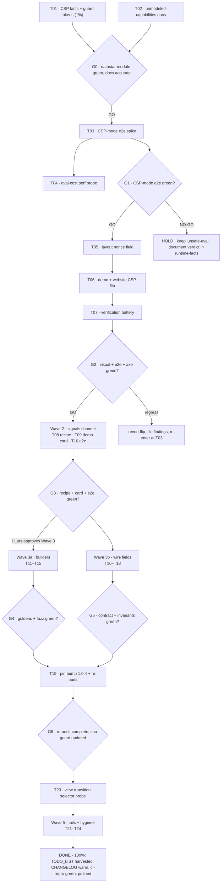

# Datastar Client-Side Superb Pareto Plan (2026-11-07 08:21)

**Origin:** this morning's deep-research session
(`docs/research/2026-11-07_datastar-client-side-deep-dive.html` + status snapshot
`docs/status/2026-11-07_08-18_datastar-client-research-status.md`). Every
load-bearing claim below was **verified against the sha-pinned Datastar 1.0.3
bundle bytes** (`go-datastar/static v0.6.1`, sha256 `5d6b7794…`) or the repo
tree this session — evidence tiers live in the report's Appendix.

**Goal (measurable):** templ-components' Datastar surface goes from
"element-patching transport only" to (1) strict-CSP-clean Datastar pages
(no `'unsafe-eval'`) proven in a browser, (2) a documented, demo-proven
signal-patch channel, (3) a typed+fuzzed builder API, and (4) wire parity with
the runtime's verified fetch options — with the 1.0.4 pin bump as its own
re-audited event. Nothing in the existing htmx-default posture changes.

**Anti-verschlimmbesser contract (read before executing anything):**

- **HTMX stays the default transport; Datastar stays rung 7, opt-in.** No
  component is re-ported to signals (ADR-0030 + JS decision ladder stand). The
  builders exist for consumers' own glue — Opportunity 8's non-goal note ships
  WITH them.
- **Never drop `'unsafe-eval'` from demo/website CSP before the CSP-mode e2e
  spike (T03) is fully green.** A broken demo page is the exact
  Verschlimmbesser this plan exists to avoid. The flip (T06) happens only
  behind a green G1.
- **Never weaken a guard test to get green.** `bundle_guard`,
  `TestEveryActionFieldHasADialectContract`, `TestDocsCountDrift` etc. are
  EXTENDED, never relaxed.
- **Never bump the Datastar pin outside the full protocol**
  (`docs/external-dependency-bumps.md`): diff old↔new bytes, re-audit every
  runtime-facts fact with report §02's token table, update
  `pinnedBundleSHA256`, warm `[Unreleased]`. The bundle WILL change at 1.0.4.
- **Goldens:** `-update` AFTER the package list, regenerate in `nix develop`
  from repo root, commit generated `*_templ.go` with every `.templ` change.
- **Counts bump in the same edit** as any new golden/enum/component
  (`TestDocsCountDrift`, `TestFeaturesEnumTableExhaustive`).
- **Wired ⇒ e2e in the same plan** (no waiver needed: T10/T15/T07 carry the
  chromedp tasks; both-dialect goldens for every new wire rendering).
- **Demo smoke is a gate** for every demo-facing task (T07, T09, T10, T15).
- CHANGELOG `[Unreleased]` warm from the first behavior-changing commit.
- No new third-party dependencies (budget closed). No Pro plugins modeled.
- Single-writer protocol: re-read `TODO_LIST.md`/`FEATURES.md` immediately
  before every edit; `git status -sb` re-check after daemon commits.

---

## Pareto breakdown (value = client-side Datastar value delivered safely)

| Tier                     | Share of plan effort | Delivers                                                                                                                                                                                                                                                                                           | Tasks                   |
| ------------------------ | -------------------- | -------------------------------------------------------------------------------------------------------------------------------------------------------------------------------------------------------------------------------------------------------------------------------------------------- | ----------------------- |
| **1% → 51%**             | ~2 h of ~60 h        | The knowledge fix: runtime-facts §CSP corrected (eval is the DEFAULT, CSP mode exists at the pin) + the fact bundle-guarded so a pin bump can never silently regress it + size-claim fixes. Kills the one wrong security claim gating every consumer's CSP, and unblocks the whole CSP workstream. | T01, T02                |
| **4% → 64%**             | +~6 h                | Strict-CSP Datastar pages that actually SHIP: e2e spike proves the library's attribute set under `data-nonce`, `layout` grows the nonce field, demo + website flip to a CSP with no `'unsafe-eval'` — verified by the full battery.                                                                | T03, T04, T05, T06, T07 |
| **20% → 80%**            | +~4 h                | The differentiated capability in consumers' hands: the signal-patch channel documented as a recipe (twin of sse-live-rows), running in the demo, browser-proven by e2e.                                                                                                                            | T08, T09, T10           |
| **Remaining 80% → 100%** | +~46 h               | Everything else, ordered: typed builders module, wire fetch-option fields, the 1.0.4 pin bump + re-audit, view-transition-selector probe, research tails, and the process handoff (TODO_LIST harvest, annotations, fixtures).                                                                      | T11–T24                 |

Read as: **one hour of T01 is worth more than a day anywhere else** — which is
why Wave 0 is a single morning commit, not a phase.

---

## Execution graph

Waves 3a and 3b are independent and can run in parallel sessions (different
modules: `datastar` vs `utils/wire` — no file overlap). Everything else is
strictly ordered by its gates.

---

## Wave 0 — the 1% (knowledge fix)

| ID  | Task (30–100 min)                                                                                                                                                                                                                                                                                                                                                                                                           | Status-report todos covered | Impact       | Effort | Value                                                          | Proof                                                               |
| --- | --------------------------------------------------------------------------------------------------------------------------------------------------------------------------------------------------------------------------------------------------------------------------------------------------------------------------------------------------------------------------------------------------------------------------- | --------------------------- | ------------ | ------ | -------------------------------------------------------------- | ------------------------------------------------------------------- |
| T01 | Correct `docs/datastar-runtime-facts.md` §CSP (eval = default; CSP mode via `data-nonce`, mechanics + caveats from report §02) AND add `data-nonce`, `data-on-signal-patch`, `viewTransitionSelector`, `filterSignals`, `openWhenHidden`, `onlyIfMissing` tokens to `datastar/bundle_guard_test.go` AND fix the "~12–15 KiB" size claims in `docs/javascript-guide.md` + `datastar/doc.go` to the measured 33,538 raw bytes | 1, 2, 3                     | **Critical** | 60 min | Security posture for every consumer; pin-bump regression guard | `cd datastar && GOWORK=off go test ./... -count=1` green; docs diff |
| T02 | Add "verified present, unmodeled" section to runtime-facts (datalines, fetch options, utility actions, per-action `openWhenHidden` default) + consumer-guide note on the script-nonce ⇄ `data-nonce` pairing                                                                                                                                                                                                                | 4, 12                       | High         | 45 min | Consumers learn the real runtime surface                       | Docs diff vs evidence table                                         |

Checklist gates — T01: goldens n-a (no render change) · wired⇒e2e n-a · counts
n-a · demo smoke n-a. T02: same. Both are docs+test-only; the guard-token test
is the proof.

### Micro-plan Wave 0 (≤12 min each)

| ID   | Task                                                                                                                                                                                                     | Min |
| ---- | -------------------------------------------------------------------------------------------------------------------------------------------------------------------------------------------------------- | --- |
| M1.1 | Re-read runtime-facts §CSP + report §02 decode snippets; draft replacement paragraphs                                                                                                                    | 8   |
| M1.2 | Rewrite §CSP: eval default, CSP-mode opt-in, activation recipe (`data-nonce` on `<html>`, equality with script nonce), empty-attr throw, attribute stripped at init                                      | 10  |
| M1.3 | Add CSP-mode caveats: nonce'd-script eval-cost unknown → probe pending (T04), TrustedTypes `datastar` identity policy, e2e-green prerequisite                                                            | 10  |
| M1.4 | `bundle_guard_test.go`: add the six tokens to the pinned-contract test                                                                                                                                   | 10  |
| M1.5 | Fix size claims: JS guide rung-7 row + `doc.go:2` → "33,538 bytes raw at the pin; upstream advertises 11.90 KiB (basis unverified)"                                                                      | 10  |
| M1.6 | `cd datastar && GOWORK=off go test ./... -count=1` green                                                                                                                                                 | 8   |
| M1.7 | CHANGELOG `[Unreleased]` entry (docs correction + guard extension)                                                                                                                                       | 6   |
| M2.1 | Write "verified present, unmodeled" section: SSE datalines (`viewTransitionSelector`, `namespace`), fetch options (verbatim destructure), `@setAll`/`@toggleAll`/`@peek`, `@query` explicitly NOT at pin | 12  |
| M2.2 | Consumer-guide paragraph: pairing the page nonce into both `SDKScriptProps.Nonce` and the new `<html data-nonce>` (forward pointer to T05)                                                               | 10  |
| M2.3 | Cross-check every new doc sentence against the evidence-tier table (A/B/C/D) — no Tier-D fact stated as fact                                                                                             | 8   |
| M2.4 | Run `go test ./utils/... ./datastar/... -count=1` (docs guards + guard test)                                                                                                                             | 8   |
| M2.5 | `git status -sb` daemon check; commit Wave 0 with detailed message                                                                                                                                       | 7   |

## Wave 1 — the 4% (CSP proven and shipped)

| ID  | Task                                                                                                                                                                                                             | Todos | Impact       | Effort | Value                       | Proof                             |
| --- | ---------------------------------------------------------------------------------------------------------------------------------------------------------------------------------------------------------------- | ----- | ------------ | ------ | --------------------------- | --------------------------------- |
| T03 | CSP-mode e2e spike: nonce'd test page + strict CSP (no `'unsafe-eval'`), run the library's real attribute flows (actions, `__debounce`, interval, intersect, indicator, show, SSE error handling) under chromedp | 5     | **Critical** | 75 min | GO/NO-GO for everything CSP | e2e suite green in CSP mode       |
| T04 | Eval-cost perf probe: micro-benchmark expression evaluation in both modes; record numbers in runtime-facts                                                                                                       | 6     | Medium       | 45 min | Informed adoption guidance  | Probe numbers documented          |
| T05 | `layout` plumbing: `DatastarNonce` on `PageProps`/`DefaultPageProps`; Base/Minimal render `<html data-nonce=…>`; omit-empty rule applies (no `data-nonce=""`); goldens                                           | 7, 8  | High         | 75 min | Library-level enablement    | layout goldens + nonce-omit tests |
| T06 | Flip demo + website: `withSecurityHeaders` strict variant, `firebase.json` `/demo/**` kept byte-equal, `go run ./cmd/site --update-csp`, shell passes the nonce                                                  | 9, 10 | High         | 60 min | The visible ship            | Header curl checks, site tests    |
| T07 | Verification battery: visual routes light+dark, datastar + wire e2e packs, axe sweep, live demo smoke, `ci-repro --lint --css`                                                                                   | 11    | **Critical** | 90 min | No regression shipped       | All lanes green                   |

Checklist gates — T03/T04: no render change (fixture page is visualtest-local)
· e2e IS the task · counts n-a · smoke n-a. T05: goldens YES (layout golden
files named in task) · e2e waived (attribute-only, no exchange wired; the CSP
flows are T03's suite) · counts n-a · smoke n-a. T06/T07: demo smoke IS the
gate · goldens: route goldens refreshed under the new CSP if pixels move
(T07-M1).

### Micro-plan Wave 1 (≤12 min each)

| ID   | Task                                                                                                                                       | Min |
| ---- | ------------------------------------------------------------------------------------------------------------------------------------------ | --- |
| M3.1 | Read `visualtest/datastar_runtime_e2e_test.go` + chromedp helpers (`pollBool`/`pollTrue`/`newFlowTab`)                                     | 10  |
| M3.2 | Build CSP-mode fixture page: per-request nonce, `script-src 'nonce-…' 'strict-dynamic'` — NO `'unsafe-eval'`, `<html data-nonce>`          | 12  |
| M3.3 | Port the action flows (click @get/@post, `__debounce` search, form `contentType: 'form'`) onto the fixture                                 | 12  |
| M3.4 | Port interval + intersect + indicator + show flows; assert each fires under CSP mode                                                       | 12  |
| M3.5 | Port SSE error-handling flow; assert lifecycle toasts still fire                                                                           | 12  |
| M3.6 | Run the suite (`nix run .#visual` env); triage failures to GO/NO-GO                                                                        | 12  |
| M3.7 | Write the GO/NO-GO verdict + numbers into plan errata; CHANGELOG if GO                                                                     | 5   |
| M4.1 | Perf harness: N-expression evaluation loop, eval mode vs CSP mode                                                                          | 12  |
| M4.2 | Run 3× per mode; record medians                                                                                                            | 8   |
| M4.3 | Document numbers + guidance sentence in runtime-facts §CSP                                                                                 | 10  |
| M4.4 | CHANGELOG rider if guidance is consumer-visible                                                                                            | 6   |
| M4.5 | `git status -sb` daemon check; commit Wave-1 spike                                                                                         | 9   |
| M5.1 | Field design: `PageProps.DatastarNonce string`; empty → attribute omitted (nonce omit-empty rule; join `TestNoEmptyNonceAttribute` family) | 10  |
| M5.2 | Implement: Base/Minimal render `data-nonce` on the `<html>` element; `DefaultPageProps` passes through                                     | 12  |
| M5.3 | Unit tests: renders when set, omitted when empty, pairs with `SDKScript` docs                                                              | 10  |
| M5.4 | Layout goldens: add nonce-set variant; refresh affected (`-update` AFTER package list, nix develop)                                        | 10  |
| M5.5 | Consumer-guide + godoc examples for the field                                                                                              | 10  |
| M5.6 | Per-module loop for touched packages; CHANGELOG                                                                                            | 8   |
| M5.7 | `git status -sb`; commit                                                                                                                   | 8   |
| M6.1 | `withSecurityHeaders`: strict CSP string (drop `'unsafe-eval'`) — demo and firebase.json stay BYTE-EQUAL                                   | 10  |
| M6.2 | Update `firebase.json` `/demo/**` header override to the same string                                                                       | 10  |
| M6.3 | `go run ./cmd/site --update-csp`; verify the firebase.json diff is exactly the CSP                                                         | 8   |
| M6.4 | Shell: pass `demoNonce` into `DefaultPageProps.DatastarNonce`                                                                              | 10  |
| M6.5 | Rebuild demo binary; `nix run .#css` if any class strings changed                                                                          | 8   |
| M6.6 | curl both route mounts; assert CSP header equality                                                                                         | 8   |
| M6.7 | `cd website && GOWORK=off GOEXPERIMENT=jsonv2 go test ./...`                                                                               | 6   |
| M7.1 | `nix run .#visual` — datastar routes light+dark; review pixel diffs                                                                        | 12  |
| M7.2 | Datastar e2e pack against the flipped demo                                                                                                 | 12  |
| M7.3 | Wire e2e pack (both transports) against the flipped demo                                                                                   | 12  |
| M7.4 | axe sweep on datastar routes; triage new violations (fix forward)                                                                          | 12  |
| M7.5 | Live demo smoke (`visualtest/tools/smoke`)                                                                                                 | 12  |
| M7.6 | `scripts/ci-repro.sh --lint --css` local lanes                                                                                             | 10  |
| M7.7 | Record results; CHANGELOG ship entry; `git status -sb`; commit                                                                             | 10  |

## Wave 2 — the 20% (signals channel)

| ID  | Task                                                                                                                                                                                                 | Todos                                                                             | Impact | Effort | Value                             | Proof                               |
| --- | ---------------------------------------------------------------------------------------------------------------------------------------------------------------------------------------------------- | --------------------------------------------------------------------------------- | ------ | ------ | --------------------------------- | ----------------------------------- |
| T08 | `docs/recipes/datastar-signals-live-data.md`: server `datastar-patch-signals` (Merge-Patch RFC 7396, `onlyIfMissing`), client `data-text` bindings + `data-on-signal-patch-filter`, local-signal `(^ | \.)_` footnote; every wire-format claim bundle-verified; demo endpoint referenced | 13     | High   | 90 min                            | Consumers learn the cheaper channel |
| T09 | Demo card: StatCards bound to `$metrics.*` via `data-text`, SSE handler streaming `PatchSignals` ticks; decide the signal-aware-StatCard-slot question in writing (todo 16)                          | 14, 16                                                                            | High   | 75 min | Visible capability                | Route goldens light+dark            |
| T10 | chromedp e2e: patched signal → StatCard text changes; politeness unchanged; goldens reviewed; counts verified unchanged                                                                              | 15                                                                                | High   | 75 min | Browser-proven, not string-proven | e2e green                           |

Checklist gates — T08: goldens n-a (recipe) · wired⇒e2e: the demo endpoint it
references is covered by T10 · counts n-a · smoke: endpoint rider. T09: goldens
YES · e2e IS T10 · counts: demo card adds no component — verify drift test
green · smoke YES. T10: goldens reviewed · e2e IS the task · smoke rider.

### Micro-plan Wave 2 (≤12 min each)

| ID    | Task                                                                                                                                  | Min                                                                                                            |
| ----- | ------------------------------------------------------------------------------------------------------------------------------------- | -------------------------------------------------------------------------------------------------------------- |
| M8.1  | Read `docs/recipes/sse-live-rows.md` structure + go-datastar SDK `PatchSignals` API at source (consumer-side contract)                | 10                                                                                                             |
| M8.2  | Draft recipe server half: SSE endpoint, `datastar-patch-signals` event, datalines (`signals`, `onlyIfMissing`), Merge-Patch semantics | 12                                                                                                             |
| M8.3  | Draft recipe client half: `data-text`/`data-show` bindings, `data-on-signal-patch` + `-filter` patterns, dotted-path naming           | 12                                                                                                             |
| M8.4  | Footnotes: `(^                                                                                                                        | \.)_`local-signal exclusion (verified destructure),`filterSignals`override,`openWhenHidden` per-action default |
| M8.5  | Bundle-verify every dataline/format claim in the recipe against the pin (grep commands inline)                                        | 12                                                                                                             |
| M8.6  | Implement the demo endpoint skeleton the recipe references                                                                            | 12                                                                                                             |
| M8.7  | Pin the wire format in `examples/demo/sse_test.go`                                                                                    | 10                                                                                                             |
| M8.8  | Proofread; link from `docs/transport-wiring.md` §busy/live; CHANGELOG                                                                 | 12                                                                                                             |
| M9.1  | Design the card: which StatCards, signal names, tick cadence                                                                          | 10                                                                                                             |
| M9.2  | Implement handler: PatchSignals ticks over the demo SSE path                                                                          | 12                                                                                                             |
| M9.3  | Render bindings (`data-text="$metrics.users"` etc. via `Attrs`)                                                                       | 12                                                                                                             |
| M9.4  | Write the StatCard-slot decision (todo 16): recipe-first verdict or slot follow-up                                                    | 10                                                                                                             |
| M9.5  | Add card to the existing datastar demo route (no `pages.go` meta change needed — same route)                                          | 10                                                                                                             |
| M9.6  | Route goldens light+dark (`-update` AFTER package list); eyeball diffs                                                                | 11                                                                                                             |
| M9.7  | Demo smoke on the endpoint; CHANGELOG                                                                                                 | 10                                                                                                             |
| M10.1 | chromedp test: wait two ticks; assert StatCard text changed without element patch                                                     | 12                                                                                                             |
| M10.2 | Assert region aria-live politeness intact; no duplicate-patch race                                                                    | 12                                                                                                             |
| M10.3 | Run e2e under both theme pins; poll helpers only                                                                                      | 12                                                                                                             |
| M10.4 | Golden diff review; regenerate ONLY if intended                                                                                       | 10                                                                                                             |
| M10.5 | Verify no count drift (`TestDocsCountDrift` green)                                                                                    | 9                                                                                                              |
| M10.6 | `git status -sb`; commit Wave 2; CHANGELOG rider                                                                                      | 9                                                                                                              |

## Wave 3a — builders (remaining 80%, parallel-safe with 3b)

| ID  | Task                                                                                                                                                                    | Todos  | Impact | Effort  | Value                                | Proof                               |
| --- | ----------------------------------------------------------------------------------------------------------------------------------------------------------------------- | ------ | ------ | ------- | ------------------------------------ | ----------------------------------- |
| T11 | `datastar/attributes.go`: `Show`/`Text`/`Bind`/`Signals`/`Computed`/`On` returning `templ.Attributes`; empty→nothing degradation; escaping per `actionExpr` conventions | 17     | High   | 100 min | Typed reactive half of Tier B        | module build + unit tests           |
| T12 | Signal-name grammar: dotted paths, `_`-local, `__` ban → `SignalName` + `IsValid()` + same-commit tests (enum rule)                                                     | 18     | High   | 75 min  | Injection surface closed at the type | fuzz + table tests                  |
| T13 | Fuzz targets (`FuzzShowTextBind`, `FuzzSignals`, `FuzzOnExpr`) + static no-URL-concatenation guard test                                                                 | 19, 21 | High   | 75 min  | The repo's safety bar, met           | `-time=30s` fuzz clean              |
| T14 | Golden sweep entries for every builder; **counts bump in same edit** (golden total in AGENTS/FEATURES via countgen)                                                     | 20     | High   | 60 min  | Rendered-output contract             | golden files + `TestDocsCountDrift` |
| T15 | Reactive demo card via builders (Opportunity 8) + JS-guide non-goal paragraph                                                                                           | 22, 23 | Medium | 45 min  | Teaches the pattern honestly         | card goldens + smoke                |

### Micro-plan Wave 3a (≤12 min each)

| ID    | Task                                                                                                    | Min |
| ----- | ------------------------------------------------------------------------------------------------------- | --- |
| M11.1 | API design pass: signatures, value receivers, `templ.Attributes` returns, doc-comment conventions       | 12  |
| M11.2 | Implement `Show`/`Text`/`Bind` (case rules: signal keys camelCase, class keys kebab)                    | 12  |
| M11.3 | Implement `Signals(map[string]any)` via `templ.JSONString` (Alpine precedent)                           | 12  |
| M11.4 | Implement `Computed(name, expr)` + `On(event, expr)` with modifier chainers (debounce/throttle/prevent) | 12  |
| M11.5 | Degradation unit tests: empty name/expr/args render nothing                                             | 10  |
| M11.6 | Escaping audit vs `indicator.go` `actionExpr`: single quotes, `$`, `;`, `<`                             | 10  |
| M11.7 | `templ generate` from repo root in nix develop; commit generated files                                  | 10  |
| M11.8 | Module build + tests `-count=1`                                                                         | 10  |
| M12.1 | Grammar definition: identifier, dotted path, `_` prefix local, no `__` in names                         | 10  |
| M12.2 | `SignalName` type + `IsValid()`                                                                         | 12  |
| M12.3 | Table tests valid/invalid + `FuzzSignalName` corpus                                                     | 10  |
| M12.4 | Builders consume `SignalName` (compile-time safety at the type)                                         | 10  |
| M12.5 | Verify enum rule: IsValid has same-commit test; FEATURES enum table check                               | 8   |
| M12.6 | CHANGELOG + counts if enum tabled                                                                       | 8   |
| M13.1 | `FuzzShowTextBind` seeds: quotes, `$`, `;`, brackets, newlines                                          | 12  |
| M13.2 | `FuzzSignals`: deep maps, hostile keys, NaN/cycles                                                      | 12  |
| M13.3 | `FuzzOnExpr`: modifier chains, empty event                                                              | 10  |
| M13.4 | Static guard test: no builder output contains URL concatenation patterns                                | 10  |
| M13.5 | Run each fuzz target `-time=30s`; triage any crash                                                      | 10  |
| M13.6 | `TestZeroRuntimePanics` compatibility pass                                                              | 9   |
| M14.1 | `golden_sweep_test.go` entries (table-driven `golden.AssertSnapshots`) per builder                      | 12  |
| M14.2 | Generate goldens in nix develop (`-update` AFTER package list)                                          | 12  |
| M14.3 | Eyeball golden output vs the runtime attribute grammar                                                  | 10  |
| M14.4 | Counts bump same edit: golden totals (countgen `-w`), verify drift test                                 | 10  |
| M14.5 | CHANGELOG; per-module loop                                                                              | 8   |
| M15.1 | Reactive demo card markup via builders (tabs or visibility toggle)                                      | 10  |
| M15.2 | JS-guide non-goal paragraph: no re-ports of native-first components                                     | 10  |
| M15.3 | Card goldens + smoke                                                                                    | 10  |
| M15.4 | `git status -sb`; commit Wave 3a                                                                        | 8   |

## Wave 3b — wire fetch-option fields (parallel-safe with 3a)

| ID  | Task                                                                                                                                                                            | Todos  | Impact | Effort | Value                                   | Proof                        |
| --- | ------------------------------------------------------------------------------------------------------------------------------------------------------------------------------- | ------ | ------ | ------ | --------------------------------------- | ---------------------------- |
| T16 | `wire.Action.Headers` (htmx `hx-headers` / datastar `headers` in the ONE options object) + `Action.Payload` (htmx `hx-vals` / datastar `payload`); chainers; contract rows      | 24, 25 | High   | 90 min | Verified runtime options, typed         | both-dialect unit tests      |
| T17 | `wire.Action.SignalsFilter` (datastar `filterSignals`; htmx ignore row) + `OpenWhenHidden` (datastar-only; `LiveRegion`/`PolledRegion` props ride-along)                        | 26, 27 | Medium | 90 min | Hidden-tab choice; local-signal control | both-dialect goldens         |
| T18 | Invariant battery extension: empty-URL inert for new fields, dialect isolation, `TestEveryActionFieldHasADialectContract` completeness, zero-value table in transport-wiring.md | 28, 29 | High   | 60 min | The wire contract stays provable        | wire module `-count=1` green |

### Micro-plan Wave 3b (≤12 min each)

| ID    | Task                                                                                                                                                           | Min |
| ----- | -------------------------------------------------------------------------------------------------------------------------------------------------------------- | --- |
| M16.1 | Design `Headers map[string]string`: htmx → `hx-headers` (JSON via `templ.JSONString`); datastar → merged into the single options object (`datastarActionExpr`) | 12  |
| M16.2 | Implement htmx rendering + tests                                                                                                                               | 12  |
| M16.3 | Implement datastar rendering + tests (merge, never second object — the 2026-10-02 lesson)                                                                      | 12  |
| M16.4 | Design `Payload string` (expression): htmx → `hx-vals`; datastar → `payload` option; document asymmetry                                                        | 10  |
| M16.5 | Implement + tests both dialects                                                                                                                                | 12  |
| M16.6 | `WithHeaders`/`WithPayload` chainers + non-mutation tests                                                                                                      | 10  |
| M16.7 | Dialect-contract rows (reflection test) for both fields                                                                                                        | 10  |
| M16.8 | Fuzz seeds for header/payload values; CHANGELOG                                                                                                                | 12  |
| M17.1 | `SignalsFilter []string` design: render as `filterSignals: {include: /…/}`; regex-escape user input                                                            | 12  |
| M17.2 | Tests: include patterns, escaping, empty→omitted                                                                                                               | 12  |
| M17.3 | `OpenWhenHidden bool` field: datastar-only; htmx ignore row documented                                                                                         | 10  |
| M17.4 | `LiveRegionProps.OpenWhenHidden` → `getActionExpr` option                                                                                                      | 10  |
| M17.5 | `PolledRegion` props ride-along; per-action default documented (off for @get)                                                                                  | 10  |
| M17.6 | Contract rows; `TestTriggerModifiersRequireAnEventTrigger` unaffected check                                                                                    | 12  |
| M17.7 | Both-dialect goldens for the new renderings                                                                                                                    | 12  |
| M17.8 | transport-wiring.md zero-value table rows; CHANGELOG                                                                                                           | 12  |
| M18.1 | `TestEmptyURLIsInertForEveryEnumCombo` extended to new fields                                                                                                  | 12  |
| M18.2 | Dialect-isolation invariants (Target never datastar, ContentType never htmx…) with new fields present                                                          | 10  |
| M18.3 | Reflection contract test completes (it fails if a field lacks a row — make it pass by ADDING rows)                                                             | 10  |
| M18.4 | wire module `-count=1` green; benchmark note                                                                                                                   | 8   |
| M18.5 | transport-wiring.md final read; `git status -sb`; commit Wave 3b                                                                                               | 10  |

## Wave 4 — pin bump (own verified event)

| ID  | Task                                                                                                                                                                                                                                                                                                                                                                               | Todos      | Impact | Effort | Value                                                                        | Proof                         |
| --- | ---------------------------------------------------------------------------------------------------------------------------------------------------------------------------------------------------------------------------------------------------------------------------------------------------------------------------------------------------------------------------------- | ---------- | ------ | ------ | ---------------------------------------------------------------------------- | ----------------------------- |
| T19 | Bump `go-datastar/static` → v0.6.x-equivalent shipping runtime 1.0.4 per `docs/external-dependency-bumps.md`: diff bytes, re-audit ALL runtime-facts facts (report §02 table = checklist), update `pinnedBundleSHA256` + tokens (`@query`, `data-star-nonce` now IN), version constants (`1_0_4` derived + `1_0_3` compat alias per the `1_0_2` precedent), full test + e2e re-run | 30, 31, 32 | High   | 90 min | #1205 cleanup-race fix for `LiveRegion.CancellationCleanup`; `@query` unlock | module + e2e green at new sha |
| T20 | Browser probe: does the non-SSE converter accept `Datastar-View-Transition-Selector`? GO → `PatchTarget.ViewTransitionSelector` + tests; NO-GO → documented verdict                                                                                                                                                                                                                | 33, 34     | Medium | 45 min | Per-element view transitions                                                 | probe verdict recorded        |

### Micro-plan Wave 4 (≤12 min each)

| ID    | Task                                                                                                       | Min |
| ----- | ---------------------------------------------------------------------------------------------------------- | --- |
| M19.1 | Read `docs/external-dependency-bumps.md`; fetch the new static version into the module cache               | 10  |
| M19.2 | Diff old↔new bundle; scope every changed token                                                             | 12  |
| M19.3 | Bump the pin in `datastar/go.mod` (+ root require if pinned there)                                         | 12  |
| M19.4 | Re-audit runtime-facts fact-by-fact (report §02 checklist); mark each verified/corrected                   | 12  |
| M19.5 | Update `pinnedBundleSHA256` + token set (`@query`, `data-star-nonce` now present; `QUERY` action token)    | 10  |
| M19.6 | `DatastarVersion1_0_4` derived from `static.Version`; `1_0_3` literal compat alias (the `1_0_2` precedent) | 10  |
| M19.7 | datastar module tests `-count=1` + demo e2e re-run                                                         | 12  |
| M19.8 | CHANGELOG `[Unreleased]`; consumer pairing note; `git status -sb`                                          | 12  |
| M20.1 | Probe page: non-SSE response carrying `Datastar-View-Transition-Selector` header                           | 12  |
| M20.2 | chromedp: assert per-element transition scoping (or absence)                                               | 12  |
| M20.3 | GO: implement `PatchTarget.ViewTransitionSelector` + handler header + tests                                | 11  |
| M20.4 | Record verdict in runtime-facts + report errata (ANNOTATE)                                                 | 10  |

## Wave 5 — tails + hygiene (the rest of 100%)

| ID  | Task                                                                                                                                                                              | Todos          | Impact | Effort | Value                                   | Proof                   |
| --- | --------------------------------------------------------------------------------------------------------------------------------------------------------------------------------- | -------------- | ------ | ------ | --------------------------------------- | ----------------------- |
| T21 | Research tails: Rocket docs (correct URL via sitemap) or out-of-scope note; release-date years via API; 11.90 KiB attribution; Pro-plugin inventory pointer                       | 35, 36, 37, 49 | Low    | 45 min | Report's Tier-D holes closed            | errata table (ANNOTATE) |
| T22 | Harvest handoff: TODO_LIST rows (with IDs), ROADMAP seeds, report Follow-through cell → ACTIVE, status README index row                                                           | 39, 40, 46     | High   | 60 min | Findings don't die in timestamped files | TODO_LIST diff          |
| T23 | HTML-gate policy: read `scripts/check-html-valid.sh` targets → decide + codify whether docs/research/*.html must pass; annotate the 2026-08-21 stale `<title>`; stale-claim sweep | 41, 44, 45     | Low    | 30 min | Series hygiene                          | decision recorded       |
| T24 | Durability: bundle-decode fixture script; `SSEErrorHandling` signal-patch evaluation note; upstream watch-list entry; crush-config skill-update seed                              | 42, 47, 48, 50 | Low    | 45 min | Next bump audit is cheap                | script + docs diffs     |

Todos 38 (this plan) and 43 (commit/push policy — executed this session) are
covered by the plan document itself and its commit; nothing from the 50 is
unmapped (mapping column above + this line).

### Micro-plan Wave 5 (≤12 min each)

| ID    | Task                                                                                     | Min |
| ----- | ---------------------------------------------------------------------------------------- | --- |
| M21.1 | Find Rocket docs via data-star.dev sitemap; read at source; verdict or out-of-scope note | 12  |
| M21.2 | GitHub API release dates → calendar years verified                                       | 8   |
| M21.3 | Homepage/build-config check for the 11.90 KiB figure's basis                             | 10  |
| M21.4 | Pro-plugin inventory (sitemap scan) → non-goals footnote pointer                         | 8   |
| M21.5 | Report errata updated (ANNOTATE, never rewrite)                                          | 7   |
| M22.1 | Re-read TODO_LIST (single-writer protocol); assign IDs to harvested rows                 | 12  |
| M22.2 | Add TODO_LIST rows for Waves 1–4 actionable items                                        | 12  |
| M22.3 | ROADMAP seeds: watch-list, Pro inventory, VTS-if-NOGO                                    | 8   |
| M22.4 | Report README Follow-through cell → ACTIVE pointer to this plan                          | 8   |
| M22.5 | docs/status/README.md index row for this morning's status file                           | 8   |
| M22.6 | Drift guards run; commit                                                                 | 12  |
| M23.1 | Read `check-html-valid.sh`; decide report-gate policy; codify                            | 10  |
| M23.2 | If in-scope: run the gate on the research report; fix findings                           | 10  |
| M23.3 | Annotate 2026-08-21 title + stale-claim sweep pass                                       | 10  |
| M24.1 | Bundle-decode fixture script (scripts/ + docs pointer)                                   | 12  |
| M24.2 | `SSEErrorHandling` × signal-patch evaluation note (component? no?)                       | 8   |
| M24.3 | Upstream watch-list entry (ROADMAP)                                                      | 8   |
| M24.4 | crush-config skill-update seed (modern-web-guidance 2026_10_30)                          | 8   |
| M24.5 | Final `git status -sb`; commit Wave 5                                                    | 9   |

---

## Verification (whole plan)

- [ ] Per-module loop green after EVERY wave:
      `for mod in utils icons errorpage charts/echarts datastar htmx; do (cd "$mod" && GOWORK=off go test ./...); done`
- [ ] `scripts/ci-repro.sh --lint --css --website` at the exact commit before
      every push; read `VERDICT: PASS (exit 0)`; re-check `git status -sb`
      (daemon race) then push immediately (RITUAL M03)
- [ ] Demo smoke + `nix run .#visual` for every demo-facing task (T07, T09, T10, T15)
- [ ] CHANGELOG `[Unreleased]` warm from Wave 0; drift counts bumped in the same edits
- [ ] Datastar e2e green under BOTH CSP modes by Wave 1's end
- [ ] Every new wire rendering carries both-dialect goldens (htmx + Datastar)
- [ ] Never retag; release cuts ride `scripts/release.sh` (separate event)

## Owner gates (⫱ planned to the gate edge)

- ⫱ **G1** (after T03/T04): CSP flip is GO-only on a fully green spike; a NO-GO
  means demo keeps `'unsafe-eval'` and the verdict is documented — no partial flips.
- ⫱ **Wave 3 approval** (after G3): builders + wire fields touch two published
  modules' public API; Lars approves scope before the API lands.
- ⫱ **T19 execution**: the pin bump is scheduled, never opportunistic; pair it
  with the next release window per the release checklist.

## Errata / corrections to prior artifacts

- **G1 = GO (2026-11-07).** `visualtest.TestDatastarCSPModeBrowser` proves all
  nine flows under a strict nonce-only CSP (no `'unsafe-eval'`) with ZERO
  `securitypolicyviolation` events; T06 (demo/website CSP flip) is unblocked.
- **T04 numbers:** eval mode median 5.0 µs/eval vs CSP mode 5.7 µs/eval
  (3 rounds × 300 synchronous dispatches, one trivial assignment expression;
  `visualtest.TestDatastarCSPEvalCostProbe`). ~14% relative overhead —
  documented in runtime-facts §CSP as guidance, not a gate.
- **T01 token correction:** the literal `data-on-signal-patch` is NOT in the
  pinned bundle — plugin registrations are `name:"…"` literals and attribute
  names assemble at runtime. The guard pins the byte-provable
  `name:"on-signal-patch"` (plus `data-nonce`, `trustedTypes`,
  `viewTransitionSelector`, `filterSignals`, `openWhenHidden`,
  `onlyIfMissing`).
- **T05 scope correction:** `PageProps.HTMLDataAttrs templ.Attributes`
  ALREADY existed (documented for exactly this use case), so no new
  `DatastarNonce` prop field was added. T05 landed as
  `layout.DatastarNonceAttrs(nonce)` (omit-empty safe) + unit tests + the
  `base_datastar_nonce_set` golden (golden total 341 → 342, counts bumped in
  the same edit).
- **Spike-discovered gotcha (documented in runtime-facts §CSP):** HTML
  attribute NAMES lowercase — camelCase signal keys cannot ride
  attribute-name suffixes (`data-signals-cspVisible` declares `cspvisible`);
  use lowercase names or value-borne JSON.
- **Fixture lesson (first spike run):** a page under strict CSP must nonce
  EVERY inline script — `feedback.ToastContainer("")` was the one blocked
  script in the first red run; flows only started passing once the page
  carried zero non-nonce'd scripts.

- **T21 research tails closed (2026-11-07, all Tier-D holes):** Rocket docs
  found via sitemap (`/reference/rocket`; beta free web-component API,
  `datastar-rocket.js`, out of scope per ADR-0033); release years
  GitHub-API-verified (1.0.0 2026-04-16 → 1.0.4 2026-09-21; 1.0.3's notes
  announce CSP mode #1142; 1.0.4 confirms `@query` + aliased nonce + Rocket
  extraction + #1205 fixes); 11.90 KiB = homepage hero figure, basis still
  unstated (raw bundle is 33,538 bytes); Pro inventory enumerated (10
  attributes, 3 actions, bundler/inspector/Stellar CSS). Report appendix
  annotated in place; runtime-facts updated. The T20 probe stays scheduled.

(Recorded here as execution proceeds — a re-audit correction at T19 or
further corrections land in this section, annotated in place.)
